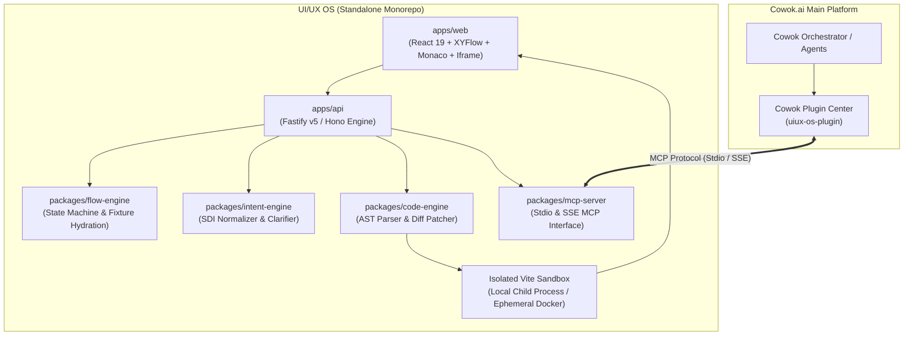

# Research Synthesis: UI/UX OS Architecture & Awesome RE Insights

**Document:** `uiux-os-awesome-re-synthesis.md`  
**Parent Workspace:** `/Users/hatrang20061988/Desktop/AI Project/uxui-os/flowforge-design-spec`  
**Status:** Phase 1 Complete (Idea Discovery & Competitive Reverse Engineering)  
**Author:** Antigravity AI Orchestrator  

---

## 1. Executive Summary

UI/UX OS (working name FlowForge) is conceived as a **flow-first, code-native design workspace** that turns ambiguous human intent into **executable user flows**, verifiable UI states, reviewable code changes, and portable frontend source.

To fulfill the user's vision:
1. **Application Independence:** UI/UX OS is architected as an autonomous monorepo (`apps/web`, `apps/api`, `packages/flow-engine`, `packages/mcp-server`), completely decoupled from Cowok.ai's internal database schema.
2. **Cowok Plugin Integration (via MCP):** An official Model Context Protocol (MCP) server enables Cowok.ai agents to invoke UI/UX OS tools over `stdio` (local) or authenticated `SSE/HTTP` (cloud).
3. **Dual Deployment Models (BYOK & BYOS):**
   - **BYOK (Bring Your Own Key):** Zero server-side key storage; client-side proxying across Anthropic, OpenAI, Gemini, DeepSeek, and local Ollama/vLLM endpoints.
   - **BYOS (Bring Your Own Server / Storage):** Zero-config single binary/Docker Compose (SQLite + local disk) for developers, with plug-and-play S3/PostgreSQL connectors for teams.
4. **Knowledge Extraction from Awesome RE:** Deep analysis of 16,809 open-source projects in the `awesome-reverse-engineered` ecosystem reveals proven architectural patterns and critical pitfalls to avoid.

---

## 2. Deep Dive: Awesome RE Lessons & Transferred Behaviors

From the 16,800+ entries indexed in `awesome-reverse-engineered` (`docs/open-modules/awesome-reverse-engineered-integration-guide.md`), six projects provide foundational architecture lessons for UI/UX OS:

| # | Project | Category & Stars | Core Behavior | Lesson for UI/UX OS |
|---|---|---|---|---|
| 1 | **`storytold/figcraft`** | Desktop Software Reimplementation (★3,426) | Reimplemented Figma from scratch in pure Rust: canvas, frames, vector networks, auto-layout. | **Avoid the Custom Canvas Sinkhole.** Rebuilding layout engines in canvas/Rust took years. UI/UX OS leverages standard CSS Flexbox/Grid via React/Vite in an iframe for 100% native web fidelity at zero layout-engine maintenance cost. |
| 2 | **`allan-simon/figma-kiwi-protocol`** | Unofficial API Clients / Productivity (★50) | Reverse-engineered Figma's binary Kiwi WebSocket schema for multi-player synchronization. | **Enforce Git-Native Diffable JSON.** Binary schemas create vendor lock-in. UI/UX OS adopts human-readable, schema-validated JSON (`flow-graph.schema.json`), allowing standard `git diff` tracking. |
| 3 | **`Michaelliv/pi-generative-ui` & `Caho1/open-claude-ui`** | AI Tools / Generative UI (★1,167 & ★1,401) | Deconstructed Claude.ai's internal React widgets and generative design system. | **Constrained Design Token Catalog.** LLMs hallucinate broken CSS if allowed unconstrained generation. Pre-loading Cowok Brand System v4.3 tokens ensures AI composes verified, accessible primitives. |
| 4 | **`musistudio/claude-code-router` & `CLIProxyAPI`** | AI Tools / Multi-Protocol Proxy (★37,840 & ★56,180) | Local proxies translating client AI requests into multi-provider formats (Claude, OpenAI, Gemini, Ollama). | **BYOK Gateway Pattern.** UI/UX OS adopts a lightweight client proxy layer, allowing users to plug in any LLM API key or local model without vendor lock-in or token markups. |
| 5 | **`JimLiu/baocut`** | Desktop Software / Canvas Editor (★1,431) | Ported Claude's slide/design canvas into an open video editor using DOM element attributes. | **Decouple DOM Selection from Code Editing.** Tagging elements with `data-ff-id` during Vite build enables the iframe to emit click selection events without polluting production code. |
| 6 | **`morluto/rea`** | RE Tooling / AI-assisted RE (★381,341) | Exposes rich MCP tools for system observation with visual/behavioral proof packaging. | **Behavioral MCP Verification.** UI/UX OS MCP server returns visual hashes, route hydration states, and build logs alongside code diffs, enabling Cowok agents to verify changes deterministically. |

---

## 3. UI/UX OS Standalone Architecture Specification



---

## 4. MCP Tool Interface (for Cowok Plugin Integration)

The MCP server packages 5 high-level semantic tools under the `design.*` namespace:

```typescript
// 1. Create project from specification
design.create_project({
  name: string,
  brief: string,
  template: "vite-react-tailwind" | "nextjs-clean",
  design_system?: "cowok-brand-v4.3" | "shadcn-default"
}) => { projectId: string, repoPath: string, activeFlowVersionId: string }

// 2. Generate or expand flow graph from natural language intent
design.generate_flow_from_intent({
  projectId: string,
  prompt: string,
  targetNodeId?: string
}) => { flowVersionId: string, addedNodes: ScreenState[], addedTransitions: Transition[], needsClarification?: ClarificationCard }

// 3. Inspect a specific screen state and its rendered DOM
design.inspect_screen_state({
  projectId: string,
  nodeId: string,
  viewport?: { width: number, height: number }
}) => { renderedHtml: string, fixtureData: Record<string, any>, accessibilityIssues: string[], screenshotHash: string }

// 4. Propose code diff based on structured intent
design.propose_diff({
  projectId: string,
  intentSpec: Record<string, any>,
  targetElementSelector?: string
}) => { proposalId: string, unifiedDiff: string, buildResult: { status: "PASS"|"FAIL", typecheckErrors: string[] } }

// 5. Approve proposal and export code
design.approve_and_export({
  projectId: string,
  proposalId: string,
  targetFormat: "zip" | "git_patch" | "github_pr"
}) => { exportUrl: string, commitHash: string }
```

---

## 5. BYOK & BYOS Implementation Blueprint

### 5.1 BYOK (Bring Your Own Key)
- **Supported Providers:** Anthropic Claude (3.5 Sonnet/Haiku), OpenAI (GPT-4o), Google (Gemini 2.5/3.0 Pro/Flash), DeepSeek (V3/R1), Local (Ollama, vLLM, LM Studio via OpenAI-compatible endpoint).
- **Security Invariant:** API keys are never stored in server databases. In desktop/local mode, they are loaded via `.env.local` or OS Keychain. In web mode, they are stored in `sessionStorage` and sent as ephemeral bearer headers.

### 5.2 BYOS (Bring Your Own Server / Storage)
- **Level 1 (Zero-DevOps Local / Desktop):**
  - Database: Embedded SQLite (`better-sqlite3`).
  - Storage: Local filesystem directory (`./data/projects/`).
  - Compute: Ephemeral localhost Vite dev server (`127.0.0.1:<allocated_port>`).
- **Level 2 (Enterprise Self-Hosted / Private Cloud):**
  - Database: PostgreSQL (Supabase, Neon, AWS RDS).
  - Storage: S3-compatible Object Storage (AWS S3, Cloudflare R2, MinIO).
  - Compute: Ephemeral Docker container sandbox with resource limits (512MB RAM, 1 CPU).

---

## 6. Actionable Phased Roadmap

1. **Phase 1: Idea Discovery & Product Scoping** (✅ Completed — Party-Mode debate, Awesome RE research, and architectural consensus locked).
2. **Phase 2: Monorepo Foundation & Cowok Design Token Ingestion** (Setup `uxui-os/` monorepo, integrate `Brand-guideline/cowok-brand-product-system-v4.3` into Tailwind).
3. **Phase 3: Flow Engine & Intent Normalizer** (Implement `ScreenState` DAG using XYFlow and Zod schema contracts).
4. **Phase 4: Preview Sandbox & AST Patch Engine** (Vite iframe runtime, element tagging `data-ff-id`, unified diff generation).
5. **Phase 5: MCP Server & Cowok Plugin Certification** (Stdio + SSE transports, verification against Cowok test harnesses).
