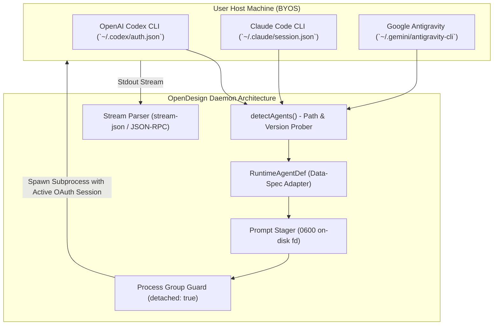
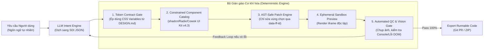

# Deep Reverse-Engineering & Mechanization Study: UI/UX OS Architecture

**Document:** `uiux-os-deep-rea-mechanization-study.md`  
**Methodology:** `/rea` (Reverse Engineer Anything v6.8.0 Mode A) + `/party-mode` (Socratic Grilling & Anti-Sycophancy)  
**Parent Workspace:** `/Users/hatrang20061988/Desktop/AI Project/uxui-os/flowforge-design-spec`  
**Date:** 2026-11-02  
**Author:** Antigravity AI Orchestrator  

---

## 1. Bản chất & Cơ chế Kiến trúc của BYOS (Bring Your Own Subscription)

### 1.1 Phân biệt Thực chất: BYOK vs. BYOS
- **BYOK (Bring Your Own Key):** Người dùng nhập API Key (OpenAI, Anthropic, Google Gemini, OpenRouter). Chi phí tính theo **từng token (Pay-per-token)**. Nhược điểm: Chi phí tăng vọt khi chạy các luồng Agent lặp lại nhiều lần (Agent loops, AST analysis, self-healing).
- **BYOS (Bring Your Own Subscription):** Người dùng tận dụng các gói thuê bao trọn gói cố định hàng tháng (**Flat-rate Subscriptions** như ChatGPT Plus/Pro \$20-\$200/tháng, Claude Pro/Team \$20-\$30/tháng, Google One AI Premium / Antigravity Cloud Code, GitHub Copilot). Thay vì gọi API tính tiền trên token, hệ thống tận dụng trực tiếp phiên đăng nhập CLI của người dùng trên terminal hoặc qua cơ chế OAuth Token Relay.

### 1.2 Cách các Hệ thống trên Máy kết nối & Vận hành BYOS
Từ việc dịch ngược (`/rea`) mã nguồn `open-design`, `sub2api` (★44.8k), `vibeproxy` (★3.4k), `meridian` (★2.1k), `ChatMock` (★1.5k), và `CLIProxyAPI` (★56.1k):



1. **Cơ chế External CLI Delegation (Không tự viết lại Agent Loop):**
   - `open-design` không tự tạo ra ReAct loop hay gọi OpenAI API endpoint. Thay vào đó, nó định nghĩa một data-spec thuần túy (`RuntimeAgentDef`) cho từng CLI (`claude`, `codex`, `agy`, `devin`, `cursor-agent`).
   - Khi kích hoạt tác vụ (`start_run`), Daemon OpenDesign khởi chạy trực tiếp tiến trình con CLI (ví dụ `claude -p --input-format stream-json` hoặc `codex app-server`).
   - **Kết quả:** Tiến trình CLI tự động đọc file phiên đăng nhập (`auth.json`, OS Keychain, session cookies) sẵn có của User trên máy tính. Toàn bộ chi phí suy luận (inference cost) được tính vào gói Subscription của User, **hoàn toàn miễn phí API token**.

2. **Kỹ thuật "Chống Nghẽn Kernel Buffer" (Anti-Truncation Prompt Staging):**
   - Khi pipe một prompt lớn (>64KB chứa `DESIGN.md`, rules, brief) qua `child.stdin.write()`, kernel buffer của Linux/macOS chỉ chứa tối đa 64 KiB. Nếu CLI mất vài giây khởi động, dữ liệu bị truncate âm thầm, làm hỏng hoàn toàn chỉ dẫn thiết kế.
   - `open-design` giải quyết triệt để: Ghi toàn bộ prompt ra file tạm `0600` (`agent-stdin-<uuid>.prompt`) trước khi spawn. Mở file descriptor (`fd`) dạng read-only và truyền thẳng vào `stdio: [fd, 'pipe', 'pipe']`. CLI con sở hữu file descriptor ngay tại tầng OS, không bao giờ bị cắt cụt dữ liệu.

3. **Bảo vệ Vòng đời Tiến trình & Diệt Zombie (Process Lifecycle Guard):**
   - Spawn tiến trình với `detached: true` để tạo POSIX process group riêng.
   - Ghi vết PID vào `agent-process-<pid>.json`. Khi Daemon khởi động lại hoặc tác vụ bị hủy (`cancel_run`), hàm `reapLeftoverAgentProcesses()` sẽ gửi `SIGKILL` tới toàn bộ process group, ngăn chặn việc CLI chạy ngầm gây hao pin hoặc tốn hạn mức subscription.

---

## 2. Dịch ngược Toàn diện 5 Hệ thống Thiết kế trên Máy (`/rea`)

### 2.1 Hệ thống 1: `OpenDesign` (`nexu-io/open-design` — ★98.3k)
- **Tech Stack:** Express 5.2.1, SQLite (`better-sqlite3` WAL mode), Next.js 16 App Router (React 18), Electron shell (`apps/desktop`), `@modelcontextprotocol/sdk` 1.29.0, SSE.
- **Quy trình Quản lý Thiết kế:**
  1. *Brief Collection (`collect_brief` & `confirm_brief`):* Thu thập yêu cầu phi kỹ thuật thành structured brief card, tránh để user phải nhập prompt dài dòng.
  2. *Design System Ingestion (`DESIGN.md`):* Đọc thư viện `content/design-systems/` (151 gói thương hiệu như Linear, Stripe, Vercel, Figma).
  3. *Token Compilation (`token-contract.ts`):* Parse frontmatter, map biến CSS (`--bg`, `--surface`, `--accent`, `--font-display`), tính toán **Scorecard & Grade** (`excellent`, `usable`, `needs-review`), và compile ra `tokens.css`.
  4. *Agent Execution:* Đẩy prompt stager vào CLI đã chọn (Codex/Claude/Antigravity), stream từng `text_delta` và `patchUpdated` qua SSE về giao diện.
  5. *Live Preview:* Render trực tiếp trong `srcdoc` iframe với sandbox bảo mật, giao tiếp hai chiều với host qua `postMessage`.
  6. *Asset Crawling (`get_artifact`):* Thuật toán BFS (độ sâu tối đa 3) quét AST/Regex (`HTML_REF_PATTERNS`, `CSS_REF_PATTERNS`) để gom toàn bộ file HTML, CSS tokens, imported SVGs thành một payload duy nhất.
  7. *Headless Deterministic Export:* Dùng `pptxgenjs` (tạo shape và text native) cho PowerPoint, `pdf-lib` cho PDF, và `hyperframes` (HTML+GSAP qua Headless Chrome + FFmpeg) để xuất video MP4.

### 2.2 Hệ thống 2: `Archify` (`tt-a1i/archify` 3.2.0)
- **Tech Stack:** Node ESM, D3.js/SVG rendering engine, Headless Chrome verification runner.
- **Triết lý Thiết kế:** Không bao giờ để LLM vẽ trực tiếp các thẻ HTML/SVG tự do.
- **Kỹ thuật Kỹ sư Thực định (Deterministic Engineering):**
  1. *Intermediate Representation (IR JSON):* Mọi sơ đồ (Architecture, Sequence, ERD, State Machine, Timeline) bắt buộc phải tuân theo cấu trúc JSON Schema chuẩn tắc (`runtime/references/authoring-defaults.md`).
  2. *Pipeline 4 bước Thực định:*
     $$\text{JSON IR} \xrightarrow{\text{validate}} \text{Schema Validation} \xrightarrow{\text{render}} \text{Standalone HTML} \xrightarrow{\text{deliver}} \text{UUID Asset} \xrightarrow{\text{check}} \text{Browser Verify}$$
  3. *Zero-Drift Browser Verification:* Tự động chạy headless browser chụp ảnh màn hình, kiểm tra lỗi console, tính toán bounding box để đảm bảo text không bị tràn khung trước khi trả về cho người dùng.

### 2.3 Hệ thống 3: `/3d-visualize` & `3DVIZ-Pro-Max`
- **Tech Stack:** React 19, Three.js, `@react-three/fiber`, `@react-three/drei`, Tailwind CSS.
- **Quy trình Quản lý Thiết kế:**
  1. *Dependency Pre-flight:* Tự động kiểm tra và cài đặt `three`, `@react-three/fiber` nếu thiếu.
  2. *Recipe Selection:* Kho dữ liệu mẫu 3D (`data/recipes/`) với các cấu hình camera, ánh sáng, shader đã được tối ưu hóa hiệu năng từ trước.
  3. *SSR-Safe Dynamic Mounting:* Ép buộc sử dụng `dynamic(() => ..., { ssr: false })` hoặc kiểm tra `typeof window !== 'undefined'` để tránh lỗi hydrate trên Next.js/Vite.
  4. *Cơ chế Dọn dẹp Bộ nhớ GPU (Zero WebGL Leak):* Bắt buộc cài đặt hook giải phóng tài nguyên khi unmount:
     ```tsx
     useEffect(() => () => { geometry?.dispose(); material?.dispose(); texture?.dispose(); }, []);
     ```
  5. *Quality Gate:* Chạy `npx tsc --noEmit` để đảm bảo 0 lỗi kiểu dữ liệu 3D.

### 2.4 Hệ thống 4: `Codex & ChatGPT CLI` (`codex app-server`)
- **Tech Stack:** Rust / Node core, stdio JSON-RPC protocol, Tree-sitter AST diff engine.
- **Cơ chế Vận hành Đặc sắc:**
  1. *Early Patch Preview (`item/fileChange/patchUpdated`):* Trong khi LLM đang sinh mã, Codex phát sự kiện diff từng dòng theo thời gian thực (real-time streaming diff). Người dùng nhìn thấy đoạn code thay đổi ngay lập tức mà không cần chờ sinh xong toàn bộ file.
  2. *Tokenless Auth:* Tận dụng file cấu hình `~/.codex/config.json` và OAuth bearer token từ tài khoản ChatGPT Plus/Pro.

### 2.5 Hệ thống 5: `UI/UX Pro Max` (`ui-ux-pro-max`)
- **Tech Stack:** Python 3 stdlib, SQLite/CSV indexed knowledge base (`ui-reasoning.csv`).
- **Quy trình Quản lý Thiết kế:**
  1. *Search Algorithm:* Tìm kiếm song song trên 5 miền (Product, Style, Color, Typography, UX rules).
  2. *Heuristic Reasoning Rules:* Áp dụng ma trận trọng số từ `ui-reasoning.csv` để chọn ra bảng màu, font chữ, độ bo góc, bóng đổ tối ưu nhất cho từng ngành nghề (Fintech, Healthcare, DevTools, SaaS).
  3. *Mô hình Master + Overrides (`MASTER.md` & `pages/*.md`):* Tạo ra một file `MASTER.md` chứa toàn bộ quy tắc toàn cục, và các file ghi đè cục bộ cho từng trang (`pages/dashboard.md`), đảm bảo tính nhất quán nhưng vẫn linh hoạt.

---

## 3. Bản đồ Phân định DE & DR: LLM Đóng Vai Trò Gì?

Trong các hệ thống thiết kế hiện đại, sai lầm lớn nhất là **bắt LLM làm việc của phần mềm thực định**.

| Hạng mục Tác vụ | Phân loại | Engine Thực thi | Vai trò của LLM (DR) vs. Phần mềm (DE) |
|---|:---:|---|---|
| **Phân tích Ý đồ & Yêu cầu** | **DR** | LLM | LLM giải mã ngôn ngữ tự nhiên mơ hồ của con người thành Structured Design Intent (SDI). |
| **Kiểm tra Token & Bảng màu** | **DE** | `token-contract.ts` | Thuật toán phần mềm tự động tính toán độ tương phản WCAG (4.5:1), kiểm tra tính đầy đủ của token. Không dùng LLM. |
| **Biên dịch CSS Tokens** | **DE** | TypeScript/PostCSS | Phần mềm tự động sinh ra file `tokens.css` từ markdown. Tuyệt đối không để LLM gõ tay mã hex. |
| **Bố cục Giao diện & Copywriting** | **DR** | LLM / Coding Agent | LLM sáng tạo nội dung văn bản, tiêu đề, cấu trúc bảng dữ liệu thực tế dựa trên ngữ cảnh nghiệp vụ. |
| **Phân giải Phụ thuộc & File** | **DE** | AST Crawler (BFS) | Thuật toán duyệt cây tự động tìm tất cả ảnh, SVG, module import liên quan. |
| **Đóng gói Đồ họa & Sơ đồ** | **DE** | Archify / SVG Engine | Thuật toán tính toán tọa độ hộp (bounding box), canh lề, đường cong spline. LLM chỉ sinh cấu trúc node/edge dạng JSON. |
| **Xuất Bản Tài liệu (PDF/PPTX/MP4)**| **DE** | `pdf-lib` / `pptxgenjs` | Phần mềm dịch trực tiếp các thẻ HTML sang vector shape nguyên bản, đảm bảo 100% pixel-perfect khi in ấn. |

---

## 4. "Cơ khí hóa" Công cụ Thiết kế: Làm Sao Để LLM Thiết Kế Chuẩn Xác Nhất?

"Cơ khí hóa" (Mechanizing Design Tools) là quá trình xây dựng một **bộ giàn giáo thực định (Deterministic Scaffolding)** xung quanh LLM, biến LLM từ một "họa sĩ vẽ bừa" thành một "kiến trúc sư lắp ráp module chuẩn":



### 4 Đòn bẩy Cơ khí hóa Thiết yếu:
1. **Khóa Chặt Bằng Tokens (`DESIGN.md` Compiler):**
   - Không cho phép LLM sinh các mã màu tự do (như `#3b82f6` hay `rgb(12, 34, 56)`).
   - Buộc LLM chỉ được sử dụng các biến quy ước: `bg-surface`, `text-primary`, `border-muted`, `font-display`.
   - Script tự động quét linter (như `validate-design-tokens.py`), phát hiện bất kỳ mã hex cứng nào sẽ đánh rớt ngay lập tức.
2. **Danh mục Component Hữu hạn (Constrained Component Registry):**
   - Tương tự như `Open Claude UI` và `pi-generative-ui`: LLM không viết lại thẻ `div` phức tạp mà chỉ gọi và cấu hình các Component mẫu đã được kiểm thử độ tương thích (Buttons, Cards, MetricLine, Drawers, Modals từ Cowok Brand System v4.3).
3. **Định danh Phần tử bằng Thuộc tính Dữ liệu (`data-ff-id`):**
   - Trong quá trình Vite build preview, tự động gán thuộc tính `data-ff-id="section-hero-title"` vào AST.
   - Khi người dùng click vào một phần tử trên màn hình preview, iframe chỉ gửi về đúng định danh `data-ff-id`, giúp Agent chỉ định vị và vá đúng đoạn mã đó (Target-Aware Diff), không bao giờ làm xáo trộn toàn bộ file.
4. **Vòng lặp Phản hồi Tự động (Closed-Loop Quality Gate):**
   - Playwright tự động chụp màn hình, kiểm tra lỗi console JavaScript và cây trợ năng (Accessibility Tree).
   - Nếu phát hiện lỗi (như tràn text, lỗi typecheck TypeScript, thiếu component), hệ thống đóng gói lỗi thành một **Verification Failure Payload** và nạp ngược lại cho LLM tự sửa (Self-Healing) trước khi người dùng kịp nhìn thấy.

---

## 5. Định hướng Chiến lược & Kiến trúc Toàn diện cho UI/UX OS

Dựa trên toàn bộ phân tích dịch ngược từ `open-design`, `archify`, `3dviz-pro-max`, `codex`, và `ui-ux-pro-max`, kiến trúc đích của **UI/UX OS** được xác lập như sau:

### 5.1 Kiến trúc Thực thi Đa chế độ (Hybrid BYOK + BYOS Core)
- **Chế độ 1: BYOS (Bring Your Own Subscription - Mặc định cho Cá nhân & Developer):**
  - Tích hợp bộ **CLI Delegation Adapter** học tập từ `open-design`.
  - Tự động phát hiện và kết nối với:
    - `codex` (thông qua `codex app-server` JSON-RPC stdio — tận dụng gói ChatGPT Plus/Pro).
    - `claude` (thông qua `claude -p --input-format stream-json` — tận dụng gói Claude Pro/Team).
    - `antigravity` (thông qua `agy -p` — tận dụng Google Antigravity Cloud Code).
    - `ollama` / `vllm` (chạy hoàn toàn offline trên GPU cục bộ).
  - Sử dụng cơ chế **File Descriptor Prompt Staging (`0600` on-disk)** để triệt tiêu lỗi cắt cụt prompt 64KB.
- **Chế độ 2: BYOK (Bring Your Own Key - Dành cho Doanh nghiệp & Cloud):**
  - Nhập trực tiếp API Key qua giao diện hoặc file `.env.local`.
  - Cơ chế Stateless: Khóa API chỉ nằm ở `sessionStorage`, không lưu vào database server.

### 5.2 Trải nghiệm "Flow-First + Live Single Preview"
- Thay vì chỉ làm công cụ vẽ tĩnh như Figma hoặc chỉ sinh từng trang đơn lẻ như v0:
  - **Trục ngang:** Quản lý hành vi nghiệp vụ qua **Flow State Machine (XYFlow)** (`ScreenState` nodes + `Transition` edges).
  - **Khung nhìn chính:** Hiển thị **1 màn hình chạy thật (Live Runnable Screen)** với fixture dữ liệu chuẩn tương ứng với node đang kích hoạt.

### 5.3 Giao diện Plugin MCP cho Cowok.ai
- UI/UX OS đóng gói một **MCP Server chuẩn mực** (hỗ trợ cả `stdio` cho local và `SSE/HTTP` cho cloud/server) với 5 nhóm công cụ cấp cao:
  1. `design.create_project` (khởi tạo repo Vite/React với Cowok Design System v4.3).
  2. `design.generate_flow` (sinh luồng đa màn hình từ prompt ý đồ).
  3. `design.inspect_screen` (trả về HTML đã hydrate, ảnh chụp màn hình, cây accessibility).
  4. `design.propose_diff` (vá code AST theo vùng chọn, trả về unified diff đã qua build test).
  5. `design.approve_and_export` (xuất mã nguồn sạch, tạo Git PR hoặc tải file zip).
- Cowok.ai sẽ coi UI/UX OS như một "Visual Copilot Plugin", giao toàn bộ tác vụ thiết kế và thẩm định UI/UX cho UI/UX OS xử lý một cách chuyên biệt.

### 5.4 Hệ thống Kiểm soát Chất lượng Thực định (Deterministic Quality Control)
- **Token Compliance Audit:** Ép buộc 100% tuân thủ `cowok-brand-product-system-v4.3`.
- **Memory & Performance Audit:** Áp dụng quy tắc dọn dẹp WebGL (`.dispose()`) từ `3dviz-pro-max` cho tất cả các hiệu ứng 3D/Canvas.
- **Diagram & Architecture Export:** Tích hợp engine `archify` để tự động vẽ sơ đồ luồng dữ liệu (Data-flow) và kiến trúc ứng dụng thành các file HTML tương tác độc lập.
