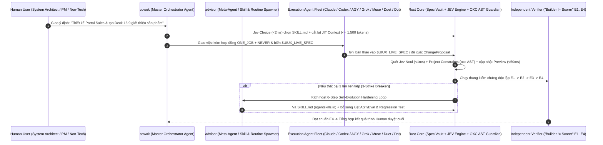

# 2.13. Host Integration Contract (Cowok.ai & External Agent Ecosystems $\leftrightarrow$ UI/UX OS)

## 1. Đồng bộ Định danh Điều phối (`cowok` & `advisor`) và Mô hình Triển khai Mở

**UI/UX OS (FlowForge Harness OS)** được thiết kế với 2 bề mặt tương tác đồng nhất trên cùng một nhân Rust (`uiux-os`):
1. **Giao diện cho Con người (Human Workbench):** Người dùng tương tác trực tiếp với **`cowok` (`Cowok Orchestrator`)** làm đầu mối điều phối duy nhất và **`advisor` (`Advisor Agent`)** làm cố vấn nâng cấp kỹ năng/quy trình, thao tác trên Flow Canvas, State-Hydrated Preview và Dual-Pane 16:9 Presentation CMS.
2. **Giao diện Mở cho Đa Nền tảng Agent (Universal Open MCP Server & `$UIUX_LIVE_SPEC` PTY):** Không chỉ đóng vai trò là Native Plugin hạng nhất cho **Cowok.ai**, UI/UX OS còn phơi bày giao thức MCP chuẩn mở (`stdio` và `Streamable HTTP/SSE`) cùng môi trường PTY/Mailbox để bất kỳ Execution Agent nào (`Claude Code`, `Codex`, `Antigravity`, `Grok Bot`, `Muse`, `Duet`, `Dot`) đều có thể kết nối và tự hành theo luật của Harness OS.



---

## 2. Hợp đồng Biến Môi trường `$UIUX_*` cho Đội hình Execution Agents (`crates/agent-fleet`)

Khi `cowok` hoặc người dùng khởi chạy một Execution Agent trong terminal PTY hoặc qua Mailbox, hệ thống tự động tiêm các biến môi trường chuẩn:
- `UIUX_LIVE_SPEC`: Đường dẫn tới file đặc tả/màn hình/slide đang mở để Agent ghi trực tiếp và kích hoạt hot-apply lên Canvas trong `<50ms` (hỗ trợ hoàn tác `Cmd+Z`).
- `UIUX_PROJECT_CONSTRAINTS`: Đường dẫn tới file JSON quy định ràng buộc của dự án hiện tại (CSS policy, `tokens.css`, `icon-manifest.json`).
- `UIUX_COORDINATION_DIR`: Đường dẫn tới hộp thư `.uiux-os/coordination/` chứa hợp đồng `ONE_JOB` + `NEVER` và trạng thái kiểm định `E1..E4`.
- `UIUX_MCP_ENDPOINT`: Địa chỉ kết nối MCP cục bộ (`stdio` hoặc `http://127.0.0.1:4311/mcp/sse`).

---

## 3. Hợp đồng Đóng gói Kỹ năng Mở (`https://agentskills.io/home` $\leftrightarrow$ Cowok.ai `plugin.json`)

Mọi gói kỹ năng trong UI/UX OS tuân thủ cấu trúc kép để chạy mượt mà trên cả **Cowok.ai**, **Claude Code**, **Codex**, và **Antigravity**:
```text
.uiux-os/plugins/<skill-slug>/
├── plugin.json          # Manifest đồng bộ kiến trúc Plugin của Cowok.ai (version, permissions, cron_sync)
├── SKILL.md             # Chuẩn https://agentskills.io/home (YAML frontmatter ~100 tokens + Instructions)
├── scripts/             # Các script kiểm tra xác định (Deterministic Helpers)
├── references/          # Tài liệu tham chiếu chuyên sâu nạp theo yêu cầu (Progressive Disclosure Tier 3)
└── assets/              # Mẫu bố cục HTML 16:9, tokens hoặc fixtures
```

<!-- BEGIN AUTO-GENERATED UCG -->
### Five-Nouns Host Slot & Feature Entrypoint Registry (UCG Auto-Projected)

| Feature Noun (`src/features/<slug>`) | Entrypoint ID | Host Shell ID | Slot ID | Cardinality | Order | Route | Design Pattern |
| :--- | :--- | :--- | :--- | :---: | :---: | :--- | :--- |
<!-- END AUTO-GENERATED UCG -->
