# Database & Storage Specification: cowok-design (UI/UX OS — FlowForge Harness OS)

## 1. Kiến trúc Lưu trữ Kép (Dual-Layer Storage Engine)

**cowok-design** sử dụng kiến trúc lưu trữ kép được quản lý thống nhất bởi `crates/spec-registry` và `crates/bot-fleet` trong Rust trên **một CSDL SQLite WAL duy nhất** (`.cowok-design/cowok-design.sqlite3`, chuẩn `0700/0600` & `PRAGMA foreign_keys = ON; busy_timeout = 5000;`):
1. **Single Authoritative Embedded SQLite (`rusqlite` WAL — V1..V8 Migrations, 42 Tables Total):**
   - `V1__initial_16_tables.sql`: 16 bảng cốt lõi (`projects`, `project_specs`, `spec_revisions`, `constraint_profiles`, `constraint_rules`, `flow_graphs`, `flow_nodes`, `flow_edges`, `screen_artifacts`, `presentation_decks`, `deck_slides`, `wording_slots`, `skill_plugins`, `model_tournaments`, `bot_jobs`, `gate_reports`) cùng bảng Recovery Journal `spec_write_intents`.
   - `V2__project_boundaries_and_chat_sessions.sql`: mở rộng `spec_tombstones`, `project_boundaries` (`config_dir` chuẩn `.cowok-design`), `chat_sessions`, `change_proposals`, `version_snapshots`, `project_workspace_files`, `github_pull_requests`, `recovery_commits`.
   - `V3__flow_workbench_dag.sql`: 12-Step Rebuild bổ sung orthogonal `version` vs `layout_version` cho `flow_graphs`, `flow_nodes`, `flow_edges` và bảng idempotency `flow_draft_deployments` (`schema_migrations`).
   - `V4__storyboard_chat_and_execution_engine.sql`: bảng thực thi đa luồng (`chat_messages`, `chat_message_node_scopes`, `node_execution_jobs`, `chat_artifact_snapshots`).
   - `V5__proposals_snapshots_runtime_columns.sql`: bổ sung runtime columns cho `change_proposals` và `version_snapshots`.
   - `V6__epic04_complete_contracts.sql`: bảng `project_assets`, `design_intakes`, `provider_configs`, `provider_secrets`, `mcp_registry`, `automation_jobs`, `execution_events`, `node_comments`, `workflow_edges`, `approval_gates`.
   - `V7__epic04_cas_seq_and_vault_convergence.sql`: hội tụ SQLite V7 cho Story 04.2 (`chat_message_node_scopes` tenant_id backfill, `execution_events` monotonic `project_seq` partial-null backfill cùng composite unique index `(project_id, project_seq)` và scope index, `node_execution_jobs` 12-step FK-preserving rebuild với trạng thái `PAUSED`/`INTERRUPTED`, `composite_scope_key`, `daemon_nonce`, `priority 10`, `updated_at`, partial unique indexes trên `projects(slug)` và `projects(workspace_root)` `WHERE trash_deleted_at IS NULL`, `element_comments` CAS anchor SHA index, `node_chat_sessions` scope index, và partial unique indexes chống duplicate NULL trên `agent_settings` & `mcp_servers`), `39` bảng tại V7.
   - `V8__daemon_auth_sessions_and_nonces.sql`: bền bỉ hóa bảo mật loopback và ý định đồng bộ (`daemon_sessions` lưu SHA-256 token + tenant/user/role/expires/revoked, `daemon_replay_nonces` chống replay HMAC-v2 xuyên daemon restart, `workspace_sync_intents` theo dõi SPEC_SYNC/PROJECT_PROMOTE/WORKSPACE_RESTORE theo fencing_token), nâng `CURRENT_SCHEMA_VERSION = 8` (**42** active SQLite WAL tables, phản chiếu 1:1 trong `prisma/schema.prisma` theo `ADR-091`, cấm tuyệt đối `dev.db` và `prisma/migrations/`).
2. **Git-Friendly File System Projections (`.cowok-design/specs/` & Workspace):** Đồng bộ hóa hai chiều 9 Canonical Specs (`01-product-overview.md` $\to$ `09-data-and-copy.md`) với `project_specs` + `spec_tombstones` + SHA-256 StaleFile OCC qua `SpecWatcher` chạy nền trong `harness-daemon`. Mọi dữ liệu proposals, sessions, snapshots đều đọc/ghi trực tiếp từ `.cowok-design/cowok-design.sqlite3` (cấm tuyệt đối vỏ RAM `OnceLock`/`HashMap` shadow DB).

---

## 2. Sơ đồ Thực thể Quan hệ Toàn diện (Entity-Relationship Diagram — 16 Core Tables)

```mermaid
erDiagram
    PROJECTS ||--|| PROJECT_CONSTRAINTS : "configures constraints"
    PROJECTS ||--o{ SPEC_DOCUMENTS : "owns (9 Foundational Specs)"
    PROJECTS ||--o{ PORTALS : "defines"
    PORTALS ||--o{ FLOW_NODES : "contains ScreenStates"
    FLOW_NODES ||--o{ FLOW_TRANSITIONS : "connects"
    PROJECTS ||--o{ DESIGN_INTENTS : "compiles SDI"
    DESIGN_INTENTS ||--o{ CHANGE_PROPOSALS : "proposes diffs"
    PROJECTS ||--o{ ANCHORED_COMMENTS : "anchors feedback"
    PROJECTS ||--o{ VERSION_SNAPSHOTS : "tracks history"
    PROJECTS ||--o{ PRESENTATIONS : "owns 16:9 decks"
    PRESENTATIONS ||--o{ SLIDES : "contains"
    PROJECTS ||--o{ SKILL_PLUGINS : "activates skills"
    PROJECTS ||--o{ TOURNAMENT_RUNS : "benchmarks models"
    PROJECTS ||--o{ FLEET_TASKS : "dispatches via cowok"
    PROJECTS ||--o{ EVOLUTION_LEDGER : "hardens via advisor"
    PROJECTS ||--o{ EVAL_RUNS : "verifies E1..E4"

    PROJECTS {
        text id PK "UUID v7"
        text slug UK "e.g., cowok-ai, distro, mkt-q4"
        text name
        text workspace_path
        text active_snapshot_id
        integer created_at
        integer updated_at
    }

    PROJECT_CONSTRAINTS {
        text id PK "UUID v7"
        text project_id FK
        text preset_profile "cowok-brand-v4.3 | custom-project-profile"
        text styling_policy "vanilla-css-tokens-only | css-modules | custom"
        integer forbid_tailwind "1 or 0 (configurable per project)"
        integer forbid_raw_hex "1 or 0"
        text tokens_css_path "Path to project tokens.css"
        text icon_manifest_path "Path to project icon-manifest.json"
        text allowed_icon_set_json "Validated list of project icons"
        text typography_contract_json "Allowed font families & scale"
        real min_wcag_contrast "Default 4.5"
        integer updated_at
    }

    SPEC_DOCUMENTS {
        text id PK "UUID v7"
        text project_id FK
        text spec_code "SPEC-01 .. SPEC-09"
        text semver "e.g., 1.2.0"
        text content_json "Validated JSON AST"
        text content_md "Projected Markdown"
        text content_hash "SHA-256 (StaleFile OCC)"
        text status "draft | approved | archived"
        integer created_at
    }

    PORTALS {
        text id PK "UUID v7"
        text project_id FK
        text portal_key "superadmin | tenant-admin | sales-app | sales-web | dev-portal"
        text target_device "desktop | tablet | mobile | responsive"
        text base_route
        text rbac_policy_json
    }

    FLOW_NODES {
        text id PK
        text tenant_id
        text project_id FK
        text portal_id FK
        text screen_key
        text title
        text node_type "screen | modal | condition | action"
        text route_path
        text component_entry_path
        text fixture_ref "Default | Empty | Loading | Error fixture ID"
        text fixture_json "Hydration fixture state"
        text note "Node semantic note"
        text viewport_preset "desktop-1440 | tablet-768 | mobile-390"
        real pos_x
        real pos_y
        integer version "OCC version"
    }

    FLOW_TRANSITIONS {
        text id PK
        text tenant_id
        text project_id FK
        text source_node_id FK
        text target_node_id FK
        text flow_type "main | if_else | if_not"
        text trigger_event "e.g., onClickApprove, onSubmit"
        text guard_condition
        integer version "OCC version"
    }

    DESIGN_INTENTS {
        text id PK "SDI DesignIntentV1 ID"
        text project_id FK
        text raw_prompt
        text intent_type "create_screen | update_flow | edit_slide | extract_rea"
        text target_scope_json
        real ambiguity_score "0.0 .. 1.0"
        real risk_score "0.0 .. 1.0"
        text clarification_variants_json "2-3 visual options if ambiguity >= 0.45"
        text status "clarifying | ready | executed"
        integer created_at
    }

    ANCHORED_COMMENTS {
        text id PK
        text project_id FK
        text target_type "screen | slide"
        text target_id
        text ff_id "data-ff-id attribute"
        text dom_selector
        text text_snapshot_hash
        text anchor_status "valid | stale"
        text comment_body
        text resolution_status "open | resolved"
        integer created_at
    }

    CHANGE_PROPOSALS {
        text id PK
        text project_id FK
        text intent_id FK
        text author_agent "cowok | claude | codex | agy | grok | muse | duet | dot"
        text diff_summary_json
        text rationale_md
        text validation_gate_status "pending | passed | failed"
        text status "proposed | applied | rejected"
        integer created_at
    }

    VERSION_SNAPSHOTS {
        text id PK
        text project_id FK
        text proposal_id FK
        text parent_snapshot_id
        text git_commit_or_tree_sha
        text label
        integer created_at
    }

    PRESENTATIONS {
        text id PK
        text project_id FK
        text slug
        text title
        text department "product | marketing | sales | executive"
        text theme_mode "warm | dim | night | night-low"
        text aspect_ratio "16:9"
        text semver
        integer updated_at
    }

    SLIDES {
        text id PK
        text presentation_id FK
        integer slide_order
        text layout_type "hero-cover | metrics-grid | split-comparison | architecture-flow | timeline"
        text title
        text subtitle
        text content_ast_json "Blocks with data-ff-id, Metrics, Live Chart bindings"
        text speaker_notes
    }

    SKILL_PLUGINS {
        text id PK
        text tenant_id
        text project_id FK
        text plugin_slug
        text name
        text version
        integer revision
        text source_type "built-in | github-repo | rea-forged | advisor-spawned"
        text upstream_repo_url
        text upstream_commit_sha
        text cron_schedule "e.g., 0 0 * * * (Daily upstream scan)"
        text skill_md_path "Path to agentskills.io SKILL.md"
        text plugin_json_path "Path to Cowok-compatible plugin.json"
        text lifecycle_state "DISCOVERED | VALIDATED | INSTALLED | ACTIVE | DEPRECATED | ARCHIVED"
        text staging_version
        text staging_diff_reasons_json
        boolean breaking_change_isolated
        boolean quarantined
        text quarantine_reason
        integer last_synced_at
    }

    TOURNAMENT_RUNS {
        text id PK
        text project_id FK
        text intent_id FK
        text contenders_json "2-3 model/agent candidates & generated variants"
        text rubric_scores_json "AST + WCAG + UX Taste scores"
        text winning_variant_id
        integer created_at
    }

    FLEET_TASKS {
        text id PK
        text project_id FK
        text orchestrated_by "cowok"
        text assigned_executor "claude | codex | agy | grok | muse | duet | dot | shell"
        text verifier_agent "independent-verifier"
        text one_job_contract_json "ONE_JOB + NEVER rules"
        text live_spec_path "$UIUX_LIVE_SPEC target"
        text verify_level_reached "E0 | E1 | E2 | E3 | E4"
        integer strike_count "0..3 (JEV 3-Strike Circuit Breaker)"
        text status "queued | running | verifying | completed | halted"
        integer updated_at
    }

    EVOLUTION_LEDGER {
        text id PK
        text project_id FK
        text authored_by "advisor"
        text failed_task_id FK
        text root_cause_analysis
        text patched_skill_slug
        text patched_ast_or_eval_rule
        text regression_test_path
        integer created_at
    }
```

---

## 3. Phân vùng Bảng Ghi Độc quyền theo Luồng Thực thi trong Single SQLite WAL (Logical Disjoint Write-Set)

Mặc dù toàn bộ hệ thống ghi về **duy nhất một tệp `.cowok-design/cowok-design.sqlite3`** (tránh Split-Brain đa tệp), quyền sở hữu ghi các bảng được phân vùng logic không chồng chéo theo `BEGIN IMMEDIATE`:
- **Domain 1 (Specs & Constraints):** `projects`, `project_specs`, `spec_revisions`, `spec_tombstones`, `spec_write_intents`, `constraint_profiles`, `constraint_rules`, `project_boundaries`, `project_workspace_files`.
- **Domain 2 (Flow & Proposals):** `flow_graphs`, `flow_nodes`, `flow_edges`, `flow_draft_deployments`, `screen_artifacts`, `change_proposals`, `version_snapshots`, `recovery_commits`.
- **Domain 3 (Presentation & Evaluation):** `presentation_decks`, `deck_slides`, `wording_slots`, `gate_reports`.
- **Domain 4 (Skills, Fleet & Chat):** `skill_plugins`, `model_tournaments`, `bot_jobs`, `github_pull_requests`, `chat_sessions`, `chat_messages`, `chat_message_node_scopes`, `node_execution_jobs`, `chat_artifact_snapshots`.

---

## 4. Đặc Tả Lộ Trình SQLite V4 (`V4__storyboard_chat_and_execution_engine.sql`)

Triển khai tại **`Story 04.2`** (Tier A Shared Infrastructure) để thống nhất SSOT cho toàn bộ Option 5 Action-Linked 2D Storyboard, Contextual Multi-Node Chat v2 và Hàng đợi thực thi song song:

### 4.1. Bảng & Cột Bổ Sung / Nâng Cấp

1. **Nâng cấp bảng `projects`**:
   - `project_code` (`TEXT UNIQUE`): Mã định danh ngắn thân thiện người dùng (ví dụ: `CWK-7X2A`).
   - `trash_deleted_at` (`INTEGER NULL`): Mốc thời gian chuyển vào thùng rác (`Trash Journal`), cho phép phục hồi hoặc xóa vĩnh viễn sau 30 ngày.
   - `provenance` (`TEXT`): Nguồn gốc dự án (`scratch | template | imported_figma | git_codebase`).

2. **Bảng `chat_sessions` & `chat_messages`**:
   - `chat_sessions`: Quản lý các phiên hội thoại của dự án.
   - `chat_messages`: Lưu từng lượt trao đổi (`role`: `user | assistant | system`), `prose_markdown`, `parent_message_id` (hỗ trợ tạo nhánh Fork hội thoại), và `turn_receipt_json` (chứa diff, snapshot hash, linter receipt).

3. **Bảng `chat_message_node_scopes`**:
   - Khóa kép đa dự án / đa node: `composite_scope_key = '${projectId}::${sessionId}::${nodeId}'`.
   - Cho phép một tin nhắn chat neo vào 1 hoặc $N$ nodes trên bản đồ 2D DAG mà không bị rò rỉ bối cảnh sang dự án khác.

4. **Bảng `node_execution_jobs`**:
   - Quản lý hàng đợi thực thi song song (`KeyedParallelCoordinator`):
   - `node_id`, `status` (`QUEUED | RUNNING | COMPLETED | FAILED | CANCELLED`), `fencing_token` (số hiệu đơn điệu chống race condition), `lease_owner`, `stale_after_timestamp`.

5. **Tách đôi Artifact Storage**:
   - `workspace_artifacts`: Tệp làm việc sống trên đĩa tại `RUNTIME_DATA_DIR/projects/:id/workspace/`.
   - `chat_artifact_snapshots`: Bản chụp bất biến theo từng lượt chat với mã băm `content_hash` SHA-256 lưu trong DB và `RUNTIME_DATA_DIR/projects/:id/snapshots/`.

### 4.2. Đặc Tả Hội Tụ SQLite V7 (`V7__epic04_cas_seq_and_vault_convergence.sql`)

Triển khai tại **`Story 04.2`** (Tier A Shared Infrastructure) nâng schema version lên `CURRENT_SCHEMA_VERSION = 7`:
1. **Backfill Tenant ID `chat_message_node_scopes`**: Đồng bộ `tenant_id` từ project sở hữu khi khác `local-default`.
2. **Monotonic Positive `project_seq` Backfill**: Tính toán lại `project_seq` đơn điệu không trùng lặp cho `execution_events`, gắn unique index `(project_id, project_seq)` và composite index `(tenant_id, project_id, composite_scope_key, project_seq)`.
3. **12-Step FK-Preserving Rebuild của `node_execution_jobs`**: Bổ sung hỗ trợ trạng thái `PAUSED` và `INTERRUPTED`, các cột `composite_scope_key`, `daemon_nonce`, `priority` (mặc định 10), và `updated_at`.
4. **Partial Unique Indexes Cho Active Projects**: Thay thế các index cũ bằng `projects_active_slug_key` và `projects_active_workspace_root_key` có điều kiện `WHERE trash_deleted_at IS NULL`.
5. **ElementComment CAS Anchor & NodeChatSession Scope**: Bổ sung index `(tenant_id, project_id, node_id, anchor_kind, artifact_sha256)` trên `element_comments` và index `(tenant_id, composite_scope_key)` trên `node_chat_sessions`.
6. **Partial Unique Indexes Global Defaults**: Ngăn ngừa trùng lặp bản ghi cấu hình mặc định (khi `project_id IS NULL`) trên `agent_settings` và `mcp_servers`.

### 4.3. Đặc Tả Bền Bỉ Hóa Daemon Auth & Sync Intents V8 (`V8__daemon_auth_sessions_and_nonces.sql`)

Triển khai bổ sung nâng schema version lên `CURRENT_SCHEMA_VERSION = 8` (**42** active tables):
1. **`daemon_sessions`**: Lưu trữ bền vững `token_sha256` (PK), `tenant_id`, `user_id`, `role`, `expires_at`, `created_at`, `revoked_at` để giữ nguyên trạng thái phiên loopback qua daemon restart.
2. **`daemon_replay_nonces`**: Ledger lưu `nonce` (PK), `daemon_nonce`, `expires_at`, `seen_at` chống replay attack HMAC-v2 kể cả sau khi daemon khởi động lại.
3. **`workspace_sync_intents`**: Ledger lưu ý định đồng bộ (`SPEC_SYNC`, `PROJECT_PROMOTE`, `WORKSPACE_RESTORE`) với `state` và `fencing_token` tham chiếu `projects(id) ON DELETE CASCADE`.

### 4.4. Epic 05 Migrations: SDI, ChangeProposal Diff & Version Snapshots V9–V11 (`V9`..`V11`)

1. **`V9__epic05_storyboard_proposals_handoff.sql`** (`CURRENT_SCHEMA_VERSION = 9`, **46** tables): Lưu `idempotency_records`, `design_intents`, `clarification_variants`, `flow_edges` rebuilt FKs cho Entry-First Live HTML & Option 5 Storyboard.
2. **`V10__story_05_2_proposals_receipts_tradeoffs.sql`** (`CURRENT_SCHEMA_VERSION = 10`): Lưu `proposal_target_nodes`, `proposal_gate_receipts`, `proposal_tradeoffs`, và mở rộng `change_proposals` (`HMAC` + `CAS` `base_snapshot_hash` + `pre_apply_safety`).
3. **`V11__story_05_3_snapshots_fork_handoff.sql`** (`CURRENT_SCHEMA_VERSION = 11`): Mở rộng `version_snapshots` (`proposal_id`, `parent_snapshot_id`, `chat_artifact_snapshot_id`), `chat_artifact_snapshots`, `chat_sessions`, `github_pull_requests`, và tầng tích hợp GitHub/IDE (`github_ide_integrations.rs`).

### 4.5. Hội tụ Plugin Lifecycle & LEARN Valve V12 (`Story 08.4` / `V12__epic08_plugins_learn_cron.sql`)

Tầng domain cốt lõi tại `Story 08.3` (`crates/plugin-host` + `packages/builtin-skills`) giữ nguyên ranh giới zero-DDL và cung cấp sẵn hợp đồng rehydration/export (`ManagedPlugin::from_persisted`, `LearnPipeline::from_persisted_state`, `export_consumed_nonces`, `prune_expired_nonces`, `load_verified_staged_bundle_from_dir`) cho `Story 08.4` nối xuống SQLite WAL ở `V12` (**49** active tables + đối xứng `ADR-091` `prisma/schema.prisma`):
1. **`skill_plugins` (`V12` Rebuild + Backfill `'ENABLED' -> 'ACTIVE'`):** Bổ sung `tenant_id`, `plugin_slug`, `version`, `revision`, `source_type`, `upstream_repo_url`, `upstream_commit_sha`, `cron_schedule`, `skill_md_path`, `plugin_json_path`, `staging_version`, `staging_manifest_json`, `staging_diff_reasons_json`, `breaking_change_isolated`, `quarantined`, `quarantine_reason`, `CHECK(lifecycle_state IN ('DISCOVERED','VALIDATED','INSTALLED','ACTIVE','DEPRECATED','ARCHIVED'))`, và partial unique `ACTIVE` index trên `(tenant_id, project_id, plugin_slug)`.
2. **`knowledge_cards`:** Lưu trữ thẻ tri thức LEARN cô lập theo `(tenant_id, project_id)` cùng `idempotency_key`, `content_sha256`, `revision`, `status CHECK('PROPOSED','ACCEPTED','REJECTED')`, `reviewed_by`, `decision_reason`, và `accepted_at`.
3. **`plugin_cron_schedules`:** Lưu trữ cấu hình đồng bộ GitHub (`cron_expression`, `lease_owner`, `fencing_token`, `stale_after_timestamp`, `consecutive_failures`, `next_retry_at`, `last_etag`, `sync_status`).
4. **`learn_consumed_nonces`:** Ledger bền vững `(tenant_id, project_id, nonce)` PK kèm `expires_at_s` phục vụ chống replay `HumanApproverToken` (`kid` rotation nạp từ Vault `0o600` qua `LearnPipeline::register_authority`) xuyên daemon restart.

### 4.6. Bản vá V13 Audit Remediation (`V13__epic08_audit_remediation.sql`)
- Nâng `CURRENT_SCHEMA_VERSION = 13` (giữ nguyên **49** tables và toàn bộ checksum V1..V12 bất biến) để rebuild bảng `knowledge_cards` mở rộng `CHECK (category IN ('RULE','ANTI_PATTERN','PATTERN','LESSON','FLOW'))`, đồng bộ 1:1 với `LearnCardCategory::Flow`, Zod `LearnCardCategoryEnum`, và chuẩn hóa timestamp `created_at` theo giây Unix.

### 4.7. Bản vá V14 Party-Mode Hardening & Legacy Slot Re-Key (`V14__epic08_party_remediation.sql`)
- Nâng `CURRENT_SCHEMA_VERSION = 14` (giữ nguyên **49** tables và bất biến V1..V13 checksum; hỗ trợ tự động re-key slot di sản Epic 08 `V9..V11` sang `V12..V14` trước khi chạy Epic 05 `V9..V11` qua `reconcile_legacy_epic08_v9_to_v11_slots`, sao lưu trước migration qua `wal_checkpoint(TRUNCATE)` + `VACUUM INTO` trong `crates/spec-registry/src/pool.rs` với `PRAGMA foreign_key_check` & `O_NOFOLLOW`).
- Khử trùng lặp thẻ `knowledge_cards` (`status != 'REJECTED'`) và tạo partial unique index `uq_knowledge_cards_active_hash` trên `(tenant_id, project_id, content_sha256) WHERE status != 'REJECTED'`, đồng thời tạo `idx_gate_reports_project_gate_target` trên `gate_reports(project_id, gate_name, target_id, timestamp DESC, id DESC)`.
- Mở rộng idempotent các cột audit và xác thực trên `gate_reports` (`tenant_id`, `correlation_id`, `target_id`, `action`, `revision`, `fencing_token`, `reason_code`) và `daemon_sessions` (`actor_kind`, bảo lưu `HUMAN_WORKBENCH_SESSION` bền vững trong SQLite).
- Cập nhật `crates/spec-registry/src/plugin_store.rs`: `insert_learn_card_tx` kiểm tra trần 1.000 card/scope trong TX, `upsert_plugin_record` chặn hồi sinh plugin `ARCHIVED`/`quarantined`, `list_consumed_nonces_scoped` & `commit_learn_card_decision` dùng `expires_at_s >= now_s`, `reap_stale_cron_leases` chuyển lease hết hạn sang `BACKOFF` rồi `FAILED` tại `MAX_CONSECUTIVE_CRON_FAILURES`, và lưu secret xác thực tương tác ngoài workspace tại `$COWOK_WORKBENCH_SECRET_DIR|$XDG_STATE_HOME|$HOME/.local/state/cowok-design/workbench-secrets/<sha256>.secret` (`0o700`/`0o600`, `O_NOFOLLOW`).

