# Database & Storage Specification: UI/UX OS (FlowForge Harness OS)

## 1. Kiến trúc Lưu trữ Kép (Dual-Layer Storage Engine)

**UI/UX OS** sử dụng kiến trúc lưu trữ kép được quản lý bởi `crates/spec-registry` và `crates/agent-fleet` trong Rust:
1. **Embedded SQLite (WAL Mode via `rusqlite`):** Lưu trữ chỉ mục tốc độ cao cho 16 bảng cốt lõi bao gồm: dự án, cấu hình ràng buộc theo dự án (`PROJECT_CONSTRAINTS`), bộ 9 Foundational Specs, sơ đồ luồng đa Portal (`FLOW_NODES`, `FLOW_TRANSITIONS`), yêu cầu ý định có cấu trúc (`DESIGN_INTENTS`), bình luận ghim phần tử (`ANCHORED_COMMENTS`), đề xuất thay đổi & lịch sử phiên bản (`CHANGE_PROPOSALS`, `VERSION_SNAPSHOTS`), bài thuyết trình 16:9 (`PRESENTATIONS`, `SLIDES`), kho plugin chuẩn `agentskills.io` (`SKILL_PLUGINS`), đấu trường thiết kế (`TOURNAMENT_RUNS`), và hộp thư điều phối đội hình Execution Agents (`FLEET_TASKS`, `EVOLUTION_LEDGER`).
2. **Git-Friendly File System Projections (`.uiux-os/`):** Đồng bộ hóa hai chiều các bản đặc tả (`01_PROJECT_BRIEF.md` $\to$ `09_EVAL_SPEC.md`), `presentation.json`, các gói kỹ năng `skills/<skill-name>/SKILL.md`, và hộp thư điều phối `.uiux-os/coordination/` ra đĩa vật lý để hỗ trợ Git diff, PR review và giao tiếp trực tiếp với các CLI Execution Agents (`Claude Code`, `Codex`, `Antigravity`, `Grok`, `Muse`, `Duet`, `Dot`).

---

## 2. Sơ đồ Thực thể Quan hệ Toàn diện (Entity-Relationship Diagram — 16 Core Tables)

```mermaid
erDiagram
    PROJECTS ||--|| PROJECT_CONSTRAINTS : "configures constraints"
    PROJECTS ||--o{ SPEC_DOCUMENTS : "owns (9 Foundational Specs)"
    PROJECTS ||--o{ PORTALS : "defines"
    PORTALS ||--o{ FLOW_NODES : "contains ScreenStates"
    FLOW_NODES ||--o{ FLOW_TRANSITIONS : "connects"
    PROJECTS ||--o{ DESIGN_INTENTS : "compiles SDI"
    DESIGN_INTENTS ||--o{ CHANGE_PROPOSALS : "proposes diffs"
    PROJECTS ||--o{ ANCHORED_COMMENTS : "anchors feedback"
    PROJECTS ||--o{ VERSION_SNAPSHOTS : "tracks history"
    PROJECTS ||--o{ PRESENTATIONS : "owns 16:9 decks"
    PRESENTATIONS ||--o{ SLIDES : "contains"
    PROJECTS ||--o{ SKILL_PLUGINS : "activates skills"
    PROJECTS ||--o{ TOURNAMENT_RUNS : "benchmarks models"
    PROJECTS ||--o{ FLEET_TASKS : "dispatches via cowok"
    PROJECTS ||--o{ EVOLUTION_LEDGER : "hardens via advisor"
    PROJECTS ||--o{ EVAL_RUNS : "verifies E1..E4"

    PROJECTS {
        text id PK "UUID v7"
        text slug UK "e.g., cowok-ai, distro, mkt-q4"
        text name
        text workspace_path
        text active_snapshot_id
        integer created_at
        integer updated_at
    }

    PROJECT_CONSTRAINTS {
        text id PK "UUID v7"
        text project_id FK
        text preset_profile "cowok-brand-v4.3 | custom-project-profile"
        text styling_policy "vanilla-css-tokens-only | css-modules | custom"
        integer forbid_tailwind "1 or 0 (configurable per project)"
        integer forbid_raw_hex "1 or 0"
        text tokens_css_path "Path to project tokens.css"
        text icon_manifest_path "Path to project icon-manifest.json"
        text allowed_icon_set_json "Validated list of project icons"
        text typography_contract_json "Allowed font families & scale"
        real min_wcag_contrast "Default 4.5"
        integer updated_at
    }

    SPEC_DOCUMENTS {
        text id PK "UUID v7"
        text project_id FK
        text spec_code "SPEC-01 .. SPEC-09"
        text semver "e.g., 1.2.0"
        text content_json "Validated JSON AST"
        text content_md "Projected Markdown"
        text content_hash "SHA-256 (StaleFile OCC)"
        text status "draft | approved | archived"
        integer created_at
    }

    PORTALS {
        text id PK "UUID v7"
        text project_id FK
        text portal_key "superadmin | tenant-admin | sales-app | sales-web | dev-portal"
        text target_device "desktop | tablet | mobile | responsive"
        text base_route
        text rbac_policy_json
    }

    FLOW_NODES {
        text id PK
        text project_id FK
        text portal_id FK
        text screen_key
        text title
        text route_path
        text component_entry_path
        text fixture_ref "Default | Empty | Loading | Error fixture ID"
        text fixture_json "Hydration fixture state"
        text viewport_preset "desktop-1440 | tablet-768 | mobile-390"
        real pos_x
        real pos_y
    }

    FLOW_TRANSITIONS {
        text id PK
        text project_id FK
        text source_node_id FK
        text target_node_id FK
        text trigger_event "e.g., onClickApprove, onSubmit"
        text guard_condition
    }

    DESIGN_INTENTS {
        text id PK "SDI DesignIntentV1 ID"
        text project_id FK
        text raw_prompt
        text intent_type "create_screen | update_flow | edit_slide | extract_rea"
        text target_scope_json
        real ambiguity_score "0.0 .. 1.0"
        real risk_score "0.0 .. 1.0"
        text clarification_variants_json "2-3 visual options if ambiguity >= 0.45"
        text status "clarifying | ready | executed"
        integer created_at
    }

    ANCHORED_COMMENTS {
        text id PK
        text project_id FK
        text target_type "screen | slide"
        text target_id
        text ff_id "data-ff-id attribute"
        text dom_selector
        text text_snapshot_hash
        text anchor_status "valid | stale"
        text comment_body
        text resolution_status "open | resolved"
        integer created_at
    }

    CHANGE_PROPOSALS {
        text id PK
        text project_id FK
        text intent_id FK
        text author_agent "cowok | claude | codex | agy | grok | muse | duet | dot"
        text diff_summary_json
        text rationale_md
        text validation_gate_status "pending | passed | failed"
        text status "proposed | applied | rejected"
        integer created_at
    }

    VERSION_SNAPSHOTS {
        text id PK
        text project_id FK
        text proposal_id FK
        text parent_snapshot_id
        text git_commit_or_tree_sha
        text label
        integer created_at
    }

    PRESENTATIONS {
        text id PK
        text project_id FK
        text slug
        text title
        text department "product | marketing | sales | executive"
        text theme_mode "warm | dim | night | night-low"
        text aspect_ratio "16:9"
        text semver
        integer updated_at
    }

    SLIDES {
        text id PK
        text presentation_id FK
        integer slide_order
        text layout_type "hero-cover | metrics-grid | split-comparison | architecture-flow | timeline"
        text title
        text subtitle
        text content_ast_json "Blocks with data-ff-id, Metrics, Live Chart bindings"
        text speaker_notes
    }

    SKILL_PLUGINS {
        text id PK
        text slug UK
        text name
        text source_type "built-in | github-repo | rea-forged | advisor-spawned"
        text upstream_repo_url
        text upstream_commit_sha
        text cron_schedule "e.g., 0 0 * * * (Daily upstream scan)"
        text skill_md_path "Path to agentskills.io SKILL.md"
        text plugin_json_path "Path to Cowok-compatible plugin.json"
        text lifecycle_state "discovered | validated | installed | active | deprecated | archived"
        integer last_synced_at
    }

    TOURNAMENT_RUNS {
        text id PK
        text project_id FK
        text intent_id FK
        text contenders_json "2-3 model/agent candidates & generated variants"
        text rubric_scores_json "AST + WCAG + UX Taste scores"
        text winning_variant_id
        integer created_at
    }

    FLEET_TASKS {
        text id PK
        text project_id FK
        text orchestrated_by "cowok"
        text assigned_executor "claude | codex | agy | grok | muse | duet | dot | shell"
        text verifier_agent "independent-verifier"
        text one_job_contract_json "ONE_JOB + NEVER rules"
        text live_spec_path "$UIUX_LIVE_SPEC target"
        text verify_level_reached "E0 | E1 | E2 | E3 | E4"
        integer strike_count "0..3 (JEV 3-Strike Circuit Breaker)"
        text status "queued | running | verifying | completed | halted"
        integer updated_at
    }

    EVOLUTION_LEDGER {
        text id PK
        text project_id FK
        text authored_by "advisor"
        text failed_task_id FK
        text root_cause_analysis
        text patched_skill_slug
        text patched_ast_or_eval_rule
        text regression_test_path
        integer created_at
    }
```

---

## 3. Phân vùng Bảng Ghi Độc quyền theo Luồng Thực thi (Disjoint DB Write-Set Allocation)

Để hỗ trợ tối đa 5 luồng phát triển song song mà không xảy ra xung đột khóa cơ sở dữ liệu:
- **Stream 1 (`core_specs.sqlite`):** `PROJECTS`, `PROJECT_CONSTRAINTS`, `SPEC_DOCUMENTS`, `PORTALS`.
- **Stream 2 (`flow_preview.sqlite`):** `FLOW_NODES`, `FLOW_TRANSITIONS`, `DESIGN_INTENTS`, `ANCHORED_COMMENTS`, `CHANGE_PROPOSALS`, `VERSION_SNAPSHOTS`.
- **Stream 3 (`presentation_cms.sqlite`):** `PRESENTATIONS`, `SLIDES`, `EVAL_RUNS`.
- **Stream 4 (`skills_rea.sqlite`):** `SKILL_PLUGINS`, `TOURNAMENT_RUNS`.
- **Stream 5 (`opc_fleet.sqlite`):** `FLEET_TASKS`, `EVOLUTION_LEDGER`.
