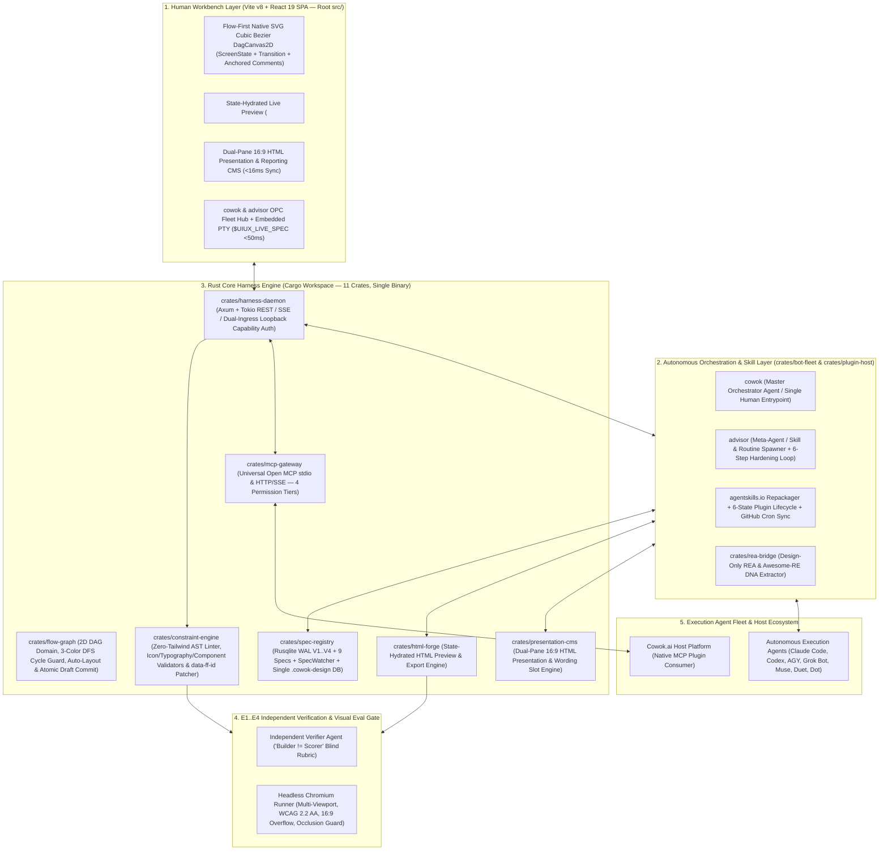

# Master Architecture Specification: cowok-design (UI/UX OS — FlowForge Harness OS)

## 1. Sơ đồ Kiến trúc Tổng thể 5 Tầng (Day-1 Rust Hybrid Harness Architecture)



---

## 2. Cấu trúc 11 Rust Crates + Frontend Workspace (`Cargo.toml` + `pnpm-workspace.yaml`)

```text
uxui-os/
├── Cargo.toml                         # Rust Workspace Root (11 Specialized Crates)
├── pnpm-workspace.yaml                # Shared TypeScript & UI Packages (`packages/*`)
├── crates/
│   ├── domain/                        # Layer 0: CanonicalSpecKey, SafeJsInteger, HarnessError, TaskHorizon, TokenBudget, ModelAdapter (ts-rs + serde)
│   ├── spec-registry/                 # Rusqlite WAL V1..V4 (0700/0600), OCC SpecRegistry, ContextSlicer, SpecWatcher & RecoveryJournal
│   ├── constraint-engine/             # Zero-Tailwind / Zero-Hex AST Linter, Icon/Typography/Component Validators & data-ff-id Patcher
│   ├── flow-graph/                    # 2D DAG Models, 3-Color DFS Cycle Guard, Topological Auto-Layout & Atomic Draft Deploy
│   ├── html-forge/                    # Safe Live HTML Forge, State Hydration Fixtures & Export Bundler
│   ├── presentation-cms/              # Dual-Pane 16:9 HTML Presentation & Wording Slot Engine (<16ms Sync)
│   ├── plugin-host/                   # agentskills.io SKILL.md Normalizer, 6-State Lifecycle & Cron Sync
│   ├── rea-bridge/                    # Design-Only REA & Reference Pattern Inspector (Tokens, Layout, State Blueprint)
│   ├── bot-fleet/                     # cowok Orchestrator, advisor Meta-Agent, Process Staging & Mailbox
│   ├── mcp-gateway/                   # Universal Open MCP Server (stdio & HTTP/SSE) with 4 Permission Tiers
│   └── harness-daemon/                # Axum HTTP/SSE Server + Binary (`src/main.rs`) + Scoped Dual-Ingress Auth + Loopback Discovery
├── src/                               # Root Vite v8 + React 19 SPA (`DagCanvas2D`, Zero-Tailwind CSS Tokens, In-Process Guarded BFF)
└── packages/
    ├── shared-types/                  # Auto-generated TypeScript bindings (`src/generated/*`) + 100% matching Zod schemas (`crates/domain` -> `ts-rs`)
    ├── ui-shell/                      # Minimalist `cowok.ai` Workbench Layout Shell, Design Tokens & Shared UI Primitives
    └── builtin-skills/                # Built-in Harness Operating Skills packaged in agentskills.io format
```

### 2.1. TDR-001: Single-Authority Rust SQLite WAL V3 & Native SVG 2D DAG Engine (`PD-01 = A`)
### Decision: Single-Authority Rust SQLite WAL V3 & Native SVG 2D DAG Engine

#### Decision
- **Status**: Active (`Chosen`: Option A — 100% Rust `crates/spec-registry` SQLite WAL V3 + `crates/flow-graph` + Native SVG `DagCanvas2D`, eliminating `@prisma/client` runtime `dev.db` and `XYFlow v12`).
- **Context**: Story `04.1` uncovered a Dual-Database Split-Brain (`dev.db` via Prisma vs `.cowok-design/cowok-design.sqlite3` via Rusqlite WAL) and unused XYFlow v12 dependencies alongside native SVG Cubic Bézier rendering.

#### Options Evaluated
| Option | Summary | Runtime Footprint | Data Consistency |
| :--- | :--- | :--- | :--- |
| **Option A (Chosen)** | Authoritative Rust `crates/spec-registry` (`V3` 12-Step Rebuild, orthogonal `version` vs `layout_version`) + `crates/flow-graph` + Native SVG `DagCanvas2D` | Single ~18MB Rust binary + Zero-dependency SVG | 100% Single-Authority ACID (`BEGIN IMMEDIATE`) |
| **Option B** | Dual-DB runtime keeping Node Prisma (`dev.db`) for Flow Graph and Rust SQLite WAL for Specs/SDI | Requires Node + Prisma engine + Rust daemon | High Split-Brain & cross-DB FK drift risk |
| **Option C** | Retain XYFlow v12 DOM-heavy canvas wrapper over Prisma BFF | Extra bundle bloat & custom CSS conflicts | Fails Zero-Tailwind Cowok Minimalist ergonomics |

#### Trade-off Analysis
- **Why Option A was preferred over Option B and Option C**: Eliminates Dual-Database Split-Brain completely while preserving `prisma/schema.prisma` strictly as a compile-time declarative DDR contract mirror. Separating `layout_version` from structural `version` (with client `Draft-Local Coordinate Guard` and batch `PATCH /nodes/positions`) enables 60fps drag/Auto-Layout without invalidating active `DraftWorkingSet` CAS tokens.
- **Accepted risk**: SQLite table rebuilds require strict 12-step execution (`PRAGMA foreign_keys = OFF` outside transaction, `CREATE *_v3 -> INSERT -> DROP old -> RENAME *_v3`, `db-migrate.lock`, `0700`/`0600` permissions).

#### Scale-Phase Roadmap
| Phase | Workload Threshold | Active Architecture | Trigger Metric for Next Phase |
| :--- | :--- | :--- | :--- |
| **Phase 1 (Active)** | `1–200` DAG nodes/project, local single-user + AI fleet (`127.0.0.1`) | `crates/spec-registry` SQLite WAL V3 (`busy_timeout = 5000ms`, batch layout `PATCH`, Snapshot 3-Way Entity Diff) | Sustained write contention `> 50` concurrent writers or P99 `> 250ms` |
| **Phase 2** | Multi-seat cloud workspace sync (`> 100` concurrent tenants) | Dedicated actor-serialized SQLite writer thread + optional cloud snapshot replication | Workspace team collaboration across remote hosts |

#### Change Log
| Date | Change Description | Reason | Physical Drift Evidence |
| :--- | :--- | :--- | :--- |
| `2026-11-11` | Replaced stale `XYFlow v12` and `apps/web/` topology with root `src/` Native SVG `DagCanvas2D`, `crates/flow-graph`, and SQLite WAL `V3` orthogonal versioning (`PD-01 = A`). | Eliminate Dual-DB Split-Brain and align SSOT with actual codebase & Party-Mode audit. | [evidence](file:///Users/hatrang20061988/Desktop/AI%20Project/uxui-os/_iwish-output/adhoc-workspace/scratch/infra-drift-evidence.json) |

### 2.2. TDR-002: Dual-Ingress Loopback Capability Auth & Vite In-Process Guarded BFF Mount
### Decision: Dual-Ingress Loopback Capability Auth & Vite In-Process Guarded BFF Mount

#### Decision
- **Status**: Active (`Chosen`: Option PA-1C — Vite in-process mount of 6 `guardedRoute({ authMode: "strict-loopback" })` forwarders + Scoped Dual-Ingress `daemon_auth.rs` on `/api/v1/projects/:id/flow/*`).

#### Options Evaluated
| Option | Summary | Sibling Compatibility | Loopback Security |
| :--- | :--- | :--- | :--- |
| **Option PA-1C (Chosen)** | Vite executes `src/app/api/projects/[id]/flow/**/route.ts` in-process -> Canonical 8-field HMAC-SHA256 v2; Tauri/Static uses SOP-isolated `X-Cowok-Session-Token` + `Host`/`Origin`/`Sec-Fetch-Site: same-origin` | 100% compatible (`0` breakage on `04.2..05.3` & 28 legacy daemon routes) | Immune to RFC 6265 cross-port cookie leak & DNS Rebinding |
| **Option PA-1A** | Raw Vite proxy bypassing `route.ts` + `127.0.0.1` `SameSite=Strict` cookies + global `guardedRoute` mutation | Breaks 4 sibling Vitest suites & 28 Rust routes | Vulnerable to RFC 6265 §8.5 port-agnostic cookie sharing |
| **Option PA-1B** | Ship persistent Node/Fastify server alongside Rust binary in desktop production | Preserves Node middleware | Bloats ~18MB binary to >120MB and doubles IPC hops |

#### Trade-off Analysis
- **Why Option PA-1C was preferred over PA-1A and PA-1B**: Guarantees Vitest contract tests and live Vite browser sessions execute the exact same `route.ts` / `proxyRoute` BFF code path, satisfies `verify-guarded-route.ts` AST gates without touching closed sibling stories, blocks RFC 6265 cross-port cookie leakage on `127.0.0.1`, and allows packaged Tauri v2 builds to run with zero Node.js dependency.
- **Accepted risk & Security Invariants**:
  - Maintaining ~140 LOC across the Vite BFF connect adapter (`cowokLoopbackBffPlugin`) and Dual-Ingress Axum extractor.
  - **`GET /api/v1/health` Redaction**: Strictly prohibited from exposing BOTH `hmac_key_hex` AND `daemon_nonce` (unauthenticated health checks return liveness/version metadata only).
  - **Session Bootstrap Capability Proof**: `POST /api/auth/local-session` (Vite BFF) and `POST /api/v1/auth/local-session` (Axum) MUST NEVER unconditionally mint `'editor'`/`'admin'` tokens to raw unverified callers; they enforce strict loopback `Host` port pinning, `Origin`/`Sec-Fetch-Site` validation, bounded/TTL-evicted session registries, and capability proof (daemon nonce / same-origin boot capability token / `COWOK_ADMIN_TOKEN`).

#### Scale-Phase Roadmap
| Phase | Deployment Mode | Active Transport & Auth Boundary | Trigger Metric for Next Phase |
| :--- | :--- | :--- | :--- |
| **Phase 1 (Active)** | Local Dev (`vite dev` / `vite preview`) & Vitest Integration (`IT-P1-01..10`) | Browser `X-Cowok-Session-Token` (`POST /api/auth/local-session`) -> Vite `cowokLoopbackBffPlugin` (`src/app/api/**` + `proxyRoute` `/api/* -> /api/v1/*` in `vite-bff-routes.ts`) -> Canonical 8-field HMAC v2 -> Axum `flow_routes.rs` / `routes/mod.rs` | Packaging standalone desktop app (`tauri build`) |
| **Phase 2** | Packaged Tauri v2 Desktop / Static `dist/` Bundle (`0` Node server) | Requires client SDK `/api/* -> /api/v1/*` prefix normalization (or Axum `/api/*` alias / Tauri custom protocol bridge) + Tauri-injected launch capability token -> `POST /api/v1/auth/local-session` -> Webview Origin-Bound `X-Cowok-Session-Token` -> Axum `flow_routes.rs` (standalone static `dist/` without BFF/prefix translation fails 404 on `/api/*`) | Remote multi-node deployment |

#### Change Log
| Date | Change Description | Reason | Physical Drift Evidence |
| :--- | :--- | :--- | :--- |
| `2026-11-11` | Established Scoped Dual-Ingress Loopback Auth (`HMAC v2` + `X-Cowok-Session-Token`) and Vite in-process BFF execution (`crates/harness-daemon/src/main.rs` `[[bin]]`). | Prevent Mock-Divergence, RFC 6265 port cookie leaks, DNS Rebinding, and sibling test regressions. | [evidence](file:///Users/hatrang20061988/Desktop/AI%20Project/uxui-os/_iwish-output/adhoc-workspace/scratch/infra-drift-evidence.json) |
| `2026-11-14` | Hardened `TDR-002` invariants: `GET /api/v1/health` redacts `daemon_nonce` + `hmac_key_hex`; `/api/auth/local-session` enforces capability proof + host-port pinning + session TTL/cap; Phase 2 documents `/api -> /api/v1` translation gap for static/Tauri mode. | Close Story 04.1 `/audit-360` P0 loopback auth findings & Phase 2 route drift. | [evidence](file:///Users/hatrang20061988/Desktop/AI%20Project/uxui-os/_iwish-output/adhoc-workspace/scratch/debate-transcript.md) |
| `2026-11-14` | Converged `TDR-001`/`TDR-002` to `SQLite V7` (`CURRENT_SCHEMA_VERSION = 7`, `agent_settings`/`mcp_servers` `project_id IS NULL` partial unique indexes, `execution_events.project_seq` SSE cursor), tightened `bootCapToken` fallback when active tokens exist, and enforced `O_NOFOLLOW` + destination hardlink (`st_nlink > 1`) rejection in `fs_jail.rs`. | Close Story 04.2 Sprint 2 `/audit-360` Option C remediation & `/infra-sync`. | [evidence](file:///Users/hatrang20061988/Desktop/AI%20Project/uxui-os/_iwish-output/adhoc-workspace/scratch/infra-drift-evidence.json) |

### 2.3. TDR-003: Hybrid Preview `<iframe sandbox>` Isolation with Opt-In Read-Only Design CDN (`Option CSP-B`)
### Decision: Hybrid Preview Iframe Sandbox Isolation with Opt-In Design CDN

#### Decision
- **Status**: Active (`Chosen`: Option CSP-B — Zero-Trust `STRICT_OFFLINE` default `sandbox="allow-scripts allow-forms"` without `allow-same-origin` + Byte-0 `MessagePort` freeze + 1-Click Scoped Read-Only Design CDN toggle).

#### Options Evaluated
| Option | Summary | Security Posture | Designer HTML Fidelity |
| :--- | :--- | :--- | :--- |
| **Option CSP-B (Chosen)** | Default `STRICT_OFFLINE` (`default-src 'none'`); 1-click per-tab/project `[Bật Design CDN]` opens fixed read-only CDN allowlist (`fonts.googleapis.com`, `fonts.gstatic.com`, `cdn.tailwindcss.com`, `unpkg.com`, `cdn.jsdelivr.net`, `cdnjs.cloudflare.com`) with `connect-src 'none'`, `referrerPolicy="no-referrer"`, no wildcard `img-src https:` | Passes 100% `SEC-IFRAME-01..08`; blocks `APPLY_HTML` inbound & image-beacon exfiltration | Preserves 100% original user HTML colors/fonts (`0` wrapper CSS bleed) |
| **Option CSP-A** | Permanent `default-src 'none'` with no external font/CDN toggle | Maximum air-gap isolation | Breaks >85% of real-world Stitch/Claude/Tailwind HTML prototypes |
| **Option CSP-C** | Open external CDNs automatically on first render without user opt-in | Unsolicited outbound requests on untrusted HTML open | Immediate external font rendering |

#### Trade-off Analysis
- **Why Option CSP-B was preferred over CSP-A and CSP-C**: Upholds strict Zero-Trust isolation by default while giving Designers a transparent 1-click opt-in for read-only typography/CSS CDNs without ever enabling `allow-same-origin`, `connect-src`, or arbitrary `img-src https:` exfiltration channels, and separates `wrapUserHtmlSrcDoc` from dark fixture card CSS (`#0f172a`).
- **Accepted risk**: ~35 LOC external-tag detector and per-tab/project toolbar toggle state.

#### Scale-Phase Roadmap
| Phase | Preview Workload | Active Sandbox Architecture | Trigger Metric for Next Phase |
| :--- | :--- | :--- | :--- |
| **Phase 1 (Active)** | Single-file & project `.html` prototypes in `CompanionLiveHtmlRightPane` | Opaque-origin `srcDoc` (`sandbox="allow-scripts allow-forms"`) + `DOMParser` Byte-0 CSP/freeze + `<body on*>` attribute strip + iframe self-navigation guard (`Story 04.1`: `STRICT_OFFLINE_CSP` default + opt-in `DESIGN_CDN_CSP`; `Story 04.5`: converges to `DOMParser`-only zero-network `default-src 'none'` with local SRI assets & 128-bit `bootSecret`) | Offline/air-gapped enterprise bundle requirement (`Story 04.5`) |
| **Phase 2** | Air-gapped enterprise & multi-asset local bundles | Rust daemon local read-only static asset packager caching approved Google Fonts / Tailwind CSS offline (`default-src 'none'`) | Enterprise air-gap policy activation |

#### Change Log
| Date | Change Description | Reason | Physical Drift Evidence |
| :--- | :--- | :--- | :--- |
| `2026-11-11` | Locked `Option CSP-B` 2-tier `<iframe sandbox>` CSP, directional `MessageChannel` schemas (forbidding `APPLY_HTML` inbound), and pure `wrapUserHtmlSrcDoc`. | Resolve security-vs-fidelity tension (`AC-03` / `KU-04.1-08`) approved by User after Party-Mode audit. | [evidence](file:///Users/hatrang20061988/Desktop/AI%20Project/uxui-os/_iwish-output/adhoc-workspace/scratch/infra-drift-evidence.json) |
| `2026-11-14` | Clarified Phase 1 (`Story 04.1`) `<body on*>` strip + self-navigation `MessagePort` guard and `Story 04.5` convergence to `DOMParser`-only zero-network `default-src 'none'`. | Prevent split-brain between `Story 04.1` `SEC-IFRAME-06` and `Story 04.5` `AC-02`. | [evidence](file:///Users/hatrang20061988/Desktop/AI%20Project/uxui-os/_iwish-output/adhoc-workspace/scratch/debate-transcript.md) |

### 2.4. TDR-004: SSOT Anti-Split-Brain, Zero RAM-Shell & Live Daemon Execution Governance
### Decision: SSOT Anti-Split-Brain, Zero RAM-Shell & Live Daemon Execution Governance

#### Decision
- **Status**: Active (`Chosen`: Single-Authority Rust `.cowok-design/cowok-design.sqlite3` + Cryptographic Dual-Ingress Auth + Live Background `SpecWatcher` + Explicit `501` Gate for Unimplemented Exports).

#### Options Evaluated
| Option | Summary | Security & Persistence | Split-Brain / Stub Risk |
| :--- | :--- | :--- | :--- |
| **Option SSOT-A (Chosen)** | Zero `OnceLock`/`HashMap` shadow stores; SQLite (`spec_tombstones`, `change_proposals`, `chat_sessions`, `version_snapshots`) is sole state truth; full HMAC-SHA256 v2 (`verify_hmac_v2` + `record_nonce_once`) or scoped `X-Cowok-Session-Token` on ALL protected routes; `proxyRoute` parity with Zod/JSON body preservation & zero `forwardDirect` BFF bypasses; zero route symlinks; live `SpecWatcher` tokio loop; explicit honest `[MISSING]`/`[INFERRED]`/`[CONFIRMED]` synthesis + real ZIP or `501` | Fail-closed auth & full restart durability | `0` RAM-shell or split-brain drift |
| **Option SSOT-B** | Permit legacy header-presence HMAC checks (`is_loopback_hmac`), `0x42` key fallback, and RAM-backed proposal/session caches for fast prototyping | Vulnerable to local spoofing & data loss on restart | High split-brain & false-positive test coverage |

#### Trade-off Analysis
- **Why Option SSOT-A was preferred over Option SSOT-B**: Epic 01 `/audit-360` + `/party-mode` proved that partial mocks (`is_loopback_hmac` header-only bypass, `OnceLock` lists shadowing SQLite, `forwardDirect` skipping `guardedRoute`, `SpecWatcher` only called in unit tests, and symlink `src/app/api/v1/projects`) mask critical failures behind passing unit tests. Enforcing Option SSOT-A aligns code, tests, Vite BFF, and planning specs under one verifiable contract.
- **Canonical Spec & Dotdir Clarifications**:
  - `.cowok-design/` is the single unified runtime dotdirectory (`.cowok-design/cowok-design.sqlite3`, `.cowok-design/daemon.lock`, `.cowok-design/.cowok-locks/`).
  - Cross-project brand inheritance is strictly restricted to design/brand specs (`03-ui-ux-spec.md` and `09-data-and-copy.md`) and MUST NEVER copy security/tenancy (`08-security-tenancy.md`) or architecture (`04-architecture.md`) across project boundaries.
  - Project brief synthesis MUST generate spec-specific structured content and label absent sections `[MISSING]` rather than stamping hardcoded `[CONFIRMED]` templates.

#### Change Log
| Date | Change Description | Reason | Physical Drift Evidence |
| :--- | :--- | :--- | :--- |
| `2026-11-13` | Added `TDR-004`, reconciled the 11 `Cargo.toml` crates & 3 `packages/*` workspace members, unified `.cowok-design/` dotdir, and outlawed RAM-shell stores, header-presence auth bypasses, `forwardDirect` BFF bypasses, and symlink route aliases. | Epic 01 `/audit-360` + `/party-mode` reconciliation approved by User (`/infra-sync`). | [evidence](file:///Users/hatrang20061988/Desktop/AI%20Project/uxui-os/_iwish-output/adhoc-workspace/scratch/infra-drift-evidence.json) |

---

## 3. Cơ chế Phối hợp Cốt lõi trong Nhân Hệ điều hành

1. **Điều phối Đơn điểm qua `cowok` & Tự tiến hóa qua `advisor` (`crates/bot-fleet`):**
   - Người dùng chỉ làm việc với **`cowok`**. `cowok` sử dụng JEV routing trong domain (`TaskHorizonRouter`) + JIT Context Slicer (`crates/spec-registry::ContextSlicer`) ($\le 1,500$ tokens), và giao việc cho Execution Agent (`Claude`, `Codex`, `AGY`, `Grok`, `Muse`, `Duet`, `Dot`) kèm hợp đồng `ONE_JOB` + `NEVER`.
   - Khi Execution Agent ghi vào file đặc tả trong `.cowok-design/specs/` hoặc workspace, **background `SpecWatcher` (`notify`)** được spawn trực tiếp trong `crates/harness-daemon` quét qua `crates/constraint-engine` (`zero-tailwind` / `zero-hex` / icon & typography contracts) và đồng bộ trạng thái `project_specs` + disk SHA-256.
   - **`advisor`** giám sát sổ cái lỗi; nếu `3-Strike Circuit Breaker` kích hoạt, `advisor` tự động phân tích nguyên nhân gốc, vá `SKILL.md` trong `crates/plugin-host` và bổ sung bài kiểm thử hồi quy.
2. **Động cơ Ràng buộc Cấu hình theo Dự án (`constraint_profiles` / `constraint_rules`):**
   - Thay vì khóa cứng một bộ quy tắc duy nhất cho mọi dự án, `crates/spec-registry` nạp cấu hình ràng buộc riêng của từng dự án (`constraint_profiles` & `constraint_rules`) vào `crates/constraint-engine` để kiểm duyệt chính xác theo luật của dự án đó.

## Feature Colocation & Compile-Time Auto-Discovery Contract

<!-- BEGIN FEATURE_COLOCATION_CONTRACT -->
- **Pattern**: `Feature Colocation & Compile-Time Auto-Discovery` (*The Shortest Path is the Best Path*)
- **colocation_profile_sha256**: `f19493b712ceab8ab149aa8f172d61a2631f8c22b4fe0094fd16fbb1247384df`
- **Frontend Feature Slices**: `6` (`src/features/<slug>/entrypoints.ts` -> `src/generated/feature-registry.ts`)
- **Rust Workspace Crates**: `11` (`crates/<slug>/Cargo.toml` 4-Tier Unidirectional DAG)
<!-- END FEATURE_COLOCATION_CONTRACT -->
