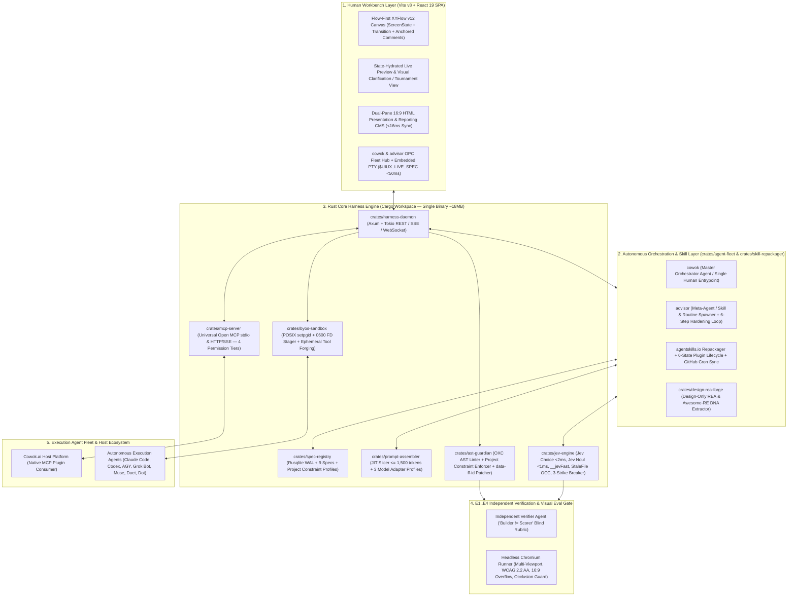

# Master Architecture Specification: UI/UX OS (FlowForge Harness OS)

## 1. Sơ đồ Kiến trúc Tổng thể 5 Tầng (Day-1 Rust Hybrid Harness Architecture)



---

## 2. Cấu trúc 11 Rust Crates + Frontend Monorepo (`Cargo.toml` + `pnpm-workspace.yaml`)

```text
uxui-os/
├── Cargo.toml                         # Rust Workspace Root (11 Specialized Crates)
├── pnpm-workspace.yaml                # Frontend & Shared UI Packages
├── crates/
│   ├── domain/                        # Rust Structs + Serde + ts-rs + schemars (SDI, 9 Specs, Flow, Slides, Fleet)
│   ├── spec-registry/                 # Rusqlite WAL (16 tables), Project Constraint Profiles, Version History
│   ├── prompt-assembler/              # JIT Context Slicer (<= 1,500 tokens) + 3 Model Capability Adapter Profiles
│   ├── ast-guardian/                  # OXC / Tree-Sitter <1ms Project Constraint Linter & data-ff-id Surgical Patcher
│   ├── jev-engine/                    # JEV — TypeSafe: Jev Choice, Jev Noul, __jevFast, StaleFile OCC, 3-Strike Breaker
│   ├── skill-repackager/              # agentskills.io SKILL.md Normalizer, 6-State Lifecycle & GitHub Cron Scheduler
│   ├── design-rea-forge/              # Design-Only REA & Awesome-RE Inspector (Tokens, Layout, State Blueprint)
│   ├── agent-fleet/                   # cowok Orchestrator, advisor Meta-Agent, portable-pty $UIUX_LIVE_SPEC & Mailbox
│   ├── byos-sandbox/                  # POSIX Process Group Spawner, 0600 FD Stager, BYOK & Ephemeral Tool Sandbox
│   ├── mcp-server/                    # Universal Open MCP Server (stdio & HTTP/SSE) with 4 Permission Tiers
│   └── harness-daemon/                # Axum HTTP/SSE Server + CLI Entrypoint (`uiux-os`) + Tauri v2 Bridge
├── apps/
│   └── web/                           # Vite v8 + React 19 SPA (Flow Canvas + Dual-Pane 16:9 CMS + OPC Fleet Hub)
└── packages/
    ├── shared-types/                  # Auto-generated TypeScript bindings from `crates/domain` via `ts-rs`
    ├── brand-tokens/                  # Default Flagship Preset (`cowok-brand-product-system-v4.3` tokens & 145 icons)
    └── builtin-skills/                # 6 Built-in Harness Operating Skills packaged in agentskills.io format
```

---

## 3. Cơ chế Phối hợp Cốt lõi trong Nhân Hệ điều hành

1. **Điều phối Đơn điểm qua `cowok` & Tự tiến hóa qua `advisor` (`crates/agent-fleet`):**
   - Người dùng chỉ làm việc với **`cowok`**. `cowok` sử dụng `Jev Choice` (<2ms) để chọn kỹ năng `SKILL.md` phù hợp, cắt lát ngữ cảnh JIT ($\le 1,500$ tokens), và giao việc cho Execution Agent (`Claude`, `Codex`, `AGY`, `Grok`, `Muse`, `Duet`, `Dot`) kèm hợp đồng `ONE_JOB` + `NEVER`.
   - Khi Execution Agent ghi vào `$UIUX_LIVE_SPEC`, file-watcher của Rust kiểm tra qua `Jev Noul` (<1ms) + `oxc` AST Linter và cập nhật thẳng lên khung nhìn trong `<50ms`.
   - **`advisor`** giám sát sổ cái lỗi; nếu `3-Strike Circuit Breaker` kích hoạt, `advisor` tự động phân tích nguyên nhân gốc, vá `SKILL.md` và bổ sung bài kiểm thử hồi quy (6-Step Hardening Loop).
2. **Động cơ Ràng buộc Cấu hình theo Dự án (`PROJECT_CONSTRAINTS`):**
   - Thay vì khóa cứng một bộ quy tắc duy nhất cho mọi dự án, `crates/spec-registry` nạp cấu hình ràng buộc riêng của từng dự án từ Bộ 9 Specs (`02_BRAND_IDENTITY`, `07_COMPONENT_REGISTRY`, `08_TECH_STACK_CONTRACT`) vào `crates/ast-guardian` và `Jev Noul` để kiểm duyệt chính xác theo luật của dự án đó.
