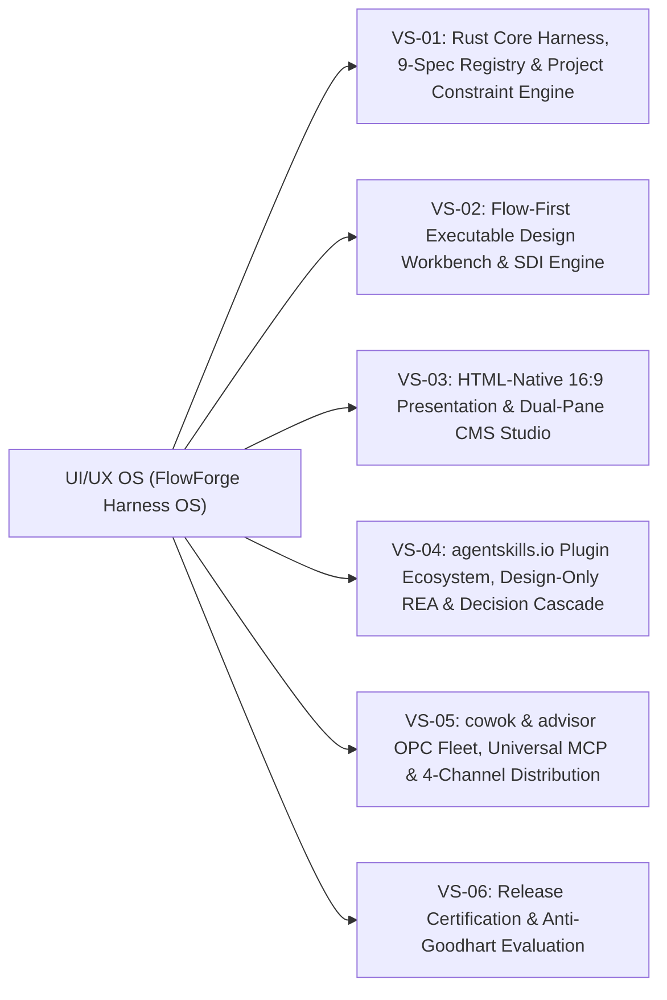

# 2.6. Feature Hierarchy (L1 $\to$ L4 Taxonomy) — UI/UX OS (FlowForge Harness OS)

## 1. Kiến trúc Phân cấp 6 Chuỗi Giá trị (6 Value Streams $\to$ 13 Epics $\to$ 22 Completed + 20 Active Slices)

---

## 2. Bảng Phân rã Chi tiết L1 $\to$ L4 (`FR-01` .. `FR-36`)

| L1 (Value Stream) | L2 (Subsystem / Crate) | L3 (Feature Group) | L4 (Atomic Capability) | FR Mapping | Story Mapping |
| :--- | :--- | :--- | :--- | :---: | :---: |
| **VS-01: Rust Core Harness & Constraint Engine** | `crates/domain` & `crates/spec-registry` | **FH-01.1: 9-Spec Vault & Schema Sync** | Khởi tạo 11-crate workspace, `ts-rs` bindings và lưu trữ 9 Foundational Specs trong SQLite WAL (16 bảng). | `FR-01`, `FR-11`, `FR-12` | `01.1..01.3` *(completed)* |
| **VS-01: Rust Core Harness & Constraint Engine** | `crates/spec-registry` & `packages/ui-shell` | **FH-01.2: KV-Cache Slicer, Hidden SSOT & 7 Craft Skills** | Portal-safe KV-Cache Compiler + 3-Profile (`02.1`), Hidden Dual-Use SSOT `AppShell` Lock + `cowok-design-opt` + 7 Craft Skills + `<15ms` 3-Zone Router (`02.4`). | `FR-14`, `FR-27`, `FR-32` | `02.1, 02.4` |
| **VS-01: Rust Core Harness & Constraint Engine** | `crates/constraint-engine` | **FH-01.3: Project-Scoped Constraint Engine & Patcher** | Thực thi cấu hình ràng buộc theo từng dự án (`PROJECT_CONSTRAINTS`: CSS policy, `tokens.css`, `icon-manifest.json`) và vá `data-ff-id` trong `<1ms`. | `FR-10`, `FR-13` | `03.1..03.3` *(completed)* |
| **VS-02: Flow-First Executable Design Workbench** | `src/` & `crates/harness-daemon` | **FH-02.1: Multi-Portal 2D DAG, Vault/Doctor, Keyed Coordinator, CAS Intake & In-Chat Vault** | `DagCanvas2D`, SQLite `V7` + SSE replay, CLI Doctor (`EXTENSION`), `CompanionLiveHtmlRightPane` (`04.1..04.5`), và `V4/V16` Chat Persistence + CAS + In-Chat Zero-Leak Vault (`04.6`). | `FR-02`, `FR-03`, `FR-06`, `FR-31` | `04.1..04.5` *(completed)*, `04.6` |
| **VS-02: Flow-First Executable Design Workbench** | `crates/html-forge` & `src/` | **FH-02.2: SDI, Cognitive Sketch-to-Polish, Shared `lol_html` & 3-Tier Flow DAG** | Launchpad, ChangeProposal Diff, Snapshots & PR (`05.1..05.3`), `sketch-paper` -> Brand Swap + Steering Chips + `lol_html` (`05.4`), `/simulate-user` + FMEA `<=8` DAG (`05.5`). | `FR-04`, `FR-05`, `FR-07`, `FR-08`, `FR-09`, `FR-33` | `05.1..05.3` *(completed)*, `05.4, 05.5` |
| **VS-03: HTML 16:9 Presentation & Dual-Pane CMS** | `crates/presentation-cms`, `crates/bot-fleet` & `src/` | **FH-03.1: Dual-Pane CMS, 2D Charts, Presenter & AI Multi-Slide Deck Gen** | Khung HTML `16:9`/`16:10`/`Auto` `V15`, Slide-Over CMS `<16ms` (`lol_html`+`html5ever`), 2D Charts & Presenter (`06.1..06.4`), AI Deck Gen + CSV/PDF->`ChartSpecV12` + `stageshow` (`06.5`). | `FR-15`, `FR-16`, `FR-17`, `FR-34` | `06.1..06.4` *(completed)*, `06.5` |
| **VS-03: HTML 16:9 Presentation & Dual-Pane CMS** | `crates/harness-daemon` & `crates/html-forge` | **FH-03.2: Pooled 1-Chromium CDP Visual QC & Split Export** | Pooled 1-Chromium CDP (`lib-audit` + `slides-check`, `elementsFromPoint`, RGBA SSIM) + Auto-Fix (`07.1`) và Split `Share & Present` vs `Developer Handoff` (`07.2`). | `FR-18` | `07.1, 07.2` |
| **VS-04: `agentskills.io`, REA Forge & Decision Cascade** | `crates/plugin-host` & `packages/builtin-skills` | **FH-04.1: `agentskills.io` Lifecycle, Split DE+DR Runtime, 7 DE Tools, Jail & `LEARN`** | Multi-Axis Registry, Triangle Linter, Repackager, 6-State Lifecycle, GitHub Cron (`08.1..08.4`), và 7 Built-in DE Tools + `HUMAN_ONLY` Tool Jail + System-1 `LEARN` (`08.5`). | `FR-19`, `FR-20`, `FR-21`, `FR-35` | `08.1..08.4` *(completed)*, `08.5` |
| **VS-04: `agentskills.io`, REA Forge & Decision Cascade** | `crates/rea-bridge`, `crates/domain` & `crates/bot-fleet` | **FH-04.2: Two-Store `/rea` DNA Forge & 5-Stage `DecisionCascadeClient`** | Two-Store `/rea` + `/awesome-re` (`Tier-1A/1B`) + License Firewall (`09.1`), và 5-Stage `DE->Decision#1->DR/DE->DE->Decision#2` `DecisionCascadeClient` (`~450 LOC`) + `RubricShield` + 3-Strike (`09.2`). | `FR-22`, `FR-23`, `FR-27` | `09.1, 09.2` |
| **VS-05: `cowok` & `advisor` OPC Fleet & MCP** | `crates/bot-fleet` | **FH-05.1: `cowok` Orchestrator, File Leases & `CMP-07` Design Tournament** | `3-Lane Router` + MPSC Write Actor + `$UIUX_LIVE_SPEC` `<50ms` (`10.1`), `worker_file_leases` + `Builder!=Scorer` + `Design Jury` (`10.2`), `CMP-07` `Blind Wipe` + Cross-Variant Borrow + `advisor` loop (`10.3`). | `FR-24`, `FR-25`, `FR-26`, `FR-27` | `10.1, 10.2, 10.3` |
| **VS-05: `cowok` & `advisor` OPC Fleet & MCP** | `crates/bot-fleet` & `crates/mcp-gateway` | **FH-05.2: BYOS/BYOK Runner + Normalizer & Universal Open MCP Gateway** | POSIX `0o600` FD + `-PGID` + Post-Execution Normalizer (`11.1`) và Bidirectional Open MCP Gateway 4 Tiers + 1-Click Installer (`11.2`). | `FR-28`, `FR-29` | `11.1, 11.2` |
| **VS-05: `cowok` & `advisor` OPC Fleet & MCP** | `crates/harness-daemon` & Packaging | **FH-05.3: 4-Channel Packaging & Standalone `/api/*` Parity** | Single-Binary CLI (`uiux-os`) `/api/*` parity (`12.1`), Tauri v2 + Cowok Plugin (`12.2`), và Docker/OCI kèm Pooled Chromium (`12.3`). | `FR-30` | `12.1, 12.2, 12.3` |
| **VS-06: Release Certification & Anti-Goodhart Eval** | `crates/harness-daemon` & `tests/eval/sealed/` | **FH-06.1: Sealed Anti-Goodhart Benchmark & 25-Case `/simulate-user` Gate** | `chmod 444` SHA-256 Sealed Runner (`with_skill` vs `baseline`), 3-provider Decision calibration, và bộ E2E `UC-01..UC-25` phủ đủ `M1..M5`. | `FR-36` | `13.1` |

<!-- BEGIN AUTO-GENERATED UCG -->
### Five-Nouns Host Slot & Feature Entrypoint Registry (UCG Auto-Projected)

| Feature Noun (`src/features/<slug>`) | Entrypoint ID | Host Shell ID | Slot ID | Cardinality | Order | Route | Design Pattern |
| :--- | :--- | :--- | :--- | :---: | :---: | :--- | :--- |
<!-- END AUTO-GENERATED UCG -->
