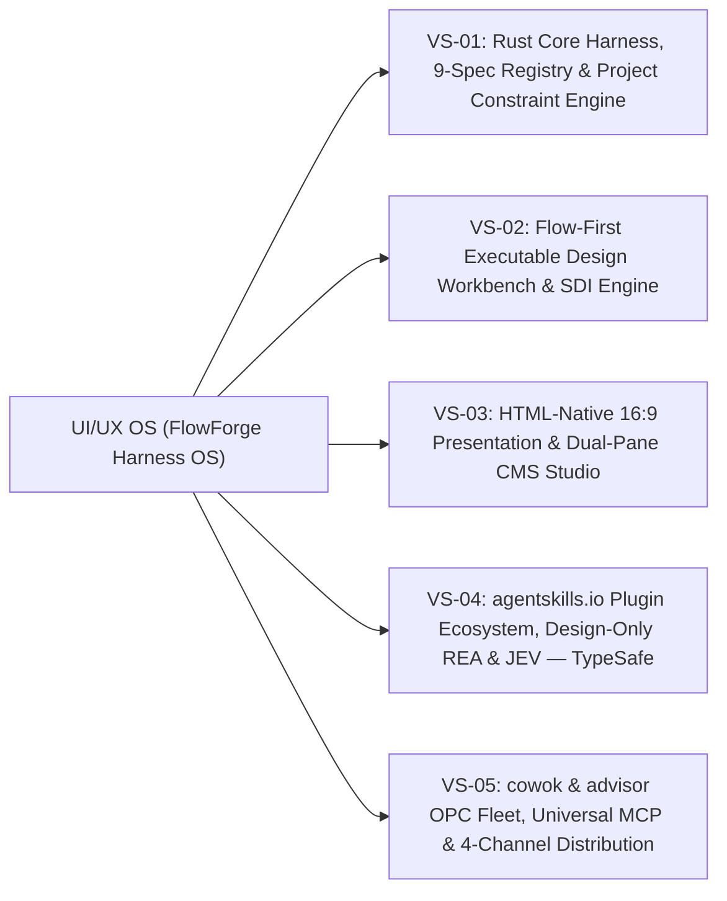

# 2.6. Feature Hierarchy (L1 $\to$ L4 Taxonomy) — UI/UX OS (FlowForge Harness OS)

## 1. Kiến trúc Phân cấp 5 Chuỗi Giá trị (5 Value Streams $\to$ 12 Epics $\to$ 36 Stories)

---

## 2. Bảng Phân rã Chi tiết L1 $\to$ L4 (`FR-01` .. `FR-30`)

| L1 (Value Stream) | L2 (Subsystem / Crate) | L3 (Feature Group) | L4 (Atomic Capability) | FR Mapping | Story Mapping |
| :--- | :--- | :--- | :--- | :---: | :---: |
| **VS-01: Rust Core Harness & Constraint Engine** | `crates/domain` & `crates/spec-registry` | **FH-01.1: 9-Spec Vault & Schema Sync** | Khởi tạo 11-crate workspace, `ts-rs` bindings và lưu trữ 9 Foundational Specs trong SQLite WAL (16 bảng). | `FR-01`, `FR-11`, `FR-12` | Story 1.1, 1.2, 1.3 |
| **VS-01: Rust Core Harness & Constraint Engine** | `crates/prompt-assembler` | **FH-01.2: JIT Context Slicer & Model Adapter** | Cắt lát ngữ cảnh theo `short`/`mid`/`long` horizon ($\le 1,500$ tokens) và 3 hồ sơ năng lực Model (`Tier-1/2/3`). | `FR-14`, `FR-27` | Story 2.1, 2.2, 2.3 |
| **VS-01: Rust Core Harness & Constraint Engine** | `crates/ast-guardian` | **FH-01.3: Project-Scoped Constraint Engine & Patcher** | Thực thi cấu hình ràng buộc theo từng dự án (`PROJECT_CONSTRAINTS`: CSS policy, `tokens.css`, `icon-manifest.json`) và vá `data-ff-id` trong `<1ms`. | `FR-10`, `FR-13` | Story 3.1, 3.2, 3.3 |
| **VS-02: Flow-First Executable Design Workbench** | `apps/web` & `crates/harness-daemon` | **FH-02.1: Multi-Portal XYFlow & State-Hydrated Preview** | Đồ thị `ScreenState` (`route + fixtureRef + viewport`) + `Transition`, xem trước đa khung nhìn và ghim bình luận (`stale_mapping`). | `FR-02`, `FR-03`, `FR-06` | Story 4.1, 4.2, 4.3 |
| **VS-02: Flow-First Executable Design Workbench** | `crates/harness-daemon` & `apps/web` | **FH-02.2: SDI Compiler, Visual Clarification & Diff Gate** | Biên dịch `DesignIntentV1`, sinh 2–3 phương án trực quan khi mơ hồ, kiểm duyệt `ChangeProposal` diff, lịch sử/khôi phục và xuất ZIP/GitHub PR. | `FR-04`, `FR-05`, `FR-07`, `FR-08`, `FR-09` | Story 5.1, 5.2, 5.3 |
| **VS-03: HTML 16:9 Presentation & Dual-Pane CMS** | `apps/web` (Presentation Studio) | **FH-03.1: Dual-Pane CMS & 16:9 Slide Stage** | Khung trình chiếu HTML `16:9` (`1920x1080`) kết hợp CMS Texting bên trái đồng bộ `<16ms`, nhúng biểu đồ sống và Agent Copilot. | `FR-15`, `FR-16`, `FR-17` | Story 6.1, 6.2, 6.3 |
| **VS-03: HTML 16:9 Presentation & Dual-Pane CMS** | `crates/harness-daemon` | **FH-03.2: Multi-Viewport Visual Eval & Exporter** | Kiểm định 17 quy tắc bố cục, tương phản WCAG 2.2 AA, chống tràn khung 16:9 và xuất file `.html` độc lập / `.pdf` vector. | `FR-18` | Story 7.1, 7.2, 7.3 |
| **VS-04: `agentskills.io`, REA Forge & `JEV`** | `crates/skill-repackager` | **FH-04.1: `agentskills.io` Repackager & Cron Lifecycle** | 6 kỹ năng vận hành lõi, bộ đóng gói repo GitHub thành `SKILL.md` + `plugin.json`, quản lý 6 trạng thái vòng đời và Cron Job cập nhật tự động. | `FR-19`, `FR-20`, `FR-21` | Story 8.1, 8.2, 8.3 |
| **VS-04: `agentskills.io`, REA Forge & `JEV`** | `crates/design-rea-forge` & `crates/jev-engine` | **FH-04.2: Design-Only REA Forge & `JEV — TypeSafe`** | Trích xuất Design DNA từ web/app tham khảo (giới hạn Design-Only) và vận hành 6 nguyên hàm `JEV — TypeSafe` (`Jev Choice`, `Jev Noul`, `__jevFast`, `StaleFile` OCC, `3-Strike`). | `FR-22`, `FR-23` | Story 9.1, 9.2, 9.3 |
| **VS-05: `cowok` & `advisor` OPC Fleet & MCP** | `crates/agent-fleet` | **FH-05.1: `cowok` Orchestrator, `advisor` Meta-Agent & PTY Fleet** | Điều phối đơn điểm qua `cowok`, tự tiến hóa 6 bước qua `advisor`, nhúng PTY `$UIUX_LIVE_SPEC` (`<50ms` + `Cmd+Z`), hộp thư `ONE_JOB`/`NEVER`, `E1..E4` và Tournament Mode. | `FR-24`, `FR-25`, `FR-26`, `FR-27` | Story 10.1, 10.2, 10.3 |
| **VS-05: `cowok` & `advisor` OPC Fleet & MCP** | `crates/byos-sandbox` & `crates/mcp-server` | **FH-05.2: BYOS/BYOK Sandbox & Universal Open MCP** | Thực thi BYOS (`0600` FD + `setpgid`) / BYOK, rèn tool tạm thời an toàn, và phơi bày Universal MCP Server (4 tầng quyền hạn) cho Cowok.ai/Codex/Claude. | `FR-28`, `FR-29` | Story 11.1, 11.2, 11.3 |
| **VS-05: `cowok` & `advisor` OPC Fleet & MCP** | `crates/harness-daemon` & Packaging | **FH-05.3: 4-Channel Packaging & Distribution** | Đóng gói và phát hành qua 4 kênh: Single-Binary CLI, Tauri v2 Desktop App, Cowok.ai Native Plugin, và Docker/OCI Container. | `FR-30` | Story 12.1, 12.2, 12.3 |

<!-- BEGIN AUTO-GENERATED UCG -->
### Five-Nouns Host Slot & Feature Entrypoint Registry (UCG Auto-Projected)

| Feature Noun (`src/features/<slug>`) | Entrypoint ID | Host Shell ID | Slot ID | Cardinality | Order | Route | Design Pattern |
| :--- | :--- | :--- | :--- | :---: | :---: | :--- | :--- |
<!-- END AUTO-GENERATED UCG -->
