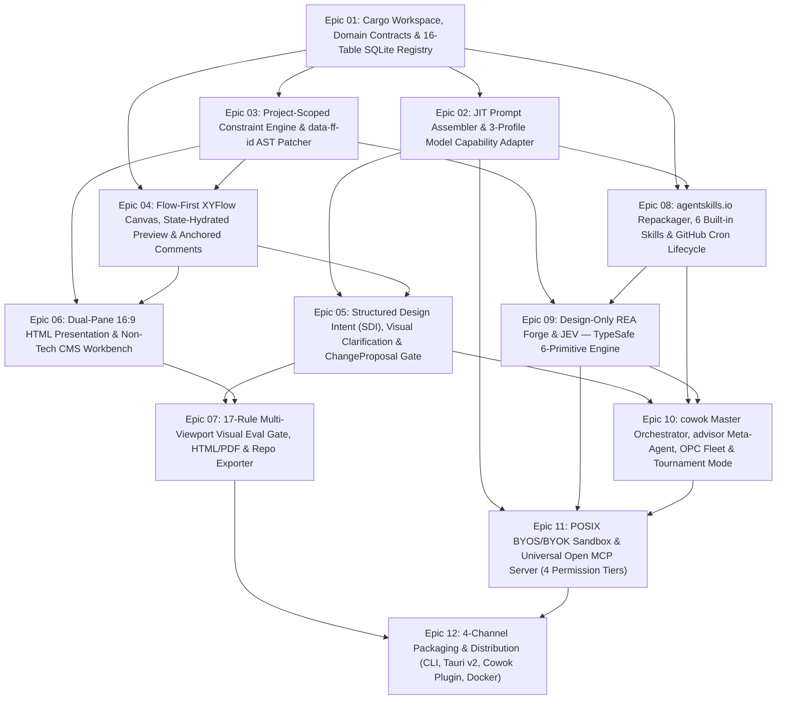

# 2.7. Cross-Dependencies & Integration Topology — UI/UX OS (FlowForge Harness OS)

## 1. Đồ thị Phụ thuộc Cấp Epic (Epic Dependency DAG: `Epic 01` $\to$ `Epic 12`)

- Epic 02 consumes Epic 01
- Epic 03 consumes Epic 01
- Epic 04 consumes Epic 01
- Epic 04 consumes Epic 03
- Epic 05 consumes Epic 02
- Epic 05 consumes Epic 04
- Epic 06 consumes Epic 03
- Epic 06 consumes Epic 04
- Epic 07 consumes Epic 05
- Epic 07 consumes Epic 06
- Epic 08 consumes Epic 01
- Epic 08 consumes Epic 02
- Epic 09 consumes Epic 03
- Epic 09 consumes Epic 08
- Epic 10 consumes Epic 05
- Epic 10 consumes Epic 08
- Epic 10 consumes Epic 09
- Epic 11 consumes Epic 02
- Epic 11 consumes Epic 09
- Epic 11 consumes Epic 10
- Epic 12 consumes Epic 07
- Epic 12 consumes Epic 11

---

## 2. Ma trận Cung cấp — Tiêu thụ (Provide / Consume SSOT Matrix)

| Nguồn cung cấp (Provider) | Sản phẩm đầu ra (Artifact / Contract) | Bên tiêu thụ (Consumer) | Cơ chế Kiểm chứng |
| :--- | :--- | :--- | :--- |
| **Epic 01 (`crates/domain` & `crates/spec-registry`)** | 16 bảng SQLite WAL + `PROJECT_CONSTRAINTS` + TypeScript `.d.ts` sinh qua `ts-rs` | **Epic 02, 03, 04, 08** | `cargo test --package domain` xuất `.d.ts` tự động và khóa ngoại SQLite WAL. |
| **Epic 02 (`crates/prompt-assembler`)** | Bộ cắt lát ngữ cảnh JIT ($\le 1,500$ tokens) + 3 Model Capability Profiles (`Tier-1/2/3`) | **Epic 05, 08, 11** | Kiểm tra ngân sách token cứng trước khi gọi BYOS/BYOK. |
| **Epic 03 (`crates/ast-guardian`)** | Động cơ thực thi ràng buộc theo dự án (`PROJECT_CONSTRAINTS`) + vá `data-ff-id` `<1ms` | **Epic 04, 06, 09** | Quét AST bằng `oxc` dưới 1ms; mặc định nạp preset `cowok-brand-product-system-v4.3`. |
| **Epic 04 & 05 (`Flow-First Core`)** | Đồ thị `ScreenState` + `Transition`, `DesignIntentV1`, Visual Clarification 2–3 phương án, `ChangeProposal` Diff & History | **Epic 06, 07, 10** | Kiểm định `E1..E4` trước khi cho phép `Apply` đề xuất thay đổi. |
| **Epic 08 (`crates/skill-repackager`)** | 6 Built-in Skills + chuẩn hóa `SKILL.md` (`agentskills.io`) + `plugin.json` + Cron Sync | **Epic 09, 10** | Xác thực schema `SKILL.md` 3 tầng Progressive Disclosure. |
| **Epic 09 (`crates/design-rea-forge` & `crates/jev-engine`)** | Bộ trích xuất Design-Only REA + 6 nguyên hàm `JEV — TypeSafe` (`Jev Choice`, `Jev Noul`, `__jevFast`, `StaleFile`, `3-Strike`) | **Epic 10, 11** | Kiểm thử độ trễ `<2ms` cho `Jev Choice` và `<1ms` cho `Jev Noul`. |
| **Epic 10 (`crates/agent-fleet`)** | Điều phối viên `cowok` + cố vấn `advisor` + PTY `$UIUX_LIVE_SPEC` `<50ms` + Hộp thư điều phối + Tournament Mode | **Epic 11, 12** | Kiểm chứng hợp đồng `ONE_JOB` + `NEVER` và nguyên tắc `"Builder != Scorer"`. |
| **Epic 11 (`crates/byos-sandbox` & `crates/mcp-server`)** | POSIX BYOS (`0600` FD) + Universal Open MCP Server (4 tầng quyền hạn) | **Epic 12 & Cowok.ai Host** | Kiểm thử giao thức JSON-RPC 2.0 trên cả `stdio` và `HTTP/SSE`. |

<!-- BEGIN AUTO-GENERATED UCG -->
### Five-Nouns & Host-Slot Cross-Feature Dependencies (UCG Auto-Projected)

| Provider Feature / Story | Consumer Feature / Host Shell | Contract / Slot / API Boundary | Verification Gate |
| :--- | :--- | :--- | :--- |
<!-- END AUTO-GENERATED UCG -->
