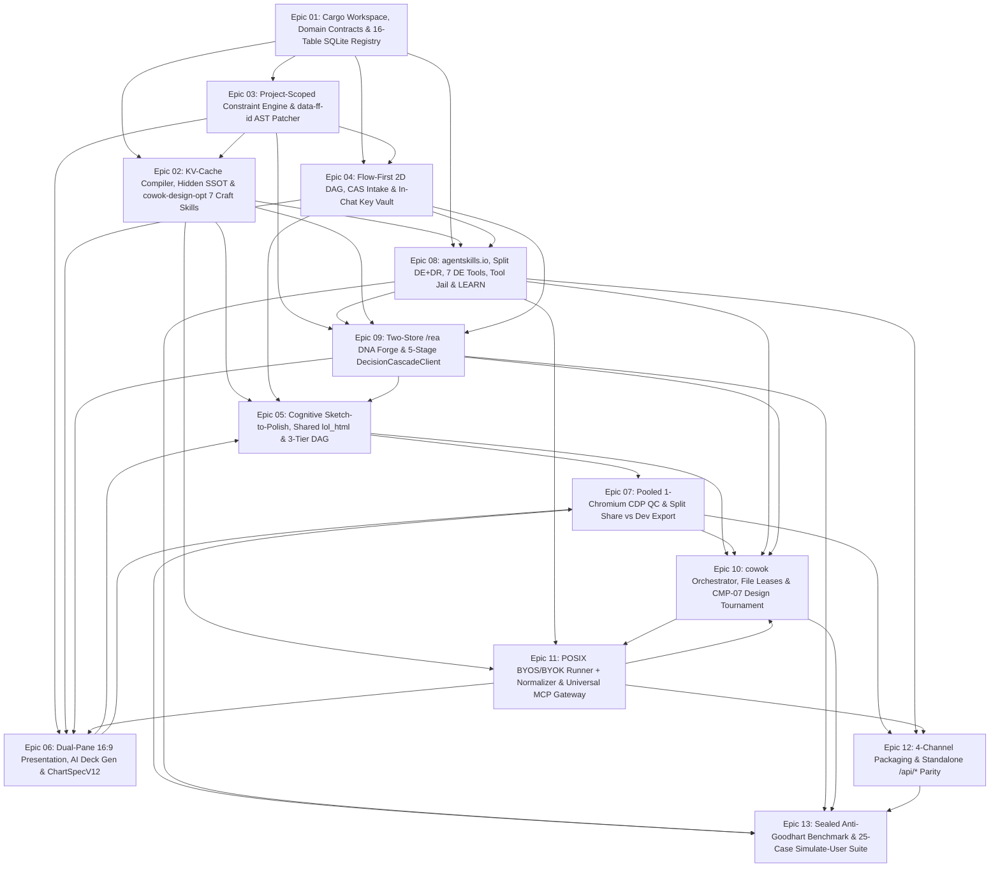

# 2.7. Cross-Dependencies & Integration Topology — UI/UX OS (FlowForge Harness OS)

## 1. Đồ thị Phụ thuộc Cấp Epic (Epic Dependency DAG: `Epic 01` $\to$ `Epic 13`)

- Epic 02 consumes Epic 01, Epic 03
- Epic 03 consumes Epic 01
- Epic 04 consumes Epic 01, Epic 03
- Epic 05 consumes Epic 02, Epic 04, Epic 06, Epic 09
- Epic 06 consumes Epic 03, Epic 04, Epic 09, Epic 11
- Epic 07 consumes Epic 05, Epic 06
- Epic 08 consumes Epic 01, Epic 02, Epic 04
- Epic 09 consumes Epic 02, Epic 03, Epic 04, Epic 08
- Epic 10 consumes Epic 04, Epic 05, Epic 07, Epic 08, Epic 09, Epic 11
- Epic 11 consumes Epic 02, Epic 04, Epic 08, Epic 10
- Epic 12 consumes Epic 07, Epic 08, Epic 11
- Epic 13 consumes Epic 07, Epic 08, Epic 09, Epic 10, Epic 12

---

## 2. Ma trận Cung cấp — Tiêu thụ (Provide / Consume SSOT Matrix)

| Nguồn cung cấp (Provider) | Sản phẩm đầu ra (Artifact / Contract) | Bên tiêu thụ (Consumer) | Cơ chế Kiểm chứng |
| :--- | :--- | :--- | :--- |
| **Epic 01 (`crates/domain`, `spec-registry`)** | SQLite WAL + `PROJECT_CONSTRAINTS` + TypeScript `.d.ts` (`ts-rs`) | **Epic 02, 03, 04, 08** | `cargo test --package domain` & khóa ngoại SQLite WAL (`01.1..01.3` completed). |
| **Epic 02 (`Story 02.1, 02.4`)** | KV-cache Prefix Compiler (`<=1,500` tok), Hidden SSOT `V16` `AppShell` Lock, `cowok-design-opt` + 7 Craft Skills + `<15ms` Router | **Epic 05, 08, 09, 11** | `0` budget overflows, `0` cross-portal leaks, `>= +25%` first-pass lib-audit lift. |
| **Epic 03 (`crates/constraint-engine`)** | `PROJECT_CONSTRAINTS` + `<1ms` `data-ff-id` (`03.1..03.3` completed) | **Epic 02, 04, 06, 09** | `oxc` AST scan `<1ms`, Flagship Preset 143 SVG icons. |
| **Epic 04 & 05** | `04.1..04.5` & `05.1..05.3` completed + `04.6` CAS/Vault + `05.4` `sketch-paper`/Shared `lol_html` + `05.5` `<=8` DAG | **Epic 06, 07, 10, 11** | `100%` secret intercept, `0` `STALE_MAPPING` cascades, `0` localStorage split-brain. |
| **Epic 06 & 07 (`presentation-cms`, `html-forge`)** | `06.1..06.4` PR #14 + `06.5` AI Deck/`ChartSpecV12` + `07.1` Pooled 1-Chromium CDP QC + `07.2` Split Export | **Epic 05, 10, 12, 13** | `<=2s` check, `<=1` Chromium, `0` offline 404, selectable vector PDF. |
| **Epic 08 (`crates/plugin-host`)** | `08.1..08.4` completed + `08.5` Split DE+DR, 7 Built-in DE Tools, `HUMAN_ONLY` Tool Jail & System-1 `LEARN` | **Epic 09, 10, 11, 12, 13** | Precision/Recall `>=95%`, FP `<=5%`, `100%` RCE/injection block. |
| **Epic 09 (`crates/rea-bridge`, `domain`, `bot-fleet`)** | Two-Store `/rea` (`09.1`), ~450 LOC Rust `DecisionCascadeClient` + 5-Stage Flow + `RubricShield` + 3-Strike (`09.2`) | **Epic 05, 06, 10, 13** | `100%` GPL clone block, `0%` float leak, `>=90%` swap consistency. |
| **Epic 10 & 11 (`bot-fleet`, `mcp-gateway`)** | `3-Lane Router`, MPSC Actor, `worker_file_leases`, `CMP-07` `Blind Wipe` + BYOS/BYOK Normalizer + 4-Tier MCP (`10.1..11.2`) | **Epic 06, 12, 13 & Hosts** | `0 SQLITE_BUSY`, `0` file collisions, `<=20s` first preview, `100%` 4-tier MCP auth. |
| **Epic 12 & 13 (`harness-daemon`, `tests/eval/sealed/`)** | Standalone `/api/*` parity, Tauri v2, Docker OCI (`12.1..12.3`) & Sealed Anti-Goodhart Benchmark + 25-Case E2E (`13.1`) | **Release Gate `M1..M5`** | `$0 <15s` PR CI, `>=22/25` Pass, `0` Blocked, `0` Gap, `100% SEALED_EVAL_TAMPER_ERROR`. |

<!-- BEGIN AUTO-GENERATED UCG -->
### Five-Nouns & Host-Slot Cross-Feature Dependencies (UCG Auto-Projected)

| Provider Feature / Story | Consumer Feature / Host Shell | Contract / Slot / API Boundary | Verification Gate |
| :--- | :--- | :--- | :--- |
<!-- END AUTO-GENERATED UCG -->
