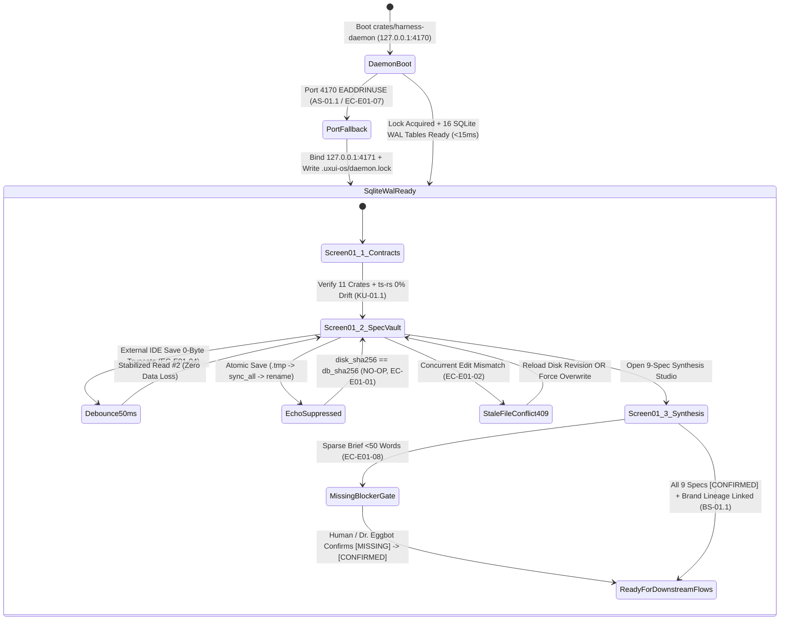

# Epic 01 UX Specification: 9-Spec Registry Vault, Domain Contract Inspector & Axum Daemon Control Plane

- **Interactive HTML Prototype:** [epic-prototype.html](file:///Users/hatrang20061988/Desktop/AI%20Project/uxui-os/_iwish-output/3.%20Development/1.%20Epic%20&%20Story/VS-01.%20Rust%20Core%20Harness,%209-Spec%20Registry%20&%20Project%20Constraint%20Engine/Epic-01/epic-prototype.html)
- **Layer FE Contract:** [layer-epic-fe.md](file:///Users/hatrang20061988/Desktop/AI%20Project/uxui-os/_iwish-output/3.%20Development/1.%20Epic%20&%20Story/VS-01.%20Rust%20Core%20Harness,%209-Spec%20Registry%20&%20Project%20Constraint%20Engine/Epic-01/layer-epic-fe.md)
- **Brand Tokens SSOT:** [tokens.css](file:///Users/hatrang20061988/Desktop/AI%20Project/uxui-os/Brand-guideline/cowok-brand-product-system-v4.3/foundations/css/tokens.css) (`warm`, `dim`, `night`, `night-low`)

---

## 1. Epic Screen Journey & State Machine

`Epic 01` hợp nhất 3 câu chuyện nền tảng (`Story 01.1`, `Story 01.2`, `Story 01.3`) thành một hành trình điều phối xuyên suốt trên **UI/UX OS Control Plane**: từ việc kiểm chứng hợp đồng kiểu dữ liệu Rust $\leftrightarrow$ TypeScript (`ts-rs`), đồng bộ 2 chiều nguyên tử giữa 16 bảng SQLite WAL và `product/specs/*.md`, đến tổng hợp tự động Bộ 9 Foundational Specs kèm gắn nhãn nguồn gốc (`[CONFIRMED]`, `[INFERRED]`, `[MISSING]`).

---

## 2. Master Screens & Stitch Assets

Thực thi quy tắc **Zero Hard Links** và **Mockup Consultation Rule**, dự án Stitch riêng cho **UI/UX OS (FlowForge Harness OS)** đã được khởi tạo và lưu trữ cấu hình động tại [stitch-project.json](file:///Users/hatrang20061988/Desktop/AI%20Project/uxui-os/stitch-project.json):

| Screen Title | Tool | Project ID | Design System ID | Screen Asset ID | Mapped Stories |
| :--- | :---: | :--- | :--- | :--- | :--- |
| **FlowForge Harness OS — Epic 01 Control Plane** | `Stitch` | `9168334019814804214` | `assets/8dea0cc19e8c48d193f6550232507a0f` | `projects/9168334019814804214/screens/223e92c3f6c64c72bfd928cc660710ae` | `Story 01.1`, `Story 01.2`, `Story 01.3` |

### Registered UX Patterns & Components Alignment (`2.11. component-registry.md` & `layer-epic-fe.md`)

| Registered Component / Pattern | Pattern ID | Usage in Epic 01 Master Screen & `epic-prototype.html` |
| :--- | :---: | :--- |
| **`<AppShell />`** | `CMP-02` / `[5.1]` | Khung làm việc 12 cột với thanh trạng thái Daemon (`127.0.0.1:4170`, `.uxui-os/daemon.lock`, `16/16 SQLite WAL Tables`) và bộ chuyển đổi 4 giao diện (`warm`, `dim`, `night`, `night-low`). |
| **`Metric Line`** | `[5.10]` | Dải 4 thẻ KPI trên cùng: (1) `9 Foundational Specs Vault`, (2) `Domain Type Sync (ts-rs)`, (3) `SQLite WAL & 2-Way Sync`, (4) `Cross-Project Brand Lineage`. |
| **`<SpecTreeExplorer />` + `DataTableView`** | `CMP-04` / `[5.21]` | Cây thư mục 9 Foundational Specs (`01-product-overview.md` .. `09-data-and-copy.md`) bên trái kết hợp bảng đối chiếu mã băm `SHA-256`, nguồn kế thừa và `SpecProvenanceBadge`. |
| **`StaleFileConflictBanner` (`Toast`)** | `[5.12]` | Thanh cảnh báo nổi bật khi xảy ra xung đột `HTTP 409 STALE_FILE` OCC giữa trình duyệt và IDE/Execution Bot, hiển thị song song `expected_sha256` vs `actual_sha256` kèm 2 nút `Reload Disk Revision` và `Force Overwrite`. |
| **`<CowokOrchestratorBar />` (`RightDrawer`)** | `CMP-13` / `[5.25]` | Ngăn phải hiển thị câu hỏi làm rõ từ **`advisor` (Dr. Eggbot)** cho các mục `[MISSING]`, bộ chọn kế thừa `inherit_brand_from_project_id`, và luồng log thời gian thực. |

---

## 3. Platform AI Consultation & Socratic Debate Report

- **Physical Evidence Files:**
  - UX Socratic Debate Report (`ux-agent`): [debate-ux-01.md](file:///Users/hatrang20061988/Desktop/AI%20Project/uxui-os/_iwish-output/adhoc-workspace/scratch/debate-ux-01.md)
  - Dev Socratic Debate Report (`dev-agent`): [debate-dev-01.md](file:///Users/hatrang20061988/Desktop/AI%20Project/uxui-os/_iwish-output/adhoc-workspace/scratch/debate-dev-01.md)

### 3.1. Tổng hợp Tư vấn từ Stitch Native AI
Khi gọi `generate_screen_from_text` trên Stitch MCP cho màn hình `223e92c3f6c64c72bfd928cc660710ae`, Native AI đã trả về hệ thống token nền giấy ấm (`#F7F5F0`), chữ mực xanh đậm (`#081E3A`), điểm nhấn Cobalt (`#4B7FFF`) và Amber (`#E89A35`), cùng 3 khuyến nghị luồng tương tác:
1. **`Inspect Domain Contracts (ts-rs)`**: Cho phép đối chiếu trực tiếp struct Rust và interface TypeScript ngay trên giao diện.
2. **`Review Axum Daemon Telemetry Logs`**: Hiển thị luồng sự kiện `notify` watcher và cổng hoạt động thực tế từ `.uxui-os/daemon.lock`.
3. **`Run Full Hash Verification Suite`**: Cung cấp nút kiểm tra nhanh tính toàn vẹn SHA-256 và trạng thái khóa OCC.

### 3.2. Kết quả Tranh biện Socratic giữa `ux-agent` và `dev-agent`

| Chủ đề Tranh biện | Quan điểm `ux-agent` | Quan điểm `dev-agent` | Quyết định Đồng thuận (`Consensus`) |
| :--- | :--- | :--- | :--- |
| **1. Tuân thủ `ADR-003` (Zero-Tailwind vs Stitch Raw HTML)** | Stitch mặc định sinh class Tailwind. Bản thân UI/UX OS Workbench và Flagship Preset phải dùng 100% Pure Vanilla CSS Custom Properties từ `tokens.css`. | Đồng ý tuyệt đối. Ngoài ra cần áp dụng nghiêm ngặt `<meta http-equiv="Content-Security-Policy">` chặn toàn bộ script ngoại vi để chống XSS/SSRF. | **CHẤP THUẬN (`MANDATORY`)**: Loại bỏ 100% Tailwind trong `epic-prototype.html`; nhúng trực tiếp biến màu 4 chế độ (`warm`, `dim`, `night`, `night-low`) từ `tokens.css` và CSP chuẩn Zero-Trust. |
| **2. Tách biệt 3 Màn hình theo Story vs. Màn hình đơn** | Nếu dồn cả 3 Story vào 1 màn hình tĩnh, người dùng sẽ bị rối mắt giữa bảng Rust Crates và trình soạn thảo Markdown. | Cần bộ chuyển đổi 3 màn hình (`Story 01.1`, `Story 01.2`, `Story 01.3`) kết hợp thanh công cụ giả lập 8 Edge Cases (`EC-E01-01..08`) để kiểm thử độc lập từng AC. | **CHẤP THUẬN (`ADOPTED`)**: Thiết kế thanh chuyển đổi 3 màn hình tương ứng 3 Story trong khi giữ cố định thanh KPI, cây 9 Specs bên trái và ngăn `cowok`/`advisor` bên phải. |
| **3. Trải nghiệm xử lý xung đột `409 STALE_FILE` & `0-Byte` IDE Save** | Người dùng non-tech không hiểu lỗi `409 OCC` hay hiện tượng IDE cắt file về `0 byte` trong `50ms`. Cần thông điệp ngôn ngữ tự nhiên rõ ràng. | Watcher giữ cửa sổ debounce `50ms` và hiển thị trạng thái chờ êm dịu (`badge-fs-debounce-state`); nếu lệch SHA-256 thật sự mới bật `StaleFileConflictBanner`. | **CHẤP THUẬN (`ADOPTED`)**: Bổ sung cả 2 trạng thái trực quan (`50ms Debounce Banner` màu Amber và `409 Conflict Banner` màu Crimson với nút `Reload Disk Revision` an toàn). |

---

## 4. Story-to-Screen Traceability Matrix

| Story ID | Tên Story | Màn hình trong `epic-prototype.html` | Các Component & Nút Giả lập `[EDGE-CASE]` (`data-ff-id`) |
| :--- | :--- | :--- | :--- |
| **[Story 01.1](file:///Users/hatrang20061988/Desktop/AI%20Project/uxui-os/_iwish-output/3.%20Development/1.%20Epic%20&%20Story/VS-01.%20Rust%20Core%20Harness,%209-Spec%20Registry%20&%20Project%20Constraint%20Engine/Epic-01/Story-01.1/story.md)** | Khởi tạo Hybrid Monorepo (11 Rust Crates + `pnpm`) & `crates/domain` Type Sync | **Screen 1** (`data-ff-id="screen-story-01-1"`) | `table-cargo-crates`, `btn-verify-ts-rs-parity`, `btn-ec-03-invalid-spec-key` (`EC-E01-03`), `btn-ec-06-unsafe-int64` (`KU-01.1`) |
| **[Story 01.2](file:///Users/hatrang20061988/Desktop/AI%20Project/uxui-os/_iwish-output/3.%20Development/1.%20Epic%20&%20Story/VS-01.%20Rust%20Core%20Harness,%209-Spec%20Registry%20&%20Project%20Constraint%20Engine/Epic-01/Story-01.2/story.md)** | Xây dựng `crates/spec-registry` với `rusqlite` SQLite WAL (16 Bảng) & 2-Way File Sync | **Screen 2** (`data-ff-id="screen-story-01-2"`) | `spec-markdown-editor`, `btn-save-spec-atomic`, `table-sqlite-16`, `banner-stale-file-conflict` (`EC-E01-02`), `badge-fs-debounce-state` (`EC-E01-04`), `btn-ec-01-echo-suppression` (`EC-E01-01`) |
| **[Story 01.3](file:///Users/hatrang20061988/Desktop/AI%20Project/uxui-os/_iwish-output/3.%20Development/1.%20Epic%20&%20Story/VS-01.%20Rust%20Core%20Harness,%209-Spec%20Registry%20&%20Project%20Constraint%20Engine/Epic-01/Story-01.3/story.md)** | Xây dựng `crates/harness-daemon` (Axum + Tokio) & 9-Spec Synthesis Pipeline | **Screen 3** (`data-ff-id="screen-story-01-3"`) | `select-inherit-brand-project` (`BS-01.1`), `input-product-brief`, `btn-run-9-spec-synthesis`, `table-9-specs-synthesis`, `btn-ec-07-port-fallback` (`AS-01.1`), `btn-ec-08-sparse-brief` (`EC-E01-08`), `btn-confirm-missing-specs` |

---

## 5. Living Spec Guidelines (`flow-stage-2a` Downstream Guidance)

1. **La bàn Thiết kế Tổng thể (`Holistic Compass`):** Tài liệu `epic-ux-spec.md` này và nguyên mẫu tương tác [epic-prototype.html](file:///Users/hatrang20061988/Desktop/AI%20Project/uxui-os/_iwish-output/3.%20Development/1.%20Epic%20&%20Story/VS-01.%20Rust%20Core%20Harness,%209-Spec%20Registry%20&%20Project%20Constraint%20Engine/Epic-01/epic-prototype.html) thiết lập kiến trúc bố cục 12 cột, bảng màu 4 chế độ (`tokens.css`), và chuẩn gắn thẻ `data-ff-id` cho toàn bộ `Epic 01`.
2. **Quyền Mở rộng Chi tiết ở Cấp Story (`Story-Level Elaboration`):** Khi đi vào bước thiết kế chi tiết `ui-spec.md` của từng Story (`Story 01.1`, `Story 01.2`, `Story 01.3`), các Agent được phép mở rộng thêm các hộp thoại phụ (như cửa sổ xem lịch sử phiên bản `SPEC_REVISIONS` hoặc bộ lọc chi tiết cho 16 bảng SQLite), miễn là giữ nguyên hệ thống biến CSS trong `tokens.css` và danh mục component đã đăng ký trong `2.11. component-registry.md`.
