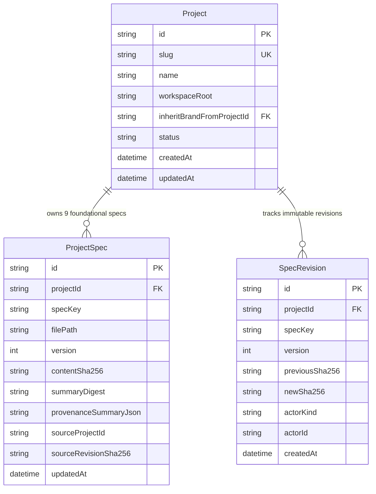

# Layer-Epic-DB: Epic 01: Cargo Workspace, Domain Contracts (ts-rs) & 16-Table SQLite Registry

## 1. Data Architecture & Scope Overview
`Epic-01` initializes the embedded `rusqlite` SQLite WAL database (`PRAGMA journal_mode = WAL; PRAGMA synchronous = NORMAL; PRAGMA busy_timeout = 5000; PRAGMA foreign_keys = ON;`) containing all **16 tables** across the 5 execution streams defined in `2.2. database-spec.md`. Within `Epic-01` (`Stream-1`: Core Project & 9-Spec Vault), `crates/spec-registry` directly owns and mutates `Project`, `ProjectSpec`, and `SpecRevision` (`PROJECTS`, `PROJECT_SPECS`, `SPEC_REVISIONS`), while provisioning the DDL schema for the remaining 13 downstream tables.

## 2. Entity Inventory & Classification

### 2.1 Owned Models (New & Schema Master for this Epic)
- **`Project`**: Root workspace project record (`PROJECTS` table) storing workspace path, active constraint profile, and optional cross-project brand inheritance pointer (`inherit_brand_from_project_id`).
- **`ProjectSpec`**: Canonical record for each of the 9 Foundational Project Context Specs (`PROJECT_SPECS` table: `01-product-overview` .. `09-data-and-copy`), storing `content_sha256` for `StaleFile` OCC, `summary_digest`, and `provenance_summary_json` (`CONFIRMED`/`INFERRED`/`MISSING` counts).
- **`SpecRevision`**: Immutable append-only revision ledger (`SPEC_REVISIONS` table) tracking every human or bot mutation with `previous_sha256`, `new_sha256`, `actor_id`, `source_project_id`, and `source_revision_sha256`.

### 2.2 Mutated Models (Cross-Epic Data Mutation)
- None (`Epic-01` is the root genesis epic with In-Degree `0`).

### 2.3 Read-Only Models (Cross-Epic Reference/Query Only)
- None declared.

## 3. Schema Definitions & Field Specifications

```prisma
// Canonical relational representation of Epic-01 owned tables in 2.2. database-spec.md
model Project {
  id                          String        @id @default(uuid())
  slug                        String        @unique
  name                        String
  workspaceRoot               String
  productBrief                String
  inheritBrandFromProjectId   String?
  status                      String        @default("ACTIVE")
  createdAt                   DateTime      @default(now())
  updatedAt                   DateTime      @updatedAt

  specs                       ProjectSpec[]
  revisions                   SpecRevision[]

  @@index([slug])
  @@index([inheritBrandFromProjectId])
}

model ProjectSpec {
  id                     String   @id @default(uuid())
  projectId              String
  specKey                String
  filePath               String
  version                Int      @default(1)
  contentSha256          String
  summaryDigest          String
  provenanceSummaryJson  String
  sourceProjectId        String?
  sourceRevisionSha256   String?
  createdAt              DateTime @default(now())
  updatedAt              DateTime @updatedAt

  project                Project  @relation(fields: [projectId], references: [id], onDelete: Cascade)

  @@unique([projectId, specKey])
  @@index([projectId, contentSha256])
}

model SpecRevision {
  id                   String   @id @default(uuid())
  projectId            String
  specKey              String
  version              Int
  previousSha256       String?
  newSha256            String
  actorKind            String
  actorId              String
  changeSummary        String
  sourceProjectId      String?
  sourceRevisionSha256 String?
  createdAt            DateTime @default(now())
  updatedAt            DateTime @updatedAt

  project              Project  @relation(fields: [projectId], references: [id], onDelete: Cascade)

  @@index([projectId, specKey, version])
}
```

## 4. Entity-Relationship Diagram



## 5. Data Migration, Seeding & Integrity Considerations
- **Migration Strategy**: Single atomic `refinery` migration `V1__initial_16_tables.sql` executing in `< 15ms` on cold start (`Story 01.2 AC-01`).
- **Concurrency & OCC Integrity**: Every `rusqlite` connection enforces `PRAGMA journal_mode = WAL; PRAGMA synchronous = NORMAL; PRAGMA busy_timeout = 5000; PRAGMA foreign_keys = ON;`. All updates to `ProjectSpec` require matching `expected_sha256 == content_sha256` (`StaleFile` OCC).
- **2-Way Disk Sync**: Hash-Gated Watcher Suppression (`disk_sha256 == db_sha256` $\rightarrow$ `NO-OP`) + `50ms` debounce on `0-byte` truncate events prevents IDE save races and echo loops.

## 6. Contract Claims Summary
- **OWNS**: [`Project`, `ProjectSpec`, `SpecRevision`]
- **READS**: []
- **MUTATES**: []
