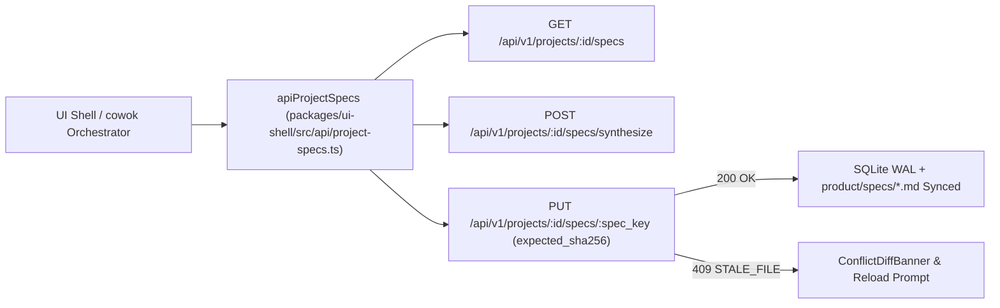
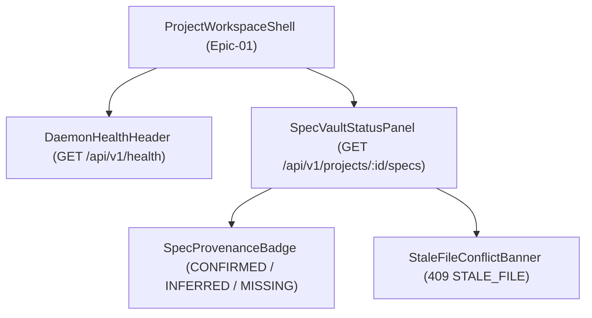

# Layer-Epic-FE: Epic 01: Cargo Workspace, Domain Contracts (ts-rs) & 16-Table SQLite Registry

## 1. UserFlow & Screen Journey
> **Architecture Note**: `Epic-01` is the Root Substrate Anchor (`KERNEL_CORE`) establishing the 11-crate Rust Workspace, `crates/domain` (`ts-rs` TypeScript bridge), `crates/spec-registry` (16-table SQLite WAL + 2-Way File Sync), and `crates/harness-daemon` (Loopback Axum HTTP/WS control plane). It defines the deterministic client-to-daemon interaction flow for reading, synthesizing, and updating the 9 Foundational Project Context Specs (`01-product-overview.md` .. `09-data-and-copy.md`).

## 2. Component Inventory Table
Enforces component reuse from `2.11. component-registry.md` and binds the TypeScript client SDK to `crates/harness-daemon` endpoints (`/api/v1/projects`, `/api/v1/projects/:id/specs`, `/api/v1/projects/:id/specs/synthesize`).

| Component Name | Type | Source | File Path / UX Pattern ID | Props / Contract | Reused From / Notes |
|----------------|------|--------|---------------------------|------------------|---------------------|
| `SpecVaultStatusPanel` | Feature | Registered Pattern | `packages/ui-shell/src/features/spec-vault/SpecVaultStatusPanel.tsx` | `{ projectId: string; specs: ProjectSpec[] }` | Consumes `GET /api/v1/projects/:id/specs` and `POST /api/v1/projects/:id/specs/synthesize` |
| `SpecProvenanceBadge` | UI | Registered Pattern | `packages/ui-shell/src/components/ui/SpecProvenanceBadge.tsx` | `{ status: 'CONFIRMED' \| 'INFERRED' \| 'MISSING' }` | Displays 9-Spec section provenance (`Story 01.1`, `Story 01.3`) |
| `StaleFileConflictBanner` | UI | Registered Pattern | `packages/ui-shell/src/components/ui/StaleFileConflictBanner.tsx` | `{ specKey: CanonicalSpecKey; expectedSha256: string; actualSha256: string }` | Handles `409 STALE_FILE` from `PUT /api/v1/projects/:id/specs/:spec_key` (`Story 01.2`) |

## 3. Registered UX Patterns & Component Layouts
Alignment with `2.3. ui-ux-spec.md` and `2.11. component-registry.md`:
- **Layout Grid**: 12-column workspace shell with collapsible 9-Spec Vault sidebar and sticky status bar showing daemon health (`GET /api/v1/health`).
- **Matched UX Pattern**: `Metric Line [5.10]` (Provenance summary counters: `CONFIRMED`, `INFERRED`, `MISSING`).
- **Matched UX Pattern**: `DataTableView [5.21]` (9 Foundational Specs list with SHA-256 revision badges and upstream brand lineage status).
- **Matched UX Pattern**: `Toast UI [5.12]` (Instant notification on `409 STALE_FILE` OCC conflict or `Upstream Brand Guideline Updated`).

## 4. Component Hierarchy & Wireflow
Structural tree showing parent-child composition for the 9-Spec Vault surface:

## 5. Host Integration Contract (8-Dimension Alignment)
- **Host Shell**: `packages/ui-shell` (React 19 + Vite) communicating with loopback `crates/harness-daemon` (`127.0.0.1:4170` or `.uxui-os/daemon.lock`).
- **Shared Types Package**: `@uxui-os/shared-types` generated deterministically via `ts-rs` from `crates/domain`.
- **Constraint Compliance**: Zero Tailwind utility classes in generated brand-strict artifacts (`ADR-003`), strict token-based CSS variables.
