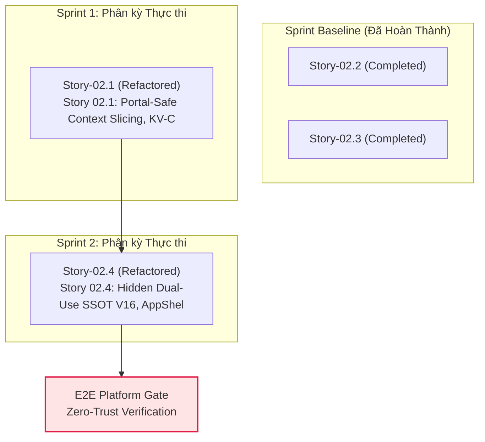

# Epic 02: JIT Prompt Assembler, KV-Cache Compiler, Hidden SSOT & `cowok-design-opt` 7 Craft Skills

## 1. Overview / Executive Summary
- **Value Stream:** `VS-01. Rust Core Harness, 9-Spec Registry & Project Constraint Engine`
- **Execution Stream:** `Stream-1` (Wave 1/2)
- **FR Covered:** `FR-14`, `FR-27`, `FR-32`
- **Provides:** Portal-Safe Context Slicer + KV-Cache Compiler (`02.1`), Hidden Dual-Use SSOT `V16` (`component_patterns`, `app_shell_locks`), `cowok-design-opt` Spine (`<=250 tok`), 7 Craft Skills 3 tầng & `<15ms` 3-Zone `CachePreservingSkillRouter` (`02.4`).
- **Consumes:** `Epic 01`, `Epic 03`.

## 2. Goals / Business Value
1. **Tiết kiệm Token & Giữ KV-Cache (`Story 02.1`):** Hợp nhất `02.1 + 02.2 + 02.3` thành một lát cắt 5 lớp (`Context Meter / CLI --inspect-prompt <-> /api/v1/context/assemble <-> TaskHorizonRouter + ContextSlicer >=60% SSOT/DOM <=350 tok outline + Static-Prefix/Dynamic-Tail Compiler <=1,500 text tok + max_image_tokens_per_turn + 3-Profile Adapter`), bảo đảm `0` tràn ngân sách và `0` rò rỉ chéo Portal.
2. **Kiến trúc Ẩn SSOT Dự án Dài & 7 Kỹ năng Nghiệp vụ Thiết kế (`Story 02.4`):** Hợp nhất Hidden Dual-Use SSOT `V16` (`AppShell`/Component Lock UI + Export `.cowok-design/exports/` + `packages/ui-shell`), xương sống vận hành `cowok-design-opt` (`<=250 tok`), **7 Craft Skills 3 tầng** (`typography`, `oklch-palette`, `stageshow-slide`, `dashboard-ux`, `impeccable-polish`, `sketch-monochrome`, `archify-diagram`), `<15ms` 3-Zone `CachePreservingSkillRouter` và `oxc` reverse sync (`confusion_risk < 0.35`, `>= +25%` first-pass `lib-audit` lift).

## 3. Scope / Scope Boundaries
- **In-Scope:**
  - `Story 02.1` (refactored — hợp nhất `02.2 + 02.3`): Portal-Safe Context Slicing, KV-Cache Static-Prefix Prompt Compiler & 3-Profile Live Execution.
  - `Story 02.4` (refactored / new slice): Hidden Dual-Use SSOT (`V16`), `AppShell` & Component Registry, `cowok-design-opt` Spine, 7 Craft Skills & 3-Zone Router.
  - `Story 02.2`, `Story 02.3`: `[DEPRECATED]` / `cancelled` (superseded by `Story 02.1`, giữ lịch sử audit).
- **Out-of-Scope:**
  - Built-in DE tools, Tool Jail & `LEARN` loop (thuộc `Story 08.5`).

## 4. Stories in Epic 02

| Story ID | Title | Status | Risk Tier | Dependencies |
| :--- | :--- | :---: | :---: | :--- |
| [Story-02.1](./Story-02.1/story.md) | Portal-Safe Context Slicing, KV-Cache Static-Prefix Prompt Compiler & 3-Profile Live Execution *(Consolidated)* | `refactored` | `2` | `['01.2', '01.3']` |
| [Story-02.4](./Story-02.4/story.md) | Hidden Dual-Use SSOT (`V16`), `AppShell` & Component Registry, `cowok-design-opt` Spine, 7 Craft Skills & 3-Zone Router | `refactored` | `3` | `['01.3', '02.1', '03.1']` |
| [Story-02.2](./Story-02.2/story.md) | *(Superseded by `Story 02.1`)* Token Budget Governor & Deterministic Prompt Compiler | `cancelled` | `2` | `['02.1']` |
| [Story-02.3](./Story-02.3/story.md) | *(Superseded by `Story 02.1`)* 3-Profile Model Capability Adapter | `cancelled` | `2` | `['02.2']` |

## 5. QA Simulator Guardian Scorecard (7-Row Hybrid Scorecard)

| Axis | Score | Notes |
| :--- | :---: | :--- |
| **1. Functional Correctness** | `9.5/10` | Phủ trọn `FR-14`, `FR-27`, `FR-32` theo lát cắt dọc 5 lớp |
| **2. Data Integrity & State** | `9.5/10` | SQLite `V16 component_patterns, app_shell_locks` & single lock owner |
| **3. Security & Validation** | `9.6/10` | Zero cross-portal leakage & AST `oxc` reverse sync |
| **4. Performance & Scalability** | `9.6/10` | KV-cache static prefix & `<15ms` 3-Zone `CachePreservingSkillRouter` |
| **5. Error Handling & Recovery** | `9.4/10` | Graceful image/text budget clamp & telemetry |
| **6. Architectural Depth & Leverage** | `9.5/10` | Dual-Use SSOT cho cả Human Export & Agent JIT |
| **7. UX Empathy** | `9.5/10` | `AppShell` Lock tự động giữ đồng bộ hàng chục màn hình cho non-tech |
| **TOTAL AVERAGE** | **9.51/10** | **PASSED (>= 8.5/10)** |

<!-- BEGIN AUTO-ROADMAP: DO NOT EDIT -->
## 3-Sprint Integrated Development Roadmap (Synchronized Phasing)

> **Mục tiêu**: Tự động hóa phân kỳ và phân bổ tuần tự/song song cho toàn bộ **2 Story Active** trên nền tảng **2 Story Baseline đã `completed`**, loại bỏ chu trình phụ thuộc (No Dependency Cycles) và tuân thủ giới hạn tải tối đa 3 Sprints.

---

### 1. Phân tích Hiện trạng & Chiến lược Phân kỳ Mới (Phasing Rationalization)

- **Baseline Nền tảng (2 Stories `completed` / `cancelled`)**: Đóng vai trò Enabler, cung cấp mock data, schemas và các dịch vụ tiền đề.
- **Phạm vi Active Delta (2 Stories)**: Được phân bổ thành 2 Sprint thực thi kế tiếp.
- **Khả năng Chạy Song Song (Parallel Execution Lanes)**:
  - **Sprint 1**: Tuần tự (Sequential) — `Story-02.1`
  - **Sprint 2**: Tuần tự (Sequential) — `Story-02.4`

---

### 2. Ma trận Cung cấp - Tiêu thụ (Provide-Consume Matrix) & Trạng thái Zod

| Story ID | Trạng thái Thực tế | Provides (Cung cấp) | Consumes (Tiêu thụ) | Zod Schema Status | Ghi chú & Rào chắn |
|---|---|---|---|:---:|---|
| **Story-02.1** | `refactored` | Cung cấp hợp đồng `POST /api/v1/context/assemble` và KV-cache Static-Prefix compiler cho `Story 02.4 | consumes_apis: | ⚠️ Chưa có (manual types) | Tuân thủ Zero-Trust Category A |
| **Story-02.2** | `cancelled` | Cung cấp năng lực của `Story 02.2` cho các Story phụ thuộc trong `Epic 02` và các làn sóng tiếp theo | consumes_apis: [] | ⚠️ Chưa có (manual types) | Tuân thủ Zero-Trust Category A |
| **Story-02.3** | `cancelled` | Cung cấp năng lực của `Story 02.3` cho các Story phụ thuộc trong `Epic 02` và các làn sóng tiếp theo | consumes_apis: [] | ⚠️ Chưa có (manual types) | Tuân thủ Zero-Trust Category A |
| **Story-02.4** | `refactored` | **AC-01 (`V16b` Hidden Dual-Use SSOT & `AppShell` Lock):** Tạo bảng `V16` (`migration slot V16b` tác | consumes_apis: | ⚠️ Chưa có (manual types) | Tuân thủ Zero-Trust Category A |

---

### 3. Sơ đồ Thực thi DAG 3 Sprint (Phased DAG Execution Roadmap)

---

### 4. Kế hoạch Chi tiết Từng Sprint (Execution Specifications)

#### Sprint 1: Phân kỳ Tác vụ
- **Mô hình**: Các câu chuyện được phát triển **tuần tự (Sequential)**.
- **Phạm vi thực thi**:
  1. **`Story-02.1`** (refactored): Story 02.1: Portal-Safe Context Slicing, KV-Cache Static-Prefix Prompt Compiler & 3-Profile Live Execution
- **Tiêu chí Hoàn thành (Sprint Done Criteria)**:
  - Toàn bộ Zod schemas và Unit tests cho các story trong sprint vượt qua 100%.
  - Kiểm thử tích hợp (Tracer Bullet) giữa các story song song không xảy ra tranh chấp dữ liệu (Race Condition).

#### Sprint 2: Phân kỳ Tác vụ
- **Mô hình**: Các câu chuyện được phát triển **tuần tự (Sequential)**.
- **Phạm vi thực thi**:
  1. **`Story-02.4`** (refactored): Story 02.4: Hidden Dual-Use SSOT (V16), AppShell & Component Registry, cowok-design-opt Spine, 7 Craft Skills & 3-Zone Router
- **Tiêu chí Hoàn thành (Sprint Done Criteria)**:
  - Toàn bộ Zod schemas và Unit tests cho các story trong sprint vượt qua 100%.
  - Kiểm thử tích hợp (Tracer Bullet) giữa các story song song không xảy ra tranh chấp dữ liệu (Race Condition).

<!-- END AUTO-ROADMAP -->