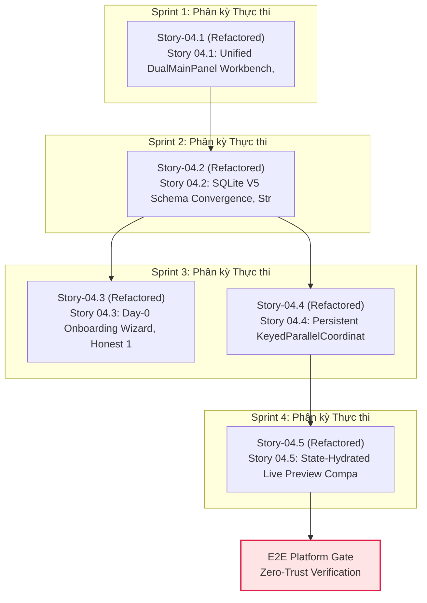

# Epic 04: Flow-First 2D SVG Bezier DAG Studio, Security Kernel, Onboarding Doctor & Persistent Node Execution

## 1. Overview / Executive Summary
- **Value Stream:** `VS-02. Flow-First Executable Design Workbench & SDI Engine`
- **Execution Stream:** `Stream-2` (Wave 2)
- **FR Covered:**
  - [FR-02: Interactive Multi-Portal Flow Graph (ScreenState & Transition)](file:///Users/hatrang20061988/Desktop/AI%20Project/uxui-os/_iwish-output/2.%20Product%20Planning/2.1.%20product-brief-or-prd.md)
  - [FR-03: State-Hydrated Live Preview & Multi-Viewport Switcher](file:///Users/hatrang20061988/Desktop/AI%20Project/uxui-os/_iwish-output/2.%20Product%20Planning/2.1.%20product-brief-or-prd.md)
  - [FR-06: Element-Anchored Comments & Stale Anchor Detection](file:///Users/hatrang20061988/Desktop/AI%20Project/uxui-os/_iwish-output/2.%20Product%20Planning/2.1.%20product-brief-or-prd.md)
- **Provides:** `Unified Host Shell & Macro Navigation Hub`, `True 2D SVG Bezier ScreenState + Transition DAG Studio`, `SQLite V5 Multi-Project SSOT & Streaming BFF`, `Day-0 CLI Doctor & SSRF-Guarded BYOK Vault`, `Persistent KeyedParallelCoordinator & SSE Last-Event-ID`, `State-Hydrated CompanionLiveHtmlRightPane & Element Comments (stale_mapping)`
- **Consumes:** `Epic 01` (Rust `crates/spec-registry` + `crates/harness-daemon` SQLite WAL Persistence), `Epic 03` (`data-ff-id` AST Injector & Patcher)

Epic 04 hiện thực hóa toàn bộ trải nghiệm thiết kế hướng luồng (`flowforge-design-spec/product`) trên kiến trúc **Core Kernel + Extension Plugin (`HYBRID_CORE_PLUS_EXTENSION`)**: đồ thị 2D SVG Cubic Bezier DAG `DagCanvas2D` (`crates/flow-graph` + SQLite `V3`/`V5`), lớp bảo mật & SSOT `V5__epic04_complete_contracts.sql` (`CURRENT_SCHEMA_VERSION = 5`) kèm `vite-bff-plugin.ts` streaming SSE pass-through, quy trình Day-0 Onboarding Wizard `<60s` tự động dò `16+` Local Coding CLIs (`installed` vs `authenticated`) với OS Keychain/`0o600` encrypted vault & SSRF-guarded BYOK verifier, bộ điều phối thực thi đa node `KeyedParallelCoordinator` có `fencing_token` + `5s` lease heartbeat + `Last-Event-ID` cursor replay, và khung xem trước cô lập `Option CSP-B` trong `CompanionLiveHtmlRightPane.tsx` tích hợp `3-Way Spatial Feedback` gắn neo `data-ff-id` (`stale_mapping`).

## 2. Goals / Business Value
1. **Trực quan hóa Hành trình Trải nghiệm (Flow-First Paradigm):** Thay thế danh sách màn hình rời rạc bằng sơ đồ luồng Native 2D SVG Cubic Bezier (`DagCanvas2D`) đồng bộ tức thì với `crates/spec-registry` SQLite WAL.
2. **Bảo mật & Toàn vẹn Nền tảng (Zero-Trust Core & SSRF/Vault Hardening):** Đóng dứt điểm lỗ hổng xác thực `legacy_specs.rs`, loại bỏ 100% `new Map()` trong BFF, thay `showDirectoryPicker` mù đường dẫn bằng Daemon FS Browser jail, và bảo vệ BYOK bằng OS Keychain / Argon2id+AES-256-GCM `.cowok-design/vault.enc` + SSRF guard.
3. **Điều phối Thực thi Song song Bền vững (KeyedParallelCoordinator + SSE Replay):** Tách biệt hoàn toàn hàng đợi theo khóa `${projectId}::${sessionId}::${nodeId}`, chống ghi đè bằng `fencing_token` CAS và tái phát sự kiện SSE không mất gói qua `Last-Event-ID`.
4. **Xem trước Cô lập & Phản hồi Định vị Chính xác (`Option CSP-B` + `stale_mapping`):** Nạp HTML runtime vào `<iframe sandbox="allow-scripts allow-forms">` (tuyệt đối cấm `allow-same-origin`) trong `CompanionLiveHtmlRightPane.tsx` kèm `MessageChannel` epoch/SHA-256 verification và bất biến `CommitAllowed` (`409 STALE_MAPPING`).

## 3. Scope / Scope Boundaries

### In-Scope
- **Story 04.1 (`CORE`):** `WorkbenchShell`, `DualMainPanel`, `40px` `Shorten Chat` rail (`PD-02 = A`), `MainSidebar` `28x28px`, 4 themes + Reactive i18n, `<BrandIcon />` (143 SVGs), `CompanionCanvasTab` + `DagCanvas2D` (Native 2D SVG Bezier, Cluster Frames, layout vs draft separation, `.dag-right-vertical-dock`, `V3` schema), plus P0 security & tech-debt remediation (`legacy_specs.rs#L527-L553` `daemon_auth`, giải thể `src/features/preview/*` trùng lặp, khử raw hex `#f59e0b`/`#4ade80`/`#f87171` và raw `fetch()` sang `src/api/`).
- **Story 04.2 (`CORE`):** Migration `V5__epic04_complete_contracts.sql` (`PRAGMA table_info` vá V2->V4 `chat_sessions.archived_at` + `tenant_id`, thêm `agent_settings`, `mcp_servers`, `storyboards`, `node_chat_sessions`, `element_comments`, `screen_fixtures`, `execution_events`, bump `CURRENT_SCHEMA_VERSION = 5`), xóa 100% `new Map()` trong `src/app/api/**`, nâng cấp `vite-bff-plugin.ts#sendWebResponse` streaming `Readable` SSE pass-through, Multi-Project CRUD + Trash Journal, Daemon-Assisted FS Folder Picker (`is_system_or_root_path` jail + `PathTokenResponse`).
- **Story 04.3 (`HYBRID / EXTENSION_PLUGIN`):** Day-0 Onboarding Wizard `<60s` (`execFile` zero shell `<=1500ms` dò 16+ CLIs phân tách **`installed` vs `authenticated`**, MCP fallback), Live BYOK Verifier `<3s` có SSRF guard + redaction (thay stub `/api/doctor` trong `SettingsGeneralModelsPane`), OS Keychain / `0o600` `.cowok-design/vault.enc` -> explicit `COWOK_VAULT_MODE=ephemeral` (cấm tuyệt đối secrets/flags trong `localStorage`), tự động gắn `X-Cowok-Session-Token` qua `src/api/`.
- **Story 04.4 (`HYBRID / CORE_COORDINATOR`):** SQLite V5 `node_execution_jobs` `KeyedParallelCoordinator` (CAS `fencing_token`, sửa pause slot leak `running + paused <= maxConcurrent`, `5s` lease heartbeat + Startup `daemon_nonce` orphan reaper, `Continue vs Steer`, xóa `setTimeout(..., 600)` giả), `/api/v1/events` SSE `execution_events(seq)` + `Last-Event-ID`, Multi-Node Floating Chat v2 (`360x480..900x850` + Pill `42px`), `MainSidebar` 3-Level Virtual Sub-Sessions + On-DAG Queue HUD.
- **Story 04.5 (`CORE`):** Hợp nhất Live Preview vào `CompanionLiveHtmlRightPane.tsx` (`sandbox="allow-scripts allow-forms"`, responsive `desktop-1440`/`tablet-768`/`mobile-390`, `Auto/16:9/16:10`, Present, Inline `</>` Editor khóa dirty buffer, 4 Sub-States `Default/Loading/Empty/Error`), `Option CSP-B` `MessageChannel` (`epoch` + `artifactSha256` + `domAnchorHash`), 3-Way Spatial Feedback vào `#chatAttachmentTray` + V5 `element_comments` CAS `CommitAllowed` (`409 STALE_MAPPING`), thanh tẩy 100% Tailwind trong `src/features/comments/**` & nối `src/api/`.

### Out-of-Scope
- Phân tích `DesignIntentV1`, Option 5 Vertical Storyboard, Sample Data Studio & Gap-Driven Discovery (thuộc phạm vi `Epic 05`).
- Kiểm duyệt `ChangeProposal` Diff Gate (`cowok-design-diff`) và GitHub PR thật (thuộc phạm vi `Epic 05`).
- Trình chiếu Slide 16:9 Dual-Pane CMS & Headless WCAG 17-Rule Linter (thuộc phạm vi `Epic 06`, `Epic 07`).

## 4. Stories in Epic 04

| Story ID | Title | Status | Risk Tier | Dependencies |
| :--- | :--- | :---: | :---: | :--- |
| **Story 04.1** | Unified DualMainPanel Workbench, Multi-Format CompanionCanvasTab, True 2D SVG Bezier DAG Studio & HMAC/Preview Remediation | `refactored` | `3` | `['01.3', '03.2']` |
| **Story 04.2** | SQLite V5 Schema Convergence, Streaming Dual-Ingress Vite BFF & Fail-Closed FS Folder Picker | `refactored` | `3` | `['04.1']` |
| **Story 04.3** | Day-0 Onboarding Wizard, Honest 16+ CLI Doctor (Extension), OS Keychain/0600 Vault & SSRF-Guarded BYOK Verifier | `refactored` | `3` | `['04.2']` |
| **Story 04.4** | Persistent KeyedParallelCoordinator, Monotonic Fencing, SSE Last-Event-ID, Multi-Node Chat v2 & 3-Level Sidebar | `refactored` | `3` | `['04.2']` |
| **Story 04.5** | State-Hydrated Live Preview (CompanionLiveHtmlRightPane), Option CSP-B Bridge & Persistent Element Comments (stale_mapping) | `refactored` | `3` | `['04.4', '03.3']` |

## 5. QA Simulator Guardian Scorecard (7-Row Hybrid Scorecard)

| Axis | Score | Notes |
| :--- | :---: | :--- |
| **1. Functional Correctness** | `9.6/10` | Đáp ứng trọn vẹn `FR-02`, `FR-03`, `FR-06` cùng toàn bộ Onboarding Doctor, Keyed Parallel Coordinator & Option CSP-B |
| **2. Data Integrity & State** | `9.6/10` | SQLite `V3` + `V5` single-writer MPSC WAL, `fencing_token` CAS, `execution_events(seq)` và `CommitAllowed` invariant |
| **3. Security & Validation** | `9.7/10` | Đóng lỗ hổng HMAC `legacy_specs.rs`, `execFile` allowlist, SSRF guard, `0o600` vault & `allow-scripts allow-forms` zero same-origin |
| **4. Performance & Scalability** | `9.5/10` | Native SVG `DagCanvas2D` 60fps không overhead ReactFlow, SSE streaming `Readable` pass-through & keyed FIFO queue |
| **5. Error Handling & Recovery** | `9.5/10` | `5s` lease heartbeat, `daemon_nonce` orphan reaper, `Last-Event-ID` replay và `409 STALE_MAPPING` re-anchor |
| **6. Architectural Depth & Leverage** | `9.6/10` | Phân tách rạch ròi `KERNEL_CORE`, `EXTENSION_PLUGIN` (CLI Doctor), `src/api/` canonical SDK & `CompanionLiveHtmlRightPane` SSOT |
| **7. UX Empathy** | `9.6/10` | Day-0 Wizard `<60s` trung thực trạng thái auth, 40px Shorten Rail, Floating Chat `42px` Pill & 3-Way Spatial Feedback |
| **TOTAL AVERAGE** | **9.59/10** | **PASSED (>= 8.5/10)** |

### Architectural DNA Check
- [x] **Tracer Bullet?** Yes
- [x] **Deletion Testable?** Yes
- [x] **Interface vs Implementation?** Yes

<!-- BEGIN AUTO-ROADMAP: DO NOT EDIT -->
## 4-Sprint Integrated Development Roadmap (Synchronized Phasing)

> **Mục tiêu**: Tự động hóa phân kỳ và phân bổ tuần tự/song song cho toàn bộ **5 Story Active** trên nền tảng **0 Story Baseline đã `completed`**, loại bỏ chu trình phụ thuộc (No Dependency Cycles) và tuân thủ giới hạn tải tối đa 4 Sprints.

---

### 1. Phân tích Hiện trạng & Chiến lược Phân kỳ Mới (Phasing Rationalization)

- **Baseline Nền tảng (0 Stories `completed` / `cancelled`)**: Đóng vai trò Enabler, cung cấp mock data, schemas và các dịch vụ tiền đề.
- **Phạm vi Active Delta (5 Stories)**: Được phân bổ thành 4 Sprint thực thi kế tiếp.
- **Khả năng Chạy Song Song (Parallel Execution Lanes)**:
  - **Sprint 1**: Tuần tự (Sequential) — `Story-04.1`
  - **Sprint 2**: Tuần tự (Sequential) — `Story-04.2`
  - **Sprint 3**: Song song (Parallel) — `Story-04.3`, `Story-04.4`
  - **Sprint 4**: Tuần tự (Sequential) — `Story-04.5`

---

### 2. Ma trận Cung cấp - Tiêu thụ (Provide-Consume Matrix) & Trạng thái Zod

| Story ID | Trạng thái Thực tế | Provides (Cung cấp) | Consumes (Tiêu thụ) | Zod Schema Status | Ghi chú & Rào chắn |
|---|---|---|---|:---:|---|
| **Story-04.1** | `refactored` | Cung cấp vỏ Workbench chuẩn (`MainSidebar`, `DualMainPanel`, `CompanionCanvasTab`, `CompanionLiveHtm | consumes_apis: | ⚠️ Chưa có (manual types) | Tuân thủ Zero-Trust Category A |
| **Story-04.2** | `refactored` | Cung cấp tầng lưu trữ SQLite `V5`, Dual-Ingress Streaming BFF và Multi-Project Workspace/FS Boundary | consumes_apis: | ⚠️ Chưa có (manual types) | Tuân thủ Zero-Trust Category A |
| **Story-04.3** | `refactored` | **AC-01 (Day-0 First-Run Onboarding Wizard `<60s` & Honest 16+ Local CLI Doctor via `execFile`):** C | consumes_apis: | ⚠️ Chưa có (manual types) | Tuân thủ Zero-Trust Category A |
| **Story-04.4** | `refactored` | Cung cấp hạ tầng chạy song song đa màn hình không chồng chéo và dòng SSE bền vững cho `Story 04.5`,  | description: "Triển khai động cơ điều phối thực thi song song bền vững và hệ thống Chat đa màn hình  | ⚠️ Chưa có (manual types) | Tuân thủ Zero-Trust Category A |
| **Story-04.5** | `refactored` | 1. **Một bề mặt Preview duy nhất (`CompanionLiveHtmlRightPane.tsx`):** Không duy trì 2 bộ iframe son | consumes_apis: | ⚠️ Chưa có (manual types) | Tuân thủ Zero-Trust Category A |

---

### 3. Sơ đồ Thực thi DAG 4 Sprint (Phased DAG Execution Roadmap)

---

### 4. Kế hoạch Chi tiết Từng Sprint (Execution Specifications)

#### Sprint 1: Phân kỳ Tác vụ
- **Mô hình**: Các câu chuyện được phát triển **tuần tự (Sequential)**.
- **Phạm vi thực thi**:
  1. **`Story-04.1`** (refactored): Story 04.1: Unified DualMainPanel Workbench, Multi-Format CompanionCanvasTab, True 2D SVG Bezier DAG Studio & HMAC/Preview Remediation
- **Tiêu chí Hoàn thành (Sprint Done Criteria)**:
  - Toàn bộ Zod schemas và Unit tests cho các story trong sprint vượt qua 100%.
  - Kiểm thử tích hợp (Tracer Bullet) giữa các story song song không xảy ra tranh chấp dữ liệu (Race Condition).

#### Sprint 2: Phân kỳ Tác vụ
- **Mô hình**: Các câu chuyện được phát triển **tuần tự (Sequential)**.
- **Phạm vi thực thi**:
  1. **`Story-04.2`** (refactored): Story 04.2: SQLite V5 Schema Convergence, Streaming Dual-Ingress Vite BFF & Fail-Closed FS Folder Picker
- **Tiêu chí Hoàn thành (Sprint Done Criteria)**:
  - Toàn bộ Zod schemas và Unit tests cho các story trong sprint vượt qua 100%.
  - Kiểm thử tích hợp (Tracer Bullet) giữa các story song song không xảy ra tranh chấp dữ liệu (Race Condition).

#### Sprint 3: Phân kỳ Tác vụ
- **Mô hình**: Các câu chuyện trong Sprint này độc lập với nhau, có thể **phát triển song song (Parallel)**.
- **Phạm vi thực thi**:
  1. **`Story-04.3`** (refactored): Story 04.3: Day-0 Onboarding Wizard, Honest 16+ CLI Doctor (Extension), OS Keychain/0600 Vault & SSRF-Guarded BYOK Verifier
  2. **`Story-04.4`** (refactored): Story 04.4: Persistent KeyedParallelCoordinator, Monotonic Fencing, SSE Last-Event-ID, Multi-Node Chat v2 & 3-Level Sidebar
- **Tiêu chí Hoàn thành (Sprint Done Criteria)**:
  - Toàn bộ Zod schemas và Unit tests cho các story trong sprint vượt qua 100%.
  - Kiểm thử tích hợp (Tracer Bullet) giữa các story song song không xảy ra tranh chấp dữ liệu (Race Condition).

#### Sprint 4: Phân kỳ Tác vụ
- **Mô hình**: Các câu chuyện được phát triển **tuần tự (Sequential)**.
- **Phạm vi thực thi**:
  1. **`Story-04.5`** (refactored): Story 04.5: State-Hydrated Live Preview (CompanionLiveHtmlRightPane), Option CSP-B Epoch/Hash Bridge & Persistent Element Comments (stale_mapping)
- **Tiêu chí Hoàn thành (Sprint Done Criteria)**:
  - Toàn bộ Zod schemas và Unit tests cho các story trong sprint vượt qua 100%.
  - Kiểm thử tích hợp (Tracer Bullet) giữa các story song song không xảy ra tranh chấp dữ liệu (Race Condition).

<!-- END AUTO-ROADMAP -->

| Story ID | Title | Dependencies | Status |
|---|---|---|---|
| [Story-04.1](./Story-04.1/story.md) | Unified DualMainPanel Workbench, Multi-Format CompanionCanvasTab, True 2D SVG Bezier DAG Studio & HMAC/Preview Remediation | 01.3, 03.2 | refactored |
| [Story-04.2](./Story-04.2/story.md) | SQLite V5 Schema Convergence, Streaming Dual-Ingress Vite BFF & Fail-Closed FS Folder Picker | 04.1 | refactored |
| [Story-04.3](./Story-04.3/story.md) | Day-0 Onboarding Wizard, Honest 16+ CLI Doctor (Extension), OS Keychain/0600 Vault & SSRF-Guarded BYOK Verifier | 04.2 | refactored |
| [Story-04.4](./Story-04.4/story.md) | Persistent KeyedParallelCoordinator, Monotonic Fencing, SSE Last-Event-ID, Multi-Node Chat v2 & 3-Level Sidebar | 04.2 | refactored |
| [Story-04.5](./Story-04.5/story.md) | State-Hydrated Live Preview (CompanionLiveHtmlRightPane), Option CSP-B Epoch/Hash Bridge & Persistent Element Comments (stale_mapping) | 04.4, 03.3 | refactored |

## Layer Documents
- [Layer-Epic-FE](./layer-epic-fe.md)
- [Layer-Epic-DB](./layer-epic-db.md)
- [Layer-Epic-API](./layer-epic-api.md)
- [Contract Claims](./contract_claims.yaml)

| Story ID | Title | Dependencies | Status |
|---|---|---|---|
| [Story-04.1](./Story-04.1/story.md) | Unified DualMainPanel Workbench, Multi-Format CompanionCanvasTab, True 2D SVG Bezier DAG Studio & HMAC/Preview Remediation | 01.3, 03.2 | refactored |
| [Story-04.2](./Story-04.2/story.md) | SQLite V5 Schema Convergence, Streaming Dual-Ingress Vite BFF & Fail-Closed FS Folder Picker | 04.1 | refactored |
| [Story-04.3](./Story-04.3/story.md) | Day-0 Onboarding Wizard, Honest 16+ CLI Doctor (Extension), OS Keychain/0600 Vault & SSRF-Guarded BYOK Verifier | 04.2 | refactored |
| [Story-04.4](./Story-04.4/story.md) | Persistent KeyedParallelCoordinator, Monotonic Fencing, SSE Last-Event-ID, Multi-Node Chat v2 & 3-Level Sidebar | 04.2 | refactored |
| [Story-04.5](./Story-04.5/story.md) | State-Hydrated Live Preview (CompanionLiveHtmlRightPane), Option CSP-B Epoch/Hash Bridge & Persistent Element Comments (stale_mapping) | 04.4, 03.3 | refactored |
| Story ID | Title | Dependencies | Status |
|---|---|---|---|
| [Story-04.1](./Story-04.1/story.md) | Unified DualMainPanel Workbench, Multi-Format CompanionCanvasTab, True 2D SVG Bezier DAG Studio & HMAC/Preview Remediation | 01.3, 03.2 | refactored |
| [Story-04.2](./Story-04.2/story.md) | SQLite V5 Schema Convergence, Streaming Dual-Ingress Vite BFF & Fail-Closed FS Folder Picker | 04.1 | refactored |
| [Story-04.3](./Story-04.3/story.md) | Day-0 Onboarding Wizard, Honest 16+ CLI Doctor (Extension), OS Keychain/0600 Vault & SSRF-Guarded BYOK Verifier | 04.2 | refactored |
| [Story-04.4](./Story-04.4/story.md) | Persistent KeyedParallelCoordinator, Monotonic Fencing, SSE Last-Event-ID, Multi-Node Chat v2 & 3-Level Sidebar | 04.2 | refactored |
| [Story-04.5](./Story-04.5/story.md) | State-Hydrated Live Preview (CompanionLiveHtmlRightPane), Option CSP-B Epoch/Hash Bridge & Persistent Element Comments (stale_mapping) | 04.4, 03.3 | refactored |
| Story ID | Title | Dependencies | Status |
|---|---|---|---|
| [Story-04.1](./Story-04.1/story.md) | Unified DualMainPanel Workbench, Multi-Format CompanionCanvasTab, True 2D SVG Bezier DAG Studio & HMAC/Preview Remediation | 01.3, 03.2 | refactored |
| [Story-04.2](./Story-04.2/story.md) | SQLite V5 Schema Convergence, Streaming Dual-Ingress Vite BFF & Fail-Closed FS Folder Picker | 04.1 | refactored |
| [Story-04.3](./Story-04.3/story.md) | Day-0 Onboarding Wizard, Honest 16+ CLI Doctor (Extension), OS Keychain/0600 Vault & SSRF-Guarded BYOK Verifier | 04.2 | refactored |
| [Story-04.4](./Story-04.4/story.md) | Persistent KeyedParallelCoordinator, Monotonic Fencing, SSE Last-Event-ID, Multi-Node Chat v2 & 3-Level Sidebar | 04.2 | refactored |
| [Story-04.5](./Story-04.5/story.md) | State-Hydrated Live Preview (CompanionLiveHtmlRightPane), Option CSP-B Epoch/Hash Bridge & Persistent Element Comments (stale_mapping) | 04.4, 03.3 | refactored |