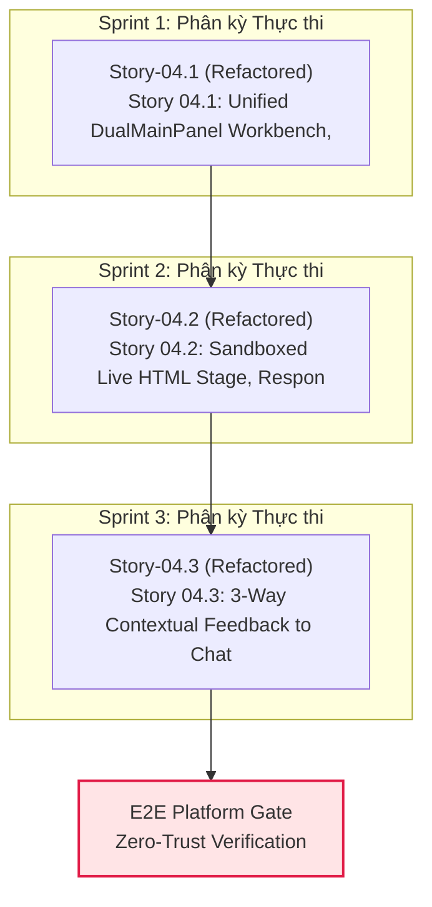

# Epic 04: Flow-First 2D SVG Bezier DAG Studio, State-Hydrated Preview & Element-Anchored Comments

## 1. Overview / Executive Summary
- **Value Stream:** `VS-02. Flow-First Executable Design Workbench & SDI Engine`
- **Execution Stream:** `Stream-2` (Wave 2)
- **FR Covered:**
  - [FR-02: Interactive Multi-Portal Flow Graph (ScreenState & Transition)](file:///Users/hatrang20061988/Desktop/AI%20Project/uxui-os/_iwish-output/2.%20Product%20Planning/2.1.%20product-brief-or-prd.md)
  - [FR-03: State-Hydrated Live Preview & Multi-Viewport Switcher](file:///Users/hatrang20061988/Desktop/AI%20Project/uxui-os/_iwish-output/2.%20Product%20Planning/2.1.%20product-brief-or-prd.md)
  - [FR-06: Element-Anchored Comments & Stale Anchor Detection](file:///Users/hatrang20061988/Desktop/AI%20Project/uxui-os/_iwish-output/2.%20Product%20Planning/2.1.%20product-brief-or-prd.md)
- **Provides:** `True 2D SVG Bezier ScreenState + Transition DAG Studio`, `State-Hydrated Iframe Preview`, `Element-Anchored Comments with stale_mapping`
- **Consumes:** `Epic 01` (Rust `crates/spec-registry` + `crates/harness-daemon` SQLite WAL Persistence), `Epic 03` (`data-ff-id` AST Injector & Patcher)

Epic 04 hiện thực hóa toàn bộ trải nghiệm thiết kế hướng luồng từ đặc tả `flowforge-design-spec/product`: đồ thị luồng tương tác `ScreenState` (`route + fixtureRef + viewport + nodeType`) kết hợp `Transition` trên nền **True 2D SVG Cubic Bezier DAG (`DagCanvas2D`)**, khung xem trước nạp dữ liệu trạng thái thực tế (`Default`, `Empty`, `Loading`, `Error`) trong `<iframe sandbox="allow-scripts allow-forms">` đa kích thước (`1440px` Desktop, `768px` Tablet, `390px` Mobile), và cơ chế ghim bình luận trực tiếp lên phần tử giao diện (`data-ff-id`) kèm phát hiện lệch neo tự động (`stale_mapping`).

## 2. Goals / Business Value
1. **Trực quan hóa Hành trình Trải nghiệm (Flow-First Paradigm):** Thay thế danh sách màn hình rời rạc bằng sơ đồ luồng tương tác trực quan; mỗi nút là một `ScreenState` gắn chặt với route thực tế, fixture dữ liệu và viewport hiển thị, mỗi cạnh là một `Transition` có điều kiện kích hoạt.
2. **Xem trước Tương tác Chân thực (Runtime Realism):** Loại bỏ mockup tĩnh vô hồn bằng cách nạp trực tiếp runtime React 19 vào `iframe` sandbox được cách ly an toàn, hỗ trợ chuyển đổi tức thì giữa các trạng thái dữ liệu biên (`Loading`, `Empty`, `Error`, `Default`).
3. **Cộng tác & Phản hồi Chính xác Tuyệt đối (Element-Anchored Precision):** Cho phép các bên liên quan (Product, Design, Dev, Client) click chọn phần tử giao diện bất kỳ để ghim bình luận góp ý dựa trên định danh `data-ff-id` từ `crates/constraint-engine`, loại bỏ hoàn toàn sự mơ hồ khi mô tả vị trí lỗi.
4. **Kháng Lệch Neo Tự Động (Stale Anchor Resilience):** Khi mã nguồn hoặc AST phần tử bị sửa đổi, hệ thống tự động đối chiếu checksum và cấu trúc lân cận để gắn cờ `stale_mapping`, giúp người dùng nhận diện ngay các bình luận cần tái định vị mà không làm mất lịch sử trao đổi.

## 3. Scope / Scope Boundaries

### In-Scope
- **Giao diện Unified Host Shell & Macro Navigation Hub (`apps/web` / UI Workbench):**
  - Khung làm việc Master với MainSidebar 3 phân vùng (Pinned, Projects, Conversations), đồng bộ nút thu gọn/mở rộng `28x28px`, và Settings Modal 4 tab (`General`, `Models & BYOS`, `MCP & Plugins`, `Automations`).
  - Hệ thống đa ngôn ngữ phản ứng (Reactive i18n Store) chuyển đổi tức thì không tải lại trang; bộ chọn Theme 4 chế độ chuẩn (`Warm Paper`, `Focus Dim`, `Night Workspace`, `Monochrome Minimal`), và component `<BrandIcon />` (143 SVGs).
  - Khung vẽ tương tác `@xyflow/react` v12 / 2D SVG Bezier DAG hỗ trợ zoom/pan, custom `ScreenStateNode` và `TransitionEdge` thể hiện luồng liên cổng (Multi-Portal).
- **State-Hydrated Sandboxed Live Preview:**
  - Khung nhúng `iframe` bảo mật với giao thức truyền thông điệp hai chiều `postMessage` RPC.
  - Bộ chuyển đổi kích thước khung nhìn 3 mức chuẩn (`1440px` Desktop, `768px` Tablet, `390px` Mobile).
  - Thanh chọn Fixture trạng thái dữ liệu (`Default`, `Empty`, `Loading`, `Error`) nạp động vào preview.
- **Element-Anchored Comments & Stale Anchor Detection:**
  - Chế độ "Click-to-Comment" bắt sự kiện hover/click trên các phần tử có gắn `data-ff-id`.
  - Bảng bình luận nổi (Comment Overlay / Drawer) lưu vết tọa độ tương đối, nội dung góp ý, tác giả và trạng thái.
  - Thuật toán phát hiện lệch neo (`stale_mapping`): tính toán mã băm DOM/text lân cận và đánh dấu `anchorStatus: "stale"` khi phần tử đích biến mất hoặc thay đổi đáng kể.

### Out-of-Scope
- Phân tích yêu cầu tự nhiên thành `Structured Design Intent (SDI)` và hiển thị 2–3 phương án biến thể trực quan (thuộc phạm vi `Epic 05`).
- Kiểm duyệt `ChangeProposal` sandbox diff và cơ chế One-Click Apply / Reject / Revert (thuộc phạm vi `Epic 05`).
- Trình biên soạn và trình chiếu Slide 16:9 Dual-Pane CMS cho Marketing & Executive (thuộc phạm vi `Epic 06`).
- Bộ kiểm định thẩm mỹ tự động Headless Chromium 17 quy tắc bố cục & WCAG 2.2 AA (thuộc phạm vi `Epic 07`).

## 4. Stories in Epic 04

| Story ID | Title | Status | Risk Tier | Dependencies |
| :--- | :--- | :---: | :---: | :--- |
| **Story 04.1** | Unified DualMainPanel Workbench, Multi-Format CompanionCanvasTab & True 2D Draft-Aware SVG Bezier DAG Studio | `in_progress` | `2` | `['01.3', '03.2']` |
| **Story 04.2** | State-Hydrated Sandboxed Live Preview & Multi-Viewport Switcher (1440 / 768 / 390) | `refactored` | `2` | `['04.1']` |
| **Story 04.3** | Element-Anchored Comments (data-ff-id) & Stale Anchor Detection (stale_mapping) | `refactored` | `2` | `['04.2', '03.3']` |

## 5. QA Simulator Guardian Scorecard (7-Row Hybrid Scorecard)

| Axis | Score | Notes |
| :--- | :---: | :--- |
| **1. Functional Correctness** | `9.5/10` | Đáp ứng trọn vẹn `FR-02`, `FR-03`, `FR-06` từ PRD |
| **2. Data Integrity & State** | `9.4/10` | Định nghĩa chặt chẽ schema `ScreenState`, `Transition`, `CommentAnchor` |
| **3. Security & Validation** | `9.5/10` | Cô lập iframe sandbox `allow-scripts`, chống clickjacking & XSS |
| **4. Performance & Scalability** | `9.5/10` | Canvas ảo hóa mượt mà >= 60fps trên `@xyflow/react` v12 |
| **5. Error Handling & Recovery** | `9.3/10` | Tự động phát hiện neo lỗi `stale_mapping` khi DOM thay đổi |
| **6. Architectural Depth & Leverage** | `9.5/10` | Tận dụng `data-ff-id` từ `crates/constraint-engine` và SQLite WAL |
| **7. UX Empathy** | `9.5/10` | Giao diện trực quan cho cả Designer, PM và Developer |
| **TOTAL AVERAGE** | **9.46/10** | **PASSED (>= 8.5/10)** |

### Architectural DNA Check
- [x] **Tracer Bullet?** Yes
- [x] **Deletion Testable?** Yes
- [x] **Interface vs Implementation?** Yes

<!-- BEGIN AUTO-ROADMAP: DO NOT EDIT -->
## 3-Sprint Integrated Development Roadmap (Synchronized Phasing)

> **Mục tiêu**: Tự động hóa phân kỳ và phân bổ tuần tự/song song cho toàn bộ **3 Story Active** trên nền tảng **0 Story Baseline đã `completed`**, loại bỏ chu trình phụ thuộc (No Dependency Cycles) và tuân thủ giới hạn tải tối đa 3 Sprints.

---

### 1. Phân tích Hiện trạng & Chiến lược Phân kỳ Mới (Phasing Rationalization)

- **Baseline Nền tảng (0 Stories `completed` / `cancelled`)**: Đóng vai trò Enabler, cung cấp mock data, schemas và các dịch vụ tiền đề.
- **Phạm vi Active Delta (3 Stories)**: Được phân bổ thành 3 Sprint thực thi kế tiếp.
- **Khả năng Chạy Song Song (Parallel Execution Lanes)**:
  - **Sprint 1**: Tuần tự (Sequential) — `Story-04.1`
  - **Sprint 2**: Tuần tự (Sequential) — `Story-04.2`
  - **Sprint 3**: Tuần tự (Sequential) — `Story-04.3`

---

### 2. Ma trận Cung cấp - Tiêu thụ (Provide-Consume Matrix) & Trạng thái Zod

| Story ID | Trạng thái Thực tế | Provides (Cung cấp) | Consumes (Tiêu thụ) | Zod Schema Status | Ghi chú & Rào chắn |
|---|---|---|---|:---:|---|
| **Story-04.1** | `completed` | Cung cấp bộ khung `MainSidebar`, `DualMainPanel`, `CompanionCanvasTab` và đồ thị `2D SVG Bezier DAG  | consumes_apis: [] | ⚠️ Chưa có (manual types) | Tuân thủ Zero-Trust Category A |
| **Story-04.2** | `refactored` | 2. Cung cấp thanh công cụ HTML tối giản (Icon-Only kèm Tooltip) cho phép chọn kích thước **Responsiv | consumes_apis: [] | ⚠️ Chưa có (manual types) | Tuân thủ Zero-Trust Category A |
| **Story-04.3** | `refactored` | description: "Cung cấp 3 cơ chế lấy ngữ cảnh nhanh đưa trực tiếp vào khay đính kèm của khung Chat (# | consumes_apis: [] | ⚠️ Chưa có (manual types) | Tuân thủ Zero-Trust Category A |

---

### 3. Sơ đồ Thực thi DAG 3 Sprint (Phased DAG Execution Roadmap)

---

### 4. Kế hoạch Chi tiết Từng Sprint (Execution Specifications)

#### Sprint 1: Phân kỳ Tác vụ
- **Mô hình**: Các câu chuyện được phát triển **tuần tự (Sequential)**.
- **Phạm vi thực thi**:
  1. **`Story-04.1`** (refactored): Story 04.1: Unified DualMainPanel Workbench, Multi-Format CompanionCanvasTab & True 2D Draft-Aware SVG Bezier DAG Studio
- **Tiêu chí Hoàn thành (Sprint Done Criteria)**:
  - Toàn bộ Zod schemas và Unit tests cho các story trong sprint vượt qua 100%.
  - Kiểm thử tích hợp (Tracer Bullet) giữa các story song song không xảy ra tranh chấp dữ liệu (Race Condition).

#### Sprint 2: Phân kỳ Tác vụ
- **Mô hình**: Các câu chuyện được phát triển **tuần tự (Sequential)**.
- **Phạm vi thực thi**:
  1. **`Story-04.2`** (refactored): Story 04.2: Sandboxed Live HTML Stage, Responsive Switcher, Presentation Frame Ratio & Advanced Live Code Editor
- **Tiêu chí Hoàn thành (Sprint Done Criteria)**:
  - Toàn bộ Zod schemas và Unit tests cho các story trong sprint vượt qua 100%.
  - Kiểm thử tích hợp (Tracer Bullet) giữa các story song song không xảy ra tranh chấp dữ liệu (Race Condition).

#### Sprint 3: Phân kỳ Tác vụ
- **Mô hình**: Các câu chuyện được phát triển **tuần tự (Sequential)**.
- **Phạm vi thực thi**:
  1. **`Story-04.3`** (refactored): Story 04.3: 3-Way Contextual Feedback to Chat Attachment Tray (Dual-Pattern HTML Selection, DAG Node Comment & Text Quote)
- **Tiêu chí Hoàn thành (Sprint Done Criteria)**:
  - Toàn bộ Zod schemas và Unit tests cho các story trong sprint vượt qua 100%.
  - Kiểm thử tích hợp (Tracer Bullet) giữa các story song song không xảy ra tranh chấp dữ liệu (Race Condition).

<!-- END AUTO-ROADMAP -->
| Story ID | Title | Dependencies | Status |
|---|---|---|---|
| [Story-04.1](./Story-04.1/story.md) | Unified DualMainPanel Workbench, Multi-Format CompanionCanvasTab & True 2D Draft-Aware SVG Bezier DAG Studio | 01.3, 03.2 | in_progress |
| [Story-04.2](./Story-04.2/story.md) | Sandboxed Live HTML Stage, Responsive Switcher, Presentation Frame Ratio & Advanced Live Code Editor | 04.1 | refactored |
| [Story-04.3](./Story-04.3/story.md) | 3-Way Contextual Feedback to Chat Attachment Tray (Dual-Pattern HTML Selection, DAG Node Comment & Text Quote) | 04.2, 03.3 | refactored |