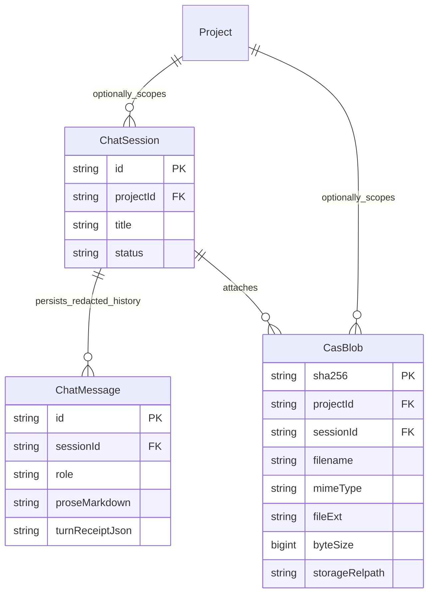

# Layer-Epic-DB: Epic 04: Flow-First 2D SVG Bezier DAG Studio, Security Kernel, CAS Intake & In-Chat Vault

## 1. Data Architecture & Scope Overview
Bounded persistence architecture for `Epic 04` on single embedded SQLite WAL (`crates/spec-registry` at `.cowok-design/cowok-design.sqlite3`, `ADR-091` `prisma/schema.prisma` parity).
Baseline tables (`V1..V15`) cover `flow_graphs`, `flow_nodes`, `flow_edges`, `chat_sessions`, `chat_messages` (`V4`), `node_execution_jobs`, `execution_events`, and `element_comments`.
`Story 04.6` adds **`V16__story_04_6_cas_blobs.sql`** (`CURRENT_SCHEMA_VERSION = 16`, migration slot `V16a`), adding content-addressed `cas_blobs` while reusing `V4` `chat_sessions` and `chat_messages` with auto-provisioned session FK support and zero plaintext secret persistence.

## 2. Entity Inventory & Classification

### 2.1 Owned Models
- **`CasBlob`**: Entity registered by 04.6.
- **`CasAttachment`**: Entity registered by 04.6.
- **`TenantCasBlobUsage`**: Entity registered by 04.6.
- **`CasUploadIngress`**: Entity registered by 04.6.
- **`CasCommandIdempotency`**: Entity registered by 04.6.
- **`VaultCommandIdempotency`**: Entity registered by 04.6.
| Entity Name | Intent | Table Name | Rationale |
| :--- | :---: | :--- | :--- |
| `CasBlob` | `OWNS` | `cas_blobs` | Tracks SHA-256 content-addressed binary/tabular uploads (`.csv`, `.tsv`, `.xlsx`, `.fig`, `.pdf`, `.png`, `.svg`, `.txt`) stored at `.cowok-design/cas/<sha256>` with concurrent dedupe lock. |

### 2.2 Mutated Models
| Entity Name | Intent | Table Name | Rationale |
| :--- | :---: | :--- | :--- |
| `ChatSession` | `MUTATES` | `chat_sessions` | Auto-provisions unattached session rows so chat persistence works immediately before project creation (`AC-01`). |
| `ChatMessage` | `MUTATES` | `chat_messages` | Persists redacted chat prose and `VaultReceipt` JSON metadata (zero plaintext keys) sorted by creation sequence. |

### 2.3 Read-Only Models
| Entity Name | Intent | Table Name | Rationale |
| :--- | :---: | :--- | :--- |
| `Project` | `READS` | `projects` | Optional foreign key reference (`project_id ON DELETE SET NULL`) scoping project-bound chat and CAS uploads. |

## 3. Schema Definitions & Field Specifications

```prisma
model CasBlob {
  sha256         String   @id
  projectId      String?  @map("project_id")
  sessionId      String   @map("session_id")
  filename       String
  mimeType       String   @map("mime_type")
  fileExt        String   @map("file_ext")
  byteSize       BigInt   @map("byte_size")
  storageRelpath String   @map("storage_relpath")
  createdAt      DateTime @default(now()) @map("created_at")

  @@index([sessionId, createdAt])
  @@map("cas_blobs")
}

model ChatSession {
  id                  String   @id @default(uuid())
  tenantId            String   @default("local-default") @map("tenant_id")
  projectId           String?  @map("project_id")
  title               String   @default("Workbench Chat")
  activePortal        String   @default("default") @map("active_portal")
  status              String   @default("ACTIVE")
  archivedAt          BigInt?  @map("archived_at")
  createdAt           DateTime @default(now()) @map("created_at")
  updatedAt           DateTime @updatedAt @map("updated_at")

  @@index([projectId, createdAt])
  @@map("chat_sessions")
}

model ChatMessage {
  id              String   @id @default(uuid())
  tenantId        String   @default("local-default") @map("tenant_id")
  sessionId       String   @map("session_id")
  role            String
  proseMarkdown   String   @map("prose_markdown")
  parentMessageId String?  @map("parent_message_id")
  turnReceiptJson String?  @map("turn_receipt_json")
  createdAt       DateTime @default(now()) @map("created_at")

  @@index([sessionId, createdAt])
  @@map("chat_messages")
}
```

## 4. Entity-Relationship Diagram


