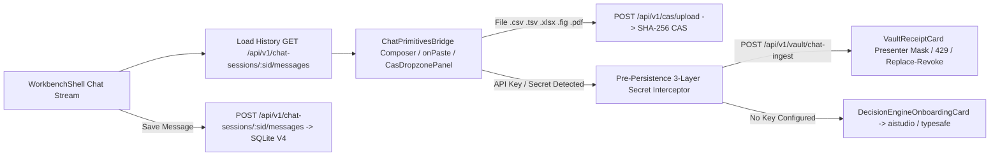
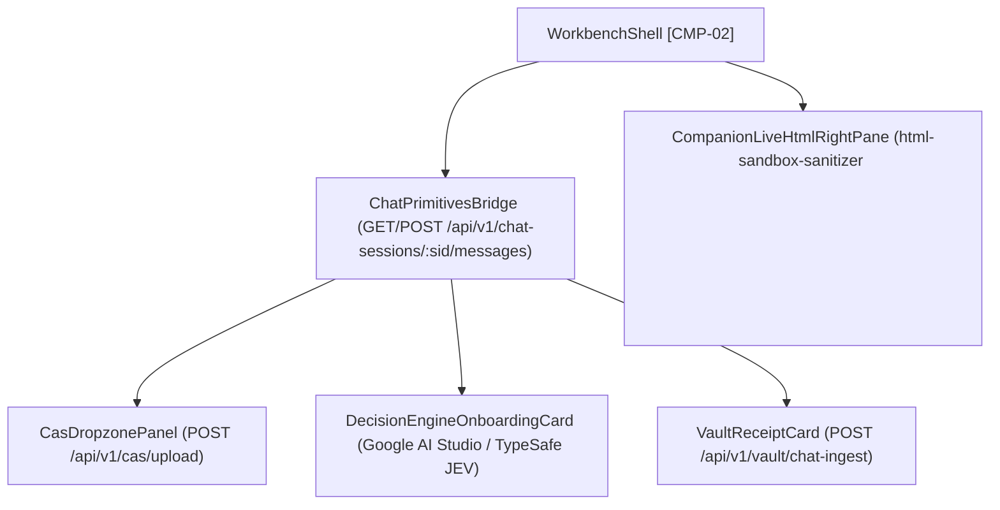

# Layer-Epic-FE: Epic 04: Flow-First 2D SVG Bezier DAG Studio, Security Kernel, CAS Intake & In-Chat Vault

## 1. UserFlow & Screen Journey
Holistic operator journey across the Flow-First Workbench (`04.1`–`04.5` completed baseline) completed by `Story 04.6` persistent chat, binary/CSV CAS intake, `<svg viewBox>` preview normalizer, and zero-leak in-chat Decision Engine key onboarding:

## 2. Component Inventory Table
Aligned strictly with `2.11. component-registry.md`, `DESIGN.md`, and `tokens.css` (Zero Tailwind, mandatory `data-ff-id`, all 4 UI states `Default/Loading/Empty/Error`):

| Component Name | Type | Source | File Path / UX Pattern ID | Props / Contract | Reused From / Notes |
| :--- | :--- | :--- | :--- | :--- | :--- |
| `BrandIcon` | UI | Existing | `src/components/ui/BrandIcon.tsx` (`CMP-01`) | `{ name: string; size?: number }` | Reused 145-SVG manifest |
| `WorkbenchShell` | Layout | Existing | `src/pages/workbench/WorkbenchShell.tsx` (`CMP-02`) | `{ projectId?: string }` | Shelled host workbench |
| `ChatPrimitivesBridge` | Feature | Extended (`Story 04.6`) | `src/features/chat-vault/ChatPrimitivesBridge.tsx` & `src/components/workbench/ChatPrimitivesBridge.tsx` | `{ sessionId: string; onMessagesLoaded?: ... }` | Replaces `sessionStorage` with `GET/POST /api/v1/chat-sessions/:sid/messages` and `onPaste` CAS capture |
| `CasDropzonePanel` | Feature | Extended (`Story 04.6`) | `src/features/chat-vault/CasDropzonePanel.tsx` (`[data-ff-id='cas-file-dropzone']`) | `{ sessionId: string; projectId?: string; onUploaded: (blob: CasBlobDto) => void }` | Supports `.csv,.tsv,.xlsx,.fig,.pdf,.png,.svg` via `POST /api/v1/cas/upload` |
| `DecisionEngineOnboardingCard` | Feature | NEW (`Story 04.6`) | `src/features/chat-vault/DecisionEngineOnboardingCard.tsx` (`[data-ff-id='decision-engine-onboarding-card']`) | `{ onSelectProvider: (p: 'google_ai_studio' \| 'typesafe_jev') => void }` | Links to `https://aistudio.google.com/app/apikey` & `https://console.typesafe.ai` with guided steps |
| `VaultReceiptCard` | Feature | NEW (`Story 04.6`) | `src/features/chat-vault/VaultReceiptCard.tsx` (`[data-ff-id='vault-receipt-card']`) | `{ receipt: VaultReceiptDto; onReplace: () => void; onRevoke: () => void }` | Presenter Mask blur, `429` pill, high-entropy alert, Enterprise Local-Only Lock |
| NEW_REGISTRY_CARD | UI | Registered Pattern | `src/components/NEW_REGISTRY_CARD.tsx` | `{}` | Registered Pattern (Unknown) |
| Usage | UI | Registered Pattern | `src/components/Usage.tsx` | `{}` | Registered Pattern (Unknown) |
| Precondition | UI | Registered Pattern | `src/components/Precondition.tsx` | `{}` | Registered Pattern (Unknown) |

## 3. Registered UX Patterns & Component Layouts
- **Host Surface (`workbenches` / `shelled`):** Mounts inside `WorkbenchShell` chat sidebar and `LaunchpadPanels`, keeping initial non-project sessions auto-provisioned via `POST /api/v1/chat-sessions/:sid/messages`.
- **Zero-Leak Secret UX (`AC-04`):** Raw API keys (`AIza...`, `jev_...`, `sk-...`, etc.) pasted into `[data-ff-id='chat-composer-input']` are intercepted client-side BEFORE optimistic React state insertion and routed directly to `POST /api/v1/vault/chat-ingest`, rendering a masked `VaultReceiptCard` (`[data-ff-id='vault-receipt-card']`).
- **Live Preview SVG Fidelity (`AC-03`):** `html-sandbox-sanitizer.ts` infers `<svg viewBox>` automatically from `width`/`height` or falls back to `0 0 1200 800`, preventing `0px` collapsed SVG diagrams while preserving double-parse mXSS scrubbing and `DESIGN_CDN_CSP` toggle safety.

## 4. Component Hierarchy & Wireflow

