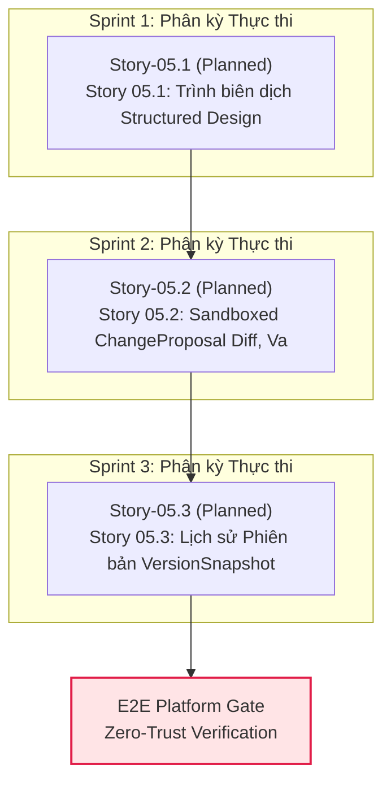

# Epic 05: Option 5 2D Storyboard, Entry-First Live HTML, Per-Node Proposals & Real GitHub PR

## 1. Overview / Executive Summary
- **Value Stream:** `VS-02. Flow-First Executable Design Workbench & SDI Engine`
- **Execution Stream:** `Stream-2` (Wave 3)
- **FR Covered:**
  - [FR-04: Natural-Language Change Request & Structured Design Intent (SDI)](file:///Users/hatrang20061988/Desktop/AI%20Project/uxui-os/_iwish-output/2.%20Product%20Planning/2.1.%20product-brief-or-prd.md)
  - [FR-05: Visual Clarification Variants on High Ambiguity](file:///Users/hatrang20061988/Desktop/AI%20Project/uxui-os/_iwish-output/2.%20Product%20Planning/2.1.%20product-brief-or-prd.md)
  - [FR-07: Sandboxed ChangeProposal Diff & Automated Validation Gate](file:///Users/hatrang20061988/Desktop/AI%20Project/uxui-os/_iwish-output/2.%20Product%20Planning/2.1.%20product-brief-or-prd.md)
  - [FR-08: One-Click Apply, Reject & Project Version History / Revert](file:///Users/hatrang20061988/Desktop/AI%20Project/uxui-os/_iwish-output/2.%20Product%20Planning/2.1.%20product-brief-or-prd.md)
  - [FR-09: Runnable Source Export (Full Repo ZIP & GitHub PR)](file:///Users/hatrang20061988/Desktop/AI%20Project/uxui-os/_iwish-output/2.%20Product%20Planning/2.1.%20product-brief-or-prd.md)
- **Provides:** `DesignIntentV1 Compiler`, `Visual Clarification 2-3 Options`, `ChangeProposal Diff Gate`, `VersionSnapshot Revert & Repo Exporter`
- **Consumes:** `Epic 02` (Multi-Portal Workspace Context Slicer & AST Jail), `Epic 04` (`FlowNode`, `SandboxedLivePreview`, `ElementComment`)

Epic 05 xây dựng hệ thống chuyển hóa ngôn ngữ tự nhiên thành ý định thiết kế có cấu trúc (Structured Design Intent - SDI), cơ chế sinh phương án trực quan làm rõ khi độ mơ hồ cao (`ambiguityScore >= 0.45`), và cổng kiểm duyệt thay đổi mã nguồn an toàn (`ChangeProposal Diff & Validation Gate`). Người dùng có thể xem trước khác biệt trực quan, kiểm tra chất lượng tự động, phê duyệt hoặc từ chối bằng 1 click, theo dõi dòng thời gian phiên bản (`VersionSnapshot`), khôi phục trạng thái và xuất bản mã nguồn chạy độc lập (Full Repo ZIP & GitHub PR).

## 2. Goals / Business Value
1. **Chuyển Hóa Yêu Cầu Tự Nhiên Thành Ý Định Thiết Kế Có Cấu Trúc (SDI Transformation):** Mọi chỉ thị từ người dùng hoặc bình luận neo trên canvas đều được phân tích thành đối tượng `DesignIntentV1` chuẩn hóa (`intentType`, `targetScope`, `requestedChanges`, `constraints`, `ambiguityScore`, `riskScore`), loại bỏ rủi ro hallucination và hiểu sai ngữ cảnh.
2. **Loại Bỏ Đoán Mò Nhờ Visual Clarification Variants:** Khi `ambiguityScore >= 0.45`, hệ thống không tự tiện can thiệp mã nguồn mà tự động đề xuất 2–3 phương án trực quan (Visual Clarification Options) kèm phân tích ưu/nhược điểm để người dùng chọn giải pháp tối ưu.
3. **Kiểm Soát Rủi Ro Bằng Sandboxed ChangeProposal Gate:** Toàn bộ sửa đổi mã nguồn được đóng gói thành `ChangeProposal` cô lập. Chỉ khi vượt qua toàn bộ các cổng kiểm tra tự động (AST Constraint, Lint, Typecheck, Build, Fixture Check) thì mới kích hoạt nút Apply.
4. **An Toàn Tuyệt Đối Với VersionSnapshot & 1-Click Revert:** Lưu trữ chuỗi lịch sử phiên bản bất biến gắn liền với cơ sở dữ liệu SQLite WAL, cho phép hoàn tác (`Revert`) về bất kỳ mốc ổn định nào trong tích tắc.
5. **Tự Do Xuất Bản Mã Nguồn (Runnable Source Export):** Cung cấp khả năng xuất toàn bộ dự án ra file ZIP hoàn chỉnh có thể chạy ngay với `pnpm install && pnpm build` hoặc mở Pull Request trực tiếp lên kho lưu trữ GitHub của người dùng.

## 3. Scope / Scope Boundaries

### In-Scope
- **Trình biên dịch Structured Design Intent (SDI):**
  - Schema `DesignIntentV1` (`intentType`, `targetScope`, `requestedChanges`, `constraints`, `ambiguityScore`, `riskScore`).
  - Bộ tính điểm mơ hồ `ambiguityScore` và đánh giá rủi ro `riskScore`.
  - Cơ chế sinh 2–3 biến thể trực quan (`Visual Clarification Options`) khi `ambiguityScore >= 0.45`.
- **Sandboxed ChangeProposal Diff & Validation Gate:**
  - Cấu trúc `ChangeProposal` với bản tóm tắt file thay đổi (`fileDiffs`), lý do thiết kế (`rationale`) và trạng thái các cổng kiểm tra (`validationSummary`).
  - Giao diện xem khác biệt trực quan (Side-by-Side hoặc Unified Diff viewer) trên Workbench Inspector.
  - Cổng kiểm định tự động (`AST Constraint`, `Typecheck`, `Build`, `Fixture Check`) ngăn chặn apply code hỏng.
  - Thao tác 1-Click Apply (áp dụng vào cây mã nguồn chính thức) và 1-Click Reject (hủy bỏ thay đổi an toàn).
- **Lịch Sử Phiên Bản (VersionSnapshot) & Xuất Bản (Export):**
  - Quản lý danh sách `VersionSnapshot` (`id`, `projectId`, `snapshotHash`, `description`, `createdAt`, `author`).
  - Cơ chế Revert 1-click về snapshot trước đó với sao lưu rollback an toàn.
  - Xuất toàn bộ mã nguồn dự án thành file ZIP độc lập kèm cấu hình build chuẩn và tích hợp đẩy GitHub PR.

### Out-of-Scope
- Trình biên soạn và trình chiếu Slide 16:9 Dual-Pane CMS cho Marketing & Executive (thuộc phạm vi `Epic 06`).
- Bộ kiểm định thẩm mỹ tự động Headless Chromium 17 quy tắc bố cục & WCAG 2.2 AA (thuộc phạm vi `Epic 07`).
- Triển khai hosting trực tiếp lên hạ tầng đám mây công cộng (Vercel, AWS, Cloudflare) (thuộc phạm vi các Epic nâng cao sau).

## 4. Stories in Epic 05

| Story ID | Title | Status | Risk Tier | Dependencies |
| :--- | :--- | :---: | :---: | :--- |
| **Story 05.1** | Trình biên dịch Structured Design Intent (SDI) (DesignIntentV1) & Visual Clarification (2-3 Phương án) | `refactored` | `2` | `['02.2', '04.3']` |
| **Story 05.2** | Sandboxed ChangeProposal Diff, Validation Gate & One-Click Apply / Reject | `refactored` | `3` | `['05.1']` |
| **Story 05.3** | Lịch sử Phiên bản (VersionSnapshot / Revert) & Xuất bản Full Repo ZIP / GitHub PR | `planned` | `2` | `['05.2']` |

## 5. QA Simulator Guardian Scorecard (7-Row Hybrid Scorecard)

| Axis | Score | Notes |
| :--- | :---: | :--- |
| **1. Functional Correctness** | `9.5/10` | Đáp ứng trọn vẹn `FR-04`, `FR-05`, `FR-07`, `FR-08`, `FR-09` từ PRD |
| **2. Data Integrity & State** | `9.4/10` | Định nghĩa schema chặt chẽ cho `DesignIntentV1`, `ChangeProposal`, `VersionSnapshot` |
| **3. Security & Validation** | `9.6/10` | Sandbox Diff cô lập, AST constraint gate chặn 100% mã độc/vi phạm |
| **4. Performance & Scalability** | `9.5/10` | Đóng gói diff và zip generation hiệu năng cao, không gây nghẽn UI |
| **5. Error Handling & Recovery** | `9.4/10` | Tự động sinh clarification khi mơ hồ, hỗ trợ 1-click atomic rollback |
| **6. Architectural Depth & Leverage** | `9.5/10` | Kế thừa AST jail, surgical patcher và SQLite WAL từ Epic 01-04 |
| **7. UX Empathy** | `9.5/10` | Trải nghiệm trực quan với visual diff, so sánh 2-3 phương án và 1-click revert |
| **TOTAL AVERAGE** | **9.49/10** | **PASSED (>= 8.5/10)** |

### Architectural DNA Check
- [x] **Tracer Bullet?** Yes
- [x] **Deletion Testable?** Yes
- [x] **Interface vs Implementation?** Yes

<!-- BEGIN AUTO-ROADMAP: DO NOT EDIT -->
## 3-Sprint Integrated Development Roadmap (Synchronized Phasing)

> **Mục tiêu**: Tự động hóa phân kỳ và phân bổ tuần tự/song song cho toàn bộ **3 Story Active** trên nền tảng **0 Story Baseline đã `completed`**, loại bỏ chu trình phụ thuộc (No Dependency Cycles) và tuân thủ giới hạn tải tối đa 3 Sprints.

---

### 1. Phân tích Hiện trạng & Chiến lược Phân kỳ Mới (Phasing Rationalization)

- **Baseline Nền tảng (0 Stories `completed` / `cancelled`)**: Đóng vai trò Enabler, cung cấp mock data, schemas và các dịch vụ tiền đề.
- **Phạm vi Active Delta (3 Stories)**: Được phân bổ thành 3 Sprint thực thi kế tiếp.
- **Khả năng Chạy Song Song (Parallel Execution Lanes)**:
  - **Sprint 1**: Tuần tự (Sequential) — `Story-05.1`
  - **Sprint 2**: Tuần tự (Sequential) — `Story-05.2`
  - **Sprint 3**: Tuần tự (Sequential) — `Story-05.3`

---

### 2. Ma trận Cung cấp - Tiêu thụ (Provide-Consume Matrix) & Trạng thái Zod

| Story ID | Trạng thái Thực tế | Provides (Cung cấp) | Consumes (Tiêu thụ) | Zod Schema Status | Ghi chú & Rào chắn |
|---|---|---|---|:---:|---|
| **Story-05.1** | `planned` | Cung cấp năng lực của `Story 05.1` cho các Story phụ thuộc trong `Epic 05` và các làn sóng tiếp theo | consumes_apis: [] | ⚠️ Chưa có (manual types) | Tuân thủ Zero-Trust Category A |
| **Story-05.2** | `planned` | Cung cấp năng lực của `Story 05.2` cho các Story phụ thuộc trong `Epic 05` và các làn sóng tiếp theo | consumes_apis: [] | ⚠️ Chưa có (manual types) | Tuân thủ Zero-Trust Category A |
| **Story-05.3** | `planned` | Cung cấp năng lực của `Story 05.3` cho các Story phụ thuộc trong `Epic 05` và các làn sóng tiếp theo | consumes_apis: [] | ⚠️ Chưa có (manual types) | Tuân thủ Zero-Trust Category A |

---

### 3. Sơ đồ Thực thi DAG 3 Sprint (Phased DAG Execution Roadmap)

---

### 4. Kế hoạch Chi tiết Từng Sprint (Execution Specifications)

#### Sprint 1: Phân kỳ Tác vụ
- **Mô hình**: Các câu chuyện được phát triển **tuần tự (Sequential)**.
- **Phạm vi thực thi**:
  1. **`Story-05.1`** (planned): Story 05.1: Trình biên dịch Structured Design Intent (SDI) (DesignIntentV1) & Visual Clarification (2-3 Phương án)
- **Tiêu chí Hoàn thành (Sprint Done Criteria)**:
  - Toàn bộ Zod schemas và Unit tests cho các story trong sprint vượt qua 100%.
  - Kiểm thử tích hợp (Tracer Bullet) giữa các story song song không xảy ra tranh chấp dữ liệu (Race Condition).

#### Sprint 2: Phân kỳ Tác vụ
- **Mô hình**: Các câu chuyện được phát triển **tuần tự (Sequential)**.
- **Phạm vi thực thi**:
  1. **`Story-05.2`** (planned): Story 05.2: Sandboxed ChangeProposal Diff, Validation Gate & One-Click Apply / Reject
- **Tiêu chí Hoàn thành (Sprint Done Criteria)**:
  - Toàn bộ Zod schemas và Unit tests cho các story trong sprint vượt qua 100%.
  - Kiểm thử tích hợp (Tracer Bullet) giữa các story song song không xảy ra tranh chấp dữ liệu (Race Condition).

#### Sprint 3: Phân kỳ Tác vụ
- **Mô hình**: Các câu chuyện được phát triển **tuần tự (Sequential)**.
- **Phạm vi thực thi**:
  1. **`Story-05.3`** (planned): Story 05.3: Lịch sử Phiên bản (VersionSnapshot / Revert) & Xuất bản Full Repo ZIP / GitHub PR
- **Tiêu chí Hoàn thành (Sprint Done Criteria)**:
  - Toàn bộ Zod schemas và Unit tests cho các story trong sprint vượt qua 100%.
  - Kiểm thử tích hợp (Tracer Bullet) giữa các story song song không xảy ra tranh chấp dữ liệu (Race Condition).

<!-- END AUTO-ROADMAP -->
| Story ID | Title | Dependencies | Status |
|---|---|---|---|
| [Story-05.1](./Story-05.1/story.md) | Agent-Centric Minimalist Open-Prose Chat, SDI Compiler & 2D DAG Structural Draft JSON Diff Analyzer | 02.2, 04.3 | refactored |
| [Story-05.2](./Story-05.2/story.md) | Sandboxed ChangeProposal Diff, Validation Gate & One-Click Apply / Reject | 05.1 | refactored |
| [Story-05.3](./Story-05.3/story.md) | Lịch sử Phiên bản (VersionSnapshot / Revert) & Xuất bản Full Repo ZIP / GitHub PR | 05.2 | planned |
| Story ID | Title | Dependencies | Status |
|---|---|---|---|
| [Story-05.1](./Story-05.1/story.md) | Agent-Centric Minimalist Open-Prose Chat, SDI Compiler & 2D DAG Structural Draft JSON Diff Analyzer | 02.2, 04.3 | refactored |
| [Story-05.2](./Story-05.2/story.md) | Sandboxed ChangeProposal Diff, Validation Gate & One-Click Apply / Reject | 05.1 | refactored |
| [Story-05.3](./Story-05.3/story.md) | Lịch sử Phiên bản (VersionSnapshot / Revert) & Xuất bản Full Repo ZIP / GitHub PR | 05.2 | planned |
| Story ID | Title | Dependencies | Status |
|---|---|---|---|
| [Story-05.1](./Story-05.1/story.md) | Agent-Centric Minimalist Open-Prose Chat, SDI Compiler & 2D DAG Structural Draft JSON Diff Analyzer | 02.2, 04.3 | refactored |
| [Story-05.2](./Story-05.2/story.md) | Sandboxed ChangeProposal Diff, Validation Gate & One-Click Apply / Reject | 05.1 | refactored |
| [Story-05.3](./Story-05.3/story.md) | Lịch sử Phiên bản (VersionSnapshot / Revert) & Xuất bản Full Repo ZIP / GitHub PR | 05.2 | planned |
| Story ID | Title | Dependencies | Status |
|---|---|---|---|
| [Story-05.1](./Story-05.1/story.md) | Agent-Centric Minimalist Open-Prose Chat, SDI Compiler & 2D DAG Structural Draft JSON Diff Analyzer | 02.2, 04.3 | refactored |
| [Story-05.2](./Story-05.2/story.md) | Sandboxed ChangeProposal Diff, Validation Gate & One-Click Apply / Reject | 05.1 | refactored |
| [Story-05.3](./Story-05.3/story.md) | Lịch sử Phiên bản (VersionSnapshot / Revert) & Xuất bản Full Repo ZIP / GitHub PR | 05.2 | planned |
| Story ID | Title | Dependencies | Status |
|---|---|---|---|
| [Story-05.1](./Story-05.1/story.md) | Agent-Centric Minimalist Open-Prose Chat, SDI Compiler & 2D DAG Structural Draft JSON Diff Analyzer | 02.2, 04.3 | refactored |
| [Story-05.2](./Story-05.2/story.md) | Sandboxed ChangeProposal Diff, Validation Gate & One-Click Apply / Reject | 05.1 | refactored |
| [Story-05.3](./Story-05.3/story.md) | Lịch sử Phiên bản (VersionSnapshot / Revert) & Xuất bản Full Repo ZIP / GitHub PR | 05.2 | planned |
| Story ID | Title | Dependencies | Status |
|---|---|---|---|
| [Story-05.1](./Story-05.1/story.md) | Agent-Centric Minimalist Open-Prose Chat, SDI Compiler & 2D DAG Structural Draft JSON Diff Analyzer | 02.2, 04.3 | refactored |
| [Story-05.2](./Story-05.2/story.md) | Sandboxed ChangeProposal Diff, Validation Gate & One-Click Apply / Reject | 05.1 | refactored |
| [Story-05.3](./Story-05.3/story.md) | Lịch sử Phiên bản (VersionSnapshot / Revert) & Xuất bản Full Repo ZIP / GitHub PR | 05.2 | planned |
| Story ID | Title | Dependencies | Status |
|---|---|---|---|
| [Story-05.1](./Story-05.1/story.md) | Agent-Centric Minimalist Open-Prose Chat, SDI Compiler & 2D DAG Structural Draft JSON Diff Analyzer | 02.2, 04.3 | refactored |
| [Story-05.2](./Story-05.2/story.md) | Sandboxed ChangeProposal Diff, Validation Gate & One-Click Apply / Reject | 05.1 | refactored |
| [Story-05.3](./Story-05.3/story.md) | Lịch sử Phiên bản (VersionSnapshot / Revert) & Xuất bản Full Repo ZIP / GitHub PR | 05.2 | planned |
| Story ID | Title | Dependencies | Status |
|---|---|---|---|
| [Story-05.1](./Story-05.1/story.md) | Agent-Centric Minimalist Open-Prose Chat, SDI Compiler & 2D DAG Structural Draft JSON Diff Analyzer | 02.2, 04.3 | refactored |
| [Story-05.2](./Story-05.2/story.md) | Sandboxed ChangeProposal Diff, Validation Gate & One-Click Apply / Reject | 05.1 | refactored |
| [Story-05.3](./Story-05.3/story.md) | Lịch sử Phiên bản (VersionSnapshot / Revert) & Xuất bản Full Repo ZIP / GitHub PR | 05.2 | planned |
| Story ID | Title | Dependencies | Status |
|---|---|---|---|
| [Story-05.1](./Story-05.1/story.md) | Agent-Centric Minimalist Open-Prose Chat, SDI Compiler & 2D DAG Structural Draft JSON Diff Analyzer | 02.2, 04.3 | refactored |
| [Story-05.2](./Story-05.2/story.md) | Sandboxed ChangeProposal Diff, Validation Gate & One-Click Apply / Reject | 05.1 | refactored |
| [Story-05.3](./Story-05.3/story.md) | Lịch sử Phiên bản (VersionSnapshot / Revert) & Xuất bản Full Repo ZIP / GitHub PR | 05.2 | planned |
| Story ID | Title | Dependencies | Status |
|---|---|---|---|
| [Story-05.1](./Story-05.1/story.md) | Agent-Centric Minimalist Open-Prose Chat, SDI Compiler & 2D DAG Structural Draft JSON Diff Analyzer | 02.2, 04.3 | refactored |
| [Story-05.2](./Story-05.2/story.md) | Sandboxed ChangeProposal Diff, Validation Gate & One-Click Apply / Reject | 05.1 | refactored |
| [Story-05.3](./Story-05.3/story.md) | Lịch sử Phiên bản (VersionSnapshot / Revert) & Xuất bản Full Repo ZIP / GitHub PR | 05.2 | planned |
| Story ID | Title | Dependencies | Status |
|---|---|---|---|
| [Story-05.1](./Story-05.1/story.md) | Agent-Centric Minimalist Open-Prose Chat, SDI Compiler & 2D DAG Structural Draft JSON Diff Analyzer | 02.2, 04.3 | refactored |
| [Story-05.2](./Story-05.2/story.md) | Sandboxed ChangeProposal Diff, Validation Gate & One-Click Apply / Reject | 05.1 | refactored |
| [Story-05.3](./Story-05.3/story.md) | Lịch sử Phiên bản (VersionSnapshot / Revert) & Xuất bản Full Repo ZIP / GitHub PR | 05.2 | planned |
| Story ID | Title | Dependencies | Status |
|---|---|---|---|
| [Story-05.1](./Story-05.1/story.md) | Agent-Centric Minimalist Open-Prose Chat, SDI Compiler & 2D DAG Structural Draft JSON Diff Analyzer | 02.2, 04.3 | refactored |
| [Story-05.2](./Story-05.2/story.md) | Sandboxed ChangeProposal Diff, Validation Gate & One-Click Apply / Reject | 05.1 | refactored |
| [Story-05.3](./Story-05.3/story.md) | Lịch sử Phiên bản (VersionSnapshot / Revert) & Xuất bản Full Repo ZIP / GitHub PR | 05.2 | planned |
| Story ID | Title | Dependencies | Status |
|---|---|---|---|
| [Story-05.1](./Story-05.1/story.md) | Agent-Centric Minimalist Open-Prose Chat, SDI Compiler & 2D DAG Structural Draft JSON Diff Analyzer | 02.2, 04.3 | refactored |
| [Story-05.2](./Story-05.2/story.md) | Sandboxed ChangeProposal Diff, Validation Gate & One-Click Apply / Reject | 05.1 | refactored |
| [Story-05.3](./Story-05.3/story.md) | Lịch sử Phiên bản (VersionSnapshot / Revert) & Xuất bản Full Repo ZIP / GitHub PR | 05.2 | planned |
| Story ID | Title | Dependencies | Status |
|---|---|---|---|
| [Story-05.1](./Story-05.1/story.md) | Agent-Centric Minimalist Open-Prose Chat, SDI Compiler & 2D DAG Structural Draft JSON Diff Analyzer | 02.2, 04.3 | refactored |
| [Story-05.2](./Story-05.2/story.md) | Sandboxed ChangeProposal Diff, Validation Gate & One-Click Apply / Reject | 05.1 | refactored |
| [Story-05.3](./Story-05.3/story.md) | Lịch sử Phiên bản (VersionSnapshot / Revert) & Xuất bản Full Repo ZIP / GitHub PR | 05.2 | planned |
| Story ID | Title | Dependencies | Status |
|---|---|---|---|
| [Story-05.1](./Story-05.1/story.md) | Agent-Centric Minimalist Open-Prose Chat, SDI Compiler & 2D DAG Structural Draft JSON Diff Analyzer | 02.2, 04.3 | refactored |
| [Story-05.2](./Story-05.2/story.md) | Sandboxed ChangeProposal Diff, Validation Gate & One-Click Apply / Reject | 05.1 | refactored |
| [Story-05.3](./Story-05.3/story.md) | Lịch sử Phiên bản (VersionSnapshot / Revert) & Xuất bản Full Repo ZIP / GitHub PR | 05.2 | refactored |
| Story ID | Title | Dependencies | Status |
|---|---|---|---|
| [Story-05.1](./Story-05.1/story.md) | Agent-Centric Minimalist Open-Prose Chat, SDI Compiler & 2D DAG Structural Draft JSON Diff Analyzer | 02.2, 04.3 | refactored |
| [Story-05.2](./Story-05.2/story.md) | Sandboxed ChangeProposal Diff, Validation Gate & One-Click Apply / Reject | 05.1 | refactored |
| [Story-05.3](./Story-05.3/story.md) | Lịch sử Phiên bản (VersionSnapshot / Revert) & Xuất bản Full Repo ZIP / GitHub PR | 05.2 | refactored |
| Story ID | Title | Dependencies | Status |
|---|---|---|---|
| [Story-05.1](./Story-05.1/story.md) | Agent-Centric Minimalist Open-Prose Chat, SDI Compiler & 2D DAG Structural Draft JSON Diff Analyzer | 02.2, 04.3 | refactored |
| [Story-05.2](./Story-05.2/story.md) | Sandboxed ChangeProposal Diff, Validation Gate & One-Click Apply / Reject | 05.1 | refactored |
| [Story-05.3](./Story-05.3/story.md) | Lịch sử Phiên bản (VersionSnapshot / Revert) & Xuất bản Full Repo ZIP / GitHub PR | 05.2 | refactored |
| Story ID | Title | Dependencies | Status |
|---|---|---|---|
| [Story-05.1](./Story-05.1/story.md) | Agent-Centric Minimalist Open-Prose Chat, SDI Compiler & 2D DAG Structural Draft JSON Diff Analyzer | 02.2, 04.3 | refactored |
| [Story-05.2](./Story-05.2/story.md) | Sandboxed ChangeProposal Diff, Validation Gate & One-Click Apply / Reject | 05.1 | refactored |
| [Story-05.3](./Story-05.3/story.md) | Lịch sử Phiên bản (VersionSnapshot / Revert) & Xuất bản Full Repo ZIP / GitHub PR | 05.2 | refactored |