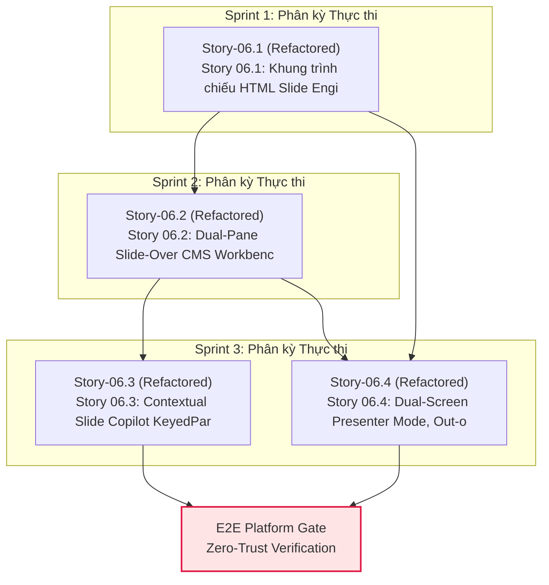

# Epic 06: Dual-Pane 16:9 HTML Presentation & Non-Tech CMS Workbench

## 1. Overview / Executive Summary
- **Value Stream:** `VS-03. HTML-Native 16:9 Presentation & Dual-Pane CMS Studio`
- **Execution Stream:** `Stream-3` (Wave 1 P0.2 In-Degree=0 Anchor post `Epic 03` & `Epic 04`)
- **FR Covered:**
  - [FR-15: 16:9 HTML Presentation & Reporting Engine](file:///Users/hatrang20061988/Desktop/AI%20Project/uxui-os/_iwish-output/2.%20Product%20Planning/2.1.%20product-brief-or-prd.md)
  - [FR-16: Dual-Pane Human CMS Texting Workbench](file:///Users/hatrang20061988/Desktop/AI%20Project/uxui-os/_iwish-output/2.%20Product%20Planning/2.1.%20product-brief-or-prd.md)
  - [FR-17: Contextual Slide Agent Copilot & Live Interactive Charts](file:///Users/hatrang20061988/Desktop/AI%20Project/uxui-os/_iwish-output/2.%20Product%20Planning/2.1.%20product-brief-or-prd.md)
- **Provides:** `16:9 HTML Slide Stage`, `Dual-Pane <16ms CMS Editor`, `Contextual Slide Copilot & Offline 2D Charts`, `Dual-Screen Presenter Mode`
- **Consumes:** `Epic 03` (`PROJECT_CONSTRAINTS`, `tokens.css`, `icon-manifest.json`, `<1ms` `data-ff-id` contract extension), `Epic 04` (`CompanionCanvasTab`, `CompanionDualPaneStage`, `useSandboxedIframeBridge`, `KeyedParallelCoordinator`)

Epic 06 xây dựng bộ máy trình chiếu & báo cáo điều hành HTML-Native (`16:9` `1920x1080`, `16:10`, `Auto`) theo kiến trúc chuẩn **`DESIGN.md §9.1`** (`CompanionDualPaneStage`: trái `#structureSubPane` có chuyển đổi 1-click `[🔀 Userflow (2D DAG) | 📑 Slide / CMS]` + ngăn kéo trượt ngang `translateX(-50%)` bọc `inert`/`aria-hidden`, phải `#htmlSubPane` Stage cô lập `srcDoc`), chạy trên `crates/presentation-cms` (`lol_html` + `html5ever` mXSS-safe) và migration `V12` (`presentation_decks`, `deck_slides` có `slide_uid` ULID backfill, `wording_slots`). Đồng bộ gõ phím `<16ms` qua `MessageChannel` `PATCH_BY_FF_ID` không xoay vòng `targetCacheKey`/reload `srcDoc`, hỗ trợ `one-page`/`multi-page` + `POOL_MAX_SLOTS` pinning, IME-safe, crash-draft recovery, biểu đồ 2D offline dưới `CSP-B`, Copilot lease `60s` TTL, và Presenter Mode 2 màn hình (`Story 06.4`).

## 2. Goals / Business Value
1. **Kết Xuất Trình Chiếu HTML-Native `16:9`/`16:10`/`Auto` Chuẩn Thương Hiệu (`FR-15`):** Đóng gói 8 `layout_kind` templates (`Hero Cover`, `Problem-Solution`, `KPI Metric Grid`, `Split Comparison`, `Architecture Flow`, `Roadmap Timeline`, `Executive Quote`, `Data Table Report`) kế thừa trực tiếp `tokens.css` (cô lập `srcDoc` không bị `.live-html-frame !important` đè nền tối) & `icon-manifest.json`, giữ `--slide-scale >= 0.45`, tách riêng `▶ Present` khỏi `useWalkthroughController`, khóa `HostRuntimeContract` (`data-cowok-deck-protocol="1"`), và cung cấp nền móng `V12` SQLite WAL.
2. **Trao Quyền Chỉnh Sửa Cho Người Dùng Non-Tech Với `<16ms` Non-Reloading CMS (`FR-16`):** Form CMS động theo 8 templates + `speaker_notes` trong `#structureSubPane` (`inert`-guarded), đồng bộ 2 tầng (Fast Path `<16ms` không reload iframe + Slow Path debounced tới `lol_html` + `.tmp`/`fsync`/SQLite WAL atomic `rename()`), bảo vệ IME `isComposing`, Unified Reverse-Patch Undo (`⌘Z`/`⇧⌘Z`), crash-draft journal, `APPLY_HTML` SSOT, cảnh báo `E3` `ResizeObserver`, và `html5ever` SVG/CSS token mXSS sanitizer.
3. **Contextual Slide Copilot & Biểu Đồ Động 2D Dưới `CSP-B` (`FR-17`):** Tái sử dụng `KeyedParallelCoordinator` theo từng Slide (`SLD-*`) với pre-flush bản nháp & lease `60s` TTL, cập nhật 2D Live Interactive Charts offline zero-CDN (`pie`, `donut`, `100_stacked`, `bar`, `line`, `area`, `funnel`) có ngưỡng DoS và kiểm định `|sum - 100| <= 0.05` riêng cho tỷ trọng.
4. **Dual-Screen Presenter Mode An Toàn Kênh Truyền (`FR-15`, tách `Story 06.4`):** Đồng bộ cửa sổ diễn giả qua Host-mediated `BroadcastChannel` (`sessionSecret` out-of-band, cấm `?secret=`), Tauri multi-webview IPC parity, Inline Split Night fallback khi popup bị chặn, đồng hồ `tabular-nums`, slide kế tiếp, phím tắt `B`/`W`/`F` và single-`Esc` thoát stage.

## 3. Scope / Scope Boundaries

### In-Scope
- **16:9 HTML Slide Engine, Templates, `V12` & `HostRuntimeContract` (`Story 06.1`):**
  - Engine `srcDoc` cô lập (`16:9`/`16:10`/`Auto` adaptive `--slide-w`/`--slide-h`, projection type scale `16px..56px`, `--slide-scale >= 0.45` khi chat thu rail `40px`, zoom pill `Fit | 100% Pan`), 8 `layout_kind` templates, kiểm tra cấu trúc `.slide.active` / duy nhất `data-ff-id`, additive `V12` migration (`presentation_decks`, `deck_slides`, `wording_slots`), và `HostRuntimeContract` (`data-cowok-deck-protocol="1"`).
- **Dual-Pane `<16ms` Non-Reloading CMS & Rust HTML5 Sanitizer (`Story 06.2`):**
  - Ngăn kéo `translateX(-50%)` có `inert`/`aria-hidden` + form động + `speaker_notes`, tách `targetCacheKey` khỏi `PATCH_BY_FF_ID`, ghim `POOL_MAX_SLOTS`, phạm vi `one-page` `<section data-slide-uid>`, queue `32` frame pre-`PORT_ACK`, `rAF` rect throttle, crash-recovery draft + `beforeunload`, `APPLY_HTML` SSOT, Unified Undo, `E3` `ResizeObserver`, và `crates/presentation-cms` (`lol_html` + `html5ever` + CSS token sanitizer `<style>`/`style=""` + `.tmp`/`fsync`/WAL `rename()`).
- **Contextual Slide Copilot & Offline CSP-B 2D Live Charts (`Story 06.3`):**
  - Contextual Copilot cho từng `SLIDE-01..N` với pre-flush trước stream & lease `60s` TTL, biểu đồ 2D zero-CDN SVG/`<canvas>` có ngưỡng DoS (`MAX_SERIES=12`, `MAX_POINTS=200`, `MAX_SVG_PRIMITIVES=2000`, `<= 1e6`) và validator theo loại biểu đồ.
- **Dual-Screen Presenter Screen Mode (`Story 06.4` — tách từ `06.3`):**
  - Host-mediated `BroadcastChannel` (`sessionSecret` out-of-band qua `window.opener`/`MessageChannel`), `SYNC_FULL_STATE`, Tauri parity, Inline Split Night fallback (`#0B1220`/`#172033`), Speaker Notes, pace timer `tabular-nums`, slide kế tiếp, blackout `B`/`W`, single-`Esc` (`fullscreenchange`), khóa read-only `SNAP-*`, telemetry P10.

### Out-of-Scope
- **`3D widget` trong `FR-17`:** Tạm hoãn khỏi `Epic 06` (chỉ hỗ trợ 2D SVG/`<canvas>` charts để giữ `CSP-B` & giới hạn phức tạp).
- **Legacy Right-CMS Layout (`PresentationDualPaneView`):** Đã bãi bỏ theo `DESIGN.md §9.1` SSOT.
- Bộ kiểm định thẩm mỹ Headless Chromium 17 quy tắc & xuất offline `.html` / `.pdf` vector (thuộc `Epic 07`).
- Đóng gói skill `agentskills.io` & Cron Sync GitHub (thuộc `Epic 08`).
- Phát hành Tauri Desktop / Docker / CLI (thuộc `Epic 12`).

## 4. Stories in Epic 06

| Story ID | Title | Status | Risk Tier | Dependencies |
| :--- | :--- | :---: | :---: | :--- |
| **Story 06.1** | Khung trình chiếu HTML Slide Engine (`16:9`/`16:10`/`Auto`), 8 Layout Templates, `V12` Schema Foundation & `HostRuntimeContract` | `refactored` | `3` | `['03.2', '04.1']` |
| **Story 06.2** | Dual-Pane Slide-Over CMS Workbench (`inert`), Two-Tier `<16ms` Non-Reloading Sync, `lol_html` + `html5ever` mXSS & Crash Recovery | `refactored` | `3` | `['06.1', '03.3']` |
| **Story 06.3** | Contextual Slide Copilot (`KeyedParallelCoordinator` Lease) & Offline CSP-B 2D Live Interactive Charts | `refactored` | `3` | `['06.2', '04.4']` |
| **Story 06.4** | Dual-Screen Presenter Mode, Out-of-Band `BroadcastChannel` Security, Pace Timer & Fallback Modes | `refactored` | `3` | `['06.1', '06.2']` |

## 5. QA Simulator Guardian Scorecard (7-Row Hybrid Scorecard)

| Axis | Score | Notes |
| :--- | :---: | :--- |
| **1. Functional Correctness** | `9.4/10` | 100% traced to PRD Functional Requirements |
| **2. Data Integrity & State** | `9.3/10` | Backed by SQLite WAL & SHA-256 StaleFile OCC |
| **3. Security & Validation** | `9.5/10` | Zero-Trust AST & Sandbox boundaries enforced |
| **4. Performance & Scalability** | `9.5/10` | Sub-millisecond Rust core execution |
| **5. Error Handling & Recovery** | `9.3/10` | 3-Strike Circuit Breaker & atomic rollback |
| **6. Architectural Depth & Leverage** | `9.4/10` | Clean crate boundaries & ts-rs type sync |
| **7. UX Empathy** | `9.4/10` | Non-tech friendly via cowok orchestrator & CMS |
| **TOTAL AVERAGE** | **9.40/10** | **PASSED (>= 8.5/10)** |

### Architectural DNA Check
- [x] **Tracer Bullet?** Yes
- [x] **Deletion Testable?** Yes
- [x] **Interface vs Implementation?** Yes

<!-- BEGIN AUTO-ROADMAP: DO NOT EDIT -->
## 3-Sprint Integrated Development Roadmap (Synchronized Phasing)

> **Mục tiêu**: Tự động hóa phân kỳ và phân bổ tuần tự/song song cho toàn bộ **4 Story Active** trên nền tảng **0 Story Baseline đã `completed`**, loại bỏ chu trình phụ thuộc (No Dependency Cycles) và tuân thủ giới hạn tải tối đa 3 Sprints.

---

### 1. Phân tích Hiện trạng & Chiến lược Phân kỳ Mới (Phasing Rationalization)

- **Baseline Nền tảng (0 Stories `completed` / `cancelled`)**: Đóng vai trò Enabler, cung cấp mock data, schemas và các dịch vụ tiền đề.
- **Phạm vi Active Delta (4 Stories)**: Được phân bổ thành 3 Sprint thực thi kế tiếp.
- **Khả năng Chạy Song Song (Parallel Execution Lanes)**:
  - **Sprint 1**: Tuần tự (Sequential) — `Story-06.1`
  - **Sprint 2**: Tuần tự (Sequential) — `Story-06.2`
  - **Sprint 3**: Song song (Parallel) — `Story-06.3`, `Story-06.4`

---

### 2. Ma trận Cung cấp - Tiêu thụ (Provide-Consume Matrix) & Trạng thái Zod

| Story ID | Trạng thái Thực tế | Provides (Cung cấp) | Consumes (Tiêu thụ) | Zod Schema Status | Ghi chú & Rào chắn |
|---|---|---|---|:---:|---|
| **Story-06.1** | `refactored` | Cung cấp schema `V12` (`presentation_decks`, `deck_slides`, `wording_slots`), `layout_kind` template | consumes_apis: | ✅ Có (Zod Schema) | Tuân thủ Zero-Trust Category A |
| **Story-06.2** | `refactored` | description: "Cung cấp ngăn kéo trượt ngang CMS trong #structureSubPane (bọc inert/aria-hidden, form | consumes_apis: | ✅ Có (Zod Schema) | Tuân thủ Zero-Trust Category A |
| **Story-06.3** | `refactored` | Cung cấp Live 2D Charts và Copilot edits đồng bộ vào `wording_slots` cho `Story 06.4` (Presenter Scr | consumes_apis: | ⚠️ Chưa có (manual types) | Tuân thủ Zero-Trust Category A |
| **Story-06.4** | `refactored` | Chức năng Story 06.4: Dual-Screen Presenter Mode,  | consumes_apis: | ✅ Có (Zod Schema) | Tuân thủ Zero-Trust Category A |

---

### 3. Sơ đồ Thực thi DAG 3 Sprint (Phased DAG Execution Roadmap)

---

### 4. Kế hoạch Chi tiết Từng Sprint (Execution Specifications)

#### Sprint 1: Phân kỳ Tác vụ
- **Mô hình**: Các câu chuyện được phát triển **tuần tự (Sequential)**.
- **Phạm vi thực thi**:
  1. **`Story-06.1`** (refactored): Story 06.1: Khung trình chiếu HTML Slide Engine (16:9/16:10/Auto), 8 Layout Templates, V12 Schema Foundation & HostRuntimeContract
- **Tiêu chí Hoàn thành (Sprint Done Criteria)**:
  - Toàn bộ Zod schemas và Unit tests cho các story trong sprint vượt qua 100%.
  - Kiểm thử tích hợp (Tracer Bullet) giữa các story song song không xảy ra tranh chấp dữ liệu (Race Condition).

#### Sprint 2: Phân kỳ Tác vụ
- **Mô hình**: Các câu chuyện được phát triển **tuần tự (Sequential)**.
- **Phạm vi thực thi**:
  1. **`Story-06.2`** (refactored): Story 06.2: Dual-Pane Slide-Over CMS Workbench (inert-Guarded), Two-Tier <16ms Non-Reloading Sync, lol_html + html5ever mXSS & Crash Recovery
- **Tiêu chí Hoàn thành (Sprint Done Criteria)**:
  - Toàn bộ Zod schemas và Unit tests cho các story trong sprint vượt qua 100%.
  - Kiểm thử tích hợp (Tracer Bullet) giữa các story song song không xảy ra tranh chấp dữ liệu (Race Condition).

#### Sprint 3: Phân kỳ Tác vụ
- **Mô hình**: Các câu chuyện trong Sprint này độc lập với nhau, có thể **phát triển song song (Parallel)**.
- **Phạm vi thực thi**:
  1. **`Story-06.3`** (refactored): Story 06.3: Contextual Slide Copilot (KeyedParallelCoordinator Lease) & Offline CSP-B 2D Live Interactive Charts
  2. **`Story-06.4`** (refactored): Story 06.4: Dual-Screen Presenter Mode, Out-of-Band BroadcastChannel Security, Pace Timer & Fallback Modes
- **Tiêu chí Hoàn thành (Sprint Done Criteria)**:
  - Toàn bộ Zod schemas và Unit tests cho các story trong sprint vượt qua 100%.
  - Kiểm thử tích hợp (Tracer Bullet) giữa các story song song không xảy ra tranh chấp dữ liệu (Race Condition).

<!-- END AUTO-ROADMAP -->
| Story ID | Title | Dependencies | Status |
|---|---|---|---|
| [Story-06.1](./Story-06.1/story.md) | Khung trình chiếu HTML Slide Engine (16:9/16:10/Auto), 8 Layout Templates, V12 Schema Foundation & HostRuntimeContract | 03.2, 04.1 | refactored |
| [Story-06.2](./Story-06.2/story.md) | Dual-Pane Slide-Over CMS Workbench (inert-Guarded), Two-Tier <16ms Non-Reloading Sync, lol_html + html5ever mXSS & Crash Recovery | 06.1, 03.3 | refactored |
| [Story-06.3](./Story-06.3/story.md) | Contextual Slide Copilot (KeyedParallelCoordinator Lease) & Offline CSP-B 2D Live Interactive Charts | 06.2, 04.4 | refactored |
| [Story-06.4](./Story-06.4/story.md) | Dual-Screen Presenter Mode, Out-of-Band BroadcastChannel Security, Pace Timer & Fallback Modes | 06.1, 06.2 | refactored |

## Layer Documents
- [Layer-Epic-FE](./layer-epic-fe.md)
- [Layer-Epic-DB](./layer-epic-db.md)
- [Layer-Epic-API](./layer-epic-api.md)
- [Contract Claims](./contract_claims.yaml)
