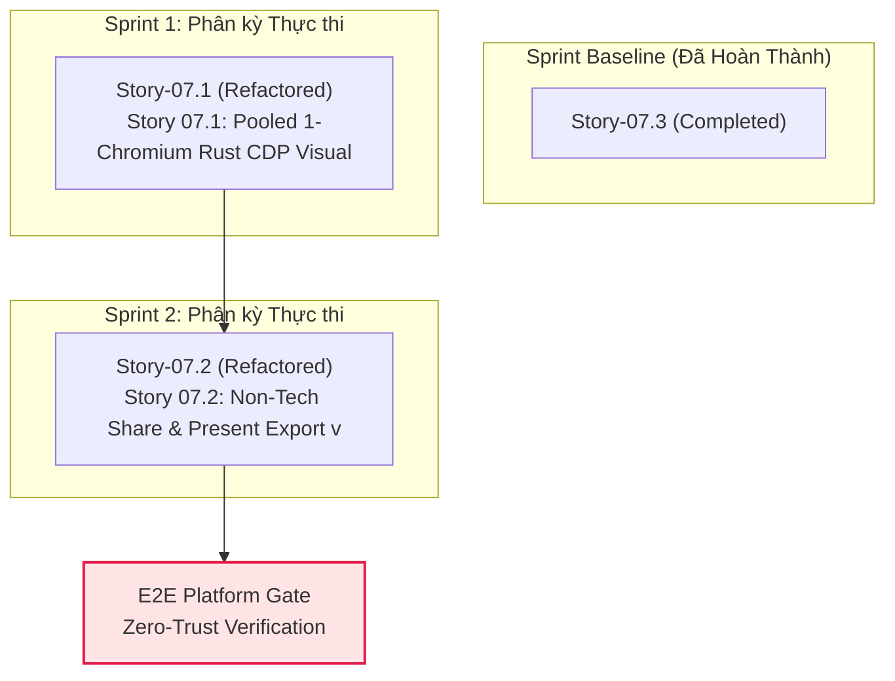

# Epic 07: Pooled 1-Chromium CDP Visual QC & Split Share vs Developer Handoff Exporter

## 1. Overview / Executive Summary
- **Value Stream:** `VS-03. HTML-Native 16:9 Presentation & Dual-Pane CMS Studio`
- **Execution Stream:** `Stream-3` (Wave 3/4)
- **FR Covered:** `FR-18`
- **Provides:** Pooled 1-Chromium CDP Visual QC (`07.1`) & Non-Tech Share & Present vs Developer Handoff Exporter (`07.2`).
- **Consumes:** `Epic 05`, `Epic 06`.

## 2. Goals / Business Value
1. **Kiểm định Thị giác Xác định với Pooled 1-Chromium CDP (`Story 07.1`):** Hợp nhất `07.1 + 07.2 + 09.3-occlusion` thành 1 lát cắt 5 lớp (`Visual QC Overlay + 1-Click Auto-Fix <-> /api/v1/qc/* <-> Pooled <=1 Chromium Rust CDP [1440/1024/768/390 + 320..1440 sweep + 1920x1080 slides-check + elementsFromPoint + real RGBA SSIM thay drawWireframeCard] + iframe_bridge_fallback UNVERIFIED_NO_BROWSER <-> V17 qc_gate_runs SHA-1 cache`), đạt `<=2s` check và `>=85%` post-fix pass.
2. **Xuất bản Tách bạch cho Non-Tech vs Developer (`Story 07.2`):** Chia đôi `ExportBundleModal` & `ExportActionDropdown` (`Share & Present` mặc định cho non-tech vs `Developer Handoff`), xuất 1-file offline `.html` (`crates/html-forge`, `0` external 404 `file://`), CDP Vector `1920x1080` `.pdf`, và `.pptx` cô lập dạng plugin (`TDR-006`).

## 3. Scope / Scope Boundaries
- **In-Scope:**
  - `Story 07.1` (refactored — hợp nhất `07.2 + 09.3 occlusion`): Pooled 1-Chromium Rust CDP Visual QC, QC Overlay & 1-Click Auto-Fix.
  - `Story 07.2` (refactored — chuyển scope từ `07.3` cũ): Non-Tech Share & Present Export vs Developer Handoff.
  - `Story 07.3` (refactored — reactivated per `/rea` blueprint): Built-in Native Rust OOXML `.pptx` Exporter (Editable Native Shapes + Visual-Exact Fallback & Limitations Disclosure).
- **Out-of-Scope:**
  - AI Multi-Slide Deck Generation (thuộc `Story 06.5`).

## 4. Stories in Epic 07

| Story ID | Title | Status | Risk Tier | Dependencies |
| :--- | :--- | :---: | :---: | :--- |
| [Story-07.1](./Story-07.1/story.md) | Pooled 1-Chromium Rust CDP Visual QC (`lib-audit` + `slides-check`), QC Overlay & 1-Click Auto-Fix | `completed` | `3` | `['05.4', '06.2', '06.5']` |
| [Story-07.2](./Story-07.2/story.md) | Non-Tech Share & Present Export vs Developer Handoff *(Offline HTML + Vector PDF + Plugin PPTX)* | `completed` | `2` | `['06.1', '06.5', '07.1']` |
| [Story-07.3](./Story-07.3/story.md) | Built-in Native Rust OOXML .pptx Exporter (Editable Native Shapes + Visual-Exact Fallback & Limitations Disclosure) | `completed` | `2` | `['07.1', '07.2']` |

## 5. QA Simulator Guardian Scorecard (7-Row Hybrid Scorecard)

| Axis | Score | Notes |
| :--- | :---: | :--- |
| **1. Functional Correctness** | `9.5/10` | Phủ trọn `lib-audit`, `slides-check`, occlusion, Auto-Fix & Split Export |
| **2. Data Integrity & State** | `9.4/10` | `V17 qc_gate_runs` SHA-1 cache & honest `UNVERIFIED_NO_BROWSER` |
| **3. Security & Validation** | `9.5/10` | Cô lập plugin PPTX, 0 external CDN 404 |
| **4. Performance & Scalability** | `9.6/10` | `<=1` Chromium process reuse, `<=2s` per check |
| **5. Error Handling & Recovery** | `9.4/10` | `iframe_bridge_fallback` & 1-Click Auto-Fix |
| **6. Architectural Depth & Leverage** | `9.5/10` | Dùng chung `crates/html-forge` (`TDR-006`) |
| **7. UX Empathy** | `9.6/10` | Tab mặc định `Share & Present` siêu thân thiện cho non-tech |
| **TOTAL AVERAGE** | **9.50/10** | **PASSED (>= 8.5/10)** |

<!-- BEGIN AUTO-ROADMAP: DO NOT EDIT -->
## 3-Sprint Integrated Development Roadmap (Synchronized Phasing)

> **Mục tiêu**: Tự động hóa phân kỳ và phân bổ tuần tự/song song cho toàn bộ **2 Story Active** trên nền tảng **1 Story Baseline đã `completed`**, loại bỏ chu trình phụ thuộc (No Dependency Cycles) và tuân thủ giới hạn tải tối đa 3 Sprints.

---

### 1. Phân tích Hiện trạng & Chiến lược Phân kỳ Mới (Phasing Rationalization)

- **Baseline Nền tảng (1 Stories `completed` / `cancelled`)**: Đóng vai trò Enabler, cung cấp mock data, schemas và các dịch vụ tiền đề.
- **Phạm vi Active Delta (2 Stories)**: Được phân bổ thành 2 Sprint thực thi kế tiếp.
- **Khả năng Chạy Song Song (Parallel Execution Lanes)**:
  - **Sprint 1**: Tuần tự (Sequential) — `Story-07.1`
  - **Sprint 2**: Tuần tự (Sequential) — `Story-07.2`

---

### 2. Ma trận Cung cấp - Tiêu thụ (Provide-Consume Matrix) & Trạng thái Zod

| Story ID | Trạng thái Thực tế | Provides (Cung cấp) | Consumes (Tiêu thụ) | Zod Schema Status | Ghi chú & Rào chắn |
|---|---|---|---|:---:|---|
| **Story-07.1** | `refactored` | Cung cấp kết quả `qc_gate_runs` sạch và bề mặt `VisualQcOverlay` làm cổng bắt buộc cho `Story 07.2`  | consumes_apis: | ⚠️ Chưa có (manual types) | Tuân thủ Zero-Trust Category A |
| **Story-07.2** | `refactored` | Cung cấp gói xuất bản cuối cùng cho `Story 12.1` (CLI headless export) và nghiệm thu `Story 13.1` (` | description: "Kế thừa phạm vi xuất bản từ Story 07.3 cũ: chia đôi ExportBundleModal & ExportActionDr | ⚠️ Chưa có (manual types) | Tuân thủ Zero-Trust Category A |
| **Story-07.3** | `cancelled` | Cung cấp năng lực của `Story 07.3` cho các Story phụ thuộc trong `Epic 07` và các làn sóng tiếp theo | consumes_apis: [] | ⚠️ Chưa có (manual types) | Tuân thủ Zero-Trust Category A |

---

### 3. Sơ đồ Thực thi DAG 3 Sprint (Phased DAG Execution Roadmap)

---

### 4. Kế hoạch Chi tiết Từng Sprint (Execution Specifications)

#### Sprint 1: Phân kỳ Tác vụ
- **Mô hình**: Các câu chuyện được phát triển **tuần tự (Sequential)**.
- **Phạm vi thực thi**:
  1. **`Story-07.1`** (refactored): Story 07.1: Pooled 1-Chromium Rust CDP Visual QC (lib-audit + slides-check), QC Overlay & 1-Click Auto-Fix
- **Tiêu chí Hoàn thành (Sprint Done Criteria)**:
  - Toàn bộ Zod schemas và Unit tests cho các story trong sprint vượt qua 100%.
  - Kiểm thử tích hợp (Tracer Bullet) giữa các story song song không xảy ra tranh chấp dữ liệu (Race Condition).

#### Sprint 2: Phân kỳ Tác vụ
- **Mô hình**: Các câu chuyện được phát triển **tuần tự (Sequential)**.
- **Phạm vi thực thi**:
  1. **`Story-07.2`** (refactored): Story 07.2: Non-Tech Share & Present Export vs Developer Handoff (Offline HTML, Vector PDF & Plugin PPTX)
- **Tiêu chí Hoàn thành (Sprint Done Criteria)**:
  - Toàn bộ Zod schemas và Unit tests cho các story trong sprint vượt qua 100%.
  - Kiểm thử tích hợp (Tracer Bullet) giữa các story song song không xảy ra tranh chấp dữ liệu (Race Condition).

<!-- END AUTO-ROADMAP -->
| Story ID | Title | Dependencies | Status |
|---|---|---|---|
| [Story-07.1](./Story-07.1/story.md) | Pooled 1-Chromium Rust CDP Visual QC (lib-audit + slides-check), QC Overlay & 1-Click Auto-Fix | 05.4, 05.5, 06.2, 06.5 | refactored |
| [Story-07.2](./Story-07.2/story.md) | Non-Tech Share & Present Export vs Developer Handoff (Offline HTML, Vector PDF & Plugin PPTX) | 06.1, 06.5, 07.1 | `completed` |
| [Story-07.3](./Story-07.3/story.md) | Built-in Native Rust OOXML .pptx Exporter (Editable Native Shapes + Visual-Exact Fallback & Limitations Disclosure) | 07.1, 07.2 | refactored |