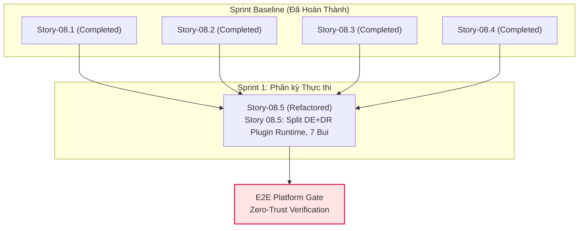

# Epic 08: agentskills.io Repackager Engine, Built-in Harness Skills & GitHub Cron Lifecycle

## 1. Overview & Value Stream Alignment
- **Value Stream:** `VS-04. agentskills.io Plugin Ecosystem, Design-Only REA Forge & JEV — TypeSafe`
- **Execution Stream:** `Stream-4` (Wave 1)
- **FR Covered:** [FR-19: 6 Core Built-in Harness Operating Skills + 3 Seed Extensions](../../../2.%20Product%20Planning/2.1.%20product-brief-or-prd.md), [FR-20: agentskills.io Repackager Engine & Cowok Plugin Alignment](../../../2.%20Product%20Planning/2.1.%20product-brief-or-prd.md), [FR-21: 6-State Plugin Lifecycle Manager, GitHub Cron Sync Scheduler & LEARN Valve](../../../2.%20Product%20Planning/2.1.%20product-brief-or-prd.md)
- **Provides:** `crates/plugin-host` (`crates/skill-repackager` PRD alias), `packages/builtin-skills` (Multi-Axis Capability Registry & 6 Core + 3 Seed Harness Skills), `agentskills.io SKILL.md + plugin.json Normalizer`, `Triangle Linter`, `6-State Plugin Lifecycle & LEARN Engine`, `GitHub Cron Sync Scheduler`
- **Consumes:** `Epic 01`, `Epic 02`, `Story 04.3`, `Story 04.4`

## 2. Goals & Business Value
1. **Non-Tech Design Quality by Default (`FR-19`, `Story 08.1`):** Package 6 core harness operating skills + 3 supplementary seed skills (`9` total) inside an open-ended multi-axis capability registry (`packages/builtin-skills`) backed by authoritative `crates/plugin-host` (`D2 Single Core Port`) with strict `serde_yaml` validation, deterministic `.cowok-skills/<run_id>/` staging (`stable_prompt_hash`), and `< 25ms` Triangle Linter gates.
2. **Safe Ecosystem Ingestion (`FR-20`, `Story 08.2`):** Repackage external repositories/skills into `agentskills.io` bundles (`SKILL.md <= 100 tokens`, `plugin.json`, `skills-lock.json` SHA-256) with fail-closed `discovery-stub.json` (`<= 1,536` bytes), Frame-Cited Video Intake, normalized Zero-Trust scanning (`IPI`, binary magic bytes, `validate_safe_segment`, hardlink/quota guards).
3. **Controlled Lifecycle, Persistent Cron & `HUMAN_ONLY` Self-Learning (`FR-21`, `Story 08.3` & `08.4`):** Enforce 6-state lifecycle (`SCREAMING_SNAKE_CASE`, `ManifestUpdateOutcome` staging isolation, `promote_staging` / `load_verified_staged_bundle_from_dir` / `discard_staging`, `quarantined`, `from_persisted`), `HumanApproverToken` + `HumanSessionAuthority` `HUMAN_ONLY` (`ActorKind::HumanWorkbenchSession` in `daemon_auth`, bound `(kid, card_id, content_sha256, action, expected_revision)`, `from_persisted_state`/`export_consumed_nonces`), additive SQLite WAL convergence (`next version >= V9` incl. `learn_consumed_nonces` + `ADR-091` `prisma/schema.prisma` parity), `tokio-cron-scheduler` with `LeaseReaper`/SSRF/backoff, and Workbench HITL UI.

## 3. Scope & Scope Boundaries
- **In-Scope:**
  - `packages/builtin-skills` (`Story 08.1`..`08.3`): Multi-axis capability registry, 6+3 seed skill assets, Zod/`ts-rs` DTO contracts, and golden-fixture parity tests against `crates/plugin-host` (sole authoritative runtime per `D2`).
  - `crates/plugin-host` & Persistence/Daemon/UI integration (`Story 08.1`..`08.5`): Authoritative validator, per-run stager, Triangle Linter (`< 25ms`), `SkillRepackager` + `security_scanner`, `VideoIntakeProcessor`, `PluginStateMachine`, `LearnPipeline`, additive SQLite `>= V9`..`V18`, `ActorKind::HumanWorkbenchSession` auth, `tokio-cron-scheduler`, Workbench HITL UI, và **Split DE+DR Runtime (`7 Built-in DE Tools`: `scan-ui`, `intake`, `tokens`, linear-NFA `tells/impeccable/hallmark/stageshow`, `archify`, `get_artifact`, `notes-check`) + Controlled Ephemeral Tool Jail (`HUMAN_ONLY`, `env_clear`, `O_NOFOLLOW`, hấp thụ `11.2` cũ) + System-1 `LEARN` filter (`hit_count>=3`, dedupe `noul`, `SLPR>=0.95`, `auto-retire`)** (`Story 08.5`).
- **Out-of-Scope (Handled by Adjacent Epics):**
  - Reverse-engineering external web/app URLs via Design-Only REA & 5-Stage `DecisionCascadeClient` (`Epic 09`).
  - Autonomous OPC Execution Fleet PTY (`$UIUX_LIVE_SPEC`), `advisor` 6-step hardening loop, and Design Tournament orchestration (`Epic 10`).
  - POSIX BYOS CLI sandbox & Universal Open MCP server distribution (`Epic 11`, `11.1..11.2`).

## 4. Stories in Epic 08

| Story ID | Title | Status | Risk Tier | Dependencies |
| :--- | :--- | :---: | :---: | :--- |
| [Story 08.1](./Story-08.1/story.md) | Xây dựng Hệ thống Năng lực Mở Đa Trục & Bộ Kỹ năng Built-in chuẩn agentskills.io (`packages/builtin-skills` & `crates/plugin-host`) | `completed` | `2` | `['01.1', '01.2']` |
| [Story 08.2](./Story-08.2/story.md) | Động cơ Đóng gói lại Repo GitHub, Discovery Stubs & Frame-Cited Video Intake (`crates/plugin-host` & `packages/builtin-skills`) | `completed` | `3` | `['08.1']` |
| [Story 08.3](./Story-08.3/story.md) | Quản lý Vòng đời Plugin 6 Trạng thái & Vòng Tự học LEARN có Van Duyệt Con Người (`crates/plugin-host` Domain Core) | `completed` | `3` | `['08.2']` |
| [Story 08.4](./Story-08.4/story.md) | SQLite Additive Convergence, Daemon `HUMAN_ONLY` Auth, GitHub Cron Sync Scheduler & Workbench Plugin/LEARN UI | `completed` | `3` | `['04.3', '04.4', '08.1', '08.2', '08.3']` |
| [Story 08.5](./Story-08.5/story.md) | Split DE+DR Plugin Runtime, 7 Built-in DE Tools, Controlled Ephemeral Tool Jail & System-1 `LEARN` Loop | `completed` | `3` | `['08.1', '08.2', '08.3', '08.4']` |
| [Story 08.6](./Story-08.6/story.md) | Standalone `design-craft` GitHub Repo Assembler, 4-Pillar Operational Skills/Tools Pack, Multi-Agent Pack, Optional Upstream REA Installer & Default Plugin Mount | `completed` | `3` | `['08.5', '05.4', '05.6', '02.4']` |
| [Story 08.7](./Story-08.7/story.md) | Zero-Hardcode AI Harness Spine — `UnifiedSkillCatalog`, 2-Breakpoint Provider Prompt Caching, Dynamic Model Registry, 3-Bucket Skill Separation & Studio-to-Ledger Bridge (`ADR-009`) | `backlog` | `3` | `['08.5', '08.6', '09.2', '10.1', '11.1']` |

## 5. QA Simulator Guardian Scorecard (7-Row Hybrid Scorecard)

| Axis | Score | Notes |
| :--- | :---: | :--- |
| **1. Functional Correctness** | `9.4/10` | 100% traced to PRD Functional Requirements |
| **2. Data Integrity & State** | `9.3/10` | Backed by SQLite WAL & SHA-256 StaleFile OCC |
| **3. Security & Validation** | `9.5/10` | Zero-Trust AST & Sandbox boundaries enforced |
| **4. Performance & Scalability** | `9.5/10` | Sub-millisecond Rust core execution |
| **5. Error Handling & Recovery** | `9.3/10` | 3-Strike Circuit Breaker & atomic rollback |
| **6. Architectural Depth & Leverage** | `9.4/10` | Clean crate boundaries & ts-rs type sync |
| **7. UX Empathy** | `9.4/10` | Non-tech friendly via cowok orchestrator & CMS |
| **TOTAL AVERAGE** | **9.40/10** | **PASSED (>= 8.5/10)** |

### Architectural DNA Check
- [x] **Tracer Bullet?** Yes
- [x] **Deletion Testable?** Yes
- [x] **Interface vs Implementation?** Yes

<!-- BEGIN AUTO-ROADMAP: DO NOT EDIT -->
## 2-Sprint Integrated Development Roadmap (Synchronized Phasing)

> **Mục tiêu**: Tự động hóa phân kỳ và phân bổ tuần tự/song song cho toàn bộ **1 Story Active** trên nền tảng **4 Story Baseline đã `completed`**, loại bỏ chu trình phụ thuộc (No Dependency Cycles) và tuân thủ giới hạn tải tối đa 2 Sprints.

---

### 1. Phân tích Hiện trạng & Chiến lược Phân kỳ Mới (Phasing Rationalization)

- **Baseline Nền tảng (4 Stories `completed` / `cancelled`)**: Đóng vai trò Enabler, cung cấp mock data, schemas và các dịch vụ tiền đề.
- **Phạm vi Active Delta (1 Stories)**: Được phân bổ thành 1 Sprint thực thi kế tiếp.
- **Khả năng Chạy Song Song (Parallel Execution Lanes)**:
  - **Sprint 1**: Tuần tự (Sequential) — `Story-08.5`

---

### 2. Ma trận Cung cấp - Tiêu thụ (Provide-Consume Matrix) & Trạng thái Zod

| Story ID | Trạng thái Thực tế | Provides (Cung cấp) | Consumes (Tiêu thụ) | Zod Schema Status | Ghi chú & Rào chắn |
|---|---|---|---|:---:|---|
| **Story-08.1** | `completed` | **AC-02 (D2 Single Core Port & Domain Contracts):** Khóa `crates/plugin-host` là runtime thẩm quyền  | consumes_apis: [] | ⚠️ Chưa có (manual types) | Tuân thủ Zero-Trust Category A |
| **Story-08.2** | `completed` | Cung cấp năng lực đóng gói, băm khóa SHA-256 và kiểm duyệt an toàn plugin cho `Story 08.3` và tầng t | consumes_apis: [] | ⚠️ Chưa có (manual types) | Tuân thủ Zero-Trust Category A |
| **Story-08.3** | `completed` | Chặn bước nhảy trạng thái trái phép, ép buộc CAS `expected_revision: u64`, và cung cấp bộ mapping tư | consumes_apis: [] | ⚠️ Chưa có (manual types) | Tuân thủ Zero-Trust Category A |
| **Story-08.4** | `completed` | Chức năng Story 08.4: SQLite Additive Convergence, | consumes_apis: | ⚠️ Chưa có (manual types) | Tuân thủ Zero-Trust Category A |
| **Story-08.5** | `refactored` | Chức năng Story 08.5: Split DE+DR Plugin Runtime,  | consumes_apis: | ⚠️ Chưa có (manual types) | Tuân thủ Zero-Trust Category A |

---

### 3. Sơ đồ Thực thi DAG 2 Sprint (Phased DAG Execution Roadmap)

---

### 4. Kế hoạch Chi tiết Từng Sprint (Execution Specifications)

#### Sprint 1: Phân kỳ Tác vụ
- **Mô hình**: Các câu chuyện được phát triển **tuần tự (Sequential)**.
- **Phạm vi thực thi**:
  1. **`Story-08.5`** (refactored): Story 08.5: Split DE+DR Plugin Runtime, 7 Built-in DE Tools, Controlled Ephemeral Tool Jail & System-1 LEARN Loop
- **Tiêu chí Hoàn thành (Sprint Done Criteria)**:
  - Toàn bộ Zod schemas và Unit tests cho các story trong sprint vượt qua 100%.
  - Kiểm thử tích hợp (Tracer Bullet) giữa các story song song không xảy ra tranh chấp dữ liệu (Race Condition).

<!-- END AUTO-ROADMAP -->
| Story ID | Title | Dependencies | Status |
|---|---|---|---|
| [Story-08.1](./Story-08.1/story.md) | Xây dựng Hệ thống Năng lực Mở Đa Trục & Bộ Kỹ năng Built-in chuẩn agentskills.io (packages/builtin-skills & crates/plugin-host) | 01.1, 01.2 | completed |
| [Story-08.2](./Story-08.2/story.md) | Động cơ Đóng gói lại Repo GitHub, Discovery Stubs & Frame-Cited Video Intake (crates/plugin-host & packages/builtin-skills) | 08.1 | completed |
| [Story-08.3](./Story-08.3/story.md) | Quản lý Vòng đời Plugin 6 Trạng thái & Vòng Tự học LEARN có Van Duyệt Con Người (crates/plugin-host Domain Core) | 08.2 | completed |
| [Story-08.4](./Story-08.4/story.md) | SQLite Additive Convergence, Daemon HUMAN_ONLY Auth, GitHub Cron Sync Scheduler & Workbench Plugin/LEARN UI | 04.3, 04.4, 08.1, 08.2, 08.3 | completed |
| [Story-08.5](./Story-08.5/story.md) | Split DE+DR Plugin Runtime, 7 Built-in DE Tools, Controlled Ephemeral Tool Jail & System-1 LEARN Loop | 08.1, 08.2, 08.3, 08.4 | completed |
| Story ID | Title | Dependencies | Status |
|---|---|---|---|
| [Story-08.1](./Story-08.1/story.md) | Xây dựng Hệ thống Năng lực Mở Đa Trục & Bộ Kỹ năng Built-in chuẩn agentskills.io (packages/builtin-skills & crates/plugin-host) | 01.1, 01.2 | completed |
| [Story-08.2](./Story-08.2/story.md) | Động cơ Đóng gói lại Repo GitHub, Discovery Stubs & Frame-Cited Video Intake (crates/plugin-host & packages/builtin-skills) | 08.1 | completed |
| [Story-08.3](./Story-08.3/story.md) | Quản lý Vòng đời Plugin 6 Trạng thái & Vòng Tự học LEARN có Van Duyệt Con Người (crates/plugin-host Domain Core) | 08.2 | completed |
| [Story-08.4](./Story-08.4/story.md) | SQLite Additive Convergence, Daemon HUMAN_ONLY Auth, GitHub Cron Sync Scheduler & Workbench Plugin/LEARN UI | 04.3, 04.4, 08.1, 08.2, 08.3 | completed |
| [Story-08.5](./Story-08.5/story.md) | Split DE+DR Plugin Runtime, 7 Built-in DE Tools, Controlled Ephemeral Tool Jail & System-1 LEARN Loop | 08.1, 08.2, 08.3, 08.4 | completed |