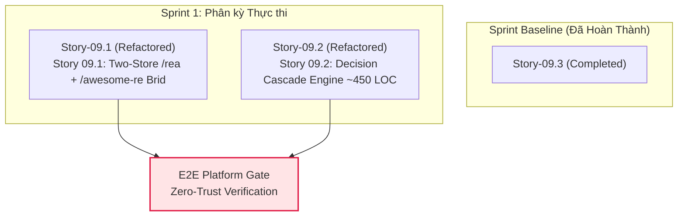

# Epic 09: Two-Store `/rea` DNA Forge & 5-Stage Rust `DecisionCascadeClient` (`RubricShield`)

## 1. Overview / Executive Summary
- **Value Stream:** `VS-04. agentskills.io Plugin Ecosystem, Design-Only REA Forge & JEV — TypeSafe`
- **Execution Stream:** `Stream-4` (Wave 2/3)
- **FR Covered:** `FR-22`, `FR-23`, `FR-27`
- **Provides:** Two-Store `/rea` + `/awesome-re` DNA Forge & License/ToS Firewall (`09.1`), Rust `~450 LOC` `DecisionCascadeClient` + 5-Stage State Machine + `RubricShield` + 3-Strike Breaker (`09.2` — không tách `crates/jev-engine`).
- **Consumes:** `Epic 02`, `Epic 03`, `Epic 04`, `Epic 08`.

## 2. Goals / Business Value
1. **Kho Tham khảo Thiết kế Sạch Pháp lý Two-Store (`Story 09.1`):** Launchpad URL/Figma/Screenshot DNA Importer + Scout MCP `rea.search_patterns` <-> `/api/v1/rea/*` <-> `crates/rea-bridge` (thay thế mock JSON ở `ProjectLaunchpadModal`) + `License/ToS Firewall` (`ADOPT_PRIOR_ART` / `REFERENCE_ONLY` / `REJECT`, `100%` chặn clone GPL/AGPL) <-> `Tier-1A` (`<=250 tok` cards) + `Tier-1B` `.cowok-design/cache/rea-reference.sqlite3` FTS5 (~2,282 UI/AI/tooling entries, `0` games).
2. **Định tuyến System-1 Nhanh, Chính xác & An toàn Tuyệt đối (`Story 09.2`):** Hợp nhất `09.2 + 09.4 + 09.3-breaker` vào `crates/domain` + `crates/bot-fleet` (không tách `crates/jev-engine`): `DecisionCascadeClient` (`Local FTS5 BM25 -> gemini-decision-1 / TypeSafe JEV -> Tiered MCDA Fallback`, `ConfidenceKind`, `egress_guard` `4KB/64KB`, `<untrusted_artifact_bytes>`, `VerdictShield` `0%` float leak) + 5-Stage (`Lane 0` & Stage-4 `$0` short-circuits, `RubricShield` `Q_pos+Q_trap+(X,Y)/(Y,X)+4-Noul` `>=90%` swap consistency, `MAX_ATTEMPTS=3` oscillation breaker) -> `V17 decision_audit_log`.

## 3. Scope / Scope Boundaries
- **In-Scope:**
  - `Story 09.1` (refactored): Design-Only `/rea` DNA Forge, Two-Store Library & License/ToS Firewall.
  - `Story 09.2` (refactored — hợp nhất `09.4` + `09.3 breaker`): 5-Stage `DE -> Decision #1 -> DR/DE -> DE -> Decision #2` Flow, Rust `DecisionCascadeClient` & `RubricShield`.
  - `Story 09.3`: `[DEPRECATED]` / `cancelled` (DOM occlusion chuyển sang `05.4` & `07.1`; 3-Strike Breaker & OCC chuyển sang `09.2`).
- **Out-of-Scope:**
  - `crates/jev-engine` crate tách rời (đã hợp nhất theo `TDR-006`).

## 4. Stories in Epic 09

| Story ID | Title | Status | Risk Tier | Dependencies |
| :--- | :--- | :---: | :---: | :--- |
| [Story-09.1](./Story-09.1/story.md) | Design-Only `/rea` DNA Forge, Two-Store `/rea` + `/awesome-re` Library & `License/ToS Firewall` | `refactored` | `3` | `['03.1', '08.2', '08.5']` |
| [Story-09.2](./Story-09.2/story.md) | 5-Stage Flow, Rust `DecisionCascadeClient`, `RubricShield` & 3-Strike Breaker *(No `crates/jev-engine`)* | `refactored` | `3` | `['02.1', '02.4', '04.6', '08.5']` |
| [Story-09.3](./Story-09.3/story.md) | *(Superseded by `05.4`, `07.1`, `09.2`)* `window.__jevFast` + Occlusion + 3-Strike Breaker | `cancelled` | `3` | `['09.2']` |

## 5. QA Simulator Guardian Scorecard (7-Row Hybrid Scorecard)

| Axis | Score | Notes |
| :--- | :---: | :--- |
| **1. Functional Correctness** | `9.5/10` | Phủ trọn Two-Store `/rea` và 5-Stage Decision Engine |
| **2. Data Integrity & State** | `9.5/10` | `V17 decision_audit_log` & `Tier-1B` FTS5 SQLite |
| **3. Security & Validation** | `9.7/10` | `100%` OWASP LLM01 `<untrusted_artifact_bytes>` & GPL block |
| **4. Performance & Scalability** | `9.6/10` | `Lane 0` & Stage-4 `$0` short-circuits, `<2ms` Tier-1 FTS5 |
| **5. Error Handling & Recovery** | `9.5/10` | Offline MCDA fallback & `MAX_ATTEMPTS=3` oscillation breaker |
| **6. Architectural Depth & Leverage** | `9.6/10` | Không thừa `crates/jev-engine`, `VerdictShield` `0%` float leak |
| **7. UX Empathy** | `9.4/10` | Nạp mẫu URL/Figma thật từ Launchpad kèm pill offline rõ ràng |
| **TOTAL AVERAGE** | **9.54/10** | **PASSED (>= 8.5/10)** |

<!-- BEGIN AUTO-ROADMAP: DO NOT EDIT -->
## 2-Sprint Integrated Development Roadmap (Synchronized Phasing)

> **Mục tiêu**: Tự động hóa phân kỳ và phân bổ tuần tự/song song cho toàn bộ **2 Story Active** trên nền tảng **1 Story Baseline đã `completed`**, loại bỏ chu trình phụ thuộc (No Dependency Cycles) và tuân thủ giới hạn tải tối đa 2 Sprints.

---

### 1. Phân tích Hiện trạng & Chiến lược Phân kỳ Mới (Phasing Rationalization)

- **Baseline Nền tảng (1 Stories `completed` / `cancelled`)**: Đóng vai trò Enabler, cung cấp mock data, schemas và các dịch vụ tiền đề.
- **Phạm vi Active Delta (2 Stories)**: Được phân bổ thành 1 Sprint thực thi kế tiếp.
- **Khả năng Chạy Song Song (Parallel Execution Lanes)**:
  - **Sprint 1**: Song song (Parallel) — `Story-09.1`, `Story-09.2`

---

### 2. Ma trận Cung cấp - Tiêu thụ (Provide-Consume Matrix) & Trạng thái Zod

| Story ID | Trạng thái Thực tế | Provides (Cung cấp) | Consumes (Tiêu thụ) | Zod Schema Status | Ghi chú & Rào chắn |
|---|---|---|---|:---:|---|
| **Story-09.1** | `refactored` | Cung cấp reference patterns sạch, đa định dạng cho `Story 02.4` (Hidden SSOT & Craft Skills), `Story | consumes_apis: | ⚠️ Chưa có (manual types) | Tuân thủ Zero-Trust Category A |
| **Story-09.2** | `refactored` | Chức năng Story 09.2: Decision Cascade Engine (~45 | consumes_apis: | ⚠️ Chưa có (manual types) | Tuân thủ Zero-Trust Category A |
| **Story-09.3** | `cancelled` | **[DEPRECATED] AC-04 (cowok-codebase-harness: Live UITree, 11 Typed Intent Codemods, 8-Step Pixel Bl | consumes_apis: [] | ⚠️ Chưa có (manual types) | Tuân thủ Zero-Trust Category A |

---

### 3. Sơ đồ Thực thi DAG 2 Sprint (Phased DAG Execution Roadmap)

---

### 4. Kế hoạch Chi tiết Từng Sprint (Execution Specifications)

#### Sprint 1: Phân kỳ Tác vụ
- **Mô hình**: Các câu chuyện trong Sprint này độc lập với nhau, có thể **phát triển song song (Parallel)**.
- **Phạm vi thực thi**:
  1. **`Story-09.1`** (refactored): Story 09.1: Two-Store /rea + /awesome-re Bridge (crates/rea-bridge), Design-Only DNA Forge & License/ToS Firewall
  2. **`Story-09.2`** (refactored): Story 09.2: Decision Cascade Engine (~450 LOC Rust DecisionCascadeClient), 5-Stage DE->Decision#1->DR/DE->DE->Decision#2 & MAX_ATTEMPTS=3 Breaker
- **Tiêu chí Hoàn thành (Sprint Done Criteria)**:
  - Toàn bộ Zod schemas và Unit tests cho các story trong sprint vượt qua 100%.
  - Kiểm thử tích hợp (Tracer Bullet) giữa các story song song không xảy ra tranh chấp dữ liệu (Race Condition).

<!-- END AUTO-ROADMAP -->