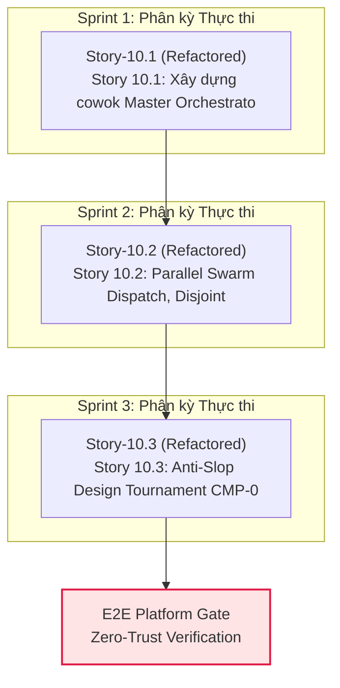

# Epic 10: `cowok` Master Orchestrator, File Leases, `Builder!=Scorer` & `CMP-07` Design Tournament

## 1. Overview / Executive Summary
- **Value Stream:** `VS-05. cowok & advisor OPC Execution Fleet, Universal MCP & 4-Channel Distribution`
- **Execution Stream:** `Stream-5` (Wave 3)
- **FR Covered:** `FR-24`, `FR-25`, `FR-26`, `FR-27`
- **Provides:** `3-Lane Router` + Single MPSC SQLite Write Actor + `$UIUX_LIVE_SPEC` `<50ms` (`10.1`), Parallel File Leases & `Builder != Scorer` (`10.2`), `CMP-07 DesignTournamentArena` (`Blind Wipe` + Cross-Variant Borrow) & `advisor` Loop (`10.3`).
- **Consumes:** `Epic 04`, `Epic 05`, `Epic 07`, `Epic 08`, `Epic 09`, `Epic 11`.

## 2. Goals / Business Value
1. **Điều phối Đơn điểm & An toàn Tuyệt đối với SQLite (`Story 10.1`):** `cowok` chạy `3-Lane Router (Lane 0/1/2)` kèm `Single MPSC SQLite Write Actor (busy_timeout=5000)` (`0 SQLITE_BUSY`) và PTY `$UIUX_LIVE_SPEC` `<50ms` hot-apply + 1-step `Cmd+Z`.
2. **Đội hình Swarm Không Đụng Độ (`Story 10.2`):** Cấp khóa vùng tệp `V17 worker_file_leases` (`fencing_token`, `owned_paths[]`) chống ghi đè, tự hạ semaphore `3 -> 1` khi gặp `429`, kiểm chứng độc lập `Builder != Scorer` (`>=95%` seeded-defect catch) và `Single-Session Design Jury` khi leo thang `EscalateToDesignJury`.
3. **Đấu trường Sáng tạo Chống Clone (`Story 10.3`):** `CMP-07 DesignTournamentArena` (`Blind Wipe` split slider + Cross-Variant Borrow dùng `reconcile_ff_ids` + `/crystallize`), 4 trục trực giao `<=15s` với Pre-Judge AST Distance Gate (`similarity <= 0.78`), Position-Swapped `RubricShield` và vòng tự tiến hóa 6 bước của `advisor` lưu vào `V18`.

## 3. Scope / Scope Boundaries
- **In-Scope:**
  - `Story 10.1` (refactored): `cowok` Master Orchestrator, `3-Lane Router`, MPSC SQLite Write Actor & `$UIUX_LIVE_SPEC` (`<50ms` + `Cmd+Z`).
  - `Story 10.2` (refactored): Parallel `Builder != Scorer` Swarm Coordination, File Leases, `429` Clamp & Tier-3 `Design Jury`.
  - `Story 10.3` (refactored): Stage-B Anti-Clone Design Tournament (`CMP-07`), `Blind Wipe`, Cross-Variant Borrow, `/crystallize` & `advisor` Loop.
- **Out-of-Scope:**
  - Bộ chấm Sealed Benchmark `chmod 444` & 25 ca E2E (thuộc `Story 13.1`).

## 4. Stories in Epic 10

| Story ID | Title | Status | Risk Tier | Dependencies |
| :--- | :--- | :---: | :---: | :--- |
| [Story-10.1](./Story-10.1/story.md) | `cowok` Master Orchestrator, `3-Lane Router`, MPSC SQLite Write Actor & `$UIUX_LIVE_SPEC` (`<50ms` + `Cmd+Z`) | `completed` | `3` | `['04.4', '09.2', '11.1']` |
| [Story-10.2](./Story-10.2/story.md) | Parallel `Builder != Scorer` Swarm Coordination, File Leases, `429` Clamp & Tier-3 `Design Jury` | `completed` | `3` | `['10.1', '07.1']` |
| [Story-10.3](./Story-10.3/story.md) | Stage-B Anti-Clone Design Tournament (`CMP-07`), `Blind Wipe`, Cross-Variant Borrow, `/crystallize` & `advisor` Loop | `completed` | `3` | `['05.4', '09.2', '10.2']` |

## 5. QA Simulator Guardian Scorecard (7-Row Hybrid Scorecard)

| Axis | Score | Notes |
| :--- | :---: | :--- |
| **1. Functional Correctness** | `9.6/10` | Phủ trọn điều phối swarm, leases, `CMP-07` & `advisor` |
| **2. Data Integrity & State** | `9.6/10` | MPSC SQLite Write Actor (`0 SQLITE_BUSY`) + `V17/V18` tables |
| **3. Security & Validation** | `9.5/10` | `Builder != Scorer`, `worker_file_leases` fencing, AST Distance `<=0.78` |
| **4. Performance & Scalability** | `9.5/10` | `<50ms` PTY hot-apply & `<=15s` orthogonal skeletons |
| **5. Error Handling & Recovery** | `9.5/10` | `429` clamp `3 -> 1`, 1-step `Cmd+Z` & Tier-3 `Design Jury` |
| **6. Architectural Depth & Leverage** | `9.6/10` | Reconcile `reconcile_ff_ids` không gãy neo khi borrow block |
| **7. UX Empathy** | `9.5/10` | Thanh trượt `Blind Wipe` & mượn chéo trực quan cho non-tech |
| **TOTAL AVERAGE** | **9.54/10** | **PASSED (>= 8.5/10)** |

<!-- BEGIN AUTO-ROADMAP: DO NOT EDIT -->
## 3-Sprint Integrated Development Roadmap (Synchronized Phasing)

> **Mục tiêu**: Tự động hóa phân kỳ và phân bổ tuần tự/song song cho toàn bộ **3 Story Active** trên nền tảng **0 Story Baseline đã `completed`**, loại bỏ chu trình phụ thuộc (No Dependency Cycles) và tuân thủ giới hạn tải tối đa 3 Sprints.

---

### 1. Phân tích Hiện trạng & Chiến lược Phân kỳ Mới (Phasing Rationalization)

- **Baseline Nền tảng (0 Stories `completed` / `cancelled`)**: Đóng vai trò Enabler, cung cấp mock data, schemas và các dịch vụ tiền đề.
- **Phạm vi Active Delta (3 Stories)**: Được phân bổ thành 3 Sprint thực thi kế tiếp.
- **Khả năng Chạy Song Song (Parallel Execution Lanes)**:
  - **Sprint 1**: Tuần tự (Sequential) — `Story-10.1`
  - **Sprint 2**: Tuần tự (Sequential) — `Story-10.2`
  - **Sprint 3**: Tuần tự (Sequential) — `Story-10.3`

---

### 2. Ma trận Cung cấp - Tiêu thụ (Provide-Consume Matrix) & Trạng thái Zod

| Story ID | Trạng thái Thực tế | Provides (Cung cấp) | Consumes (Tiêu thụ) | Zod Schema Status | Ghi chú & Rào chắn |
|---|---|---|---|:---:|---|
| **Story-10.1** | `refactored` | **AC-04 (Zero-Port Live Patch Bridge `<50ms` & Unified Asset Library Provenance Backlinks):** `Story | consumes_apis: | ⚠️ Chưa có (manual types) | Tuân thủ Zero-Trust Category A |
| **Story-10.2** | `refactored` | **AC-03 ([EDGE-CASE] Builder Self-PASS Spoof Block, `429` Semaphore Clamp `3->1` & Expired Lease `-P | consumes_apis: | ⚠️ Chưa có (manual types) | Tuân thủ Zero-Trust Category A |
| **Story-10.3** | `refactored` | **AC-03 (`advisor` 6-Step Self-Evolution Loop, `tests/eval/sealed/` Deny Guard & `/crystallize`):**  | consumes_apis: | ⚠️ Chưa có (manual types) | Tuân thủ Zero-Trust Category A |

---

### 3. Sơ đồ Thực thi DAG 3 Sprint (Phased DAG Execution Roadmap)

---

### 4. Kế hoạch Chi tiết Từng Sprint (Execution Specifications)

#### Sprint 1: Phân kỳ Tác vụ
- **Mô hình**: Các câu chuyện được phát triển **tuần tự (Sequential)**.
- **Phạm vi thực thi**:
  1. **`Story-10.1`** (refactored): Story 10.1: Xây dựng cowok Master Orchestrator & Embedded PTY $UIUX_LIVE_SPEC (<50ms Hot-Apply + Cmd+Z)
- **Tiêu chí Hoàn thành (Sprint Done Criteria)**:
  - Toàn bộ Zod schemas và Unit tests cho các story trong sprint vượt qua 100%.
  - Kiểm thử tích hợp (Tracer Bullet) giữa các story song song không xảy ra tranh chấp dữ liệu (Race Condition).

#### Sprint 2: Phân kỳ Tác vụ
- **Mô hình**: Các câu chuyện được phát triển **tuần tự (Sequential)**.
- **Phạm vi thực thi**:
  1. **`Story-10.2`** (refactored): Story 10.2: Parallel Swarm Dispatch, Disjoint V17 worker_file_leases, 429 Semaphore Clamp & Independent Builder != Scorer QC (E1..E4 >= 95%)
- **Tiêu chí Hoàn thành (Sprint Done Criteria)**:
  - Toàn bộ Zod schemas và Unit tests cho các story trong sprint vượt qua 100%.
  - Kiểm thử tích hợp (Tracer Bullet) giữa các story song song không xảy ra tranh chấp dữ liệu (Race Condition).

#### Sprint 3: Phân kỳ Tác vụ
- **Mô hình**: Các câu chuyện được phát triển **tuần tự (Sequential)**.
- **Phạm vi thực thi**:
  1. **`Story-10.3`** (refactored): Story 10.3: Anti-Slop Design Tournament (CMP-07, 4 Trục Trực giao <=15s, AST Distance <=0.78, Position-Swapped RubricShield), Cross-Variant Borrow & advisor 6-Step Loop
- **Tiêu chí Hoàn thành (Sprint Done Criteria)**:
  - Toàn bộ Zod schemas và Unit tests cho các story trong sprint vượt qua 100%.
  - Kiểm thử tích hợp (Tracer Bullet) giữa các story song song không xảy ra tranh chấp dữ liệu (Race Condition).

<!-- END AUTO-ROADMAP -->
| Story ID | Title | Dependencies | Status |
|---|---|---|---|
| [Story-10.1](./Story-10.1/story.md) | Xây dựng cowok Master Orchestrator & Embedded PTY $UIUX_LIVE_SPEC (<50ms Hot-Apply + Cmd+Z) | 04.4, 09.2, 11.1 | refactored |
| [Story-10.2](./Story-10.2/story.md) | Parallel Swarm Dispatch, Disjoint V17 worker_file_leases, 429 Semaphore Clamp & Independent Builder != Scorer QC (E1..E4 >= 95%) | 10.1, 07.1, 08.5 | refactored |
| [Story-10.3](./Story-10.3/story.md) | Anti-Slop Design Tournament (CMP-07, 4 Trục Trực giao <=15s, AST Distance <=0.78, Position-Swapped RubricShield), Cross-Variant Borrow & advisor 6-Step Loop | 05.4, 09.2, 10.2 | `completed` |