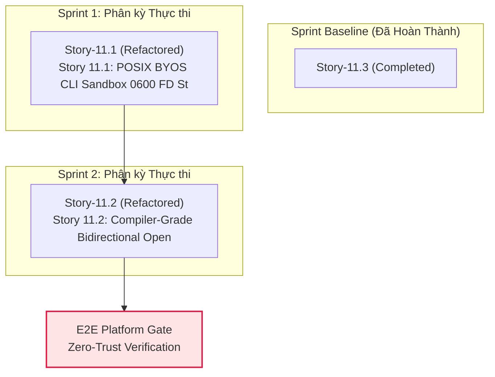

# Epic 11: POSIX BYOS/BYOK Runner (`0o600` FD + `-PGID`), Cross-CLI Normalizer & Universal Open MCP Gateway

## 1. Overview / Executive Summary
- **Value Stream:** `VS-05. cowok & advisor OPC Execution Fleet, Universal MCP & 4-Channel Distribution`
- **Execution Stream:** `Stream-5` (Wave 3/4)
- **FR Covered:** `FR-28`, `FR-29`
- **Provides:** Real BYOS/BYOK Execution Runner + Post-Execution Normalizer (`11.1`) & Universal Open MCP Server (`11.2`).
- **Consumes:** `Epic 02`, `Epic 04`, `Epic 08`, `Epic 10`.

## 2. Goals / Business Value
1. **Xóa Stubs & Chuẩn hóa Thực thi Đa CLI (`Story 11.1`):** Thay thế hoàn toàn các stub giả (`dispatchNodeExecution.ts`, `presentation_copilot.rs`) bằng `crates/bot-fleet` BYOS CLI runner (`0o600` FD staging + `-PGID` process group reaper bảo đảm `0` orphan processes `<=2s` sau cancel) + BYOK streaming + **CLI-Agnostic Post-Execution Normalizer** (`oxc / lol_html -> reconcile_ff_ids -> TriangleLinter -> IconValidator`), đạt `<=20s` first visual preview.
2. **Mở Cổng MCP Hai Chiều Cho Hệ Sinh Thái Ngoài (`Story 11.2`):** Chuyển phạm vi Open MCP Server từ `11.3` cũ thành `Story 11.2` (`crates/mcp-gateway` trên `stdio` + `SSE`, 4 tầng quyền `READ_ONLY..HUMAN_ONLY`, Self-Healing `ToolError` trả payload sửa lỗi AST/linter, Settings `MCP` 1-Click Installer cho Claude/Cursor/Codex/Antigravity). *(Phần Ephemeral Tool Forging `11.2` cũ đã hợp nhất gọn vào `Story 08.5`.)*

## 3. Scope / Scope Boundaries
- **In-Scope:**
  - `Story 11.1` (refactored): POSIX BYOS CLI Runner (`0o600` FD + `-PGID` Reaper), BYOK Unified Gateway & Cross-CLI Normalizer.
  - `Story 11.2` (refactored — kế thừa `11.3` cũ): Compiler-Grade Bidirectional Open MCP Server (4 Auth Tiers) & 1-Click Host Installer UI.
  - `Story 11.3`: `[DEPRECATED]` / `cancelled` (superseded by `Story 11.2`; phần Tool Jail chuyển về `Story 08.5`).
- **Out-of-Scope:**
  - `HUMAN_ONLY` Controlled Ephemeral Tool Jail & 7 DE Tools (thuộc `Story 08.5`).

## 4. Stories in Epic 11

| Story ID | Title | Status | Risk Tier | Dependencies |
| :--- | :--- | :---: | :---: | :--- |
| [Story-11.1](./Story-11.1/story.md) | POSIX BYOS CLI Runner (`0o600` FD + `-PGID` Reaper), BYOK Unified Gateway & Cross-CLI Normalizer | `completed` | `3` | `['04.3', '04.4', '02.1']` |
| [Story-11.2](./Story-11.2/story.md) | Compiler-Grade Bidirectional Open MCP Server (4 Auth Tiers) & 1-Click Host Installer UI | `completed` | `3` | `['10.1', '11.1', '08.5']` |
| [Story-11.3](./Story-11.3/story.md) | *(Superseded by `Story 11.2`)* Bidirectional Open MCP Server | `cancelled` | `3` | `['11.1', '10.2']` |

## 5. QA Simulator Guardian Scorecard (7-Row Hybrid Scorecard)

| Axis | Score | Notes |
| :--- | :---: | :--- |
| **1. Functional Correctness** | `9.5/10` | Thay thế 100% stubs và mở 4 tầng MCP chuẩn xác |
| **2. Data Integrity & State** | `9.4/10` | Normalizer đảm bảo `data-ff-id` & `tokens.css` đồng bộ sau mỗi CLI run |
| **3. Security & Validation** | `9.7/10` | `0o600` FD + `-PGID` reaper + 4-Tier MCP enforcement (`100%`) |
| **4. Performance & Scalability** | `9.5/10` | `<=20s` first preview & dọn process `<=2s` |
| **5. Error Handling & Recovery** | `9.5/10` | Self-healing AST/linter `ToolError` payloads |
| **6. Architectural Depth & Leverage** | `9.5/10` | Không tách trùng lặp sandbox (`TDR-007`) |
| **7. UX Empathy** | `9.4/10` | Cài đặt MCP 1-Click cho non-tech và vibe coder |
| **TOTAL AVERAGE** | **9.50/10** | **PASSED (>= 8.5/10)** |

<!-- BEGIN AUTO-ROADMAP: DO NOT EDIT -->
## 3-Sprint Integrated Development Roadmap (Synchronized Phasing)

> **Mục tiêu**: Tự động hóa phân kỳ và phân bổ tuần tự/song song cho toàn bộ **2 Story Active** trên nền tảng **1 Story Baseline đã `completed`**, loại bỏ chu trình phụ thuộc (No Dependency Cycles) và tuân thủ giới hạn tải tối đa 3 Sprints.

---

### 1. Phân tích Hiện trạng & Chiến lược Phân kỳ Mới (Phasing Rationalization)

- **Baseline Nền tảng (1 Stories `completed` / `cancelled`)**: Đóng vai trò Enabler, cung cấp mock data, schemas và các dịch vụ tiền đề.
- **Phạm vi Active Delta (2 Stories)**: Được phân bổ thành 2 Sprint thực thi kế tiếp.
- **Khả năng Chạy Song Song (Parallel Execution Lanes)**:
  - **Sprint 1**: Tuần tự (Sequential) — `Story-11.1`
  - **Sprint 2**: Tuần tự (Sequential) — `Story-11.2`

---

### 2. Ma trận Cung cấp - Tiêu thụ (Provide-Consume Matrix) & Trạng thái Zod

| Story ID | Trạng thái Thực tế | Provides (Cung cấp) | Consumes (Tiêu thụ) | Zod Schema Status | Ghi chú & Rào chắn |
|---|---|---|---|:---:|---|
| **Story-11.1** | `refactored` | Cung cấp động cơ thực thi sạch & an toàn cho `Story 06.5` (AI Deck Gen), `Story 10.1..10.3` (OPC Fle | consumes_apis: | ⚠️ Chưa có (manual types) | Tuân thủ Zero-Trust Category A |
| **Story-11.2** | `refactored` | Cung cấp kênh MCP chuẩn cho `Story 12.1` (`uiux-os mcp`), `Story 12.2` (Tauri/Cowok Native Plugin) v | description: "Kế thừa phạm vi Open MCP Server + 1-Click Host Installer UI từ Story 11.3 cũ (phần Eph | ⚠️ Chưa có (manual types) | Tuân thủ Zero-Trust Category A |
| **Story-11.3** | `cancelled` | Chức năng Story 11.3: Compiler-Grade Bidirectional | consumes_apis: [] | ⚠️ Chưa có (manual types) | Tuân thủ Zero-Trust Category A |

---

### 3. Sơ đồ Thực thi DAG 3 Sprint (Phased DAG Execution Roadmap)

---

### 4. Kế hoạch Chi tiết Từng Sprint (Execution Specifications)

#### Sprint 1: Phân kỳ Tác vụ
- **Mô hình**: Các câu chuyện được phát triển **tuần tự (Sequential)**.
- **Phạm vi thực thi**:
  1. **`Story-11.1`** (refactored): Story 11.1: POSIX BYOS CLI Sandbox (0600 FD Staging + setpgid/killpg) & BYOK Unified Gateway
- **Tiêu chí Hoàn thành (Sprint Done Criteria)**:
  - Toàn bộ Zod schemas và Unit tests cho các story trong sprint vượt qua 100%.
  - Kiểm thử tích hợp (Tracer Bullet) giữa các story song song không xảy ra tranh chấp dữ liệu (Race Condition).

#### Sprint 2: Phân kỳ Tác vụ
- **Mô hình**: Các câu chuyện được phát triển **tuần tự (Sequential)**.
- **Phạm vi thực thi**:
  1. **`Story-11.2`** (refactored): Story 11.2: Compiler-Grade Bidirectional Open MCP Server, 1-Click Host Installer UI & Run-Scoped Tool Bundles
- **Tiêu chí Hoàn thành (Sprint Done Criteria)**:
  - Toàn bộ Zod schemas và Unit tests cho các story trong sprint vượt qua 100%.
  - Kiểm thử tích hợp (Tracer Bullet) giữa các story song song không xảy ra tranh chấp dữ liệu (Race Condition).

<!-- END AUTO-ROADMAP -->
| Story ID | Title | Dependencies | Status |
|---|---|---|---|
| [Story-11.1](./Story-11.1/story.md) | POSIX BYOS CLI Sandbox (0600 FD Staging + setpgid/killpg) & BYOK Unified Gateway | 04.3, 04.4, 04.6, 02.1 | completed |
| [Story-11.2](./Story-11.2/story.md) | Compiler-Grade Bidirectional Open MCP Server, 1-Click Host Installer UI & Run-Scoped Tool Bundles | 10.1, 11.1, 08.5 | refactored |
| [Story-11.3](./Story-11.3/story.md) | Compiler-Grade Bidirectional Open MCP Server & 1-Click Host Installer UI | 11.1, 11.2 | cancelled |