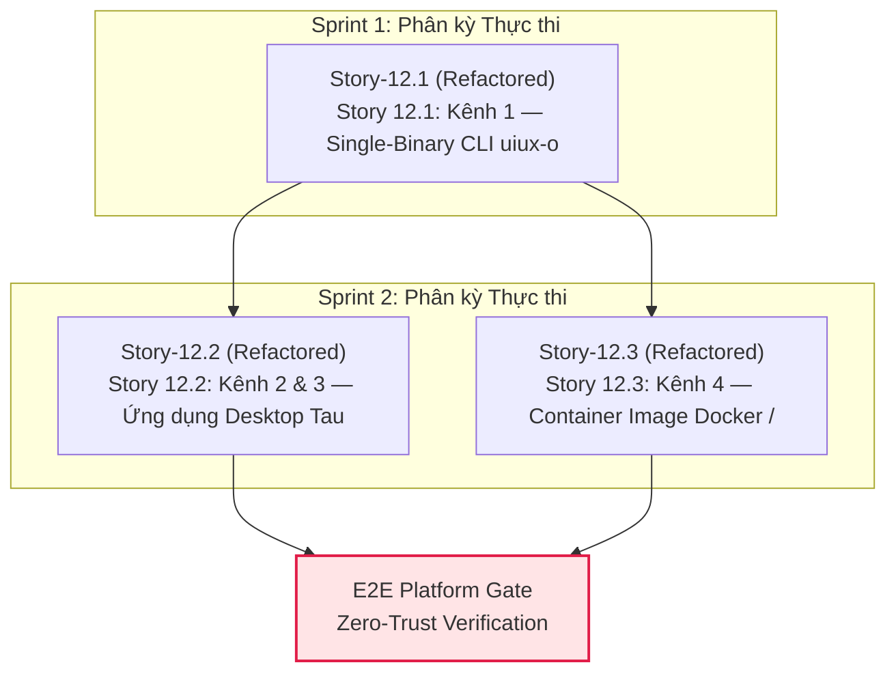

# Epic 12: 4-Channel Packaging, Standalone `/api/*` Parity & OCI Distribution

## 1. Overview / Executive Summary
- **Value Stream:** `VS-05. cowok & advisor OPC Execution Fleet, Universal MCP & 4-Channel Distribution`
- **Execution Stream:** `Stream-5` (Wave 4)
- **FR Covered:** `FR-30`
- **Provides:** 4 kênh phân phối chính thức kèm standalone `/api/*` daemon route parity (`0` Vite-proxy 404).
- **Consumes:** `Epic 07`, `Epic 08`, `Epic 11`.

## 2. Goals / Business Value
1. **Binary Độc lập & Tương thích Đường dẫn Standalone (`Story 12.1`):** Nhúng React 19 Workbench & built-in skills vào 1 Rust binary `uiux-os`, mở thêm alias `/api/*` ngay trên `crates/harness-daemon` để chạy độc lập không cần Vite dev server (`0` Vite-proxy 404s).
2. **Desktop Gốc Tauri v2 & Native Cowok Plugin (`Story 12.2`):** Đóng gói `.dmg`/`.msi`/`.AppImage` cho non-tech và gói plugin chuẩn Cowok.ai đồng bộ kiến trúc `08.5`.
3. **CI/CD Team Container kèm Pooled Chromium (`Story 12.3`):** Image `Docker`/`OCI` tích hợp sẵn Pooled Headless Chromium cho `lib-audit`, `slides-check` (`07.1`) và Sealed Eval (`13.1`).

## 3. Scope / Scope Boundaries
- **In-Scope:**
  - `Story 12.1` (refactored): Single-Binary CLI (`uiux-os`) & Local Web với Standalone `/api/*` Daemon Alias.
  - `Story 12.2` (refactored): Ứng dụng Desktop `Tauri v2` & Native Plugin Pack cho Cowok.ai.
  - `Story 12.3` (refactored): Docker / OCI Image kèm Pooled Headless Chromium.
- **Out-of-Scope:**
  - Bộ benchmark `tests/eval/sealed/` & 25 ca `/simulate-user` (thuộc `Epic 13`).

## 4. Stories in Epic 12

| Story ID | Title | Status | Risk Tier | Dependencies |
| :--- | :--- | :---: | :---: | :--- |
| [Story-12.1](./Story-12.1/story.md) | Kênh 1 — Single-Binary CLI (`uiux-os`) & Local Web Workbench với `/api/*` Standalone Parity | `refactored` | `2` | `['07.2', '11.1', '11.2']` |
| [Story-12.2](./Story-12.2/story.md) | Kênh 2 & 3 — Ứng dụng Desktop `Tauri v2` (`.dmg`/`.msi`/`.AppImage`) & Gói Native Plugin cho Cowok.ai | `refactored` | `2` | `['12.1', '08.5']` |
| [Story-12.3](./Story-12.3/story.md) | Kênh 4 — Container Image (`Docker` / `OCI`) kèm Pooled Headless Chromium cho Đội nhóm & CI/CD | `refactored` | `2` | `['07.1', '12.1']` |

## 5. QA Simulator Guardian Scorecard (7-Row Hybrid Scorecard)

| Axis | Score | Notes |
| :--- | :---: | :--- |
| **1. Functional Correctness** | `9.5/10` | Phủ đủ 4 kênh phát hành & fix hổng `/api/*` khi không qua Vite |
| **2. Data Integrity & State** | `9.4/10` | Parity giữa Vite BFF và standalone `harness-daemon` |
| **3. Security & Validation** | `9.5/10` | Loopback auth & CSP giữ nguyên trên mọi kênh |
| **4. Performance & Scalability** | `9.5/10` | Binary gọn nhẹ, Docker sẵn Pooled Chromium |
| **5. Error Handling & Recovery** | `9.4/10` | Graceful fallback & health diagnostics |
| **6. Architectural Depth & Leverage** | `9.5/10` | Một mã nguồn Rust + Vite dùng chung 4 kênh |
| **7. UX Empathy** | `9.6/10` | Non-tech cài đặt 1 click qua `.dmg`/`.msi` hoặc `npx` |
| **TOTAL AVERAGE** | **9.49/10** | **PASSED (>= 8.5/10)** |

<!-- BEGIN AUTO-ROADMAP: DO NOT EDIT -->
## 2-Sprint Integrated Development Roadmap (Synchronized Phasing)

> **Mục tiêu**: Tự động hóa phân kỳ và phân bổ tuần tự/song song cho toàn bộ **3 Story Active** trên nền tảng **0 Story Baseline đã `completed`**, loại bỏ chu trình phụ thuộc (No Dependency Cycles) và tuân thủ giới hạn tải tối đa 2 Sprints.

---

### 1. Phân tích Hiện trạng & Chiến lược Phân kỳ Mới (Phasing Rationalization)

- **Baseline Nền tảng (0 Stories `completed` / `cancelled`)**: Đóng vai trò Enabler, cung cấp mock data, schemas và các dịch vụ tiền đề.
- **Phạm vi Active Delta (3 Stories)**: Được phân bổ thành 2 Sprint thực thi kế tiếp.
- **Khả năng Chạy Song Song (Parallel Execution Lanes)**:
  - **Sprint 1**: Tuần tự (Sequential) — `Story-12.1`
  - **Sprint 2**: Song song (Parallel) — `Story-12.2`, `Story-12.3`

---

### 2. Ma trận Cung cấp - Tiêu thụ (Provide-Consume Matrix) & Trạng thái Zod

| Story ID | Trạng thái Thực tế | Provides (Cung cấp) | Consumes (Tiêu thụ) | Zod Schema Status | Ghi chú & Rào chắn |
|---|---|---|---|:---:|---|
| **Story-12.1** | `refactored` | **AC-04 (Focus-Free Headless Screenshot & HTML Visual Diff Suite CLI):** Cung cấp `cowok-design diff | consumes_apis: | ⚠️ Chưa có (manual types) | Tuân thủ Zero-Trust Category A |
| **Story-12.2** | `refactored` | Chức năng Story 12.2: Kênh 2 & 3 — Ứng dụng Deskto | consumes_apis: | ⚠️ Chưa có (manual types) | Tuân thủ Zero-Trust Category A |
| **Story-12.3** | `refactored` | **AC-02 (CI/CD Headless Gate & MCP Streamable HTTP Integration):** Hỗ trợ chạy một lệnh CI gate (`ui | consumes_apis: | ⚠️ Chưa có (manual types) | Tuân thủ Zero-Trust Category A |

---

### 3. Sơ đồ Thực thi DAG 2 Sprint (Phased DAG Execution Roadmap)

---

### 4. Kế hoạch Chi tiết Từng Sprint (Execution Specifications)

#### Sprint 1: Phân kỳ Tác vụ
- **Mô hình**: Các câu chuyện được phát triển **tuần tự (Sequential)**.
- **Phạm vi thực thi**:
  1. **`Story-12.1`** (refactored): Story 12.1: Kênh 1 — Single-Binary CLI (uiux-os) & Local Web Workbench (cargo / brew / npx)
- **Tiêu chí Hoàn thành (Sprint Done Criteria)**:
  - Toàn bộ Zod schemas và Unit tests cho các story trong sprint vượt qua 100%.
  - Kiểm thử tích hợp (Tracer Bullet) giữa các story song song không xảy ra tranh chấp dữ liệu (Race Condition).

#### Sprint 2: Phân kỳ Tác vụ
- **Mô hình**: Các câu chuyện trong Sprint này độc lập với nhau, có thể **phát triển song song (Parallel)**.
- **Phạm vi thực thi**:
  1. **`Story-12.2`** (refactored): Story 12.2: Kênh 2 & 3 — Ứng dụng Desktop Tauri v2 (.dmg/.msi/.AppImage) & Gói Native Plugin cho Cowok.ai
  2. **`Story-12.3`** (refactored): Story 12.3: Kênh 4 — Container Image (Docker / OCI) kèm Headless Chromium cho Đội nhóm & CI/CD
- **Tiêu chí Hoàn thành (Sprint Done Criteria)**:
  - Toàn bộ Zod schemas và Unit tests cho các story trong sprint vượt qua 100%.
  - Kiểm thử tích hợp (Tracer Bullet) giữa các story song song không xảy ra tranh chấp dữ liệu (Race Condition).

<!-- END AUTO-ROADMAP -->