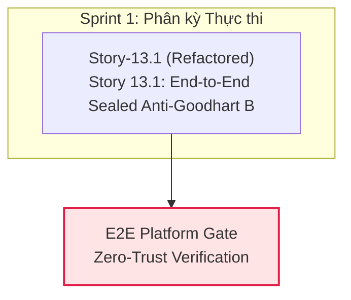

# Epic 13: End-to-End Sealed Anti-Goodhart Benchmark & 25-Case `/simulate-user` Certification Suite

## 1. Overview / Executive Summary
- **Value Stream:** `VS-06. Release Certification & Anti-Goodhart Evaluation`
- **Execution Stream:** `Stream-6` (Wave 4 — Release Certification Gate)
- **FR Covered:** `FR-36`
- **Provides:** Sealed Anti-Goodhart Eval Runner (`tests/eval/sealed/`, `V18 eval_benchmark_runs`, `gate-history.jsonl`), Workbench `M1..M5` Certification Drawer, CLI `uiux-os eval run`, và bộ 25 kịch bản `/simulate-user` (`UC-01..UC-25`).
- **Consumes:** `Epic 07`, `Epic 08`, `Epic 09`, `Epic 10`, `Epic 12`.

## 2. Goals / Business Value
1. **Chống Goodhart Tuyệt Đối (`TDR-007`):** Đóng băng bộ chấm điểm chuẩn tại `tests/eval/sealed/` quyền `chmod 444` + xác thực SHA-256 trước khi chạy; mọi hành vi sửa đổi thước đo kích hoạt tức thì `100% SEALED_EVAL_TAMPER_ERROR`.
2. **Đo Lường Thực Chất Lợi Thế Của Hệ Harness (`Paired Ablation`):** So sánh có kiểm chứng `with_skill` vs `baseline` trên `>=12` briefs, hiệu chuẩn 3 nhà cung cấp Decision Engine (`Local FTS5`, `gemini-decision-1` / `TypeSafe JEV`, `Deterministic MCDA`), và tiêm lỗi `Builder != Scorer` (`>=95%` catch rate).
3. **Nghiệm Thu Toàn Hành Trình Non-Tech (`25-Case /simulate-user E2E`):** Tự động chạy 25 ca E2E Playwright (`UC-01..UC-25`) qua đủ 5 cột mốc `M1..M5`, bảo đảm `$0 <15s` PR CI và `>=22/25 Full Pass, 0 Blocked, 0 Gap`.

## 3. Scope / Scope Boundaries
- **In-Scope:**
  - `Story 13.1` (new): End-to-End Sealed Anti-Goodhart Benchmark Runner & 25-Case `/simulate-user` `M1..M5` Certification Suite.
- **Out-of-Scope:**
  - Thực thi vòng lọc `LEARN` hằng ngày (thuộc `Story 08.5`) và đấu trường từng phiên thiết kế (thuộc `Story 10.3`).

## 4. Stories in Epic 13

| Story ID | Title | Status | Risk Tier | Dependencies |
| :--- | :--- | :---: | :---: | :--- |
| [Story-13.1](./Story-13.1/story.md) | End-to-End Sealed Anti-Goodhart Benchmark Runner & 25-Case `/simulate-user` `M1..M5` Certification Suite | `refactored` | `3` | `['07.1', '08.5', '09.2', '10.3', '12.1']` |

## 5. QA Simulator Guardian Scorecard (7-Row Hybrid Scorecard)

| Axis | Score | Notes |
| :--- | :---: | :--- |
| **1. Functional Correctness** | `9.6/10` | Phủ đủ 25 ca `/simulate-user`, paired ablation & 3-provider calibration |
| **2. Data Integrity & State** | `9.6/10` | `V18 eval_benchmark_runs` + immutable `chmod 444` SHA-256 manifest |
| **3. Security & Validation** | `9.7/10` | `100% SEALED_EVAL_TAMPER_ERROR` chặn tự gian lận eval |
| **4. Performance & Scalability** | `9.5/10` | `$0 <15s` PR CI tier vs full release Playwright E2E suite |
| **5. Error Handling & Recovery** | `9.5/10` | Fail-closed trên sai lệch SHA-256 hoặc regression `<22/25` |
| **6. Architectural Depth & Leverage** | `9.6/10` | Chứng nhận toàn hệ sinh thái `M1..M5` trước phát hành |
| **7. UX Empathy** | `9.5/10` | Certification Drawer hiển thị minh bạch tiến độ 25 kịch bản non-tech |
| **TOTAL AVERAGE** | **9.57/10** | **PASSED (>= 8.5/10)** |

<!-- BEGIN AUTO-ROADMAP: DO NOT EDIT -->
## 1-Sprint Integrated Development Roadmap (Synchronized Phasing)

> **Mục tiêu**: Tự động hóa phân kỳ và phân bổ tuần tự/song song cho toàn bộ **1 Story Active** trên nền tảng **0 Story Baseline đã `completed`**, loại bỏ chu trình phụ thuộc (No Dependency Cycles) và tuân thủ giới hạn tải tối đa 1 Sprints.

---

### 1. Phân tích Hiện trạng & Chiến lược Phân kỳ Mới (Phasing Rationalization)

- **Baseline Nền tảng (0 Stories `completed` / `cancelled`)**: Đóng vai trò Enabler, cung cấp mock data, schemas và các dịch vụ tiền đề.
- **Phạm vi Active Delta (1 Stories)**: Được phân bổ thành 1 Sprint thực thi kế tiếp.
- **Khả năng Chạy Song Song (Parallel Execution Lanes)**:
  - **Sprint 1**: Tuần tự (Sequential) — `Story-13.1`

---

### 2. Ma trận Cung cấp - Tiêu thụ (Provide-Consume Matrix) & Trạng thái Zod

| Story ID | Trạng thái Thực tế | Provides (Cung cấp) | Consumes (Tiêu thụ) | Zod Schema Status | Ghi chú & Rào chắn |
|---|---|---|---|:---:|---|
| **Story-13.1** | `refactored` | Khóa chuẩn nghiệm thu khách quan cho toàn bộ `cowok-design`: bộ benchmark `tests/eval/sealed/` được  | consumes_apis: | ⚠️ Chưa có (manual types) | Tuân thủ Zero-Trust Category A |

---

### 3. Sơ đồ Thực thi DAG 1 Sprint (Phased DAG Execution Roadmap)

---

### 4. Kế hoạch Chi tiết Từng Sprint (Execution Specifications)

#### Sprint 1: Phân kỳ Tác vụ
- **Mô hình**: Các câu chuyện được phát triển **tuần tự (Sequential)**.
- **Phạm vi thực thi**:
  1. **`Story-13.1`** (refactored): Story 13.1: End-to-End Sealed Anti-Goodhart Benchmark Runner & 25-Case /simulate-user M1..M5 Certification Suite
- **Tiêu chí Hoàn thành (Sprint Done Criteria)**:
  - Toàn bộ Zod schemas và Unit tests cho các story trong sprint vượt qua 100%.
  - Kiểm thử tích hợp (Tracer Bullet) giữa các story song song không xảy ra tranh chấp dữ liệu (Race Condition).

<!-- END AUTO-ROADMAP -->
| Story ID | Title | Dependencies | Status |
|---|---|---|---|
| [Story-13.1](./Story-13.1/story.md) | End-to-End Sealed Anti-Goodhart Benchmark Runner & 25-Case /simulate-user M1..M5 Certification Suite | 05.5, 07.1, 08.5, 09.2, 10.3, 12.1, 12.3 | refactored |