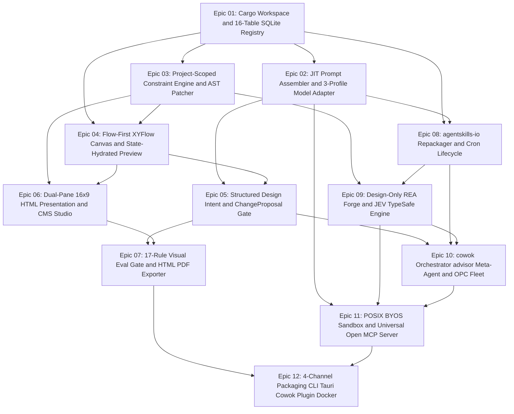
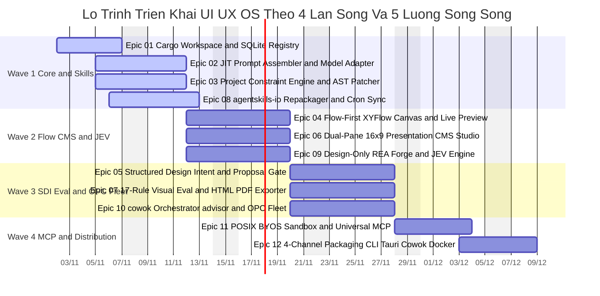

# Lộ Trình Sản Phẩm Toàn Diện & Ma Trận Phụ Thuộc Thực Thi: UI/UX OS (FlowForge Harness OS)
*(Comprehensive Product Phased Roadmap & Dependency Matrix — v3.0 Universal)*

> **Phiên bản:** v3.0-Universal  
> **Ngày cập nhật:** 2026-11-02  
> **Trạng thái:** Active SSOT Baseline (`3. Development`)  
> **Bản thể dự án (Archetypes):** `mechanized-design-harness-os`, `agent-fleet-orchestrator`, `html-presentation-cms`  
> **Cặp đôi Điều phối Trung tâm:** **`cowok`** (`Cowok Orchestrator`) & **`advisor`** (`Advisor Agent`)  
> **Ngân sách Worktree đồng thời:** $\le 5$ song song (Tuân thủ trần Worktree Quota $\le 5$)  
> **Hợp đồng Macro-to-Micro Lock:** `_iwish-output/_state/roadmap-lock.json`

---

## 1. Tổng Quan Hiện Trạng & Điểm Tựa Nghiệp Vụ (Maturity Baseline vs. Active Delta)

Dự án **UI/UX OS (FlowForge)** đã hoàn tất 100% giai đoạn **Idea Discovery** (6 báo cáo nghiên cứu chuyên sâu, bao gồm `/rea` trên `design:os studio v0.7.6` và Awesome-RE) cùng **Product Planning** (`FR-01` .. `FR-30`, 16 bảng SQLite WAL, 11 Rust Crates, 4 ADR). Toàn bộ **12 Epics** và **36 User Stories** được tổ chức vào **4 Làn sóng Phát triển (4 Waves)** trên **5 Luồng Thực thi Song song (5 Parallel Streams)**.

### 1.1. Bảng Điểm Tựa Nền Tảng Đã Hoàn Thành (Maturity Baseline)

| STT | Mã Giai Đoạn / Khối Nền Tảng | Trạng Thái | Thực Thể Dữ Liệu & Hợp Đồng Đã Sẵn Sàng Cung Cấp |
| :---: | :--- | :---: | :--- |
| **01** | **Phase 1: Idea Discovery & Deep `/rea` Studies** | `completed` | 6 Báo cáo REA (`design:os v0.7.6`, `OpenDesign`, `Codex`, `Awesome-RE`, `Rust vs Go`, `Project Constraints`) |
| **02** | **Phase 2: Product Planning & Architecture Specs** | `completed` | PRD (`FR-01`..`FR-30`), DB Spec (16 bảng SQLite WAL), UI/UX Spec, 11-Crate Architecture, `ADR-001`..`ADR-004` |

### 1.2. Thống Kê Active Delta Cần Triển Khai
- **Tổng số Epics dự án:** 12 Epics (`Epic 01` .. `Epic 12`)
- **Tổng số User Stories:** 36 Stories (`Story 01.1` .. `Story 12.3`)
- **Số làn sóng phát triển (Waves):** 4 Waves (`Wave 1` $\to$ `Wave 4`)
- **Số luồng song song (Parallel Tracks):** 5 Streams (`Stream-1` .. `Stream-5`)

---

## 2. Ma Trận Cung Cấp - Tiêu Thụ & Phân Tích Đồ Thị Khối (Provide-Consume Matrix & Dependency DAG)

### 2.1. Bảng Ma Trận Phụ Thuộc Chi Tiết Cấp Epic (`Epic 01` .. `Epic 12`)

| Epic ID | Tên Khối Nghiệp Vụ | Stream | Cung Cấp (Provides - Entities & Contracts) | Tiêu Thụ (Consumes - From Epics) | Wave |
| :--- | :--- | :---: | :--- | :--- | :---: |
| **Epic 01** | Cargo Workspace, Domain Contracts (`ts-rs`) & 16-Table SQLite Registry | `Stream-1` | `crates/domain`, `crates/spec-registry`, 9-Spec Vault | *(Root Anchor — In-Degree 0)* | Wave 1 |
| **Epic 02** | JIT Prompt Assembler & 3-Profile Model Capability Adapter | `Stream-1` | `crates/prompt-assembler`, $\le 1,500$ token slicer, 3 Model Profiles | `Epic 01` | Wave 1 |
| **Epic 03** | Project-Scoped Configurable Constraint Engine & `<1ms` `data-ff-id` Patcher | `Stream-1` | `crates/ast-guardian`, `PROJECT_CONSTRAINTS`, Flagship Preset 145 Icons | `Epic 01` | Wave 1 |
| **Epic 04** | Flow-First XYFlow Canvas, State-Hydrated Preview & Anchored Comments | `Stream-2` | `ScreenState` + `Transition` DAG, Multi-Viewport Iframe, `stale_mapping` | `Epic 01`, `Epic 03` | Wave 2 |
| **Epic 05** | Structured Design Intent (SDI), Visual Clarification & `ChangeProposal` Gate | `Stream-2` | `DesignIntentV1`, 2–3 Clarification Variants, Sandbox Diff & Revert | `Epic 02`, `Epic 04` | Wave 3 |
| **Epic 06** | Dual-Pane 16:9 HTML Presentation & Non-Tech CMS Workbench | `Stream-3` | 16:9 Slide Stage, `<16ms` Human CMS Texting, Live Charts & Copilot | `Epic 03`, `Epic 04` | Wave 2 |
| **Epic 07** | 17-Rule Multi-Viewport Visual Eval Gate, HTML/PDF & Repo Exporter | `Stream-3` | 17-Rule Linter, WCAG 2.2 AA, 16:9 Overflow Gate, HTML/PDF Export | `Epic 05`, `Epic 06` | Wave 3 |
| **Epic 08** | `agentskills.io` Repackager, 6 Built-in Skills & GitHub Cron Lifecycle | `Stream-4` | `crates/skill-repackager`, `SKILL.md` + `plugin.json`, Cron Sync | `Epic 01`, `Epic 02` | Wave 1 |
| **Epic 09** | `Design-Only REA Forge` & `JEV — TypeSafe` 6-Primitive Acceleration Engine | `Stream-4` | `crates/design-rea-forge`, `crates/jev-engine` (`Jev Choice`, `Jev Noul`, `__jevFast`) | `Epic 03`, `Epic 08` | Wave 2 |
| **Epic 10** | `cowok` Master Orchestrator, `advisor` Meta-Agent, OPC Fleet & Tournament Mode | `Stream-5` | `crates/agent-fleet`, `$UIUX_LIVE_SPEC` `<50ms` PTY, `ONE_JOB`/`NEVER`, `E1..E4`, Tournament | `Epic 05`, `Epic 08`, `Epic 09` | Wave 3 |
| **Epic 11** | POSIX BYOS/BYOK Sandbox & Universal Open MCP Server (4 Permission Tiers) | `Stream-5` | `crates/byos-sandbox` (`0600` FD), `crates/mcp-server` (`stdio` + `HTTP/SSE`) | `Epic 02`, `Epic 09`, `Epic 10` | Wave 4 |
| **Epic 12** | 4-Channel Packaging & Distribution (CLI, Tauri v2, Cowok Plugin, Docker) | `Stream-5` | Single-Binary CLI, Tauri v2 Desktop, Cowok Plugin Pack, OCI Image | `Epic 07`, `Epic 11` | Wave 4 |

### 2.2. Sơ Đồ Đồ Thị Khối Liên Kết Phụ Thuộc (Macro-DAG Flowchart)

---

## 3. Các Nguyên Tắc Logic Bất Biến Của Dự Án (Core Engineering & Domain Invariants)

- **Project-Scoped Configurable Design Constraints:** Mỗi dự án khi khởi tạo được thiết lập cấu hình ràng buộc riêng (`PROJECT_CONSTRAINTS` trích xuất từ `02_BRAND_IDENTITY`, `07_COMPONENT_REGISTRY`, `08_TECH_STACK_CONTRACT`), được kiểm duyệt trong `<1ms` bởi `oxc` AST Linter và `Jev Noul`. Gói `cowok-brand-product-system-v4.3` (Zero-Tailwind + 145 Brand SVG Icons) là Flagship Preset mặc định.
- **Đồng bộ Cặp đôi Điều phối `cowok` & `advisor`:** Người dùng chỉ tương tác với duy nhất **`cowok`** (`Cowok Orchestrator`); **`advisor`** (`Advisor Agent`) tự động sinh/nâng cấp kỹ năng `SKILL.md` và chạy vòng lặp tự tiến hóa 6 bước khi phát hiện lỗi lặp lại.
- **Độc lập Kiểm định (`"Builder != Scorer"`) & Thang Bằng chứng `E1..E4`:** Execution Agent sinh ra giao diện/slide tuyệt đối không được tự chấm `PASS`; bắt buộc đi qua `Verifier Agent` độc lập trên 4 cấp độ `E1..E4`.

---

## 4. Phân Tích Khả Năng Triển Khai Song Song (Parallel Execution Tracks)

### 4.1. Bảng Định Nghĩa 5 Parallel Tracks & Phạm Vi Cô Lập Bảng Dữ Liệu

| Mã Luồng | Tên Luồng & Phạm Vi Chuyên Biệt | Danh Mục Bảng DB Sở Hữu Độc Quyền (Disjoint Write-Set) | Ngân Sách Worktree ($\le 5$) |
| :--- | :--- | :--- | :---: |
| **Stream-1** | Rust Core Harness, 9-Spec Vault & Project Constraint Engine (`core_specs.prisma`) | `PROJECTS`, `PROJECT_CONSTRAINTS`, `SPEC_DOCUMENTS`, `PORTALS` | `1` worktree |
| **Stream-2** | Flow-First Executable Design Workbench & SDI Engine (`flow_preview.prisma`) | `FLOW_NODES`, `FLOW_TRANSITIONS`, `DESIGN_INTENTS`, `ANCHORED_COMMENTS`, `CHANGE_PROPOSALS`, `VERSION_SNAPSHOTS` | `1` worktree |
| **Stream-3** | Dual-Pane 16:9 HTML Presentation CMS & Visual Eval Gate (`presentation_cms.prisma`) | `PRESENTATIONS`, `SLIDES`, `EVAL_RUNS` | `1` worktree |
| **Stream-4** | `agentskills.io` Ecosystem, `Design-Only REA Forge` & `JEV — TypeSafe` (`skills_rea.prisma`) | `SKILL_PLUGINS`, `TOURNAMENT_RUNS` | `1` worktree |
| **Stream-5** | `cowok` & `advisor` OPC Fleet, Universal MCP & 4-Channel Distribution (`opc_fleet.prisma`) | `FLEET_TASKS`, `EVOLUTION_LEDGER` | `1` worktree |

### 4.2. Ranh Giới Hợp Đồng Đóng Băng (Contract-First Isolation Boundary)
- **Contract-First & Phase 0 Schema Seal Gate:** `Epic 01` khóa chặt các struct trong `crates/domain` và xuất `.d.ts` tự động qua `ts-rs`.
- **Sync Barrier Giữa Các Làn Sóng (Wave Sync Barrier):** Mọi Stream trong Wave hiện tại phải vượt qua `cargo test`, `oxc` AST Gate và Sync Barrier trước khi mở khóa Wave kế tiếp.

---

## 5. Lộ Trình Phát Triển Toàn Diện Theo Làn Sóng (Multi-Wave Phased Master Plan)

### 5.1. Bảng Phân Kỳ Chi Tiết 4 Làn Sóng (`Wave 1` $\rightarrow$ `Wave 4`)

### 🔷 HORIZON 1: Foundational Rust Core, 9-Spec Vault, Project Constraint Engine & Built-in Skills
> **Mục tiêu (Vertical Value Slice):** Khởi tạo monorepo 11 Rust crates + `pnpm`, vận hành 16 bảng SQLite WAL, bộ cắt lát ngữ cảnh JIT ($\le 1,500$ tokens), động cơ ràng buộc cấu hình theo dự án (`oxc` AST `<1ms`), và đóng gói 6 Built-in Skills chuẩn `agentskills.io`.

| Luồng Thực Thi (Stream) | Miền Dữ Liệu & Crates | Chuỗi Bước Nhân Quả (Intra-Stream Causal Steps) | Epics Đóng Khép Kín (Closed Epics) |
| :--- | :--- | :--- | :--- |
| **Stream 1: Core Harness & Constraint Engine** | `core_specs.prisma` (`crates/domain`, `spec-registry`, `prompt-assembler`, `ast-guardian`) | `Epic-01` $\rightarrow$ `Epic-02` $\rightarrow$ `Epic-03` | `Epic-01`, `Epic-02`, `Epic-03` |
| **Stream 4: `agentskills.io` & Plugin Lifecycle** | `skills_rea.prisma` (`crates/skill-repackager`) | `Epic-08` | `Epic-08` |

### 🔷 HORIZON 2: Flow-First Executable Workbench, Dual-Pane 16:9 Presentation CMS & JEV / REA Engine
> **Mục tiêu (Vertical Value Slice):** Ra mắt giao diện Flow-First (`ScreenState` + `Transition`, State-Hydrated Live Preview, Element-Anchored Comments), giao diện Dual-Pane 16:9 Presentation CMS (`<16ms` sync), cùng bộ tăng tốc `JEV — TypeSafe` và `Design-Only REA Forge`.

| Luồng Thực Thi (Stream) | Miền Dữ Liệu & Crates | Chuỗi Bước Nhân Quả (Intra-Stream Causal Steps) | Epics Đóng Khép Kín (Closed Epics) |
| :--- | :--- | :--- | :--- |
| **Stream 2: Flow-First Design Workbench** | `flow_preview.prisma` (`apps/web` Flow Canvas) | `Epic-04` | `Epic-04` |
| **Stream 3: 16:9 Presentation & CMS Studio** | `presentation_cms.prisma` (`apps/web` Dual-Pane CMS) | `Epic-06` | `Epic-06` |
| **Stream 4: REA Forge & `JEV — TypeSafe`** | `skills_rea.prisma` (`crates/design-rea-forge`, `crates/jev-engine`) | `Epic-09` | `Epic-09` |

### 🔷 HORIZON 3: SDI Visual Clarification, 17-Rule Visual Eval Gate & `cowok` / `advisor` Autonomous OPC Fleet
> **Mục tiêu (Vertical Value Slice):** Hoàn thiện trình biên dịch `DesignIntentV1` + 2–3 phương án Visual Clarification + `ChangeProposal` Diff Gate, bộ kiểm định 17 quy tắc + xuất HTML/PDF/Repo ZIP, và vận hành đội hình Execution Agents tự hành dưới sự chỉ huy của **`cowok`** & **`advisor`** (`$UIUX_LIVE_SPEC` `<50ms` PTY + Tournament Mode).

| Luồng Thực Thi (Stream) | Miền Dữ Liệu & Crates | Chuỗi Bước Nhân Quả (Intra-Stream Causal Steps) | Epics Đóng Khép Kín (Closed Epics) |
| :--- | :--- | :--- | :--- |
| **Stream 2: SDI & ChangeProposal Gate** | `flow_preview.prisma` (`crates/harness-daemon` SDI) | `Epic-05` | `Epic-05` |
| **Stream 3: 17-Rule Eval & Exporter** | `presentation_cms.prisma` (`crates/harness-daemon` Eval) | `Epic-07` | `Epic-07` |
| **Stream 5: `cowok` & `advisor` OPC Fleet** | `opc_fleet.prisma` (`crates/agent-fleet`) | `Epic-10` | `Epic-10` |

### 🔷 HORIZON 4: POSIX BYOS/BYOK Sandbox, Universal Open MCP Server & 4-Channel Distribution
> **Mục tiêu (Vertical Value Slice):** Đóng gói hoàn chỉnh sandbox BYOS (`0600` FD + `setpgid`), rèn tool tạm thời an toàn, máy chủ Universal Open MCP (4 tầng quyền hạn) cho Cowok.ai/Claude/Codex/AGY, và xuất bản trên cả 4 kênh phân phối (CLI, Tauri v2 Desktop, Cowok Plugin, Docker).

| Luồng Thực Thi (Stream) | Miền Dữ Liệu & Crates | Chuỗi Bước Nhân Quả (Intra-Stream Causal Steps) | Epics Đóng Khép Kín (Closed Epics) |
| :--- | :--- | :--- | :--- |
| **Stream 5: Universal MCP & 4-Channel Release** | `opc_fleet.prisma` (`crates/byos-sandbox`, `crates/mcp-server`) | `Epic-11` $\rightarrow$ `Epic-12` | `Epic-11`, `Epic-12` |

### 5.2. Biểu Đồ Gantt Tiến Độ Thực Thi Đa Làn Sóng (Multi-Wave Phased Gantt)

---

## 6. Kế Hoạch Hành Động Tức Thời Cho Sprint Hiện Tại (Immediate P0 Action Slices)

Từ **Wave 1 (Horizon 1)**, các Story mỏ neo có bậc vào bằng 0 hoặc mở khóa trực tiếp toàn bộ chuỗi nhân quả được kích hoạt ở trạng thái `ready-for-dev`:

| Mã Lát Cắt | Module / Epic Trọng Tâm | Danh Sách Story IDs Triển Khai Ngay | Luồng (Track) | Lý Do Kích Hoạt Tức Thời (Activation Rationale) |
| :---: | :--- | :--- | :---: | :--- |
| **H1.S1** | **Epic 01, 02, 03**: Rust Core Harness, 16-Table SQLite Registry & Project Constraint Engine | `01.1`, `01.2`, `01.3`, `02.1`, `03.1` | `Stream-1` | Mỏ neo nền tảng (In-Degree = 0) cung cấp `crates/domain` (`ts-rs`), `crates/spec-registry` và `PROJECT_CONSTRAINTS` cho toàn dự án. |
| **H1.S2** | **Epic 08**: `agentskills.io` Repackager & 6 Built-in Harness Skills | `08.1`, `08.2`, `08.3` | `Stream-4` | Khởi tạo chuẩn đóng gói `SKILL.md` (`agentskills.io`) + `plugin.json` để sẵn sàng cho `cowok`, `advisor` và `Design-Only REA Forge`. |
