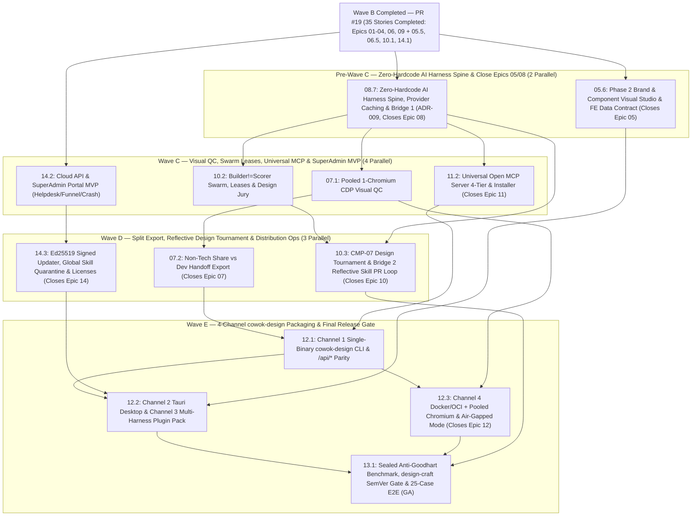

# Lộ Trình Sản Phẩm Toàn Diện & Ma Trận Phụ Thuộc Thực Thi: `cowok-design` (Open-Source Agent-Native Design & Presentation Harness OS)
*(Comprehensive Product Phased Roadmap & Dependency Matrix — v4.1)*

> **Phiên bản:** `v4.1-Wave-B-Completed-And-ADR-009`  
> **Ngày cập nhật:** `2026-11-24`  
> **Định danh sản phẩm & CLI thống nhất:** **`cowok-design`** (`ADR-008`, thay thế hoàn toàn tên cũ `uiux-os`)  
> **Ngân sách Worktree đồng thời:** $\le 4$ song song (tuân thủ trần Worktree Quota $\le 5$, disjoint file/schema write-sets)  
> **Trạng thái nguồn chân lý:** Đồng bộ 1:1 với `_iwish-output/sprint-status.yaml`, `_iwish-output/3. Development/sprint-status.yaml`, `PRD (FR-01..FR-39)` và `Architecture (ADR-001..ADR-009)`.

---

## 1. Tổng Quan Hiện Trạng (Maturity Baseline vs. Active Delta)

### 1.1. Maturity Baseline — Đã Hoàn Thành (`35` Stories `completed` / `6` Epics 100% xong)

| Epic | Tên Khối Nghiệp Vụ | Trạng Thái | Stories Đã Hoàn Thành | Còn Lại |
| :---: | :--- | :---: | :--- | :--- |
| **Epic 01** | Cargo Workspace, Domain Contracts (`ts-rs`) & SQLite WAL Core | `completed` | `01.1`, `01.2`, `01.3` | *(0)* |
| **Epic 02** | KV-Cache Compiler, Hidden SSOT (`V16..V18`) & 7 Craft Skills | `completed` | `02.1`, `02.4` *(02.2/02.3 cancelled)* | *(0)* |
| **Epic 03** | Project-Scoped Constraint Engine & `<1ms` `data-ff-id` Patcher | `completed` | `03.1`, `03.2`, `03.3` | *(0)* |
| **Epic 04** | Flow-First 2D DAG Studio, Security Kernel, CAS Intake & In-Chat Vault | `completed` | `04.1`, `04.2`, `04.3`, `04.4`, `04.5`, `04.6` | *(0)* |
| **Epic 05** | 2D Storyboard, Sketch-to-Polish, Shared `lol_html`, 3-Tier Flow DAG & Visual Studio | `in-progress` | `05.1`, `05.2`, `05.3`, `05.4`, `05.5` | **`05.6`** |
| **Epic 06** | Dual-Pane 16:9 HTML Presentation, Non-Tech CMS & Option D Chart/Dashboard Studio v2 | `completed` | `06.1`, `06.2`, `06.3`, `06.4`, `06.5` | *(0)* |
| **Epic 08** | `agentskills.io` Lifecycle, Split DE+DR (`V20`), `design-craft` & Zero-Hardcode Spine (`ADR-009`) | `in-progress` | `08.1`, `08.2`, `08.3`, `08.4`, `08.5`, `08.6` | **`08.7`** |
| **Epic 09** | Two-Store `/rea` + `/awesome-re` DNA Forge & 5-Stage Rust `DecisionCascadeClient` (`V21`) | `completed` | `09.1`, `09.2` *(09.3 cancelled)* | *(0)* |
| **Epic 10** | `cowok` Master Orchestrator, Swarm Leases & `CMP-07` Design Tournament | `in-progress` | `10.1` | **`10.2`, `10.3`** |
| **Epic 11** | POSIX CLI Sandbox (`0o600` FD + `-PGID`), Unified API Gateway & Open MCP | `in-progress` | `11.1` *(11.3 cancelled)* | **`11.2`** |
| **Epic 14** | Cloud Control Plane, Non-Tech Support Desk & SuperAdmin Portal | `in-progress` | `14.1` | **`14.2`, `14.3`** |

### 1.2. Thống Kê Active Delta Còn Lại (`13` Stories across `8` Active Epics)
- **Tổng số Epics:** `14` (`6` đã hoàn thành 100%: `01, 02, 03, 04, 06, 09`; `8` đang triển khai: `05, 07, 08, 10, 11, 12, 13, 14`).
- **Đã hoàn tất Wave A (`08.6` ∥ `09.1` ∥ `09.2`) và Wave B (`05.5` ∥ `06.5` ∥ `10.1` ∥ `14.1` — PR #19).**
- **Tổng số Stories còn lại cần triển khai:** **`13` stories** chia thành **Pre-Wave C (`ADR-009` Keystone) $\to$ Wave C $\to$ Wave D $\to$ Wave E**.

---

## 2. Phân Tích Phụ Thuộc & Sơ Đồ DAG Phần Còn Lại (Pre-Wave C $\to$ Wave E)

### 2.1. Các Điểm Nút Kiến Trúc Quan Trọng (Critical Path & Ordering Invariants)
1. **Chèn `Pre-Wave C: Story 08.7 (ADR-009)` TRƯỚC Wave C:** Loại bỏ hoàn toàn 6 điểm hardcode trong AI Harness Core (`CRAFT_SKILL_SPECS`, `default_model_for_provider`, `mount_default_design_craft_plugin()`, 2-Breakpoint wire-native prompt caching, 3-Bucket skill separation và Bridge 1 `Manual Studio Correction -> V18a gate_failure_ledger`) để `Story 10.2` (Swarm) và `Story 11.2` (Universal Open MCP) kế thừa thẳng `UnifiedSkillCatalog` sạch ngay từ đầu. Có thể chạy song song **`05.6`** (đóng kín `Epic 05`) vì tập file ghi hoàn toàn rời rạc.
2. **Đưa `Story 14.1` (đã `completed` trong Wave B) TRƯỚC `Epic 12`:** Non-Tech Support Drawer (hỗ trợ đính kèm ảnh/video `<= 5 MB` + Lightbox) và SQLite Telemetry Outbox đã sẵn sàng cho mọi gói phân phối `12.1..12.3`.
3. **Khép kín Bridge 2 (`Story 10.3` + `Story 13.1` → `design-craft` SemVer):** `advisor` trong `Story 10.3` tiêu thụ trực tiếp `gate_failure_ledger` từ Bridge 1 (`08.7`) để sinh Reflective Skill PR vào `design-craft` Staging, được kiểm định mù bởi `Story 13.1` (`with_skill > baseline`, 0 hồi quy trên cặp `data-viz-storyteller` + `dashboard-design`).
4. **Tách repo độc lập `cowok-ai/design-craft` hậu Wave D (Model C):** Sau khi Wave D (`10.3`, `14.3`) hoàn tất, xuất bản `packages/design-craft/` thành repo mở độc lập `cowok-ai/design-craft` và đóng gói vào 5-Host Multi-Harness Plugin Pack (`12.2`).
5. **Chốt `Story 13.1` (Sealed Anti-Goodhart Benchmark & 25-Case E2E) ở cuối cùng (Wave E):** Kiểm định tổng thể 4 kênh phân phối + Design Tournament + Data Storytelling ablation trước GA.

### 2.2. Sơ Đồ Thực Thi DAG (Wave B Completed $\to$ Wave E)

---

## 3. Kế Hoạch Chi Tiết Từng Làn Sóng (Wave A $\to$ Wave E)

| Wave | Trạng Thái | Stories Song Song (`<= 4` Tracks) | Đóng Khép Kín Epic | Mục Tiêu Giá Trị Bàn Giao (Vertical Value Slice) | Điều Kiện Mở Khóa |
| :---: | :---: | :--- | :---: | :--- | :--- |
| **Wave A** | `completed` | `08.6` ∥ `09.1` ∥ `09.2` | **Epic 09** | Repo `design-craft` (`08.6`), Two-Store `/rea` FTS5 (`09.1`), và **5-Stage `DecisionCascadeClient` (`09.2`, `V21`)**. | PR #17 merged |
| **Wave B** | `completed` | `05.5` ∥ `06.5` ∥ `10.1` ∥ `14.1` | **Epic 06** | 3-Tier Flow DAG (`05.5`), Option D Chart & Dashboard Studio v2 + Layer 1 Data Storytelling (`06.5`), `cowok` Master Orchestrator (`10.1`), và Non-Tech Support Drawer + Media Lightbox (`14.1`). | Wave A merged (PR #19) |
| **Pre-Wave C** | `next` | `08.7` ∥ `05.6` | **Epic 05, 08** | **Zero-Hardcode AI Harness Spine (`ADR-009`: `UnifiedSkillCatalog`, 3-Bucket Skills, 2-Breakpoint Wire-Native Caching, Dynamic Model Registry, Bridge 1 Studio→Ledger)** (`08.7`) + Brand Visual Studio (`05.6`). | Wave B (PR #19) merged |
| **Wave C** | `planned` | `07.1` ∥ `10.2` ∥ `11.2` ∥ `14.2` | **Epic 11** | Visual QC 1-Chromium CDP (`07.1`), Swarm `Builder!=Scorer` (`10.2`), **Universal Open MCP Server** (`11.2`), và **SuperAdmin Portal MVP** (`14.2`). | Pre-Wave C (`08.7`) merged |
| **Wave D** | `planned` | `07.2` ∥ `10.3` ∥ `14.3` | **Epic 07, 10, 14** | Split Export (`07.2`), Design Tournament `CMP-07` + **Bridge 2 Reflective Skill PR Pipeline** (`10.3`), và **Ed25519 Signed Updater + Global Skill Quarantine** (`14.3`). | Wave C merged |
| **Wave E** | `planned` | `12.1` → `12.2` ∥ `12.3` → `13.1` | **Epic 12, 13 (GA)** | Single-Binary **`cowok-design`** (`12.1`), Desktop **Tauri v2** + **5-Host Multi-Harness Plugin Pack** (`12.2`), **Docker/OCI Air-Gapped** (`12.3`), chốt **25-Case Sealed Anti-Goodhart & `design-craft` SemVer Gate** (`13.1`). | Wave D merged |

---

## 4. Hành Động Tức Thời (Immediate Next Actions)
1. **Merge PR #19 (Wave B + `ADR-009` Spec Sync):** Chốt hoàn tất `05.5`, `06.5` (Option D Studio v2 + `dashboard-design` MIT verbatim + `data-viz-storyteller v2.0`), `10.1`, `14.1` cùng đặc tả `ADR-009` / `Story 08.7` / `PRD FR-39`.
2. **Khởi chạy Pre-Wave C (`Story 08.7` ∥ `Story 05.6`):** Triển khai `UnifiedSkillCatalog`, tách 3-Bucket (`packages/design-craft/` vs `packages/host-skills/` vs `upstream-skills/`), bật Wire-Native Provider Prompt Caching + Bridge 1 (`Manual Studio Correction -> gate_failure_ledger`), đồng thời khép kín `Epic 05` & `Epic 08`.
3. **Tiến vào Wave C (`07.1` ∥ `10.2` ∥ `11.2` ∥ `14.2`):** Xây dựng Swarm Leases, Universal Open MCP Server (`crates/mcp-gateway`) và SuperAdmin Portal MVP trên nền AI Harness không hardcode.
