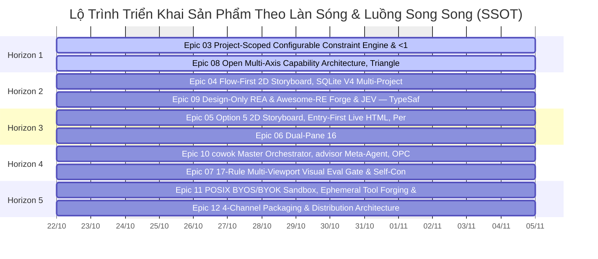

# Lộ Trình Sản Phẩm Toàn Diện & Ma Trận Phụ Thuộc Thực Thi: cowok-design (Open-Source Agent-Native Design & Presentation Harness OS)
*(Comprehensive Product Phased Roadmap & Dependency Matrix)*

> **Phiên bản:** v3.0-Universal  
> **Ngày cập nhật:** 2026-11-12  
> **Trạng thái:** Active SSOT Baseline (Folder `3. Development`)  
> **Bản thể dự án (Archetypes):** universal-hybrid-saas  
> **Ngân sách Worktree đồng thời:** $\le 5$ song song (Tuân thủ trần Worktree Quota $\le 5$)  
> **Hợp đồng Macro-to-Micro Lock:** `_iwish-output/_state/roadmap-lock.json`

---

## 1. Tổng Quan Hiện Trạng & Điểm Tựa Nghiệp Vụ (Maturity Baseline vs. Active Delta)

Hệ thống tính toán lộ trình dựa trên nguyên tắc **Mỏ neo Bậc vào bằng 0 (In-Degree = 0 Anchors)**: các Epics đã đạt trạng thái `completed` được xác lập làm **Maturity Baseline** đóng băng, không tái lập lịch, đóng vai trò là nền tảng cung cấp thực thể dữ liệu sạch cho các Epics đang triển khai (`Active Delta`).

### 1.1. Bảng Điểm Tựa Nền Tảng Đã Hoàn Thành (Maturity Baseline)

| STT | Mã Epic & Tên Module | Trạng Thái | Thực Thể Dữ Liệu & Hợp Đồng Đã Sẵn Sàng Cung Cấp |
| :---: | :--- | :---: | :--- |
| **Epic 01** | Cargo Workspace, Domain Contracts (ts-rs) & 16-Table SQLite Registry | `3` stories | `completed` | Zero-dependency baseline anchor |
| **Epic 02** | JIT Prompt Assembler & 3-Profile Model Capability Adapter | `3` stories | `completed` | Zero-dependency baseline anchor |

### 1.2. Thống Kê Active Delta Cần Triển Khai
- **Tổng số Epics dự án:** 12
- **Epics đã hoàn thành (Maturity Baseline):** 2
- **Epics đang triển khai / Backlog:** 10
- **Số làn sóng phát triển (Waves):** 5 Waves
- **Số luồng song song (Parallel Tracks):** 5 Tracks

---

## 2. Ma Trận Cung Cấp - Tiêu Thụ & Phân Tích Đồ Thị Khối (Provide-Consume Matrix & Dependency DAG)

### 2.1. Bảng Ma Trận Phụ Thuộc Chi Tiết Cấp Epic & Sub-Epic Phase Slices

| Epic ID / Slice | Tên Khối Nghiệp Vụ | Cung Cấp (Provides - Entities & Contracts) | Tiêu Thụ (Consumes - From Epics) | Độ Toàn Vẹn Tiêu Thụ & Rủi Ro Nghẽn (Blocker Risk) |
| :--- | :--- | :--- | :--- | :--- |
| **Epic 03** | Project-Scoped Configurable Constraint Engine & <1ms data-ff-id Patcher | `Stream-1` | `Epic 04`, `Epic 06`, `Epic 09` | `Epic 01` |
| **Epic 04** | Flow-First 2D Storyboard, SQLite V4 Multi-Project SSOT, Keyed Parallel Engine & Contextual Node Chat | `Stream-2` | `Epic 05`, `Epic 06` | `Epic 01`, `Epic 03` |
| **Epic 05** | Option 5 2D Storyboard, Entry-First Live HTML, Per-Node Proposals & Real GitHub PR | `Stream-3` | `Epic 07`, `Epic 10` | `Epic 02`, `Epic 04` |
| **Epic 06** | Dual-Pane 16:9 HTML Presentation & Non-Tech CMS Workbench | `Stream-4` | `Epic 07` | `Epic 03`, `Epic 04` |
| **Epic 07** | 17-Rule Multi-Viewport Visual Eval Gate & Self-Contained HTML / Vector PDF Exporter | `Stream-5` | `Epic 12` | `Epic 05`, `Epic 06` |
| **Epic 08** | Open Multi-Axis Capability Architecture, Triangle Linter, Video Intake & LEARN Engine | `Stream-1` | `Epic 09`, `Epic 10` | `Epic 01`, `Epic 02` |
| **Epic 09** | Design-Only REA & Awesome-RE Forge & JEV — TypeSafe 6-Primitive Acceleration Engine | `Stream-2` | `Epic 10`, `Epic 11` | `Epic 03`, `Epic 08` |
| **Epic 10** | cowok Master Orchestrator, advisor Meta-Agent, OPC Execution Fleet & Design Tournament | `Stream-3` | `Epic 11` | `Epic 05`, `Epic 08`, `Epic 09` |
| **Epic 11** | POSIX BYOS/BYOK Sandbox, Ephemeral Tool Forging & Compiler-Grade Open MCP Ecosystem | `Stream-4` | `Epic 12` | `Epic 02`, `Epic 09`, `Epic 10` |
| **Epic 12** | 4-Channel Packaging & Distribution Architecture | `Stream-5` | *(Không có)* | `Epic 07`, `Epic 11` |

### 2.2. Sơ Đồ Đồ Thị Khối Liên Kết Phụ Thuộc (Macro-DAG Flowchart)

```mermaid
flowchart TD
flowchart TD
    E01["Epic 01: Cargo Workspace, Domain Contracts ts-rs & 16-Table (Completed)"]
    E02["Epic 02: JIT Prompt Assembler & 3-Profile Model Capability  (Completed)"]
    E03["Epic 03: Project-Scoped Configurable Constraint Engine & <1"]
    E04["Epic 04: Flow-First 2D Storyboard, SQLite V4 Multi-Project "]
    E05["Epic 05: Option 5 2D Storyboard, Entry-First Live HTML, Per"]
    E06["Epic 06: Dual-Pane 16:9 HTML Presentation & Non-Tech CMS Wo"]
    E07["Epic 07: 17-Rule Multi-Viewport Visual Eval Gate & Self-Con"]
    E08["Epic 08: Open Multi-Axis Capability Architecture, Triangle "]
    E09["Epic 09: Design-Only REA & Awesome-RE Forge & JEV — TypeSaf"]
    E10["Epic 10: cowok Master Orchestrator, advisor Meta-Agent, OPC"]
    E11["Epic 11: POSIX BYOS/BYOK Sandbox, Ephemeral Tool Forging & "]
    E12["Epic 12: 4-Channel Packaging & Distribution Architecture"]
    E01 --> E03
    E01 --> E04
    E03 --> E04
    E02 --> E05
    E04 --> E05
    E03 --> E06
    E04 --> E06
    E05 --> E07
    E06 --> E07
    E01 --> E08
    E02 --> E08
    E03 --> E09
    E08 --> E09
    E05 --> E10
    E08 --> E10
    E09 --> E10
    E02 --> E11
    E09 --> E11
    E10 --> E11
    E07 --> E12
    E11 --> E12
```

---

## 3. Các Nguyên Tắc Logic Bất Biến Của Dự Án (Core Engineering & Domain Invariants)

Thứ tự ưu tiên và phân bổ Wave không chỉ dựa vào phụ thuộc kỹ thuật thuần túy mà bắt buộc phải tuân thủ nghiêm ngặt **Các Nguyên Tắc Bất Biến Miền Nghiệp Vụ (Domain Invariants)** để loại bỏ rủi ro tài chính, vận hành và phân mảnh kiến trúc:

- Không có invariant cụ thể.

---

## 4. Phân Tích Khả Năng Triển Khai Song Song (Parallel Execution Tracks)

Để tối ưu hóa thời gian bàn giao (Time-to-Market) mà không gây xung đột mã nguồn (Merge Conflicts trên `schema.prisma`) hoặc vượt trần tài nguyên ($\le 5$ worktrees), toàn bộ danh mục Epics được phân rã thành **5 Luồng triển khai song song độc lập**:

### 4.1. Bảng Định Nghĩa 5 Parallel Tracks & Phạm Vi Cô Lập Bảng Dữ Liệu

| Mã Luồng | Tên Luồng & Phạm Vi Chuyên Biệt | Danh Mục Bảng DB Sở Hữu Độc Quyền (Disjoint Write-Set) | Ngân Sách Worktree ($\le 4$) |
| :--- | :--- | :--- | :---: |
| **Stream-1** | VS-01. Rust Core Harness, 9-Spec Registry & Project Constraint Engine (VS-01. Rust Core Harness, 9-Spec Registry & Project Constraint Engine) | `domain_stream-1:CoreTables`, `domain_stream-1:LedgerTables` | `1` worktree |
| **Stream-2** | VS-02. Flow-First Executable Design Workbench & SDI Engine (VS-02. Flow-First Executable Design Workbench & SDI Engine) | `domain_stream-2:CoreTables`, `domain_stream-2:LedgerTables` | `1` worktree |
| **Stream-3** | VS-03. HTML-Native 16:9 Presentation & Dual-Pane CMS Studio (VS-03. HTML-Native 16:9 Presentation & Dual-Pane CMS Studio) | `domain_stream-3:CoreTables`, `domain_stream-3:LedgerTables` | `1` worktree |
| **Stream-4** | VS-04. agentskills.io Plugin Ecosystem, Design-Only REA Forge & JEV — TypeSafe (VS-04. agentskills.io Plugin Ecosystem, Design-Only REA Forge & JEV — TypeSafe) | `domain_stream-4:CoreTables`, `domain_stream-4:LedgerTables` | `1` worktree |
| **Stream-5** | VS-05. cowok & advisor OPC Execution Fleet, Universal MCP & 4-Channel Distribution (VS-05. cowok & advisor OPC Execution Fleet, Universal MCP & 4-Channel Distribution) | `domain_stream-5:CoreTables`, `domain_stream-5:LedgerTables` | `1` worktree |

### 4.2. Ranh Giới Hợp Đồng Đóng Băng (Contract-First Isolation Boundary)
- **Cổng Đồng Bộ Cấp Horizon/Wave (Contract-First & Sync Barrier):** Mọi Track/Stream trong Wave hiện tại phải hoàn tất 100% các bước nhân quả và vượt qua Sync Barrier (`git merge` + đóng băng Schema + E2E Gate) trước khi mở khóa Wave kế tiếp.
- **Cô Lập Stream Song Song & Khóa Schema (Phase 0 Schema Seal Gate):** Các Streams chạy song song trên các Worktrees độc lập, không ghi đè chéo schema. Bất kỳ bảng dùng chung nào phải được khóa ở Phase 0 Frozen Baseline.

---

## 5. Lộ Trình Phát Triển Toàn Diện Theo Làn Sóng (Multi-Wave Phased Master Plan)

### 5.1. Bảng Phân Kỳ Chi Tiết 5 Làn Sóng (Wave 1 $\rightarrow$ Wave 5)

| Làn Sóng | Tên Làn Sóng & Mục Tiêu Trọng Tâm | Danh Mục Epics & Sub-Epic Phase Slices | Lát Cắt Giá Trị Dọc Bàn Giao (Vertical Value Slice) | Điều Kiện Tiền Đề Mở Khóa (Unblock Condition) |
| :---: | :--- | :--- | :--- | :--- |
| **Horizon 1** | Wave 1: Vertical Value Increment 1 | `Epic 03`, `Epic 08` | Delivery of core capabilities for Wave 1 | Baseline hoàn tất |
| **Horizon 2** | Wave 2: Vertical Value Increment 2 | `Epic 04`, `Epic 09` | Delivery of core capabilities for Wave 2 | Horizon 1 Sync Barrier hoàn tất |
| **Horizon 3** | Wave 3: Vertical Value Increment 3 | `Epic 05`, `Epic 06` | Delivery of core capabilities for Wave 3 | Horizon 2 Sync Barrier hoàn tất |
| **Horizon 4** | Wave 4: Vertical Value Increment 4 | `Epic 10`, `Epic 07` | Delivery of core capabilities for Wave 4 | Horizon 3 Sync Barrier hoàn tất |
| **Horizon 5** | Wave 5: Vertical Value Increment 5 | `Epic 11`, `Epic 12` | Delivery of core capabilities for Wave 5 | Horizon 4 Sync Barrier hoàn tất |

### 5.2. Biểu Đồ Gantt Tiến Độ Thực Thi Đa Làn Sóng (Multi-Wave Phased Gantt)



---

## 6. Kế Hoạch Hành Động Tức Thời Cho Sprint Hiện Tại (Immediate P0 Action Slices)

Từ Wave hiện tại, hệ thống lọc ra các **Lát Cắt Hành Động P0 Tức Thời (Immediate P0 Action Slices)** có bậc vào bằng 0 (`In-Degree == 0`), đã sẵn sàng 100% tài liệu tiền đề và có thể tiến hành lập Spec Stack hoặc code ngay lập tức:

| Mã Lát Cắt | Module / Epic Trọng Tâm | Danh Sách Story IDs Triển Khai Ngay | Luồng (Track) | Lý Do Kích Hoạt Tức Thời (Activation Rationale) |
| :---: | :--- | :--- | :---: | :--- |
| **P0.1** | **Epic 03**: Project-Scoped Configurable Constraint Engine & <1ms data-ff-id Patcher (Immediate P0 Anchor) | `03.1`, `03.2`, `03.3` | `Stream-1` | Zero blocker risk anchor for Wave 1 unblocking downstream business workflows. |
| **P0.2** | **Epic 08**: Open Multi-Axis Capability Architecture, Triangle Linter, Video Intake & LEARN Engine (Immediate P0 Anchor) | `08.1`, `08.2`, `08.3` | `Stream-1` | Zero blocker risk anchor for Wave 1 unblocking downstream business workflows. |

---

> [!NOTE]
> Bản roadmap này được bảo vệ bởi cổng kiểm định **Category A Zero-Trust** (`validate-product-roadmap.py`). Khi có bất kỳ thay đổi kiến trúc hoặc khi một Epic hoàn thành tại `/iwish-feature-retrospective`, các Auto-Trigger Hooks sẽ tự động cập nhật và duy trì tính nhất quán tuyệt đối.
