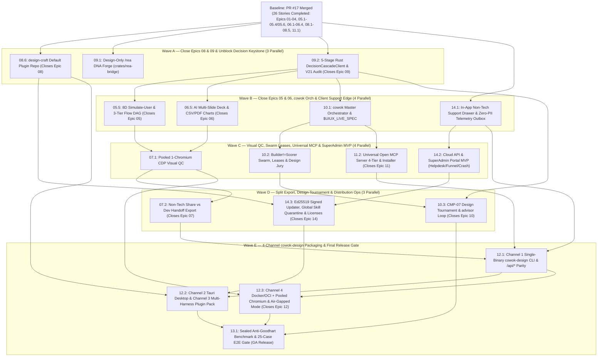

# Lộ Trình Sản Phẩm Toàn Diện & Ma Trận Phụ Thuộc Thực Thi: `cowok-design` (Open-Source Agent-Native Design & Presentation Harness OS)
*(Comprehensive Product Phased Roadmap & Dependency Matrix — v4.0)*

> **Phiên bản:** `v4.0-Unified-Naming-And-Control-Plane`  
> **Ngày cập nhật:** `2026-11-23`  
> **Định danh sản phẩm & CLI thống nhất:** **`cowok-design`** (`ADR-008`, thay thế hoàn toàn tên cũ `uiux-os`)  
> **Ngân sách Worktree đồng thời:** $\le 4$ song song (tuân thủ trần Worktree Quota $\le 5$, disjoint file/schema write-sets)  
> **Trạng thái nguồn chân lý:** Đồng bộ 1:1 với `_iwish-output/sprint-status.yaml`, `PRD (FR-01..FR-38)` và `Architecture (ADR-001..ADR-008)`.

---

## 1. Tổng Quan Hiện Trạng (Maturity Baseline vs. Active Delta)

### 1.1. Maturity Baseline — Đã Hoàn Thành (`26` Stories `completed` / `4` Epics 100% xong)

| Epic | Tên Khối Nghiệp Vụ | Trạng Thái | Stories Đã Hoàn Thành | Còn Lại |
| :---: | :--- | :---: | :--- | :--- |
| **Epic 01** | Cargo Workspace, Domain Contracts (`ts-rs`) & SQLite WAL Core | `completed` | `01.1`, `01.2`, `01.3` | *(0)* |
| **Epic 02** | KV-Cache Compiler, Hidden SSOT (`V16..V18`) & 7 Craft Skills | `completed` | `02.1`, `02.4` *(02.2/02.3 cancelled)* | *(0)* |
| **Epic 03** | Project-Scoped Constraint Engine & `<1ms` `data-ff-id` Patcher | `completed` | `03.1`, `03.2`, `03.3` | *(0)* |
| **Epic 04** | Flow-First 2D DAG Studio, Security Kernel, CAS Intake & In-Chat Vault | `completed` | `04.1`, `04.2`, `04.3`, `04.4`, `04.5`, `04.6` | *(0)* |
| **Epic 05** | 2D Storyboard, Sketch-to-Polish, Shared `lol_html` & Snapshots/PR | `in-progress` | `05.1`, `05.2`, `05.3`, `05.4`, `05.6` | **`05.5`** |
| **Epic 06** | Dual-Pane 16:9 HTML Presentation & Non-Tech CMS Workbench | `in-progress` | `06.1`, `06.2`, `06.3`, `06.4` | **`06.5`** |
| **Epic 08** | `agentskills.io` Lifecycle, Split DE+DR Runtime (`V20`), 7 DE Tools & `LEARN` | `completed` | `08.1`, `08.2`, `08.3`, `08.4`, `08.5`, `08.6` | *(0)* |
| **Epic 09** | Two-Store `/rea` + `/awesome-re` DNA Forge & 5-Stage Rust `DecisionCascadeClient` (`V21`) | `completed` | `09.1`, `09.2` *(09.3 cancelled)* | *(0)* |
| **Epic 11** | POSIX CLI Sandbox (`0o600` FD + `-PGID`), Unified API Gateway & Open MCP | `in-progress` | `11.1` *(11.3 cancelled)* | **`11.2`** |

### 1.2. Thống Kê Active Delta Còn Lại (`14` Stories across `8` Active Epics)
- **Tổng số Epics:** `14` (`6` đã hoàn thành 100%, `8` đang triển khai/backlog)
- **Tổng số Stories còn lại cần triển khai:** **`14` stories** chia thành **4 Làn sóng tiếp theo (Wave B $\to$ Wave E)** sau khi **Wave A (`08.6` ∥ `09.1` ∥ `09.2`)** hoàn tất `completed`.

---

## 2. Phân Tích Phụ Thuộc & Sơ Đồ DAG Phần Còn Lại (Wave A $\to$ Wave E)

### 2.1. Các Điểm Nút Kiến Trúc Quan Trọng (Critical Path & Ordering Invariants)
1. **PR #17 CI Gate First (Pre-Wave A):** Khắc phục 2 lỗi CI trên PR #17 (`RLIMIT_NPROC` Linux trong `tool_jail.rs` + `Gitleaks` trên `story_11_1_sandbox_and_gateway.rs:128`) và merge vào `master` trước khi mở nhánh Wave A.
2. **Mở khóa `Story 08.6` (`design-craft`) & `Story 06.5` (AI Multi-Slide Deck) ngay lập tức:** Cả `08.5` và `11.1` vừa hoàn thành đã mở khóa trực tiếp `08.6`, `06.5`, `09.1` và `10.1`.
3. **Đưa `Story 14.1` (Client Edge Support/Telemetry) TRƯỚC `Epic 12`:** Để khi đóng gói single-binary `cowok-design` (`12.1`) và Desktop/5-Host Plugin (`12.2`), tính năng **Non-Tech Support Drawer (không cần GitHub)** và **Activation Funnel Telemetry** đã được nhúng sẵn từ Day-1, tránh phải đóng gói lại 2 lần.
4. **Đưa `Story 08.6` (`design-craft`) & `Story 14.3` (Ed25519 Signed Updater/Quarantine) TRƯỚC `Story 12.2`:** Giúp Kênh 2 (Desktop Tauri v2) có sẵn chữ ký Ed25519 updater và Kênh 3 (Universal Multi-Harness Plugin Pack cho `Cowok.ai`, `Claude Code`, `Codex`, `Antigravity`, `Cursor`) đóng gói trực tiếp từ repo `design-craft`.
5. **Chốt `Story 13.1` (Sealed Anti-Goodhart Benchmark & 25-Case E2E) ở cuối cùng (Wave E):** Kiểm định tổng thể toàn bộ 4 kênh phân phối + Design Tournament + 5-Stage Decision Cascade trước khi phát hành GA.

### 2.2. Sơ Đồ Thực Thi DAG 5 Làn Sóng (Active Remaining Stories)

---

## 3. Kế Hoạch Chi Tiết Từng Làn Sóng (Wave A $\to$ Wave E)

| Wave | Stories Song Song (`<= 4` Tracks) | Đóng Khép Kín Epic | Mục Tiêu Giá Trị Bàn Giao (Vertical Value Slice) | Điều Kiện Mở Khóa |
| :---: | :--- | :---: | :--- | :--- |
| **Wave A** | `08.6` ∥ `09.1` ∥ `09.2` | **Epic 08, 09** | Xuất bản repo `design-craft` độc lập (`08.6`), Two-Store `/rea` FTS5 (`09.1`), và **5-Stage `DecisionCascadeClient` (`09.2`, `V21`)** — mở khóa trực tiếp `05.5`, `06.5` và `10.1`! | PR #17 merged (`d7b5c45`) |
| **Wave B** | `05.5` ∥ `06.5` ∥ `10.1` ∥ `14.1` | **Epic 05, 06** | Hoàn tất Flow DAG 3 tầng (`05.5`), AI Multi-Slide Deck thật (`06.5`), `cowok` Master Orchestrator (`10.1`), và **In-App Non-Tech Support Drawer + Telemetry Outbox** (`14.1`). | Wave A merged |
| **Wave C** | `07.1` ∥ `10.2` ∥ `11.2` ∥ `14.2` | **Epic 11** | Visual QC 1-Chromium CDP (`07.1`), Swarm `Builder!=Scorer` (`10.2`), **Universal Open MCP Server** (`11.2`), và **SuperAdmin Portal MVP** (`14.2`). | Wave B merged |
| **Wave D** | `07.2` ∥ `10.3` ∥ `14.3` | **Epic 07, 10, 14** | Split Export (`07.2`), Design Tournament `CMP-07` (`10.3`), và **Ed25519 Signed Updater + Global Skill Quarantine + Offline Licenses** (`14.3`). | Wave C merged |
| **Wave E** | `12.1` → `12.2` ∥ `12.3` → `13.1` | **Epic 12, 13 (GA)** | Single-Binary **`cowok-design`** (`12.1`), Desktop **Tauri v2** + **5-Host Multi-Harness Plugin Pack** (`12.2`), **Docker/OCI Air-Gapped** (`12.3`), chốt kiểm định **25-Case Sealed Anti-Goodhart** (`13.1`). | Wave D merged |

---

## 4. Hành Động Tức Thời (Immediate Next Actions)
1. **Ngay lập tức (Gate 0):** Chờ xác nhận của bạn cho **PR #17 Party-Mode Fix Plan (`LD-01..LD-04`)** $\to$ push commit sửa 2 lỗi CI (`RLIMIT_NPROC` Linux + `Gitleaks`), xác nhận 9/9 CI xanh và merge PR #17.
2. **Commit Spec & Roadmap (`PR #18`):** Đẩy sạch bản cập nhật `PRD (FR-30, FR-37, FR-38)`, `ADR-008`, `Story 12.1/12.2` (thống nhất tên `cowok-design` + 5-Host Plugin Pack), `Epic 14 (14.1–14.3)` và `development-roadmap.md v4.0` sau khi PR #17 merge.
3. **Khởi chạy Wave A (`/flow-auto-approve`):** Chạy song song `Story 08.6` (`design-craft`) ∥ `Story 05.5` ∥ `Story 06.5` ∥ `Story 09.1` (khép kín cùng lúc 3 Epic lớn: `05`, `06`, `08`!).
