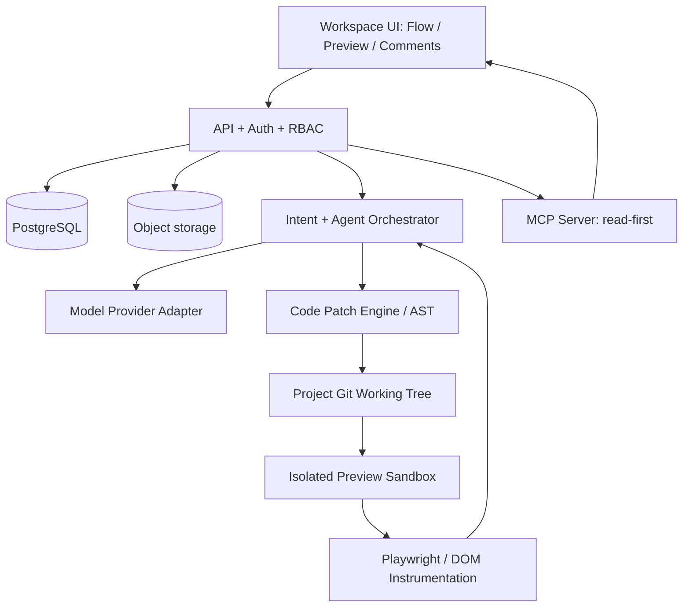

# Architecture & Tech Stack — v0.1

## Architectural principles
- **Code-native:** actual TSX/components and CSS are executable UI source of truth.
- **Flow-aware:** approved expected behavior modeled separately as versioned screen-state graph.
- **Intent-driven:** natural language is normalized to Structured Design Intent (SDI) with provenance.
- **Deterministic-first:** inspect AST, parse, modify, build, run tests before relying on vision model.
- **Reversible:** isolated working branch / patch, checkpoints and human approval.
- **Multi-provider:** model adapter interface; entitlement tested independently for subscription.

## Component overview


## Core subsystems
1. **Workspace web app** React + TypeScript + flow canvas (XYFlow), Monaco read/code edit panel, comments inspector, preview iframe.
2. **Project API** Node TypeScript (Fastify or Hono; decide via spike), Zod schema validation; Postgres via Drizzle/Prisma (select one).
3. **Intent service** parses user text/references/target into structured SDI; confidence/risk classification; returns clarification cards only when needed.
4. **Agent orchestrator** single coordinator, specialized *tools* rather than proliferating agents. Model adapter routes tool calls, vision, structured outputs.
5. **Code patch engine** TS parser/AST (TypeScript API or Babel+Recast), validates allowed paths, generates unified diff, applies patch only in isolated workspace.
6. **Flow adapter** serializes graph and binds node to component/route + fixture, provides deterministic preview state hydration. Graph-code drift detector.
7. **Preview sandbox** ephemeral container/web runtime; strict isolation from platform secrets. Reverse proxy with auth, resource limits, network egress policy. Use unique origin for untrusted preview.
8. **Validation pipeline** install (allowlisted), typecheck, lint, build, Playwright route/flow smoke and visual snapshot optional; logs linked to change proposal.
9. **MCP** official TypeScript v2 SDK; read-only tools for P1; mutating tools require explicit delegated project scope and human approval.
10. **Git integration** deploy GitHub App minimum scopes; export zip at P0, PR at P1. Never hard-code credentials in project files.

## Suggested monorepo topology
```text
apps/
  web/                 # React workspace
  api/                 # API/auth orchestration
  worker/              # sandbox jobs and validation
packages/
  domain/              # entities, Zod contracts, events
  flow-engine/         # graph and fixture adapter
  intent-engine/       # SDI normalization and clarification
  agent-runtime/       # provider adapters, tool interfaces
  code-engine/         # source maps, AST, diff, patches
  mcp-server/          # external read-only tools
  ui/                  # shared first-party components
  template-react/      # constrained Vite demo/export template
infra/
  containers/          # sandbox image, security policies
  migrations/
```

## Proposed tech stack
- TypeScript end-to-end; React/Vite/Tailwind in generated template; shadcn/ui/Radix for controlled primitives.
- XYFlow / React Flow for graph; Monaco for text editor.
- Fastify/Hono (decision open), PostgreSQL, S3-compatible storage, Redis/queue for background **server jobs**; avoid user-facing promise of asynchronous assistant delivery.
- Node worker orchestrating isolated containers; Playwright; TypeScript compiler/Babel/Recast.
- MCP TS SDK v2. Provider adapters (Vercel AI SDK or directly provider SDK) with structured schema and tool capability checks.
- Optional WebContainers **only after commercial licensing/runtime spike**; remote sandbox can simplify reproducibility while increasing infrastructure cost.

## Source/graph consistency
```
intent -> approved SDI -> flow version -> plan -> code patch -> sandbox preview
       -> tests + screenshots -> user approval -> git commit/export
```
Store `sourceCommit`, `templateVersion`, `fixtureVersion` per flow version. If selected screen cannot resolve, show `STALE_MAPPING` and remediation; never show silently outdated screenshot as live preview.

## Source-element mapping (constrained MVP)
- During bundling, a transform annotates supported JSX elements with generated stable IDs in preview-only bundle; store source file, AST path, original range and component identity.
- On selection, iframe posts structured message containing elementId, projectId, sandbox session ID and safe box metrics (strict origin check); server resolves and validates against source mapping table.
- Comments survive code changes through stable logical ids or fallback semantic locator + screenshot, with an explicit `anchorStatus=stale` on failure.
- Visual property editing P2; first implement **comment-on-element** and target-aware patch.

## Sandboxing and threat model
Risks: running malicious `postinstall` code, prompt injection in repo/attachments, cross-tenant data leaks, SSRF, credential exfiltration, XSS from preview content, arbitrary path writes, MCP tool abuse and bill shock. Controls: separate origin; no platform secrets in sandbox; read-only mount where feasible; per-tenant isolated compute; disable egress by default with allowlist; CPU/memory/time limits; artifact virus/type checks; signed asset URLs; scoped tokens; audit; approval gates.

## Observability
Trace each request with `intentId`, `proposalId`, `sandboxRunId`, `flowVersion`, model and tool steps; redact prompts/secrets according to policy. Track latency, token spend, failure reason, build/test outcome, approval and revert.

## Architecture decision records required before implementation
ADR-001 sandbox strategy; ADR-002 schema/versioning; ADR-003 AST mapping strategy; ADR-004 model provider abstraction; ADR-005 Git connection scopes; ADR-006 data retention and tenancy.
