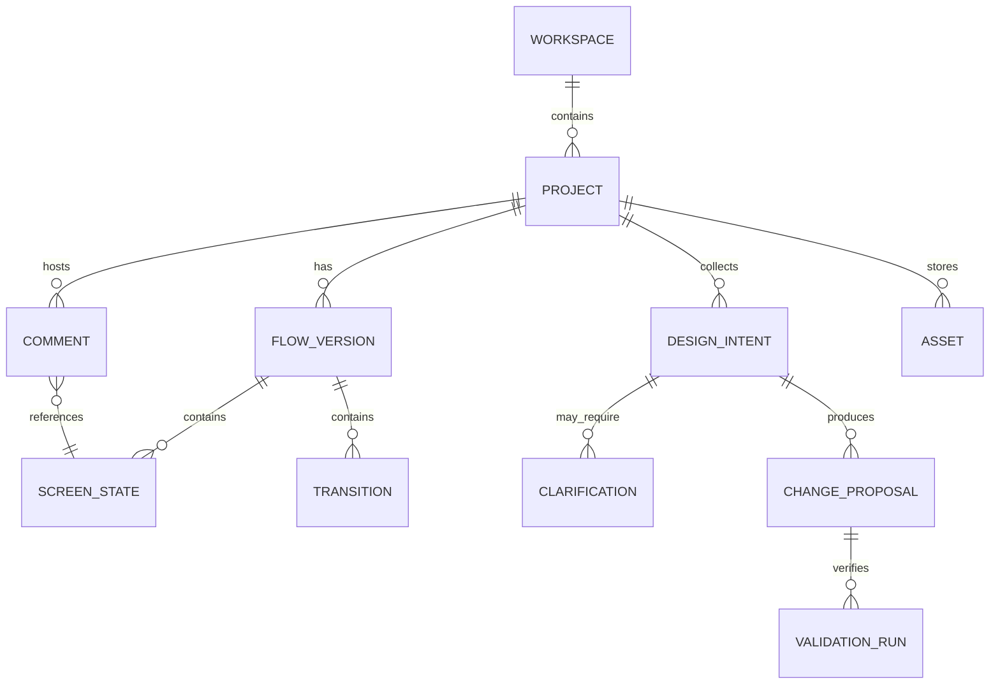

# Domain Model, Contracts & APIs

## Canonical model


## Entity fields
- `Workspace(id, name, ownerId, plan)`; `Project(id, workspaceId, name, repoRef?, templateVersion, activeFlowVersionId)`.
- `FlowVersion(id, projectId, graphSchemaVersion, sourceCommit, fixturesVersion, createdAt)`.
- `ScreenState(id, flowVersionId, name, route, componentRef, fixtureRef, viewport, entryAction?, expectedAssertions[])`.
- `Transition(id, flowVersionId, fromNodeId, toNodeId, event, guard?, expectedEffect?)`.
- `DesignIntent(id, projectId, userId, targetRef, requestText, attachmentIds[], ambiguity, risk, status, structuredSpec, provenance)`.
- `Clarification(id, intentId, question, variants[], chosenVariant?, skippedReason?)`.
- `ChangeProposal(id, intentId, baseCommit, diffRef, changedPaths[], status, validationSummary, approvedBy?)`.
- `Comment(id, projectId, nodeId?, elementAnchor?, body, attachmentIds[], authorId, status, anchorStatus)`.
- `ValidationRun(id, proposalId, build, typecheck, lint, tests, screenshots[], errors[], completedAt)`.

## Invariants
1. Each transition has existing source/target nodes in same flow version.
2. Each node uniquely resolves to route+fixture+viewport for current source commit, or is shown as unresolved.
3. Mutating project routes require project-level RBAC and optimistic concurrency (`baseVersion`/ETag).
4. No proposal may be accepted if required build/test gates fail or base commit changed without rebase.
5. One source path may map to multiple preview instances; never assume one-to-one DOM/JSX mapping.
6. Attachments referenced by intent or comment must belong to same tenant/project.
7. Deleting a node with comments requires explicit user handling (or safe archive), never silent loss.

## Example API contract (proposed, not yet implementation)
```
POST   /v1/projects
GET    /v1/projects/:id
GET    /v1/projects/:id/flows/current
PUT    /v1/projects/:id/flows/:versionId
POST   /v1/projects/:id/preview/sessions
POST   /v1/projects/:id/intents
POST   /v1/intents/:id/clarifications/:choiceId
POST   /v1/intents/:id/proposals
POST   /v1/proposals/:id/validate
POST   /v1/proposals/:id/approve
POST   /v1/proposals/:id/reject
POST   /v1/projects/:id/comments
PATCH  /v1/comments/:id
POST   /v1/projects/:id/exports
GET    /v1/projects/:id/exports/:exportId
```
Returns typed errors: `UNRESOLVED_NODE`, `STALE_MAPPING`, `INVALID_FIXTURE`, `BUILD_FAILED`, `AUTH_REQUIRED`, `REVISION_CONFLICT`, `SANDBOX_TIMEOUT`, `PROVIDER_UNAVAILABLE`.

## MCP v1 tools (read-only)
`design.list_projects`, `design.get_project_context`, `design.get_flow_graph`, `design.get_screen`, `design.get_comments`, `design.get_validation_summary`. P2 gated: `design.propose_change`, `design.add_comment`, `design.run_validation`, `design.export_source`. Explicitly scope MCP credentials to workspace/project, log calls, rate-limit.

## Design Intent processing
Raw message + media -> target resolver -> risk/ambiguity classifier -> structured SDI -> optional clarification -> approved spec -> patch job. `status`: `captured|needs_clarification|ready|proposed|approved|implemented|rejected`. Every structured field carries confidence/provenance where needed.

## Schema files
`schemas/flow-graph.schema.json` and `schemas/design-intent.schema.json` are **draft validation formats**. They need versioning, property tests and API schemas before production.
