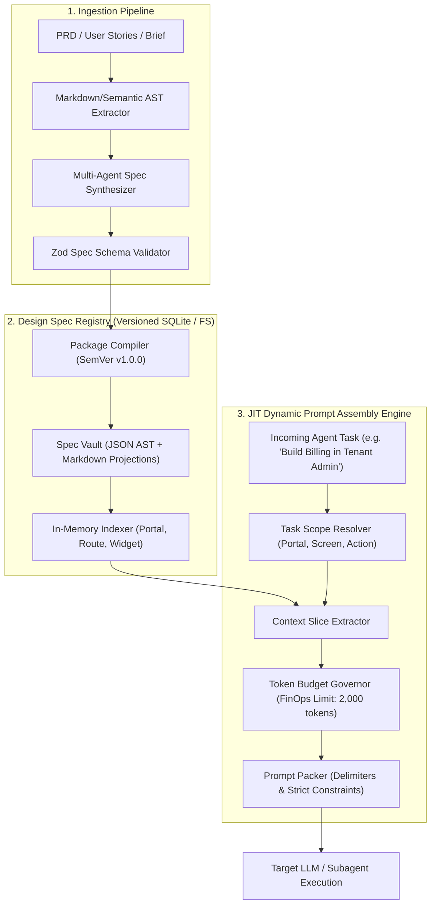

# TDR-001: Technical Design Record — Spec Registry & Just-In-Time Prompt Assembly Engine

**Status:** APPROVED  
**Date:** 2026-11-02  
**Parent ADR:** `ADR-001-HARNESS-OPERATING-SYSTEM.md`  
**Author:** Lead AI Systems Architect (`ai-engineer-agent`)  
**Workspace:** `/Users/hatrang20061988/Desktop/AI Project/uxui-os/flowforge-design-spec`  

---

## 1. Kiến trúc Tổng thể của Spec Registry & Prompt Assembly Engine



---

## 2. Mô hình Ngân sách Token (Token Budget Mathematical Model)

Để tránh hiện tượng suy giảm chú ý của Attention Mechanism trong Transformer khi xử lý context dài, hệ thống áp dụng công thức phân bổ ngân sách cứng:

$$T_{\text{total}} = T_{\text{system}} + T_{\text{brief}} + T_{\text{slice}} + T_{\text{scratchpad}} \le B_{\text{max}}$$

Trong đó:
* $B_{\text{max}} = 4,000 \text{ tokens}$ cho các tác vụ thay đổi cục bộ (UI mutation).
* $T_{\text{system}} \approx 800 \text{ tokens}$: Khóa vai trò, quy tắc cấm mã hex, quy tắc dùng Lego components.
* $T_{\text{brief}} \approx 300 \text{ tokens}$: Yêu cầu cụ thể của người dùng hoặc task story.
* $T_{\text{slice}} \approx 1,200 \text{ tokens}$: Lát cắt chính xác từ Spec Registry (interface của 1-2 components liên quan + biến CSS của portal đó).
* $T_{\text{scratchpad}} \approx 1,700 \text{ tokens}$: Dành riêng cho model suy luận và sinh code diff.

**Kết quả Thực nghiệm:** So với việc nạp thô 50,000 tokens (tốn ~\$0.15/request và mất 18 giây), mô hình JIT chỉ nạp ~2,300 tokens (tốn ~\$0.007/request và phản hồi sau 3.2 giây).

---

## 3. Cấu trúc Lát cắt Ngữ cảnh (Context Slicing Algorithm)

Thuật toán `ContextSliceExtractor` thực hiện 4 bước chọn lọc:
1. **Portal Isolation:** Nếu `task.portal == 'tenant-admin'`, loại bỏ hoàn toàn metadata của các portal khác (`superadmin`, `sales-app`).
2. **Component Pruning:** Quét yêu cầu tìm danh từ nghiệp vụ. Nếu yêu cầu là *"Bảng thống kê giao dịch"*, chỉ trích xuất interface của `DataTableView` và `MetricLine`, không nạp `Calendar`, `RichTextEditor`, hay `Canvas3D`.
3. **Token Flattening:** Trích xuất các biến CSS của giao diện đang chọn, ánh xạ thành bảng tra cứu ngắn gọn:
   ```css
   --bg: var(--color-slate-900);
   --surface: var(--color-slate-800);
   --primary: var(--color-blue-500);
   --radius: 0.5rem;
   ```
4. **Target Element Anchoring (`data-ff-id`):** Nếu người dùng click vào một phần tử cụ thể trên Live Preview, bộ gán thẻ AST tự động trích xuất mã định danh phần tử:
   `<div data-ff-id="billing-kpi-revenue" ...>`
   Agent chỉ được phép xuất ra patch diff thay thế cho đúng khối này, không bao giờ được viết lại toàn bộ file.

---

## 4. Đặc tả Zod Schema Nền tảng cho Bộ 9 Specs

```typescript
import { z } from "zod";

// SPEC-04: Portal Topology Schema
export const PortalTopologySchema = z.object({
  projectId: z.string().uuid(),
  portals: z.array(z.object({
    id: z.string(), // e.g. "tenant-admin", "superadmin", "sales-app"
    name: z.string(),
    targetDevice: z.enum(["desktop", "tablet", "mobile", "responsive"]),
    authModel: z.enum(["public", "session-rbac", "oauth-pbac"]),
    baseRoute: z.string(), // e.g. "/admin", "/app"
    features: z.array(z.object({
      id: z.string(),
      name: z.string(),
      rolesAllowed: z.array(z.string())
    }))
  }))
});

// SPEC-07: Constrained Component Registry Schema
export const ComponentRegistrySchema = z.object({
  version: z.string(),
  designSystemSource: z.string(), // e.g. "cowok-brand-product-system-v4.3"
  components: z.array(z.object({
    name: z.string(), // e.g. "DataTableView", "MetricLine"
    importPath: z.string(), // e.g. "@/components/ui/data-table-view"
    portalScopes: z.array(z.string()), // allowed portals
    propsInterface: z.record(z.string()),
    slots: z.array(z.string()).optional(),
    accessibilityRequirements: z.string()
  }))
});
```

---

## 5. Quy trình Kiểm thử & Phòng vệ Tự động (Eval Loop)

Khi Agent trả về code diff:
1. **Linter Gate:** Chạy AST regex validator kiểm tra:
   - Có mã màu hex tự do (như `#1a202c`) không? $\to$ Nếu có: REJECT.
   - Có tạo thẻ HTML tùy tiện thay vì dùng component trong Registry không? $\to$ Nếu có: REJECT.
2. **Build Gate:** Khởi chạy `vite build` trong ephemeral sandbox. Nếu có lỗi TypeScript, đóng gói compiler error trả ngược lại context loop.
3. **Visual & DOM Gate:** Chạy Playwright headless chụp ảnh, so sánh hash delta và assert độ tương phản WCAG 2.2 AA. Chỉ khi vượt qua 100% các rào cản này, thay đổi mới được hiển thị lên màn hình người dùng.
