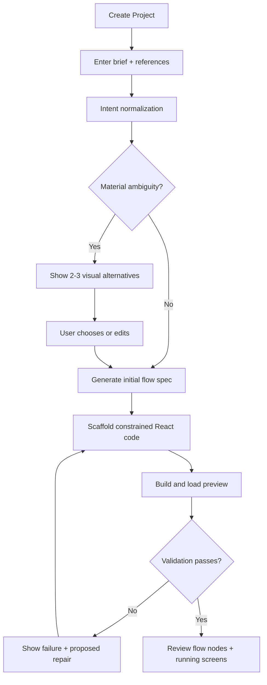
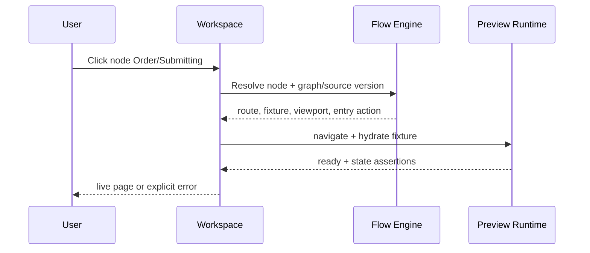
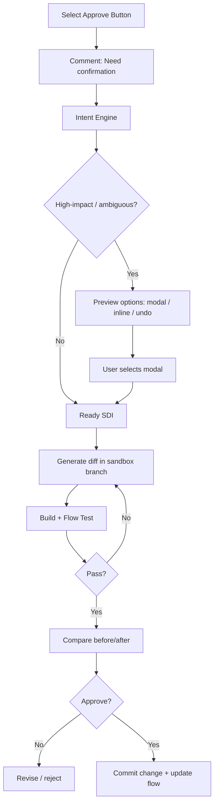

# User Flows & State Design

## Flow A — Create project from product description

**Acceptance:** user can create project, see initial flow, visit node, observe actual runtime; unresolved references shown explicitly.

## Flow B — Click flow node to preview specific state

**State design:** `loading`, `ready`, `unresolved`, `sandbox_failed`, `fixture_invalid`, `stale_mapping`. Do not masquerade fixture screenshot as working runtime.

## Flow C — Element-linked change with clarification

**Accept criteria:** cancel does not mutate order; confirmation precedes mutation; loading disables repeated action; success/error states handled.

## Flow D — Review and export
1. Open review inbox filtered by node, screen and unresolved comments.
2. Click comment → preview exact state; highlight selected element or show stale anchor status.
3. Resolve comment only after accepting corresponding diff or explicitly dismissing.
4. Export ZIP with `src/`, assets, flow JSON, fixtures, README and lockfile; build locally.
5. GitHub PR requires explicit project authorization, selected branch and user confirmation.

## Flow E — Optional MCP external agent
1. Authenticated external client lists projects.
2. Reads graph, screen details and outstanding comments.
3. Proposes design changes via agent's own work (P1 read-only; mutating workflow deferred).
4. User reviews in workspace; no silent main-branch writes.

## Seed project: Order approval
Nodes: `login`, `dashboard`, `order-list`, `order-detail-pending`, `confirmation-modal`, `submitting`, `approved`, `error`, `permission-denied`.
Edges: login success, navigate list, open detail, click approve, confirm/cancel, request success/failure, retry, forbidden. Include responsive desktop/mobile viewport variants as metadata, not duplicate entire flow by default.

## UX behavior rules
- Flow map is navigator and behavioral model, not a wall of screenshots.
- Keep selected state and preview state synchronized; `Inspect` mode distinct from `Interact` mode.
- Comments attach to node+element and include snapshot/version context.
- Clarify only high uncertainty/high impact; low-risk edits can proceed as revertible proposals.
- Loading, empty, error, permissions, cancel paths appear in flow where relevant.
